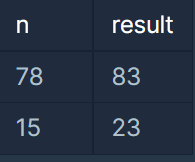
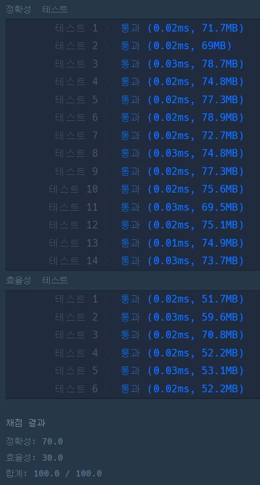

#### **문제 : 다음 큰 숫자**

**문제 설명**

자연수 n이 주어졌을 때, n의 다음 큰 숫자는 다음과 같이 정의 합니다.

* 조건 1. n의 다음 큰 숫자는 n보다 큰 자연수 입니다.
* 조건 2. n의 다음 큰 숫자와 n은 2진수로 변환했을 때 1의 갯수가 같습니다.
* 조건 3. n의 다음 큰 숫자는 조건 1, 2를 만족하는 수 중 가장 작은 수 입니다.

예를 들어서 78(1001110)의 다음 큰 숫자는 83(1010011)입니다.

자연수 n이 매개변수로 주어질 때, n의 다음 큰 숫자를 return 하는 solution 함수를 완성해주세요.

**제한 사항**

* n은 1,000,000 이하의 자연수 입니다.

**입출력 예**



**문제 풀이**

풀이 1

문제를 풀이하기 전에 함수들을 찾아보았다.

Integer.toBinaryString()을 통해서 문제를 풀 수 있지만, 이 방법을 사용할 경우 2진수로 변환하고 1의 개수를 구하는 작업이 반복된다. 이 작업을 줄일 수 있는 방법으로 Interger.bitCount()라는 함수를 통해서 1의 개수를 구할 수 있는 방법이 있었다.

```java
class Solution {
    public int solution(int n) {

        // 1. n을 2진수로 변환했을 때 1의 개수
        int n_cnt = Integer.bitCount(n);

        // 2. 1의 개수가 동일한 n보다 큰 수 찾기
        while(true){
            // 3. n보다 큰 수
            n++;

            // 4. n보다 큰 수와 n의 2진수로 변환했을 때 1의 개수 비교
            if(n_cnt == Integer.bitCount(n))
                break;
        }

        return n;
    }
}
```



---

> **Point : 3**효율적인 코드인지는 알지 못한다.  
>   
> 하지만 기존 코드보다 개선시켰다. 더 좋은 방법은 무엇일까?
