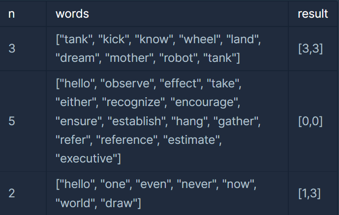
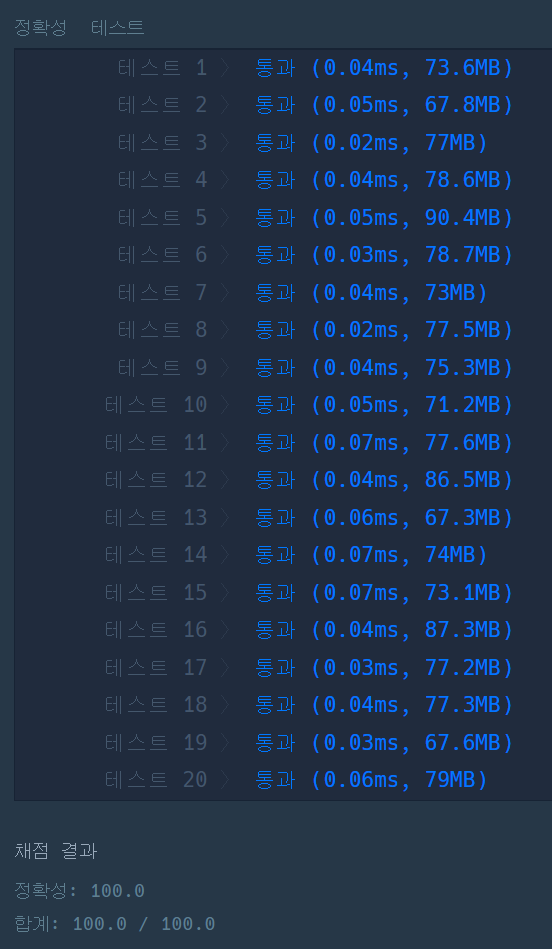

#### **문제 : Summer/Winter Coding(~2018) - 영어 끝말잇기**

**문제 설명**

1부터 n까지 번호가 붙어있는 n명의 사람이 영어 끝말잇기를 하고 있습니다. 영어 끝말잇기는 다음과 같은 규칙으로 진행됩니다.

1. 1번부터 번호 순서대로 한 사람씩 차례대로 단어를 말합니다.
2. 마지막 사람이 단어를 말한 다음에는 다시 1번부터 시작합니다.
3. 앞사람이 말한 단어의 마지막 문자로 시작하는 단어를 말해야 합니다.
4. 이전에 등장했던 단어는 사용할 수 없습니다.
5. 한 글자인 단어는 인정되지 않습니다.

다음은 3명이 끝말잇기를 하는 상황을 나타냅니다.

tank → kick → know → wheel → land → dream → mother → robot → tank

위 끝말잇기는 다음과 같이 진행됩니다.

* 1번 사람이 자신의 첫 번째 차례에 tank를 말합니다.
* 2번 사람이 자신의 첫 번째 차례에 kick을 말합니다.
* 3번 사람이 자신의 첫 번째 차례에 know를 말합니다.
* 1번 사람이 자신의 두 번째 차례에 wheel을 말합니다.
* (계속 진행)

끝말잇기를 계속 진행해 나가다 보면, 3번 사람이 자신의 세 번째 차례에 말한 tank 라는 단어는 이전에 등장했던 단어이므로 탈락하게 됩니다.

사람의 수 n과 사람들이 순서대로 말한 단어 words 가 매개변수로 주어질 때, 가장 먼저 탈락하는 사람의 번호와 그 사람이 자신의 몇 번째 차례에 탈락하는지를 구해서 return 하도록 solution 함수를 완성해주세요.

**제한 사항**

* 끝말잇기에 참여하는 사람의 수 n은 2 이상 10 이하의 자연수입니다.
* words는 끝말잇기에 사용한 단어들이 순서대로 들어있는 배열이며, 길이는 n 이상 100 이하입니다.
* 단어의 길이는 2 이상 50 이하입니다.
* 모든 단어는 알파벳 소문자로만 이루어져 있습니다.
* 끝말잇기에 사용되는 단어의 뜻(의미)은 신경 쓰지 않으셔도 됩니다.
* 정답은 [ 번호, 차례 ] 형태로 return 해주세요.
* 만약 주어진 단어들로 탈락자가 생기지 않는다면, [0, 0]을 return 해주세요.

**입출력 예**



**문제 풀이**

영어 끝말잇기를 통해 탈락자가 발생할 경우, 번호와 차례를 반환하고 없을 경우 [0, 0]을 반환하는 문제이다.

* 번호 = (words 배열의 인덱스 % 사람의 수) + **1**  // 인덱스가 0부터 시작
* 차례 = (words 배열의 인덱스 / 사람의 수) + **1**    // 몇번째 바퀴

```java
import java.util.*;

class Solution {
    public int[] solution(int n, String[] words) {
        int[] answer = {0, 0};

        // 1. 중복 확인을 위한 자료구조 선정
        Map<String, Integer> map = new HashMap<>();

        // 2. words 배열 순서대로 반복
        for(int i=0; i<words.length; i++){
            // 3. 첫 번째 참여자가 아닌 경우
            if(i != 0){
                // 현재 단어의 처음 철자
                char first = words[i].charAt(0); 
                // 이전 단어의 마지막 철자
                char last = words[i-1].charAt(words[i-1].length()-1);

                // 단어가 중복되거나 철자가 이어지지 않은 경우
                if(map.containsKey(words[i]) || last != first){
                    answer[0] = (i % n) + 1;    // 번호
                    answer[1] = (i / n) + 1;    // 차례
                    return answer;
                }   
            }

            map.put(words[i], 1);
        }

        return answer;
    }
}
```

---

> **Point : 5  
>   
> 이 문제에서 다양한 자료구조를 선택하여 풀이할 수 있지만,  
> Key의 중복을 쉽게 확인할 수 있는 Map을 선택하여 풀이하였다.**


