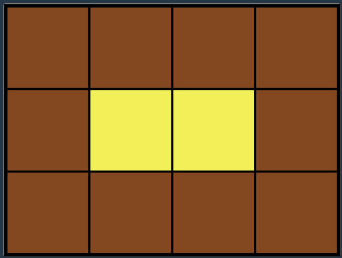
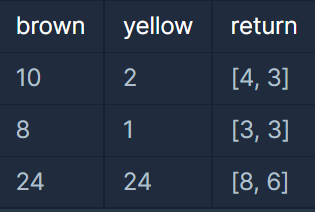
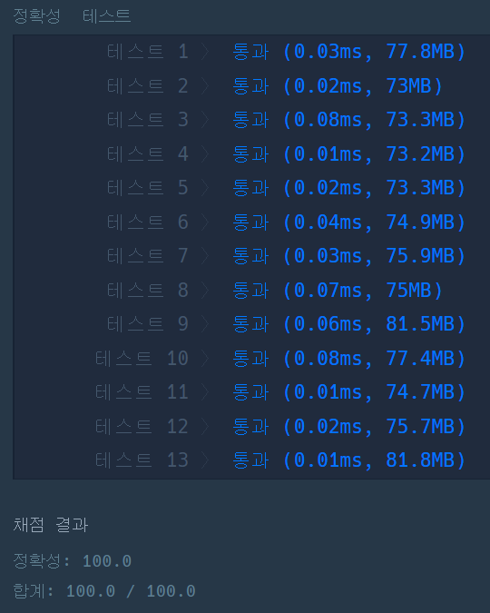

#### **문제 : 완전 탐색 - 카펫**

**문제 설명**

**Leo는 카펫을 사러 갔다가 아래 그림과 같이 중앙에는 노란색으로 칠해져 있고 테두리 1줄은 갈색으로 칠해져 있는 격자 모양 카펫을 봤습니다.**



**Leo는 집으로 돌아와서 아까 본 카펫의 노란색과 갈색으로 색칠된 격자의 개수는 기억했지만, 전체 카펫의 크기는 기억하지 못했습니다.   

Leo가 본 카펫에서 갈색 격자의 수 brown, 노란색 격자의 수 yellow가 매개변수로 주어질 때 카펫의 가로, 세로 크기를 순서대로 배열에 담아 return 하도록 solution 함수를 작성해주세요.**

**제한 사항**

* 갈색 격자의 수 brown은 8 이상 5,000 이하인 자연수입니다.
* 노란색 격자의 수 yellow는 1 이상 2,000,000 이하인 자연수입니다.
* 카펫의 가로 길이는 세로 길이와 같거나, 세로 길이보다 깁니다.

**입출력 예**



**문제 풀이**

brown과 yellow를 가지고 행과 열의 개수를 반환하는 문제이다.

**조건**

* 행과 열이 3이상이어야 한다.
* 가로의 길이는 서로의 길이와 같거나, 세로보다 길어야 한다.
* brown과 yellow의 합은 세로와 가로의 곱과 같다.

y = 1 → x = 8 → [1, 9] [3, 3] [9, 1] 중 [3, 3]만 가능

y = 2 → x = 10 → [1, 12] [2, 6] [3, 4], [4, 3] [6, 2] [12, 1] 중 [4, 3]만 가능

=> (가로의 길이 - 2) \* (세로의 길이 - 2) = yellow

```java
class Solution {
    public int[] solution(int brown, int yellow) {
        int[] answer = new int[2];

        int row = 0;    // 가로
        int col = 0;    // 세로

        int area = brown + yellow;  // 전체 격자 개수

        for(int i = 3; i <= area; i++){
            col = i;
            row = area / col;

            // 행의 개수가 3이하이면 Pass 합니다.
            if(row < 3) continue;

            // 행은 열보다 크거나 같아야 한다.
            if(row >= col){
                // (row - 2) * (col -2) = yellow
                if((row - 2) * (col -2) == yellow){
                    answer[0] = row;
                    answer[1] = col;
                    return answer;
                }
            }
        }

        return answer;
    }
}
```



---

> **Point : 3**  
>   
> 어려웠어요...
