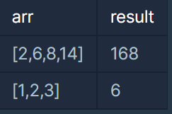
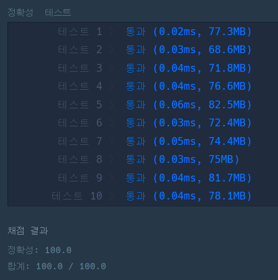

#### **문제 - N개의 최소 공배수**

**문제 설명**

**두 수의 최소공배수(Least Common Multiple)란 입력된 두 수의 배수 중 공통이 되는 가장 작은 숫자를 의미합니다. 예를 들어 2와 7의 최소공배수는 14가 됩니다. 정의를 확장해서, n개의 수의 최소공배수는 n 개의 수들의 배수 중 공통이 되는 가장 작은 숫자가 됩니다. n개의 숫자를 담은 배열 arr이 입력되었을 때 이 수들의 최소공배수를 반환하는 함수, solution을 완성해 주세요.**

**제한 사항**

* arr은 길이 1이상, 15이하인 배열입니다.
* arr의 원소는 100 이하인 자연수입니다.

**입출력 예**



**문제 풀이**

N개의 숫자의 최소공배수를 반환하는 문제이다.

이 문제에 대해 이해하기 위해서는 **유클리드 호제법**에 대해 이해할 필요가 있다.

> 유클리드 호제법이란 유클리드 알고리즘이라고도 불리며 2개의 2ㅏ연수 또는 정식의 최대 공약수를 구하는 알고리즘의 하나이다. 호제법이란 두 수가 서로 상대방 수를 나누어서 결국 원하는 수를 얻는 알고리즘을 나타낸다. 2개의 자연수 a, b에 대해서 a를 b로 나눈 나머지를 r이라 하면(단 a>b), a와 b의 최대 공약수는 b과 r의 최대공약수와 같다. 이 성질에 따라, b를 r로 나눈 나머지 r`를 구하고, 다시 r과 r`로 나눈 나머지를 구하는 과정을 반복하여 나머지가 0이 되었을 때 나누는 수가 a와 b의 최대공약수이다.  
> [출처 - 위키백과]

* **최대 공약수**  
  a와 b에서 a를 b로 나눈 나머지가 r이라고 했을 때 GCD(a, b) = GCD(b, r)이며, r이 0이면 그때 b가 최대 공약수이다.
* **최소 공배수**두 자연수 A, B의 최대공약수가 G, 최소공배수가 L일때,  A = a \* G, B = b \* G(a, b는 서로소)라고 하면 L = A \* B \*G  
  정리하면 A \* B = L \* G이다.

[전략]

1. 최대공약수를 구한다.
2. 최대공약수를 이용하여 최소공배수를 구한다.
3. 이 과정을 배열의 길이 - 1만큼 반복한다.

```java
class Solution {

    public int solution(int[] arr) {
        // 1. 배열의 첫 번째 값을 저장.
        int answer = arr[0];

        for(int i=1; i<arr.length; i++){
            // 2. 최대공약수 하기 
            int gcd = gcd(answer, arr[i]);

            // 3. 최소공배수
            answer = answer * arr[i] / gcd;
        }

        return answer;
    }

    // 5. 최대공약수 메소드, 유클리드 호제법
    public int gcd(int a, int b){
        int x = Math.max(a,b);
        int y = Math.min(a,b);

        while(x % y != 0){
            int r = x % y;
            x = y;
            y = r;
        }

        return y;
    }
}
```



---

> Point : 6  
>   
> 보자마자 유클리드 호제법이 생각나서 다행이다...
