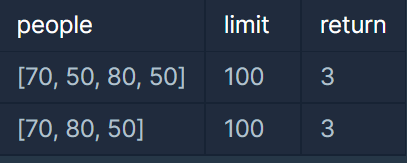

#### **문제 설명**

무인도에 갇힌 사람들을 구명보트를 이용하여 구출하려고 합니다. 구명보트는 작아서 한 번에 최대 2명씩 밖에 탈 수 없고, 무게 제한도 있습니다.   

예를 들어, 사람들의 몸무게가 [70kg, 50kg, 80kg, 50kg]이고 구명보트의 무게 제한이 100kg이라면 2번째 사람과 4번째 사람은 같이 탈 수 있지만 1번째 사람과 3번째 사람의 무게의 합은 150kg이므로 구명보트의 무게 제한을 초과하여 같이 탈 수 없습니다.   

구명보트를 최대한 적게 사용하여 모든 사람을 구출하려고 합니다.   

사람들의 몸무게를 담은 배열 people과 구명보트의 무게 제한 limit가 매개변수로 주어질 때, 모든 사람을 구출하기 위해 필요한 구명보트 개수의 최솟값을 return 하도록 solution 함수를 작성해주세요.

#### **제한 사항**

* 무인도에 갇힌 사람은 1명 이상 50,000명 이하입니다.
* 각 사람의 몸무게는 40kg 이상 240kg 이하입니다.
* 구명보트의 무게 제한은 40kg 이상 240kg 이하입니다.
* 구명보트의 무게 제한은 항상 사람들의 몸무게 중 최댓값보다 크게 주어지므로 사람들을 구출할 수 없는 경우는 없습니다.

#### **입출력 예**



#### **문제 풀이**

최대한 많은 사람들을 배에 태워 구출한 배의 횟수를 반환하는 문제이다.

무거운 사람과 가벼운 사람을 조합하여 최대한 많은 사람들을 한번에 보내는 것이 중요하다.

1. 배열을 정렬한다.
2. 가장 무거운 사람과 가벼운사람을 조합하여 제한된 무게보다 작다면 구출
3. 크다면 가벼운 사람을 남기고 무거운 사람만 배출

```java
import java.util.Arrays;

class Solution {
    public int solution(int[] people, int limit) {
        int answer = 0;

        // 오름차순 정렬
        Arrays.sort(people);

        for(int i=people.length - 1, j = 0; i >= j ; i--){
            if(people[i] + people[j] <= limit){
                j++;
                answer++;
            }else{
                answer++;
            }
        }

        return answer;
    }
}
```


---

> **Point : 7**어렵지 않았지만 쉽지도 않았던 것 같다...
