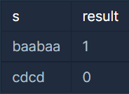
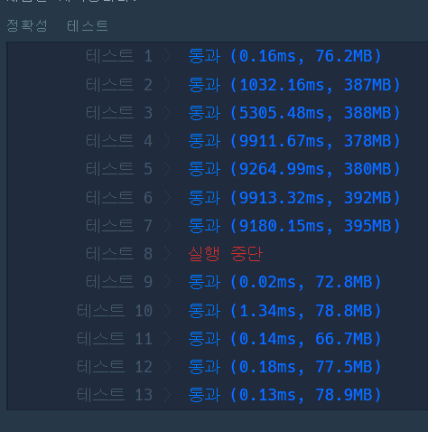
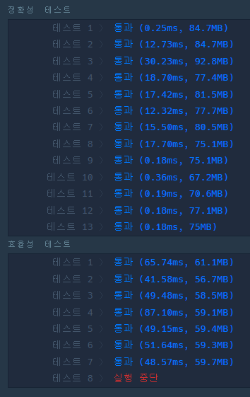
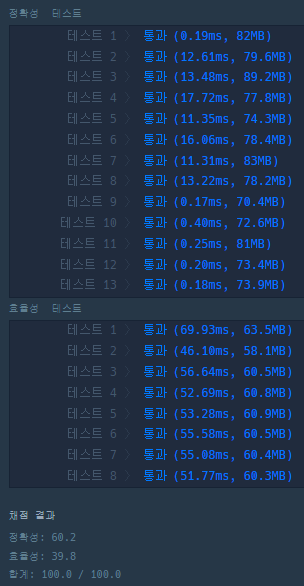

#### **문제 : 짝지어 제거하기**

**문제 설명**

짝지어 제거하기는, 알파벳 소문자로 이루어진 문자열을 가지고 시작합니다. 먼저 문자열에서 같은 알파벳이 2개 붙어 있는 짝을 찾습니다. 그다음, 그 둘을 제거한 뒤, 앞뒤로 문자열을 이어 붙입니다. 이 과정을 반복해서 문자열을 모두 제거한다면 짝지어 제거하기가 종료됩니다. 문자열 S가 주어졌을 때, 짝지어 제거하기를 성공적으로 수행할 수 있는지 반환하는 함수를 완성해 주세요. 성공적으로 수행할 수 있으면 1을, 아닐 경우 0을 리턴해주면 됩니다.   

예를 들어, 문자열 S = baabaa 라면  
b aa baa → bb aa → aa →  
의 순서로 문자열을 모두 제거할 수 있으므로 1을 반환합니다.

**제한사항**

* 문자열의 길이 : 1,000,000이하의 자연수
* 문자열은 모두 소문자로 이루어져 있습니다.

**입출력 예**



**문제 풀이**

문자열 s에서 연속하여 동일한 문제가 나올경우 제거하는 작업을 반복하였을 때 문자열의 길이가 0이 되면 1을, 아닌 경우 0을 반환하는 문제이다.

**풀이 1**

* 순차적으로 문자 탐색
* 현재 인덱스의 문자와 다음 인덱스의 문자가 동일한지 확인  
  동일하다면 현재 인덱스와 다음 인덱스의 값을 교체  
  반복문의 인덱스는 0으로 초기화

```java
class Solution
{
    public int solution(String s)
    {
        int answer = -1;

        for(int i=0; i < s.length() - 1;i++){
            if(s.charAt(i) == s.charAt(i+1)){
                s = s.replaceFirst(s.substring(i, i+2), "");
                i = -1;
            }
        }

        return s.length() == 0 ? 1 : 0;
    }
}
```



**풀이 2**

* 동일한 값을 제거한다는 것이 Stack 자료구조를 유추할 수 있다.
* Stack에 값을 삽입하고 동일한 값이 있다면 제거하는 작업을 반복

```java
import java.util.*;
class Solution
{
    public int solution(String s)
    {
        Stack<Character> stack = new Stack<>();

        for(int i=0; i<s.length(); i++){
            if(!stack.empty() && stack.peek() == s.charAt(i)){
                stack.pop();
            }else{
                stack.push(s.charAt(i));
            }
        }
        return stack.isEmpty() ? 1 : 0;
    }
}
```



**풀이 3**

* 반복문 사용방법을 변경

```java
import java.util.*;
class Solution
{
    public int solution(String s)
    {
        Stack<Character> stack = new Stack<>();

        for (char ch : s.toCharArray()) {
            if (!stack.isEmpty() && stack.peek() == ch)
                stack.pop();
            else
                stack.push(ch);
        }
        return stack.isEmpty() ? 1 : 0;
    }
}
```



---

> **Point : 4**
