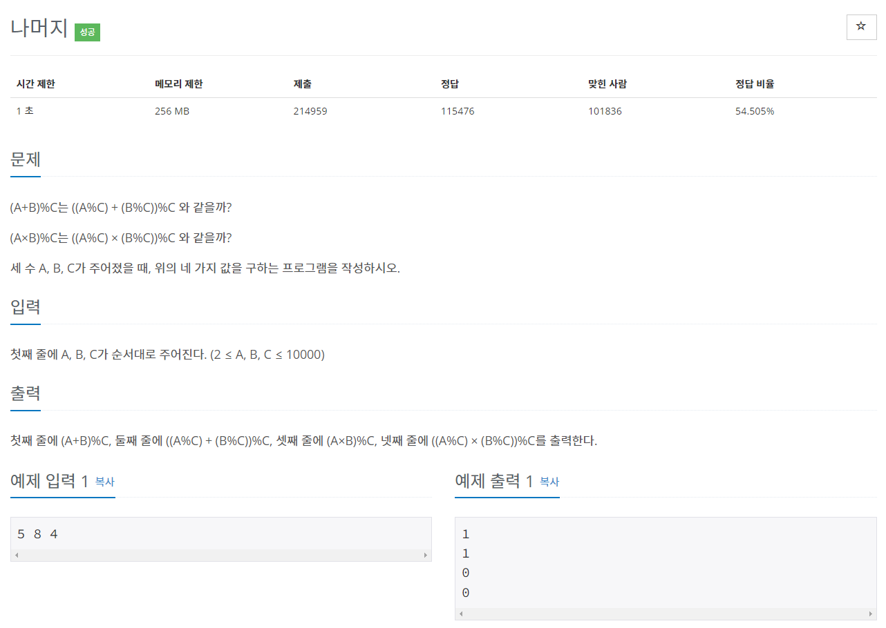
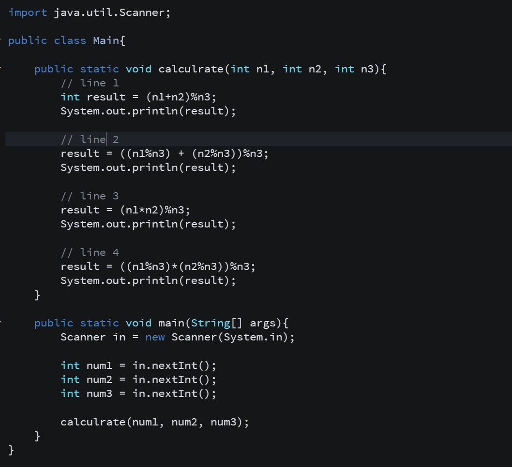
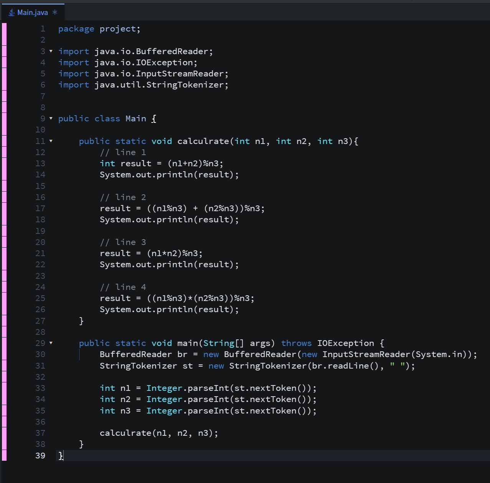
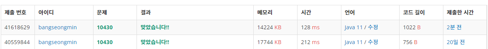

* **문제**

* **간단설명**

**- 산술 연산을 분리하여 출력하는 문제로 파악하였습니다.**

* **풀이**

**- 방법 1(Scanner 클래스)**

**Scanner을 사용하여 입력받아 산술연산을 처리하는 메소드를 만들어 처리하도록 하였습니다.**

**출력은 간편하게 하기 위해 System 클래스를 사용하였습니다.**

**- 방법 2(BufferedReader와 StringTokenizer)**

**산술연산 처리는 메소드로 처리하였기 떄문에 입력 메소드를 변경하여 풀이하였습니다.**

**- 성능차이**

**보시는 것처럼 성능 차이는 굉장히 차이나는 것을 볼 수 있습니다. 저도 비교를 위해서 작성하였는데.. 이렇게 차이가 많이 나는 줄 몰랐습니다.. 작성하면서 배우는 개발자 Mr.Bang입니다.**

* **정리**

**코딩테스트를 보면서 문제를 많이 풀었지만, 효율성 점수에 많이 낮았는데 이유를 알게 되고 나니까 더더욱 공부해야한다는 생각밖에 들지 않습니다.**
