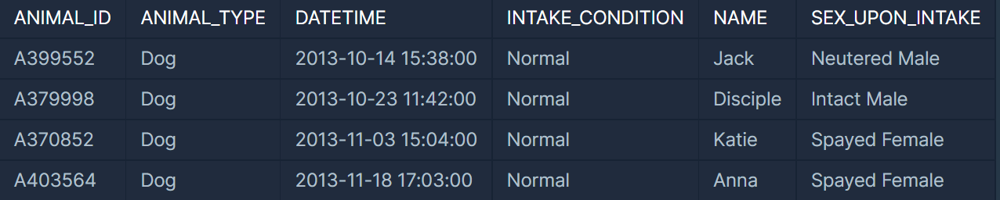
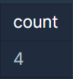
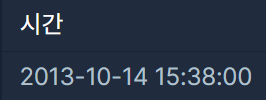
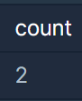
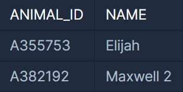

### **문제 : 동물 수 구하기**

**문제 설명**

ANIMAL\_INS 테이블은 동물 보호소에 들어온 동물의 정보를 담은 테이블입니다. ANIMAL\_INS 테이블 구조는 다음과 같으며, ANIMAL\_ID, ANIMAL\_TYPE, DATETIME, INTAKE\_CONDITION, NAME, SEX\_UPON\_INTAKE는 각각 동물의 아이디, 생물 종, 보호 시작일, 보호 시작 시 상태, 이름, 성별 및 중성화 여부를 나타냅니다. 동물 보호소에 동물이 몇 마리 들어왔는지 조회하는 SQL 문을 작성해주세요.

**예시**



동물 보호소에 들어온 동물은 4마리입니다. 따라서 SQL문을 실행하면 다음과 같이 나와야 합니다.



**문제 풀이**

* 동물 보호소에 들어온 동물의 개수를 출력해야 하므로 count()메소드를 사용 해야한다.

```sql
SELECT count(*)
FROM ANIMAL_INS
```

---

### **문제 : 최솟값 구하기**

**문제 설명**

ANIMAL\_INS 테이블은 동물 보호소에 들어온 동물의 정보를 담은 테이블입니다. ANIMAL\_INS 테이블 구조는 다음과 같으며, ANIMAL\_ID, ANIMAL\_TYPE, DATETIME, INTAKE\_CONDITION, NAME, SEX\_UPON\_INTAKE는 각각 동물의 아이디, 생물 종, 보호 시작일, 보호 시작 시 상태, 이름, 성별 및 중성화 여부를 나타냅니다. 동물 보호소에 가장 먼저 들어온 동물은 언제 들어왔는지 조회하는 SQL 문을 작성해주세요.

**예시**


가장 먼저 들어온 동물은 Jack이고, Jack은 2013-10-14 15:38:00에 들어왔습니다. 따라서 SQL문을 실행하면 다음과 같이 나와야 합니다.



**문제 풀이**

* 동물 보호소에 들어온 순으로 정렬하여 개수를 1개로 줄이게 되면 가장 먼저 들어온 동물 1개가 추출된다.

```sql
SELECT DATETIME
FROM ANIMAL_INS
ORDER BY DATETIME
LIMIT 1
```

---

### **문제 : 중복 제거하기**

**문제 설명**

ANIMAL\_INS 테이블은 동물 보호소에 들어온 동물의 정보를 담은 테이블입니다. ANIMAL\_INS 테이블 구조는 다음과 같으며, ANIMAL\_ID, ANIMAL\_TYPE, DATETIME, INTAKE\_CONDITION, NAME, SEX\_UPON\_INTAKE는 각각 동물의 아이디, 생물 종, 보호 시작일, 보호 시작 시 상태, 이름, 성별 및 중성화 여부를 나타냅니다. 이때 이름이 NULL인 경우는 집계하지 않으며 중복되는 이름은 하나로 칩니다.

**예시**


보호소에 들어온 동물의 이름은 NULL(없음), \*Sam, \*Sam, \*Sweetie입니다. 이 중 NULL과 중복되는 이름을 고려하면, 보호소에 들어온 동물 이름의 수는 2입니다. 따라서 SQL문을 실행하면 다음과 같이 나와야 합니다.



**문제 풀이**

* 보호소에 들어온 동물의 이름 중 중복을 제외한 이름의 개수를 출력하는 문제이다.

```sql
SELECT count(DISTINCT NAME)
FROM ANIMAL_INS
```

---

### **문제 : 이름에 el이 들어가는 동물 찾기**

**문제 설명**

ANIMAL\_INS 테이블은 동물 보호소에 들어온 동물의 정보를 담은 테이블입니다. ANIMAL\_INS 테이블 구조는 다음과 같으며, ANIMAL\_ID, ANIMAL\_TYPE, DATETIME, INTAKE\_CONDITION, NAME, SEX\_UPON\_INTAKE는 각각 동물의 아이디, 생물 종, 보호 시작일, 보호 시작 시 상태, 이름, 성별 및 중성화 여부를 나타냅니다.

보호소에 돌아가신 할머니가 기르던 개를 찾는 사람이 찾아왔습니다. 이 사람이 말하길 할머니가 기르던 개는 이름에 'el'이 들어간다고 합니다. 동물 보호소에 들어온 동물 이름 중, 이름에 "EL"이 들어가는 개의 아이디와 이름을 조회하는 SQL문을 작성해주세요. 이때 결과는 이름 순으로 조회해주세요. 단, 이름의 대소문자는 구분하지 않습니다.

**예시**


* 이름에 'el'이 들어가는 동물은 Elijah, Ella, Maxwell 2입니다.
* 이 중, 개는 Elijah, Maxwell 2입니다.

따라서 SQL문을 실행하면 다음과 같이 나와야 합니다.



**문제 풀이**

* 보호소에 있는 동물 중 이름에 'el'이 들어간다.
* 할머니가 기르시던 동물은 강아지다.
* 이름 순으로 조회해야한다.
* ID와 이름을 출력하여야 한다.

```sql
SELECT ANIMAL_ID, NAME
FROM ANIMAL_INS
WHERE ANIMAL_TYPE = "Dog" AND NAME LIKE '%el%'
ORDER BY NAME
```
