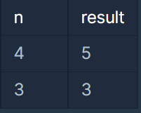
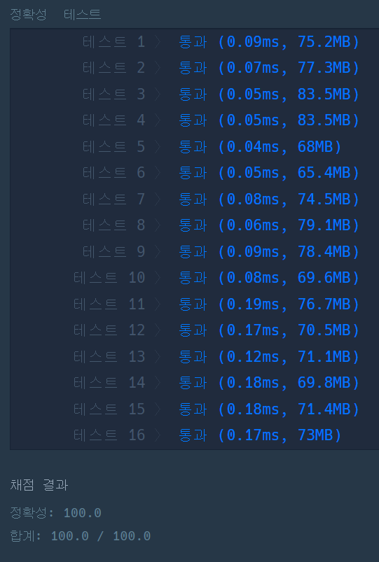

#### **문제 : 멀리 뛰기**

**문제 설명**

효진이는 멀리 뛰기를 연습하고 있습니다. 효진이는 한번에 1칸, 또는 2칸을 뛸 수 있습니다. 칸이 총 4개 있을 때, 효진이는   
(1칸, 1칸, 1칸, 1칸)   
(1칸, 2칸, 1칸)   
(1칸, 1칸, 2칸)   
(2칸, 1칸, 1칸)   
(2칸, 2칸)   
의 5가지 방법으로 맨 끝 칸에 도달할 수 있습니다. 멀리뛰기에 사용될 칸의 수 n이 주어질 때, 효진이가 끝에 도달하는 방법이 몇 가지인지 알아내, 여기에 1234567를 나눈 나머지를 리턴하는 함수, solution을 완성하세요. 예를 들어 4가 입력된다면, 5를 return하면 됩니다.

**제한 사항**

* n은 1 이상, 2000 이하인 정수입니다.

**입출력 예**



**문제 풀이**

**풀이 1**

> **n칸 멀리뛰기를 할때 끝까지 도달할 수 있는 방법의 가지수를 반환하는 문제이다.  
> ( 이때 1234567를 나눈 나머지를 리턴해야 한다는 것을 유의해야함.)**

* n = 1, result = 1 → (1)
* n = 2, result = 2 → (1, 1) (2)
* n = 3, result = 3 → (1, 1, 1) (1, 2) (2, 1)
* n = 4, result = 5 → (1, 1, 1, 1) (1, 1, 2) (1, 2, 1) (2, 1, 1) (2, 2)
* n = 5, result = 8 → (1, 1, 1, 1, 1) (1, 1, 1, 2) (1, 1, 2, 1) ...   

  **결론적으로 피보나치 수열과 동일한 패턴이라는 것을 확인 할 수 있다.**

즉, N = (N-2) + (N -1)이다.

```java
class Solution {
    public long solution(int n) {
        long answer = 0;

        if(n <= 2) return n;

        // n+1칸의 배열 선언
        long[] dp = new long[n+1];

        // 초기화
        dp[1] = 1;
        dp[2] = 2;

        for(int i = 3; i<= n; i++){
            dp[i] += (dp[i-1] + dp[i-2]) % 1234567;
        }

        return dp[n];
    }
}
```



---

> **Point : 8**이 문제의 규칙을 보면서 피보나치가 떠오른게 신의 한수였다.
