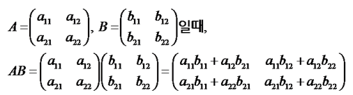
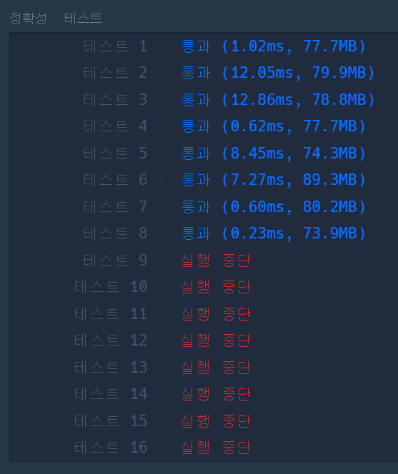
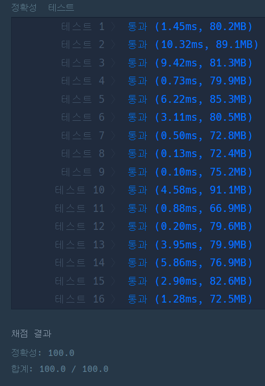

#### **문제 : 행렬의 곱셈**

**문제 설명**

2차원 행렬 arr1과 arr2를 입력받아, arr1에 arr2를 곱한 결과를 반환하는 함수, solution을 완성해주세요.

**제한 조건**

* 행렬 arr1, arr2의 행과 열의 길이는 2 이상 100 이하입니다.
* 행렬 arr1, arr2의 원소는 -10 이상 20 이하인 자연수입니다.
* 곱할 수 있는 배열만 주어집니다.

**문제 풀이**

> 행렬의 곱을 계산하는 문제이다.

행렬의 곱

* 첫째 행렬의 열 개수와 둘째 행렬의 행 개수가 동일해야한다.(제한조건 3에 의해 항상 성립)
* 행렬곱의 결과는 첫째 행렬의 행 개수와 둘째 행렬의 열 개수를 가진다.



**풀이1**

연속성 있게 참조되지 않아 성능상 효율적이지 않은 코드를 볼 수 있다.

```java
class Solution {
    public int[][] solution(int[][] arr1, int[][] arr2) {
        // 행렬곱의 결과 모양은 첫째 행렬의 행 개수와 둘째 행렬의 열 개수
        int[][] answer = new int[arr1.length][arr2[0].length];

        for(int i = 0 ; i < arr1.length ; ++i){
            for(int j = 0 ; j < arr2[0].length ; ++j){
                for(int k = 0 ; k < arr1[0].length ; ++k) {
                    answer[i][j] += arr1[i][k] * arr2[k][j];
                }
            }
        }

        return answer;
    }
}
```



**풀이2**

연산 순서를 변형시킨 개선된 코드

```java
class Solution {
    public int[][] solution(int[][] arr1, int[][] arr2) {
        // 행렬곱의 결과 모양은 첫째 행렬의 행 개수와 둘째 행렬의 열 개수
        int[][] answer = new int[arr1.length][arr2[0].length];
        int r = -1;

        for(int i = 0 ; i < arr1[0].length ; i++){
            for(int j = 0 ; j < arr1.length ; j++){

                // arr1(j, i) 원소를 고정하고, 그에 대한 arr2의 i열을 고정시켜 k행을 움직이면서 연산한다.
                r = arr1[j][i];


                for(int k = 0 ; k < arr2[0].length ; k++) {
                    answer[j][k] += r * arr2[i][k];
                }
            }
        }

        return answer;
    }
}
```



---

> **Point : 3**  
>   
> 이 문제를 풀면서 메모리 구조에 대해 생각을 하였다.  
> 풀이1 코드는 머리속으로는 쉽지만, 메모리 구조상으로는 불연속적이었다.  
>   
> 문제점을 해결하기 위해 풀이 2와 같은 구조로 풀이하게 되었다.  
>   
> 조금 더 좋은 방법이 있는지 살펴보다가 **스트라센 알고리즘**이라는 방법이 있었다.  
>   
> 분할 정복으로 풀이하는 방법이라고 하는데...  
> **스트라센 알고리즘**은 처음 들어서 공부하고 다시 도전해봐야겠다.
