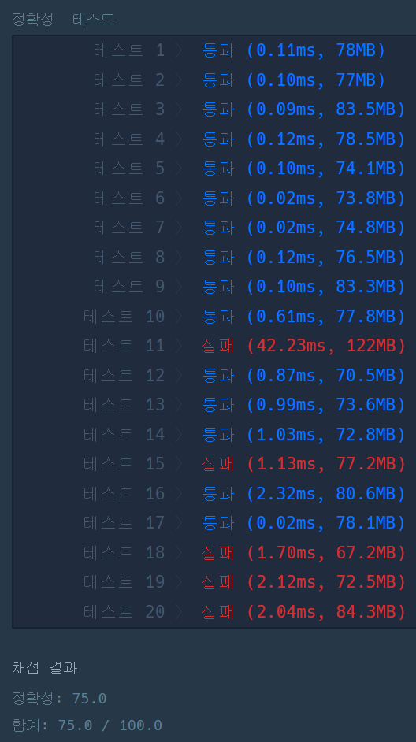
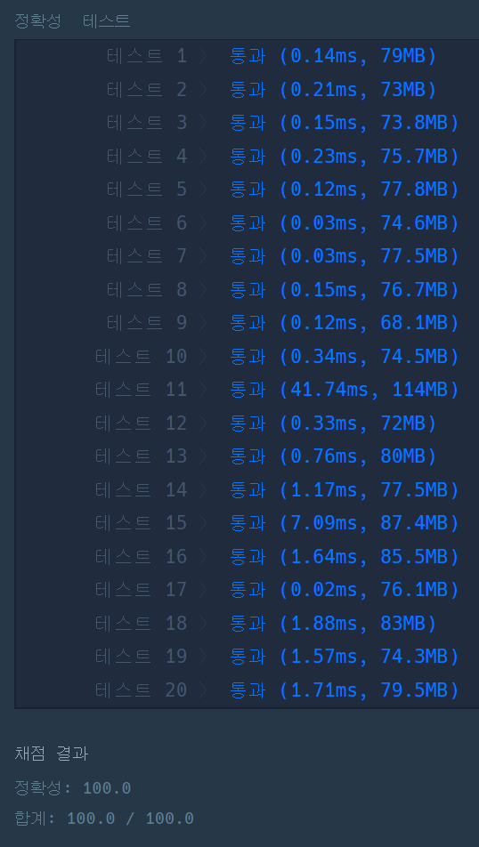

#### **문제 : (2018 KAKAO BLIND RECRUITMENT) 1차 캐시**

**문제 설명**

지도개발팀에서 근무하는 제이지는 지도에서 도시 이름을 검색하면 해당 도시와 관련된 맛집 게시물들을 데이터베이스에서 읽어 보여주는 서비스를 개발하고 있다.  
이 프로그램의 테스팅 업무를 담당하고 있는 어피치는 서비스를 오픈하기 전 각 로직에 대한 성능 측정을 수행하였는데, 제이지가 작성한 부분 중 데이터베이스에서 게시물을 가져오는 부분의 실행시간이 너무 오래 걸린다는 것을 알게 되었다.  
어피치는 제이지에게 해당 로직을 개선하라고 닦달하기 시작하였고, 제이지는 DB 캐시를 적용하여 성능 개선을 시도하고 있지만 캐시 크기를 얼마로 해야 효율적인지 몰라 난감한 상황이다.

어피치에게 시달리는 제이지를 도와, DB 캐시를 적용할 때 캐시 크기에 따른 실행시간 측정 프로그램을 작성하시오.

**입력 형식**

* 캐시 크기(cacheSize)와 도시이름 배열(cities)을 입력받는다.
* cacheSize는 정수이며, 범위는 0 ≦ cacheSize ≦ 30 이다.
* cities는 도시 이름으로 이뤄진 문자열 배열로, 최대 도시 수는 100,000개이다.
* 각 도시 이름은 공백, 숫자, 특수문자 등이 없는 영문자로 구성되며, 대소문자 구분을 하지 않는다. 도시 이름은 최대 20자로 이루어져 있다.

**출력 형식**

* 입력된 도시이름 배열을 순서대로 처리할 때, "총 실행시간"을 출력한다.

**조건**

* 캐시 교체 알고리즘은 LRU(Least Recently Used)를 사용한다.
* cache hit일 경우 실행시간은 1이다.
* cache miss일 경우 실행시간은 5이다.

**문제 풀이**

> 도시 이름을 순차 탐색하여 캐시에 저장하는데 걸리는 실행 시간을 출력하는 문제이다.  
> 자료구조 선정  
> 1. 삽입과 존재하는지 확인을 위한 검색이 용이하여야 한다.  
> 다시 생각하면, 삽입과 삭제가 용이하여야 한다.   
> 인덱스 위치가 아닌 존재하면 된다.

**풀이1**

* 캐시에 존재하지 않을 경우(cache miss), 실행시간 5초
* 캐시에 존재할 경우(cache hit), 실행시간 1초
* 캐시 교체 알고리즘은 LRU(Least Recently Used)를 사용한다.  
  즉, 가장 오래동안 참조하지 않은 페이지를 캐시에서 교체하는 것이다.
* **캐시 크기**가 **고정**되므로 **배열**을 사용하여 풀이하였다.

```java
import java.util.*;

class Solution {
    public int solution(int cacheSize, String[] cities) {
        int answer = 0;     // 실행 시간
        int index = 0;      // 인덱스 위치

        // 예외 - 캐시 크기가 0인 경우, cache miss로 처리한다.
        if(cacheSize == 0) return 5 * cities.length;
        // 캐시 크기만큼 배열 선언
        String[] caches = new String[cacheSize];
        // 도시이름 배열
        for(String city : cities){
            // 배열이 가득차게 되면, LRU 적용
            if(index == cacheSize)
                index = 0;
            // 배열에 해당 도시가 포함되어 있는지 확인(대문자 -> 소문자로 통일)
            if(Arrays.asList(caches).contains(city.toLowerCase())){
                // 1초 추가
                answer++;

            // 배열에 해당 도시가 포함되어 있는지 않은 경우
            }else{
                // 도시 이름은 소문자로 통일
                caches[index] = city.toLowerCase();
                // 배열에 존재하지 않으므로 실행시간 5초 추가
                answer += 5;
                index++;
            }
        }

        return answer;
    }
}
```



**풀이2**

* LRU를 구현하기 위해 Queue의 LinkedList 사용

```java
import java.util.*;

class Solution {
    public int solution(int cacheSize, String[] cities) {
        // 예외 - 캐시 크기가 0인 경우, cache miss로 처리한다.
        if(cacheSize == 0) return 5 * cities.length;

        int answer = 0;     // 실행 시간

        LinkedList<String> caches = new LinkedList<>();

        // 도시이름 배열
        for(String city : cities){
            // 도시 이름은 소문자로 통일
            String temp = city.toLowerCase();

            // 캐시에 존재할 경우
            if(caches.remove(temp)){
                caches.addFirst(temp);
                answer++;
            // 캐시에 존재하지 않은 경우
            }else{
                if(caches.size() == cacheSize){
                    caches.pollLast();
                }

                caches.addFirst(temp);
                answer += 5;
            }
        }

        return answer;
    }
}
```



---

> **Point : 9**  
>   
> 배열을 사용한 경우 (테스트 1 ~ 8 기준)  
> 풀이 1 : 평균 0.1025ms   
> 풀이 2 : 평균 0.14ms  
>   
> 그래서 풀이1번을 제출했었다..  
>   
> 풀이1은 테스트 11, 15, 18, 19, 20에서 실패였다.  
> 그래서 풀이 2를 제출하였다.
