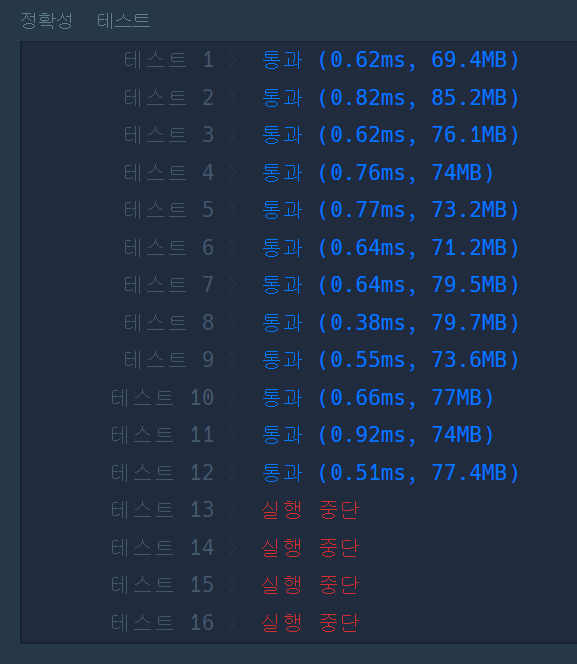
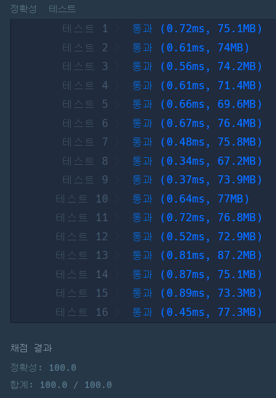

#### **문제 : 정렬 > H-Index**

**문제 설명**

H-Index는 과학자의 생산성과 영향력을 나타내는 지표입니다. 어느 과학자의 H-Index를 나타내는 값인 h를 구하려고 합니다. 위키백과1에 따르면, H-Index는 다음과 같이 구합니다.   

어떤 과학자가 발표한 논문 n편 중, h번 이상 인용된 논문이 h편 이상이고 나머지 논문이 h번 이하 인용되었다면 h의 최댓값이 이 과학자의 H-Index입니다.   

어떤 과학자가 발표한 논문의 인용 횟수를 담은 배열 citations가 매개변수로 주어질 때, 이 과학자의 H-Index를 return 하도록 solution 함수를 작성해주세요.

**제한사항**

* 과학자가 발표한 논문의 수는 1편 이상 1,000편 이하입니다.
* 논문별 인용 횟수는 0회 이상 10,000회 이하입니다.

**문제 풀이**

> 논문 인용횟수를 값으로 가진 배열에서 "전체 n편 중 h편의 논문이  h회 이상 인용되었다" 조건에 부합하는 h를 출력하는 문제이다.

**풀이1**

* '~이상인 요소의 개수'를 구하기 위해 정렬이 필요하다.
* 순차적으로 H-Index 조건여부 파악

```java
import java.util.*;

class Solution {
    public int solution(int[] citations) {
        int answer = 0;
        int small = 0;    

        // 정렬
        Arrays.sort(citations);

        for(int i=0; i<citations.length; i++){
            // 현재 논문의 인용횟수와 현재 논문보다 인용횟수가 크거나 같은 논문의 편수
            small = Math.min(citations[i], citations.length-i);

            if(small >= answer)
                answer = Math.max(answer, small);
            else
                break;
        }

        return answer;
    }
}
```

**풀이2**

* 동일한 원리를 다시 생각해보면 citations[i]에서 i값을 증가시키고 논문의 수를 감소시키면서 비교 했을 때 인용 횟수가 논문의 수 이상이 되었을 때의 논문의 수가 H-Index가 된다

```java
import java.util.*;

class Solution {
    public int solution(int[] citations) {
        int answer = 0;
        int h;

        // 정렬
        Arrays.sort(citations);

        for(int i=0; i<citations.length; i++){
            h = citations.length - i;

            if(citations[i] >= h){
                answer = h;
                break;
            }
        }

        return answer;
    }
}
```

---



풀이 1 - 실행 결과



풀이 2 - 실행 결과
