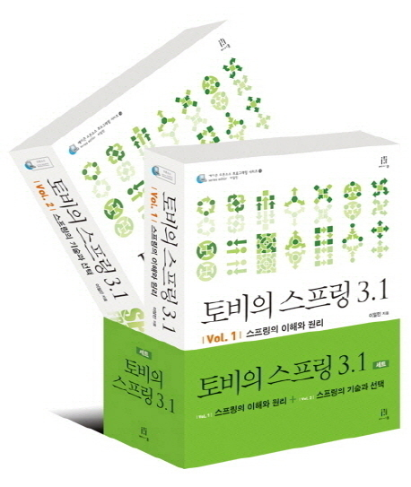
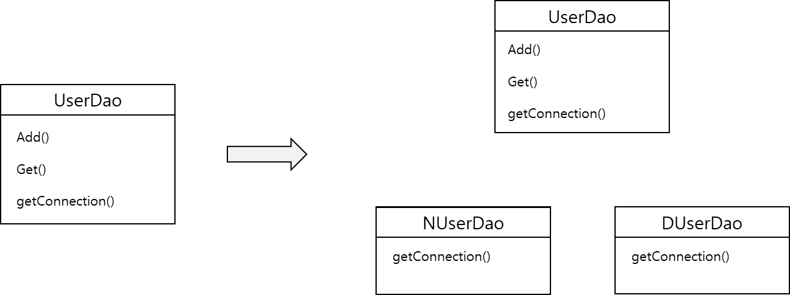

## **오브젝트와 의존관계**

> **스프링의 핵심 철학**- 자바 엔터프라이즈 기술의 혼란 속에서 잃어버렸던 객체지향 기술의 진정한 가치를 회복시키고, 그로부터 객체지향 프로그래밍 제공하는 폭넓은 혜택을 누릴 수 있도록 기본으로 돌아가는 것이다.

### **초난감 DAO**

> **DAO(Data Access Object)**- DB를 사용해 데이터를 조회하거나 조작하는 기능을 전담하도록 만든 오브젝트

#### **User**

사용자 정보를 저장할 때에는 **\*자바빈 규약**을 따르는 오브젝트를 이용하면 편리하다.

```java
// 1-1. 사용자 정보 저장용 자바빈 User 클래스

package com.domain;

public class User {

    private String id;
    private String password;
    private String name;

    public String getId() {
        return id;
    }

    public void setId(String id) {
        this.id = id;
    }

    public String getPassword() {
        return password;
    }

    public void setPassword(String password) {
        this.password = password;
    }

    public String getName() {
        return name;
    }

    public void setName(String name) {
        this.name = name;
    }
}
```

#### **UserDao**

사용자 정보를 DB에 넣고 관리할 수 있는 클래스

> **\* JDBC를 이용하는 작업의 순서**  
> 1. DB 연결을 위한 Connection을 가져오기  
> 2. SQL을 담은 Statement(또는 PreparedStatement) 생성  
> 3. Statement 실행  
> 4. 조회의 경우 SQL 쿼리의 실행 결과를 ResultSet으로 받아서 정보를 저장할 오브젝트에 옮겨준다.  
> 5. 작업 중에 생성된 리소스(Connection, Statement, Resultset) 같은 리소스는 작업을 마친 후 반드시 닫아준다.  
> 6. JDBC API가 만들어내는 예외를 잡아서 직접 처리하거나, 메소드에 throws를 선언해서 예외가 발생하면 메소드 밖으로 던지게 한다.

```sql
package com.dao;

import com.domain.Users;
import java.sql.*;

public class UserDao {

    public void add(Users user) throws ClassNotFoundException, SQLException {
        Class.forName("com.mysql.jdbc.Driver");
        Connection c = DriverManager.getConnection("jdbc:mysql://localhost/springbook", "spring", "book");
        PreparedStatement ps = c.prepareStatement(
                "insert into users(id, name, password) values(?, ?, ?)");

        ps.setString(1, user.getId());
        ps.setString(2, user.getName());
        ps.setString(3, user.getPassword());

    	ps.executeUpdate();                                 // Query 실행

        ps.close();                                     // preparedStatement 닫기
        c.close();                                      // Connection 종료
    }

    public Users get(String id) throws ClassNotFoundException, SQLException {
        Class.forName("com.mysql.jdbc.Driver");
        Connection c = DriverManager.getConnection("jdbc:mysql://localhost/springbook", "spring", "book");

        PreparedStatement ps = c.prepareStatement(
                "select * from users where id = ?");
        ps.setString(1, id);

        ResultSet rs = ps.executeQuery();
        rs.next();

        Users user = new Users();
        user.setId(rs.getString("id"));
        user.setName(rs.getString("name"));
        user.setPassword(rs.getString("password"));

        rs.close();
        ps.close();
        c.close();

        return user;
    }
}
```

#### **DAO 테스트 코드**

코드의 기능을 검증하고자 할 때 사용할 수 있는 가장 간단한 방법은 오브젝트 스스로 자신을 검증하도록 만들어주는 것이다.

```java
    @Test
    public void addAndGet() throws SQLException, ClassNotFoundException {
        UserDao userDao = new UserDao();

        User user = new User();
        user.setId("0");
        user.setName("seongminBang");
        user.setPassword("1234");

        userDao.add(user);

        System.out.println(user.getId() + " Enroll Success");

        User result = userDao.get("0");
        assertEquals("0", result.getId());

        System.out.println(result.getName());
        System.out.println(result.getPassword());

        System.out.println(result.getId()+" Search Success");
    }
```

> 🔎 [생각해보기]  
> 1. 현재 코드에 문제가 많은 이유가 무엇일까?  
> - 중복된 코드와 관심사의 분리가 이루어지지 않았기 때문이다.  
> - 예외에 대한 처리가 없다.  
>   
> 2. 잘 동작하는 코드를 굳이 수정하고 개선해야 하는 이유는 무엇일까?  
> - 관심사의 분리가 이루어지지 않아 코드 수정 시 전체적인 변경이 필요하기 때문이다.  
>   
> 3. DAO 코드를 개선했을 때의 장점은 무엇일까?  
> - 문제 발생 시에 해당 관심사만 변경이 요구된다. 개발 시간 단축 등 업무 효율성이 높아진다.  
>   
> 4. 장점들이 당장에, 또는 미래에 주는 유익은 무엇일까?  
> 변화에 쉽게 대처가능해진다. 분리와 확장을 통해 문제를 쉽게 대처가능하다.  
>   
> 5. 객체지향 설계의 원칙과는 무슨 상관이 있을까?  
> 객체지향 기술이 만드러내는 가상의 추상세계 자체를 효과적으로 구성할 수 있고, 이를 자유롭고 편리하게 변경, 발전, 확장시킬 수 있기 때문이다.  
>   
> 6. DAO를 개선하는 경우와 그대로 사용하는 경우, 스프링을 사용하는 개발에서 무슨 차이가 있을까?  
> 코드 수가 확실히 줄어든다. 또한 관심사의 분리로 문제 발생 시 해결하는데 걸리는 시간과 미래에 발생할 수 있는 불확실성을 쉽게 제거할 수 있다.

---

### **DAO의 분리**

#### **관심사의 분리**

* 오브젝트에 대한 설계와 이를 구현한 코드는 변화한다.
  + 사용자의 비즈니스 프로세스와 그에 따른 요구사항은 끊임없이 바뀌고 발전한다.
  + 애플리케이션이 기반을 두고 있는 기술도 시간이 지남에 따라 바뀌고, 운영되는 환경도 변화한다.
  + 애플리케이션이 더 이상 사용되지 않아 폐기처분될 때가 돼야 변화는 중지한다.
* 개발자가 객체를 설계할 때 가장 염두에 둬야 할 사항은 미래의 변화를 어떻게 대비할 것인가이다.
* 객체지향 기술은 실세계를 최대한 가깝게 모델링해낼 수 있기 때문에 의미가 있다고 여겨지지만, 그보다는 객체지향 기술이 만들어내는 가상의 추상세계 자체를 효과적으로 구성할 수 있고, 이를 자유롭고 편리하게 변경, 발전, 확장시킬 수 있다는 데 더 의미가 있다.
* 미래를 준비하는 데 있어 가장 중요한 과제는 변화에 어떻게 대비할 것인가이다.
  + 가장 좋은 대책은 변화의 폭을 최소한으로 줄여주는 것이다.  
    (예시) 두명의 개발자에게 동일한 기능 변경을 요청했다고 하자.  
    한 명은 단 몇 줄의 코드만 수정하고, 그 변경이 나머지 기능에는 전혀 문제를 일으키지 않는다는 것까지 검증해주는데 5분이 걸렸다. 다른 개발자는 동일한 기능을 변경하는 데 5시간이 걸린데다, 그것이 기존에 잘동작하던 다른 기능에 오류를 일으킬지도 모른다는 새로운 불안감까지 일으켰다면 과연 어떤 개발자가 더 미래의 변화를 잘 준비한 것일까?  

    (정답) 최소한의, 확신을 가진 작업만으로도 기능을 수정해낸 개발자  
    **How?** **분리**와 **확장**을 고려한 설계를 통해 가능하다.
  + **분리**- 모든 변경과 발전은 한 번에 한 가지 관심사항에 집중해서 일어난다.  
    - 문제점  
      변화는 대체로 집중된 한 가지 관심에 대해 일어나지만 그에 따른 작업은 한 곳에 집중되지 않는 경우가 많다.  
      (예시)   
      - DB 접속용 암호를 변경하려고 DAO 클래스 수백 개를 모두 수정해야 한다면?   
      - 트랜잭션 기술을 다른 것으로 바꿨다고 비즈니스 로직이 담긴 코드의 구조를 모두 변경해야 한다면?  
      - 다른 개발자가 개발한 코드에 변경이 일어날 때마다 내가 만들 클래스도 함께 수정을 해줘야 한다면?   

      => 변화가 한 번에 한 가지 관심에 집중돼서 일어난다면, 우리가 준비해야 할 일은 한 가지 관심이 한 군데에 집중되게 하는 것이다.   
      즉, 관심이 같은 것끼리는 모으고, 관심이 다른 것은 따로 떨어져 있게 하는 것이다.
    - 프로그래밍의 기초 개념 중에 **관심사의 분리(Separation of Concerns)**가 있다.   
      이를 객체지향에 적용해 보면, 관심이 같은 것끼리는 하나의 객체 안으로 또는 친한 객체로 모이게 하고, 관심이 다른 것은 가능한 한 따로 떨어져서 서로 영향을 주지 않도록 분리하는 것이라고 생각할 수 있다.

#### **커넥션 만들기의 추출**

**UserDao의 관심사항**

* 첫째는 DB와 연결을 위한 커넥션을 가져오는 것  
  세분화하면 어떤 DB를 사용할 것인지, 어떤 드라이버를 사용할 것인지, 어떤 로그인 정보를 사용할 것인지, 커넥션을 생성하는 방법은 또 어떤 것이다라는 겄가지 구분해서 볼 수 있다.
* 둘째는 사용자 등록을 위해 DB에 보낼 SQL 문장을 담을 Statement를 만들고 실행하는 것  
  1. 파라미터로 넘어온 사용자 정보를 Statement에 바인딩  
  2. Statement에 담긴 SQL을 DB를 통해 실행  
  파라미터를 바인딩하는 것과 어떠 SQL을 사용할지를 다른 관심사로 분리할 수 도 있다.
* 셋째는 리소스(Statement, Connection etc) 오브젝트를 닫아줘서 소중한 공유 리소스를 시스템에 돌려주는 것

**UserDao의 문제점**

* **예외처리 부재**  
  - 현재 Dao 코드에는 예외사항에 대한 처리가 전혀 없다.  
  → 수많은 동시 사용자가 있고, 한번 시작되면 장기간 운용되는 서버에 올라간다면 예외상황에 적절하게 대응해서 공유 리소스를 반환하지 않는 일이 없도록 세심하게 주의해야 한다.
* **관심사항 미분리**  
  - 첫째 관심사인 DB 연결을 위한 Connection 오브젝트를 가져오는 코드는 다른 관심사와 섞여서 메소드에 담겨 있다.
* **중복된 코드**  
  - add() 메소드에 있는 DB 커넥션을 가져오는 코드와 동일한 코드가 get() 메소드에 중복되어 있다.

**중복 코드의 메소드 추출**

중복된 DB 연결 코드를 독립적인 메소드로 만들어둔다.

```java
// 1-4. getConnection 메소드를 추출해서 중복을 제거한 UserDao

public void add(User user) throws ClassNotFoundException, SQLException{
    Connection c = connectionMaker.makeConnection();
    ...
}

public User get(String id) throws ClassNotFoundException, SQLException {
    Connection c = connectionMaker.makeConnection();
    ...
}

private Connection getConnection() throws ClassNotFoundException, SQLException {
    Class.forName("com.mysql.cj.jdbc.Driver");
    Connection c = DriverManager.getConnection("jdbc:mysql://localhost/spring_book", "root", "root");
    return c;
}
```

**변경사항에 대한 검증: 리팩토링과 테스트**

문제 - 코드를 수정한 후에는 기능에 문제가 없다는 게 보장되지 않는다.

해결 - 변경된 UserDao의 기능이 변경되기 전과 동일한지 확인하기 위해 메소드를 실행하여 테스트하면 된다.

문제 - 현재 main 메소드를 여러 번 실행하면 두 번쨰부터는 무조건 예외가 발생한다.

원인 - 테이블의 기본키인 id 값이 중복되기 때문이다.

해결 - main 메소드 테스트를 다시 실행하기 전에 User 테이블의 사용자 정보를 모두 삭제해줘야 한다.

> ****📖** 리팩토링**  
> 여러 메소드에 중복돼서 등장하는 특정 관심사항이 담긴 코드를 별도의 메소드로 분리하고 기능에 영향을 주지 않으면서 코드의 구조만 변경하는 것을 의미한다.  
>   
> **메소드 추출(extract method) 기법**getConnection()과 같이 공통의 기능을 담당하는 메소드로 중복된 코드를 뽑아내는 것을 의미한다.

#### 

#### **DB 커넥션 만들기의 독립**

>  UserDao 소스코드를 제공하지 않고 고객 스스로 원하는 DB 커넥션 생성 방식을 적용해가면서 UserDao를 사용하게 할 수 있을까?

**상속을 통한 확장**

UserDao에서 메소드의 구현 코드를 제거하고 getConnection()을 추상 메소드로 만드는 방법이다.

추상클래스 UserDao를 구입한 사용자들은 서브클래스에 getConnection() 메소드를 원하는 방식대로 구현할 수 있다.

이를 통해 UserDao의 소스코드를 제공해서 수정해 쓰도록 하지 않아도 getConnection() 메소드를 원하는 방식으로 확장하여 UserDao의 기능과 함께 사용할 수 있다.

> 동일 클래스에 다른 메소드로 분리됐던 DB 커넥션 연결이라는 관심을 상속을 통해 서브클래스로 분리한 것이다.



상속을 통한 UserDao 확장 방법

```java
// 1-5. 상속을 통한 확장 방법이 제공되는 UserDao
public abstract class UserDao{
	public void add(User user) throws ClassNotFoundException, SQLException{
    	Connection c = getConnection();
        ...
    }

	public void get(User user) throws ClassNotFoundException, SQLException{
    	Connection c = getConnection();
        ...
    }

	public abstract Connection getConnection() throws ClassNotFoundException, SQLException;
}

public class NUserDao extends UserDao{
	public Connection getConnection() throws ClassNotFoundException, SQLException {
    	...
    }
}

public class DUserDao extends UserDao{
	public Connection getConnection() throws ClassNotFoundException, SQLException {
    	...
    }
}
```

* DAO의 핵심 기능  
  1. 어떻게 데이터를 등록하고 가져올 것인가(SQL 작성, 파라미터 바인딩, 쿼리 실행, 검색정보 전달)라는 관심을 담당하는 UserDao  
  2. DB 연결 방법은 어떻게 할 것인가라는 관심을 담고 있는 NUserDao, DUserDao가 클래스 레벨  
  로 구분이 되고 있다.

클래스 계층구조를 통해 두 개의 관심이 독립적으로 분리되면서 UserDao는 변경이 용이하고 손쉽게 확장할 수 있다.

> ****📖** 템플릿 메소드 패턴(Template Method Pattern)**  
> 슈퍼클래스에 기본적인 로직의 흐름(커넥션 가져오기, SQL 생성, 실행, 반환)을 만들고, 그 기능의 일부를 추상 메소드나 오버라이딩이 가능한 protected 메소드 등으로 만든 뒤 서브클래스에서 이런 메소드를 필요에 맞게 구현해서 사용하도록 하는 방법  
>   
> **팩토리 메소드 패턴(Factory Method Pattern)**  
> 서브클래스에서 구체적인 오브젝트 생성 방법을 결정하게 하는 것을 팩토리 메소드 패턴이라 부르기도 한다.

서브클래스에서 구현하는 getConnection() 메소드는 JDBC가 정의한 Connection 인터페이스를 구현한 Connection 오브젝트를 각자의 생성 알고리즘을 이용해 만들어낸다. getConnection() 메소드에서 생성하는 Connection 오브젝트의 구현 클래스는 제각각이겠지만 UserDao는 Connection 인터페이스 타입의 오브젝트라는 것 외에는 관심을 두지 않는다.

관심 사항

* UserDao는 어떤 기능을 사용한다는 데에만 관심이 있다.
* 서브 클래스에서는 어떤 식으로 Connection 기능을 제공하는지와 어떤 방법으로 Connection 오브젝트를 만들어내는지가 관심사항이다.

UserDao는 Connection  오브젝트가 만들어지는 방법과 내부 동작방식에는 상관없이 자신이 필요한 기능을 Connection 인터페이스를 통해 사용하기만 할 뿐이다.


1-2. UserDao에 적용된 팩토리 메소드 패턴

그림 1-2는 서브클래스의 getConnection()을 통해 만들어진 Connection 오브젝트의 종류가 달라질 수 있게 하는 것을 목적으로 하는 디자인 패턴인 팩토리 메소드 패턴을 나타내는 그림이다.

NUserDao와 DUserDao가 모두 같은 종류의  Connection 구현 클래스의 오브젝트를 리턴할 수 있고, 오브젝트를 생성하는 방식이 다를 수 있다. (팩토리 메소드 패턴)

정리하면, **"UserDao에 팩토리 메소드 패턴을 적용해서 getConnection()을 분리한 것"**이다.

> 🔎 [요약]  
> Q. **리팩토링 메소드 추출 기법을 사용한 이유**  
> A. 중복돼서 등장하는 공통된 관심사를 제거하여 유지보수와 확장을 용이하게 하기 위해서이다.  
>   
> Q. **템플릿 메소드 패턴을 사용한 이유**  
> A. 중복 코드를 줄이고 자식 클래스에게 핵심 로직의 관리를 용이하게 하기 위해서이다.  
>   
> Q. **디자인 패턴에 팩토리 메소드 패턴을 적용한 이유**  
> A. 사용자가 원하는 방식으로 사용할 수 있게 다양성을 보장해주기 위해서이다.  
> 즉, 기존 코드를 수정하지 않고 새로운 인스턴스를 여러 방법으로 생성할 수 있는 "확장에 열려있고 변경에 닫혀있는 객체 지향 원칙"을 만족하는 객체 생성 방법이다.

템플릿 메소드 패턴 또는 팩토리 메소드 패턴으로 관심사항이 다른 코드를 분리해내고, 서로 독립적으로 변경 또는 확장할 수 있도록 만드는 것은 간단하면서도 매우 효과적인 방법이다.

* 문제점 - 상속을 사용  
  상속 자체는 간단해 보이고 사용하기도 편리하게 느껴지지만 사실 많은 한계점이 있다.  
  + **다중 상속에 문제**  
    만약 UserDao가 다른 목적을 위해 상속을 사용하고 있다면 어떻게 할 것인가?   
    > 자바는 클래스의 다중상속을 허용하지 않는다. 단지, 커넥션 객체를 가져오는 방법을 분리하기 위해 상속구조로 만들어버리면, 다른 목적으로 UserDao에 상속을 적용하기 힘들다.
  + **상속을 통한 상하위 클래스의 관계는 생각보다 밀접하다.**상속을 통해 관심이 다른 기능을 분리하고, 필요에 따라 다양한 변신이 가능하도록 확장성도 줬지만 여전히 상속관계는 두 가지 관심사에 대해 긴밀한 결합을 허용한다.  
    슈퍼클래스 내부의 변경이 있을 때 모든 서브클래스를 함께 수정하거나 다시 개발해야 할 수도 있다. 반대로 그런 변화에 다른 불편을 주지 않기 위해 슈퍼클래스가 더 이상 변화하지 않도록 제약을 가해야 할지도 모른다.
  + **확장된 기능인 DB 커넥션을 생성하는 코드를 다른 DAO 클래스에 적용할 수 없다.**  
    UserDao 외에 DAO 클래스들이 계속 만들어진다면 그때는 상속을 통해서 만들어진 getConnection()의 구현 코드가 매 DAO 클래스마다 중복돼서 나타나는 심각한 문제가 발생할 것이다.

---

### **DAO의 확장**

**관심사에 따라 분리한 오브젝트들은 제각기 독특한 변화의 특징이 있다.**(예) 현재 데이터 액세스 로직을 어떻게 만들 것인가와 DB 연결을 어떤 방법으로 할 것인가라는 두 개의 관심을 상하위 클래스로 분리하였는데, 이 두 개의 관심은 변화의 성격이 다르다.

**> 변화의 성격이 다르다는 변화의 이유와 시기, 주기 등이 다르다는 의미이다.**

* UserDao는  
  1. JDBC API를 사용할 것인가?  
  2. DB 전용 API를 사용할 것인가?  
  3. 어떤 테이블 이름과 필드 이름을 사용해 어떤 SQL을 만들 것인가?  
  4. 어떤 오브젝트를 통해 DB에 저장할 정보를 전달받고, DB에서 꺼내온 정보를 저장해서 넘겨줄 것인가?  
  와 같은 관심을 가진 코드를 모아둔 것이다.  

  따라서 이런 관심사가 바뀌면 그때 변경이 일어난다.  
  + DB 연결 방법이 그대로라면 DB 연결 확장 기능을 담은 NUserDao나  DUserDao의 코드는 변하지 않는다.
  + 사용자 정보를 저장하고 가져오는 방법에 대한 관심은 바뀌지 않지만 DB 연결 방식이나 DB 커넥션을 가져오는 방법이 바뀌면, UserDao 코드는 그대로인 채로 NUserDao나 DUserDao의 코드만 바뀐다.

> **추상 클래스를 만들고 이를 상속한 서브클래스에서 변화가 필요한 부분을 바꿔서 쓸수 있게 만드는 이유는 변화의 성격이 다른 것을 분리해서, 서로 영향을 주지 않은 채로 각각 필요한 시점에 독립적으로 변경할 수 있게 하기 위해서다.**

#### **클래스의 분리**

관심사가 다르고 변화의 성격이 다른 두 가지 코드를 분리할 것이다.

* (Before) 독립된 메소드를 만들어서 분리하여 상하위 클래스로 분리한 상태
* (After) 상속관계도 아닌 완전히 독립적인 클래스로 분리


1-3. 두 개의 독립된 클래스로 분리한 결과

**설명**

* SimpleConnectionMaker라는 새로운 클래스를 만들고 DB 생성 기능을 makeNewConnection() 메소드에 넣는다.
* UserDao는 new 키워드를 사용해 SimpleConnectionMaker 클래스의 오브젝트를 생성하여 add(), get() 메소드에서 사용하면 된다.
* UserDao는 상속을 통한 방법을 사용하지 않으므로 absract일 필요가 없어진다.

```java
package com.dao;

import com.domain.User;
import java.sql.*;

public class UserDao {

    private final SimpleConnectionMaker simpleConnectionMaker;

    public UserDao(){
    	// 상태를 관리하는 것이 아니므로 한 번만 만들어 인스턴스 변수에 저장해두고 사용하면 된다.
        this.simpleConnectionMaker = new SimpleConnectionMaker();
    }

    public void add(User user) throws ClassNotFoundException, SQLException{
        Connection c = simpleConnectionMaker.makeNewConnection();
    }

    public User get(String id) throws ClassNotFoundException, SQLException {
        Connection c = simpleConnectionMaker.makeNewConnection();    
    }
}


public class SimpleConnectionMaker {
    public Connection makeNewConnection() throws ClassNotFoundException, SQLException {
        Class.forName("com.mysql.jdbc.Driver");
        Connection c = DriverManager.getConnection("jdbc:mysql://localhost/springbook", "spring", "book");
        return c;
    }
}
```

* **문제**  
  성격이 다른 코드를 분리하였지만, 사용자에게 UserDao 클래스만 공급하고 상속을 통해 DB 커넥션 기능을 확장해서 사용하게 했던 게 불가능해졌다.
* **원인**UserDao의 코드가 SimpleConnectionMaker라는 특정 클래스에 종속되어 있기 때문에 상속을 사용했을 때처럼 UserDao 코드의 수정 없이 DB 커넥션 생성 기능을 변경할 방법이 없다.
* **현재 상황**  
  DB 커넥션을 제공하는 클래스를 사용하기 위해서 UserDao 소스코드의 다음 줄을 직접 수정해야 한다. UserDao의 소스코드를 함께 제공하지 않고는 DB 연결 방법을 바꿀 수 없다는 초기 문제로 되돌아와 버렸다.

클래스를 분리한 경우 상속을 이용했을 때와 마찬가지로 자유로운 확장이 가능하게 하려면 두 가지 문제를 해결해야 한다.

1. SimpleConnectionMaker의 메소드 → **유지보수량 증가**  
   현재 makeNewConnection()을 사용해 DB 커넥션을 가져오도록 설계하였는데, N사에서 만든 DB 커넥션 제공 클래스는 openConnection()이라는 메소드 이름을 사용하였다면 UserDao 내에 메소드의 커넥션을 가져오는 코드를 일일이 변경해야한다.
2. DB 커넥션을 제공하는 클래스가 어떤 것인지를 UserDao가 구체적으로 알고 있어야 한다. → **확장성 저하**  
   UserDao에 SimpleConnectionMaker 클래스 타입의 인스턴스 변수까지 정의하여 사용하고 있으므로, N사에서 다른 클래스를 구현하면 코드를 수정해야 한다.

이러한 문제의 근본적인 원인은 UserDao가 바뀔 수 있는 정보, 즉 DB 커넥션을 가져오는 클래스에 대해 너무 많이 알고 있기 때문이다. 어떤 클래스가 쓰일지, 그 클래스에서 커넥션을 가져오는 메소드는 이름이 뭔지까지 일일이 알고 있어야 한다. 정리하면 **UserDao는 DB 커넥션을 가져오는 구체적인 방법에 종속되어 있다**.

#### **인터페이스의 도입**

**해결책**

* 두 개의 클래스가 서로 긴말하게 연결되어 있지 않도록 중간에 추상적인 느슨한 연결고리를 만들어주는 것이다.

> **※ 추상화란?**  
> > 어떤 것들의 공통적인 성격을 뽑아내어 이를 따로 분리해내는 작업이다.

자바가 추상화를 위해 제공하는 가장 유용한 도구는 인터페이스다. 인터페이스는 자신을 구현한 클래스에 대한 구체적인 정보는 모두 감춰버린다. 오브젝트를 만들려면 구체적인 클래스 하나를 선택해야겠지만 인터페이스로 추상화해놓은 최소한의 통로를 통해 접근하는 쪽에서는 오브젝트를 만들 때 사용할 클래스가 무엇인지 몰라도 문제가 없다.

인터페이스를 통해 접근하게 하면 실제 구현 클래스를 바꿔도 신경 쓸 일이 없다.


인터페이스는 어떤 일을 하곘다는 기능만 정의해놓은 것이다.

> 구현 방법은 인터페이스를 구현한 클래스들의 몫이다.

```java
// 리스트 1-8. ConnectionMaker 인터페이스
package com.dao;

public interface ConnectionMaker {

    public Connection makeConnection() throws ClassNotFoundException, SQLException;
}
```

고객에게 UserDao클래스와 함께 ConnectionMaker 인터페이스를 전달하면 고객은 ConnectionMaker인터페이스를 구현한 클래스르 만들고, 자신들의 DB 연결 기술을 이용해 DB 커넥션을 가져오도록 메소드를 작성해주면 된다. 

```java
// 리스트 1-9. ConnectionMaker 구현 클래스
package com.dao;

public class NConnectionMaker implements ConnectionMaker{

    @Override
    public Connection makeConnection() throws ClassNotFoundException, SQLException {
        Class.forName("com.mysql.cj.jdbc.Driver");
        Connection c = DriverManager.getConnection("jdbc:mysql://localhost/spring_book", "root", "root");
        return c;
    }
}
```

UserDao는 특정 클래스 대신 인터페이스를 사용하여 DB 커넥션을 가져와 사용할 수 있게 된다.

```java
// 1-10. ConnectionMaker 인터페이스를 사용하도록 개선한 UserDao
package com.dao;

import com.domain.User;
import java.sql.*;

public class UserDao {

    // 인터페이스를 통해 오브젝트에 접근하므로 구체적인 클래스 정보를 알 필요가 없다.
    private ConnectionMaker connectionMaker;

    public UserDao() {
        this.connectionMaker = new NConnectionMaker();
    }

    public void add(User user) throws ClassNotFoundException, SQLException{
        Connection c = connectionMaker.makeConnection();

		...
    }

    public User get(String id) throws ClassNotFoundException, SQLException {
        Connection c = connectionMaker.makeConnection();

		...
    }

}
```

**문제점**

* ConnectionMaker인터페이스의 구현 클래스인 NConnectionMaker()가 사용된 것을 볼 수 있다.  

  UserDao의 다른 모든 곳에서는 인터페이스를 이용하게 만들어 DB 커넥션을 제공하는 클래스에 대한 구체적인 정보는 모두 제거가 가능했지만, 초기에 한 번 어떤 클래스의 오브젝트를 사용할지를 결정하는 생성자의 코드는 제거되지 않고 남아 있다.  

  ▶ UserDao의 확장성 문제가 여전히 남아있다.

#### **관계설정 책임의 분리**

> UserDao와 ConnectionMaker라는 두 개의 관심사를  
> 인터페이스를 사용하여 거의 완벽하게 분리하였는데,   
> 왜 UserDao가 인터페이스뿐 아니라 구체적인 클래스까지  
> 알아야한다는 문제가 발생하는 것일까?

* UserDao에는 어떤 ConnectionMaker 구현 클래스를 사용할지를 결정하는 코드가 남아 있기 때문에 인터페이스를 이용한 분리에도 불구하고 여전히 UserDao 변경 없이는 DB 커넥션 기능의 확장이 자유롭지 못하다.   

  ▶ UserDao 안에 분리되지 않은 또 다른 관심사항이 존재하고 있다.

UserDao를 사용하는 클라이언트가 적어도 하나는 존재할 것이다.

* UserDao의 클라이언트 오브젝트가 바로 제 3의 관심사항인 UserDao와 ConnectionMaker 구현 클래스의 관계를 결정해주는 기능을 결정해주는 기능을 분리해서 두기에 적절한 곳이다.  

  \* UserDao의 클라이언트라고 한다면 UserDao를 사용하는 오브젝트를 가리킨다.

> **클라이언트의 의미**  
> 브라우저나 PC 같은 클라이언트 장비를 의미하는 것이 아니라 두 개의 오브젝트가 있고 한 오브젝트가 다른 오브젝트의 기능을 사용하다면, 사용되는 쪽이 사용하는 쪽에게 서비스를 제공하는 셈이다.  
>   
> 정리하면 사용되는 오브젝트를 서비스, 사용하는 오브젝트를 클라이언트라 부를 수 있다.

* UserDao가 어떤 ConnectionMaker의 구현 클래스를 사용할지를 결정하도록 만들어보자.  

  즉 UserDao 오브젝트와 특정 클래스로부터 만들어진 ConnectionMaker 오브젝트 사이에 관계를 설정해주는 것이다.
  + 클래스 사이의 관계를 설정해주는 것은 아니다.  

    클래스 사이에 관계가 만들어진다는 것은 한 클래스가 인터페이스 없이 다른 클래스를 직접 사용한다는 뜻이다.  
    따라서 클래스가 아니라 오브젝트와 오브젝트 사이의 관계를 설정해줘야 한다.  

    오브젝트 사이의 관계는 런타임 시에 한쪽이 다른 오브젝트의 러퍼런스를 갖고 있는 방식으로 만들어진다.  

    (예시) ConnectionMaker connectionMaker = new DConnectionMaker();  

    위 코드는 DConnectionMaker의 오브젝트의 레퍼런스를 UserDao의 connectionMaker 변수에 넣어서 사용하게 함으로써, 이 두개의 오브젝트가 '사용'이라는 관계를 맺게 해준다.  

    오브젝트 사이의 관계가 만들어지려면 오브젝트가 있어야 하는데, 위와 같이 직접 생성자를 호출해서 직접 오브젝트를 만드는 방법도 있지만 외부에서 만들어준 것을 가져오는 방법(메소드 파라미터 또는 생성자 파라미터)이 있다.  

    위 방법으로 UserDao의 모든 코드는 ConnectionMaker 인터페이스 외에는 어떤 클래스와 관계를 맺지 않도록 할수 있다. 그래야만 의존관계가 만들어질 것이고, UserDao의 수정 없이 DB 커넥션 구현 클래스를 변경할 수 있다.  

    이는 객체지향 프로그램에 다형성때문에 가능한 것이다.

UserDao 오브젝트가 DConnectionMaker 오브젝트를 사용하게 하려면 두 클래스의 오브젝트 사이에 런타임 사용관계 또는 링크, 또는 의존관계라는 불리는 관계를 맺어주면 된다.


1-6. UserDao 오브젝트와 DConnectionMaker 오브젝트 사이의 관계가 만들어진 상태

* UserDao도 아니고 DConnectionMaker와 같은 ConnectionMaker 구현 클래스도 아닌 제 3의 오브젝트라고 했던 UserDao의 클라이언트는 무슨 역할을 하는 것일까?  

  런타임 오브젝트 관계를 갖는 구조로 만들어주는 게 클라이언트의 책임이다.
  + 클라이언트는 자기가 UserDao를 사용해야 할 입장이기 때문에 UserDao의 세부 전략이라고도 볼 수 있는 ConnectionMaker의 구현 클래스를 선택하고, 선택한 클래스의 오브젝트를 생성해서 UserDao와 연결해줄 수 있다.
  + 기존의 UserDao에서는 생성자에게 이 책임이 있어 자신이 사용할 오브젝트를 직접 만들어서, 자신과 관계를 만들어버리는 것이 기존 UserDao 생성자가 한 일이다.  

    이로 인해 확장성을 떨어뜨리는 문제를 일으키는 것이다.

```java
// 1-11. 수정한 생성자

public class UserDao {

    private ConnectionMaker connectionMaker;

    public UserDao(ConnectionMaker connectionMaker) {
        this.connectionMaker = connectionMaker;
    }

    ... 생략
}
```

> **요약**. DConnectionMaker를 생성하는 코드는 UserDao와 특정 ConnectionMaker 구현 클래스의 오브젝트 간 관계를 맺는 책임을 담당하는 코드였는데, 그것을 UserDao의 클라이언트에게 넘겨버린 것이다.

```java
// 1-12. 관계설정 책임이 추가된 UserDao 클라이언트인 테스트 코드
package com.dao;

import com.domain.User;
import org.junit.jupiter.api.Test;
import java.sql.SQLException;
import static org.junit.jupiter.api.Assertions.assertEquals;

public class UserDaoTest {

    @Test
    public void addAndGet() throws SQLException, ClassNotFoundException {
    	ConnectionMaker connectionMaker = new DConnectionMaker();
        UserDao userDao = new UserDao(connectionMaker);
	...
    }
}
```

* UserDaoTest는 UserDao와 ConnectionMaker 구현 클래스와의 런타임 오브젝트 의존관계를 설정하는 책임을 담당
  + 특정 ConnectionMaker 구현 클래스의 오브젝트를 만들고, UserDao 생성자 파라미터에 넣어 두 개의 오브젝트를 연결해준다.
  + 원래 자기 책임이던 UserDao에 대한 테스트 작업을 수행한다.  

    이를 통해 UserDao를 변경하지 않고 DB 연결 기능을 확장해서 사용할 수 있게 되었다.

```java
// 리스트 1-13. 클라이언트 역할의 UserDaoTest
ConnectionMaker connectionMaker = new DConnectionMaker();
```

UserDao는 자신의 관심사이자 책임인 사용자 데이터 액세스 작업을 위해 SQL을 생성하고, 이를 실행하는데 집중할 수 있게 되었다.


그림 1-7. 관계설정 책임을 담당한 클라이언트 UserDaoTest가 추가된 구조

#### **원칙과 패턴**

**개방 폐쇄 원칙(OCP, Open-Closed Principle)**

> **개방 폐쇄 원칙**을 이용하여 리팩토링 작업의 특징과 최종적으로 개선된 설계와 코드의 장점이 무엇인지 설명할 수 있다.

* 개방 폐쇄 원칙은 깔끔한 설계를 위해 적용 가능한 객체지향 설계 원칙 중의 하나이다.  

  간단히 정의하면 '**클래스나 모듈은 확자에는 열려 있어야 하고 변경에는 닫혀 있어야 한다**'라고 할 수 있다.  

  예시) UserDao  
  - UserDao는 DB 연결 방법이라는 기능을 확장하는 데는 열려 있다.  
  - UserDao에 전혀 영향을 주지 않고도 얼마든지 기능을 확장할 수 있게 되어 있다.  
  - UserDao 자신의 핵심 기능을 구현한 코드는 변화에 영향을 받지 않고 유지할 수 있으므로 변경에는 닫혀 있다고 할 수 있다.  

  <그림 1-7>은 개방 폐쇄 원칙을 가장 잘 보여주는 그림이다. 인터페이스를 통해 제공되는 확장 포인트는 확장을 위해 개방되어 있다. 반면 인터페이스를 이용하는 클래스는 자신의 변화가 불필요하게 일어나지 않도록 폐쇄되어 있다.

**높은 응집도와 낮은 결합도**

개발 폐쇄 원칙은 **높은 응집도와 낮은 결합도(high coherence and low coupling)** 라는 소프트웨어 개발의 고전적인 원리로도 설명이 가능하다.

* 응집도가 높다는 건 하나의 모듈, 클래스가 하나의 책임 또는 관심사에만 집중되어 있다는 뜻이다.  
  불필요하거나 직접 관련이 없는 외부의 관심과 책임이 얽혀 있지 않으며, 하나의 공통 관심사는 한 클래스에 모여 있다. 높은 응집도는 클래스 레벨뿐 아니라, 패키지, 컴포넌트, 모듈에 이르기까지 그 대상의 크기가 달라도 동일한 원리로 적용될 수 있다.
* **높은 응집도**응집도가 높다는 것은 변화가 일어날 때 해당 모듈에서 변하는 부분이 크다는 것으로 설명할 수 있다.  
  즉 변경이 일어날 때 모듈의 많은 부분이 함께 바뀐다면 응집도가 높다고 말할 수 있다.   

  만약 모듈의 일부분에만 변경이 일어나도 된다면, 모듈 전체에서 어떤 부분이 바뀌어야 하는지 파악해야 하고, 또 그 변경으로 인해 바뀌지 않는 부분에는 다른 영향을 미치지는 않는지 확인해야 하는 이중의 부담이 생긴다.  

  (예시 1) 초난감 DAO에서 DB 커넥션을 만드는 기능을, DriverManager를 이용한 방법에서 다른 DB 커넥션 풀 라이브러리를 사용하는 방법으로 변경한다고 했을 때, 초난감 DAO 처럼 여러 관심사와 책임이 얽혀 있는 복잡한 코드에서는 변경이 필요한 부분을 찾아내는 것도 번거로울 일일뿐더러, 그렇게 변경한 것이 혹시 DAO의 다른 기능에 영향을 줘서 오류를 발생시키지는 않는지도 확인해야 한다.  

  (예시 2) ConnectionMaker 인터페이스를 이용해 DB 연결 기능을 독립시킨 경우라면, DB 커넥션 풀을 활용하는 ConnectionMaker 구현 클래스를 새로 만들기만하면 된다. 기존에 구현한 DConnectionMaker를 일부 수정하더라도 마찬가지이다. **작업은 항상 전체적으로 일어나고 무엇을 변경할지 명확하며, 그것이 UserDao 등 다른 클래스의 수정을 요구하지 않을뿐더러, 기능에 영향을 주지 않는다는 사실을 손쉽게 확인할 수 있다.** DB 연결 방식에 변경이 일어난 경우에 이를 검증하려고 한다면, 변경한 ConnectionMaker 구현 클래스를 직접 테스트해보는 것만으로도 충분하기 때문이다.
* **낮은 결합도 -** **낮은 결합도는 높은 응집도보다 더 민감한 원칙이다.**책임과 관심사가 다른 오브젝트 또는 모듈과는 낮은 결합도, 즉 느슨하게 연결된 형태를 유지하는 것이 바람직하다.   
  느슨한 연결은 관계를 유지하는 데 꼭 필요한 최소한의 방법만 간접적인 형태로 제공하고, 나머지는 서로 독립적이고 알 필요도 없게 만들어주는 것이다. 결합도가 낮아지면 변화에 대응하는 속도가 높아지고, 구성이 깔끔해진다. 또한 확장하기에도 매우 편리하다.  

  결합도란 '**하나의 오브젝트가 변경이 일어날 때에 관계를 맺고 있는 다른 오브젝트에게 변화를 요구하는 정도'**를 의미한다. 낮은 결합도란 하나의 변경이 일어날 때 마치 파문이 이는 것처럼 여타 모듈과 객체로 변경에 대한 요구가 전파되지 않는 상태를 말한다.   

  (예시 1) ConnectionMaker 인터페이스의 도입으로 인해 DB 연결 기능을 구현한 클래스가 바뀌더라도 DAO의 코드는 변경될 필요가 없게 되었다. ConnectionMaker와 UserDao의 결합도가 낮아진 것이다.  

  (예시 2) ConnectionMaker의 클래스를 결정하는 책임을  DAO의 클라이언트로 분리한 덕분에 사용할 Connectionmaker 구현 클래스가 바뀌어도, DAO 클래스의 코드를 수정할 필요가 없다.  

  **결합도가 높아지면 변경에 따르는 작업량이 많아지고, 변경으로 인해 버그가 발생할 가능성이 높아진다.**

* UserDao와 ConnectionMaker의 관계는 인터페이스를 통해 매우 느슨하게 연결되어 있다.
  + UserDao 클래스는 자신의 책임에 대한 응집도가 높다. 사용자의 데이터를 처리하는 기능이 겨기저기 흩어져 있지 않고 DAO 안에 이해하기 쉽고, 깔끔하게 모여 있다.
  + ConnectionMaker는 자신의 기능에 충실하도록 독립되어 순수한 자신의 책임을 담당하는 데만 충실할 수있다.  

    ▶  ConnectionMaker가 자체의 응집력을 유지하면서 확장되고 발전하더라도 이 낮은 결합도를 통해 관계하고 있는 UserDao나 기타 DAO에 영향을 주지 않을 수 있다.

**전략 패턴(Strategy Pattern)**

> 전략 패턴은 자신의 기능 맥락(context)에서, 필요에 따라 변경이 필요한 알고리즘을 인터페이스를 통해 외부로 분리시키고, 이를 구현한 구체적인 **알고리즘** 클래스를 필요에 따라 바꿔서 사용할 수 있게 하는 디자인 패턴이다.  
>   
> **\*** UserDaoTest-UserDao-ConnectionMaker 구조를 디자인 패턴의 시각으로 보면 전략 패턴에 해당한다고 볼 수 있다.  
> **\*** **알고리즘**이란 독립적인 책임으로 분리가 가능한 기능을 뜻한다. 이를 대체 가능한 전략이라고 보기 때문에 패턴의 이름이 **전략패턴**이다.

* UserDao 는 전략패턴의 컨텍스트에 해당한다.  
  + 컨텍스트는 자신의 기능을 수행하는데 필요한 기능 중에서 변경 가능한, DB 연결 방식이라는 알고리즘을 ConnectionMaker라는 인터페이스로 정의하고, 이를 구현한 클래스, 즉 전략을 바꿔가면서 사용할 수 있게 분리했다.
* 전략 패턴에서 클라이언트의 필요성
  + 컨텍스트(UserDao)를 사용하는 클라이언트(UserDaoTest)는 컨텍스트가 사용할 전략(ConnectionMaker를 구현한 클래스)을 컨텍스트의 생성자 등을 통해 제공해주는게 일반적이다.

---

### **제어의 역전(IoC)**

#### **오브젝트 팩토리**

UserDaoTest의 목적은 UserDao의 기능이 잘 동작하는지를 테스트하려고 만든 것이인데, 기존에 **UserDao**가 직접 담당하던 기능, 즉 어떤 ConnectionMaker 구현 클래스를 사용할지를 결정하는 기능을 떠맡았다. 이유는 **UserDao**가**ConnectionMaker** 인터페이스를 구현한 특정 클래스로부터 완벽하게 독립할 수 있도록 UserDao의 클라이언트인 UserDaoTest가 담당하게 된 것이다. 현재 또 다른 책임까지 떠맡고 있으므로 문제가 있다.

분리될 기능은 UserDao와 ConnectionMaker 구현 클래스의 오브젝트를 만드는 것과, 만들어진 두 개의 오브젝트가 연결돼서 사용될 수 있도록 관계를 맺어주는 것이다.

**팩토리**

분리시킬 기능을 담당할 클래스를 만들 것이다. 클래스의 역할은 **객체의 생성 방법을 결정하고 만들어진 오브젝트를 돌려주는 것**인데, 이런 일을 하는 오브젝트를 흔히 **팩토리(factory)**라고 부른다.

> ※ 주의사항  
> 디자인 패턴에서 말하는 특별한 문제를 해결하기 위해 사용되는 추상 팩토리 패턴이나 팩토리 메소드 패턴과 다르므로 혼동하면 안된다.

오브젝트를 생성하는 쪽과 생성된 오브젝트를 사용하는 쪽의 역할과 책임을 깔끔하게 분리하려는 목적으로 사용하는 것이다. 어떻게 만들지와 어떻게 사용할지는 다른 관심이다.

팩토리 역할을 맡은 클래스 DaoFactory

* UserDaoTest에 담겨있던 UserDao, ConnectionMaker 관련 생성 작업을 DaoFactory로 이동
* UserDaoTest은 DaoFacotry에 요청해서 미리 만들어진 UserDao 오브젝트를 가져와 사용

```java
// 1-14. UserDao의 생성 책임을 맡은 팩토리 클래스

public class DaoFactory{
	public UserDao userDao(){
    	// 팩토리의 메소드는 UserDao 타입의 오브젝트를 어떻게 만들고, 어떻게 준비시킬지를 결정한다.
    	ConnectionMaker connectionMaker = new DConnectionMaker();
        UserDao userDao = new UserDao(connectionMaker);
        return userDao;
	}
}
```

DaoFactory의 userDao 메소드를 호출하면 DConnectionMaker를 사용해 DB 커넥션을 가져오도록 이미 설정된 UserDao 오브젝트를 돌려준다. UserDaoTest는 UserDao가 어떻게 초기화되어 있는지에 신경 쓰지 않고 팩토리로부터 UserDao 오브젝트를 받아다가, 자신의 관심사인 테스트를 위해 활용하기만 하면 된다.

```java
// 1-15. 팩토리를 사용하도록 수정한 UserDaoTest

public class UserDaoTest {
	public static void main(String[] args) throws ClassNotFoundException, SQLException {
    	UserDao dao = new DaoFactory().userDao();
        ...
    }
}
```

**설계도로서의 팩토리**

* UserDao와 ConnectionMaker는 각각 애플리케이션의 핵심적인 데이터 로직과 기술 로직을 담당
* DaoFactory는 애플리케이션의 오브젝트들을 구성하고 그 관계를 정의하는 책임을 담당
  + 전자가 실질적인 로직을 담당하는 컴포넌트라면,   
    후자는 애플리케이션을 구성하는 컴포넌트의 구조와 관계를 정의한 설계도 같은 역할을 한다고 할 수 있다.


그림 1-8. 오브젝트 팩토리를 활용한 구조

N사와 D사에 UserDao를 공급할 때 UserDao, ConnectionMaker와 함께 DaoFactory도 제공한다. UserDao와 달리 DaoFactory는 소스를 제공한다. 새로운 ConnectionMaker 구현 클래스로 변경이 필요하면 DaoFactory를 수정해서 변경된 클래스를 생성해 설정해주도록 코드를 수정해주면 된다. UserDao는 변경이 필요 없으므로 안전하게 소스코드를 보존할 수 있다. 동시에 DB 연결 방식은 자유로운 확장이 가능하다.

DaoFactory를 분리했을 때 얻을 수 있는 장점 중 애플리케이션의 컴포넌트 역할을 하는 오브젝트와 애플리케이션의 구조를 결정하는 오브젝트를 분리했다는 데 가장 의미가 있다.

#### **오브젝트 팩토리의 활용**

> **DaoFactory에 UserDao가 아닌 다른 DAO의 생성 기능을 넣으면 어떻게 될까?**

AccountDao, MessageDao 등을 만들었을 때 UserDao를 생성하는 userDao() 메소드를 복사해서 accountDao(), messageDao() 메소드로 만든다면 ConnectionMaker 구현 클래스의 오브젝트를 생성하는 코드가 메소드마다 반복되는 문제가 발생한다. 어떤 ConnectionMaker 구현 클래스를 사용할지를 결정하는 기능이 중복돼서 나타난다고 볼 수 있다.

여러 개의 DAO를 생성하는 메소드가 추가되면 DAO를 만드는 팩토리 메소드 안에 모두 ConnectionMaker 구현 클래스의 인스턴스를 만드는 부분이 반복돼서 나타난다. 오브젝트 생성 코드가 중복되는 것은 좋지 않은 현상이다. DAO가 더 많아지면 ConnectionMaker의 구현 클래스를 바꿀 때마다 모든 메소드를 일일이 수정해야 하기 때문이다.

```java
// 1-16. DAO 생성 메소드의 추가로 인해 발생하는 중복
public class DaoFactory {

    public UserDao userDao(){
        return new UserDao(new DConnectionMaker());
    }

    public AccountDao accountDao(){
        return new AccountDao(new DConnectionMaker());
    }

    public MessageDao messageDao(){
        return new MessageDao(new DConnectionMaker());
    }
}
```

중복 문제를 해결하기 위해 ConnectionMaker의 구현 클래스를 결정하고 오브젝트를 만드는 코드를 별도의 메소드로 분리하면 된다. DAO를 생성하는 각 메소드에서 새로 만든 ConnectionMaker 생성용 메소드를 이용하도록 수정한다. 아무리 DAO 팩토리 메소드가 많아져도 문제가 없다.

```java
// 1-17. 생성 오브젝트 코드 수정

public class DaoFactory {

    public UserDao userDao(){
        UserDao userDao = new UserDao(connectionMaker());
        return userDao;
    }

    public AccountDao accountDao(){
        return AccountDao(connectionMaker());
    }

    public MessageDao messageDao(){
        return MessageDao(connectionMaker());
    }

    public ConnectionMaker connectionMaker(){
        return new DConnectionMaker();
    }
}
```

#### **제어권의 이전을 통한 제어관계 역전**

> **제어의 역전**은 **간단히 프로그램의 제어 흐름 구조가 뒤바뀌는 것**이라 할 수 있다.  
> 개발자가 작성한 객체나 메서드의 제어를 개발자가 아니라 외부에 위임하는 설계 원칙을 제어의 역전이라고 한다.

* **일반적인 프로그램의 흐름**  
  main() 메소드와 같이 프로그램이 시작되는 지점에서 다음에 사용할 오브젝트를 결정하고, 결정한 오브젝트를 생성하고, 만들어진 오브젝트에 있는 메소드를 호출하고, 그 오브젝트 메소드 안에서 다음에 사용할 것을 결정하고 호출하는 식의 작업이 반복된다. 이런 프로그램 구조에서 각 오브젝트는 프로그램 흐름을 결정하거나 사용할 오브젝트를 구성하는 작업에 능동적으로 참여한다. 초기 UserDao를 보면 테스트용 main() 메소드는 UserDao 클래스의 오브젝트를 직접 생성하고, 만들어진 오브젝트의 메소드를 사용한다. UserDao 또한 자신이 사용할 ConnectionMaker의 구현 클래스를 자신이 결정하고, 그 오브젝트를 필요한 시점에서 생성해두고, 각 메소드에서 이를 사용한다. 모든 오브젝트가 능동적으로 자신이 사용할 클래스를 결정하고, 언제 어떻게 그 오브젝트를 만들지를 스스로 관장한다.   

  **> 모든 종류의 작업은 사용하는 쪽에서 제어하는 구조다.**
* **제어의 역전**  
  제어의 역전에서는 오브젝트가 자신이 사용할 오브젝트를 스스로 선택하지도 생성하지도 않는다. 자신도 어떻게 만들어지고 어디서 사용되는지를 알 수 없다. 모든 제어 권한을 자신이 아닌 다른 대상에게 위임하기 때문이다. 프로그램의 시작을 담당하는 main()과 같은 엔트리 포인트를 제외하면 모든 오브젝트는 위임받은 제어 권한을 갖는 특별한 오브젝트에 의해 결정되고 만들어진다.  

  (예시 1) **서블릿**  
  일반적인 자바 프로그램은 main()메소드에서 시작해서 개발자가 미리 정한 순서를 따라 오브젝트가 생성되고 실행된다. 그런데 서블릿을 개발해서 서버에 배포할 수는 있지만, 그 실행을 개발자가 직접 제어할 수 있는 방법은 없다.  
  서블릿 안에 main() 메소드가 있어서 직접 실행시킬 수 있는 것도 아니고 서블릿에 대한 제어 권한을 가진 컨테이너가 적절한 시점에 서블릿 클래스의 오브젝트를 만들고 그 안의 메소드를 호출한다. 서블릿이나 JSP, EJB처럼 컨테이너 안에서 동작하는 구조는 간단한 방식이긴 하지만 역전의 개념이 적용되어 있다고 볼 수 있다.  

  (예시 2) **디자인 패턴**  
  초난감 DAO 개선 작업의 초기에 적용했던 템플릿 메소드 패턴을 보면 추상 UserDao를 상속한 서브클래스는 getConnection()을 구현하지만, 이 메소드가 언제 어떻게 사용될지 자신은 모른다. 서블클래스에서 결정되는 것이 아니다. 단지 이런 방식으로 DB 커넥션을 만든다는 기능만 구현해놓으면, 슈퍼클래스인 UserDao의 템플릿 메소드인 add(), get() 등에서 필요할 때 호출해서 사용하는 것이다. 즉 제어권을 상위 템플릿 메소드에 넘기고 자신은 필요할 때 호출되어 사용되도록 한다는, 제어의 역전 개념을 발견할 수 있다. 템플릿 메소드는 제어의 역전이라는 개념을 활용해 문제를 해결하는 디자인 패턴이라고 볼 수 있다.  

  (예시 3) **프레임워크**프레임워크는 라이브러리의 다른 이름이 아니다. 프레임워크는 단지 미리 만들어둔 반제품이나, 확장해서 사용할 수 있도록 준비된 추상 라이브러리의 집합이이 아니다. 프레임워크가 어떤 것인지 이해하려면 라이브러리와 프레임워크가 어떻게 다른지 알아야 한다.  

  **- 라이브러리**를 사용하는 애플리케이션 코드는 애플리케이션의 흐름을 직접 제어한다. 단지 동작하는 중에 필요한 기능이 있을 때 능동적으로 라이브러리를 사용할 뿐이다.  
  - **프레임워크**는 거꾸로 애플리케이션 코드가 프레임워크에 의해 사용된다. 보통 프레임워크 위에 개발한 클래스를 등록해두고, 프레임워크가 흐름을 주도하는 중에 개발자가 만든 애플리케이션 코드를 사용하도록 만드는 방식이다.   

  ※ 주의사항  
  - 최근에는 툴킷, 엔진, 라이브러리 등도 유행을 따라서 프레임워크라고 부리기도 하는데 이는 잘못된 것이다. 이유는 프레임워크에는 분명한 제어의 역전 개념이 적용되어 있어야 한다. 애플리케이션 코드는 프레임워크가 짜놓은 틀에서 수동적으로 동작해야 한다.  

  (예시 4) **UserDao와 DaoFactory**  
  ConnectionMaker의 구현 클래스를 결정하고 오브젝트를 만드는 제어권은 UserDao에서 DaoFactory로 옮겨졌다.  
  자신이 어떤 ConnectionMaker 구현 클래스를 만들고 사용할지를 결정할 권한을 DaoFactory로 넘겼으니 UserDao는 이제 능동적이 아니라 수동적인 존재가 되었다.   
  UserDao도 팩토리에 의해 수동적으로 만들어지고 자신이 사용할 오브젝트도 DaoFactory가 공급해주는 것을 수동적으로 사용하게 되었다.   
  UserDaoTest는 DaoFactory가 만들고 초기화해서 자신에게 사용하도록 공급해주는 ConnectionMaker를 사용할 수밖에 없다. UserDao와 ConnectionMaker의 구현체를 생성하는 책임도 DaoFactory가 맡고 있다.바로 이것이 제어의 역전이 일어난 상황이다. 자연스럽게 관심을 분리하고 책음을 나누고 유연하게 확장 가능한 구조로 만들기 위해 DacFactory를 도입했던 과정이 바로 IoC를 적용하는 작업이라고 볼 수 있다.  

  IoC는 기본적으로 프레임워크만의 기술도 아니고 프레임워크가 꼭 필요한 개념도 아니다. 단순하게 생각하면 디자인 패턴에서도 발견할 수 있는 것처럼 상당히 폭넓게 사용되는 프로그래밍 모델이다. IoC를 적용함으로써 설계가 깔끔해지고 유연성이 증가하며 확장성이 좋아지기 때문에 필요할 때면 IoC 스타일의 설계와 코드를 만들어 사용하면 된다.  

  제어의 역전에서는 프레임워크 또는 컨테이너와 같이 애플리케이션 컴포넌트의 생성과 관계설정, 사용, 생명주기 관리 등을 관장하는 존재가 필요하다. DaoFacotry는 오브젝트 수준의 가장 단순한 IoC컨테이너 내지는 IoC  프레임워크라고 불릴 수 있다. 단순한 적용이라면 DaoFactory와 같이 IoC 제어권을 가진 오브젝트를 분리해서 만드는 방법이면 충분하겠지만, IoC를 애플리케이션 전반에 걸쳐 본격적으로 적용하려면 스프링과 같은 IoC 프레임워크의 도움을 받는 편이 훨씬 유리하다. 스프링은 IoC를 모든 기능의 기초가 되는 기반기술로 삼고 있으며, IoC를 극한까지 적용하고 있는 프레임워크다.

---

### **추가 설명**

* **JavaBean(= Bean)**  
  JavaBean은 원래 비주얼 툴에서 조작 가능한 컴포넌트를 말한다. 자바의 주력 개발 플랫폼이 웹 기반의 엔터프라이즈 방식으로 바뀌면서 비주얼 컴포넌트로서 자바빈은 인기를 잃어갔지만, 자바빈의 몇 가지 코딩 관례는 JSP 빈, EJB와 같은 표준 기술과 자바빈 스타일의 오브젝트를 사용하는 오픈소스 기술을 통해 계속 이어져 왔다. 이제는 자바빈이라고 말하면 비주얼 컴포턴트라기보다는 두 가지 관례를 따라 만들어진 오브젝트를 가리킨다.  
  + 디폴트 생성자 : 자바빈은 파라미터가 없는 디폴트 생성자를 갖고 있어야 한다. 툴이나 프레임워크에서 \***리플렉션**을 이용해 오브젝트를 생성하기 때문이다.
  + 프로퍼티 : 자바빈이 노출하는 이름을 가진 속성을 프로퍼티라고 한다.
* **JavaBean 규약**  
  + **(규칙 1) 패키지 - JavaBean은 기본(default) 패키지 이외의 특정 패키지에 속해 있어야 한다.**  
    ① default package에 속해 있을 경우 자바빈 규약에 만족하지 않는다.  
    EX) src/(default package)/SampleA.java (X)  
    ② 특정 패키지에 존재하고 있다.  
    EX) src/com/domain/SampleB.java(O)
  + **(규칙 2)기본 생성자가 존재해야 한다.**  
    JavaBean은 오버로딩 되지 않은, 즉 매개변수 값이 없는 기본 생성자가 존재하여야 한다.
  + **(규칙 3)멤버변수의 접근제어자는 private로 선언되어야 한다.**
  + **(규칙 4)멤버변수에 접근 가능한 getter와 setter 메소드가 존재해야 한다.**  
    멤버 변수의 접근제어자가 private 이므로 getter와 setter를 통해 해당 멤버변수에 접근 가능하다.
  + **(규칙 5)**멤버 변수가 배열형인 경우에는 배열 전체 또는 일부 값을 설정하는 방법이 있다.
  + **(규칙 6 **- 선택**) 직렬화되어 있어야 한다.**  
    객체 직렬화란 객체를 입출력에 사용할 수 있도록 객체의 멤버들을 바이트 형태로 변화시키는 것이다.  
    java.io.Serializable 인터페이스를 상속하여 직렬화할 수 있다. 객체를 바이트 스트림으로 변환하는 것을 마샬링(Marshalling)이라고 하며, 반대로 객체화하는 것을 언마샬링이라고 한다.
* **Reflection**구체적인 클래스 타입을 알지 못해도 그 클래스의 메소드, 타입, 변수들에 접근할 수 있도록 해주는 자바 API이다.  
  자바의 리플렉션은 클래스, 인터페이스, 메소드들을 찾을 수 있고, 객체를 생성하거나 변수를 변경하거나 메소드를 호출할 수 있다.
* **Statement 클래스와 PreparedStatement 클래스의 차이  
  1. Statement 클래스**- SQL 구문을 실행하는 역할  
  - 스스로는 SQL 구문을 이해하지 못하고 전달 역할  
  - SQL 관리는 가능하지만, 연결 정보가 없다.  

  **2. PreparedStatement 클래스**  
  - Statement 클래스의 기능 향상  
  - 인자와 관련된 작업이 특화  
  - 코드 안정성과 가독성이 높다.  
  - 코드량이 증가(ResultSet 해줘야 하기 때문)  
  - 텍스트 SQL 호출

```java
// 1. Statement 클래스의 SQL

String name = "홍길동";
String memo = "메모 테스트 입니다. 홍길동's 메모장";
String priority = "1";

String sql = String.format("insert into tblMemo values(memoSeq.nextval,'%s','%s',default,%s)", name, memo, priority); 

// 2. PreparedStatement 클래스의 SQL
sql = "insert into tblMemo values(memoSeq.nextval,?,?,default,?)";
pstat = conn.prepareStatement(sql);

//매개변수 값 대입 + 매개변수 유효화 처리.
pstat.setString(1, name);
pstat.setString(2, memo);
pstat.setString(3, priority);
```

> ****📖** 리팩토링**  
> 리팩토링은 기존의 코드를 외부의 동작방식에는 변화없이 내부 구조를 변경해서 재구성하는 작업 또는 기술을 말한다. 리팩토링을 하면 코드 내부의 설계가 개선되어 코드를 이해하기가 더 편해지고, 변화에 효율적으로 대응할 수 있다. 결국 생산성은 올라가고, 코드의 품질은 높아지며, 유지보수하기 용이해지고, 견고하면서도 유연한 제품을 개발할 수 있다.  
>   
> **🔎 리팩토링이 필요한 이유**  
> - 생산성, 코드의 품질을 높이고, 유지보수를 용이하기 하기 위해서이다.

> ****📖** 디자인 패턴**  
> 디자인 패턴은 소프트웨어 설계 시 특정 상황에서 자주 만나는 문제를 해결하기 위해 사용할 수 있는 재사용 가능한 솔루션을 말한다. 모든 패턴에는 간결한 이름이 있어서 잘 알려진 패턴을 적용하고자 할 때 간단히 패턴 이름을 언급하는 것만으로도 설계의 의도와 해결책을 함께 설명할 수 있다는 장점이 있다.  
>   
> 디자인 패턴은 주로 객체지향 설계에 관한 것이고, 대부분 객체지향적 설계 원칙을 이용해 문제를 해결한다. 패턴의 설계 구조를 보면 대부분 비슷한데, 그 이유는 객체지향적 설계로부터 문제를 해결하기 위해 적용할 수 있는 확장성 추구 방법이 대부분 두 가지 구조로 정리되기 때문이다.   
> 하나는 클래스 상속이고 다른 오브젝트 합성이다. 따라서 패턴의 구조만 보면 대부분 비슷해 보인다. 패턴에서 가장 중요한 것은 각 패턴의 핵심이 담긴 목적 또는 의도이다. 패턴을 적용할 상황, 해결해야 할 문제, 솔루션의 구조와 각 요소의 역할과 함께 핵심 의도가 무엇인지를 기억해둬야 한다.

> **📖 템플릿 메소드 패턴**  
> 상속을 통해 슈퍼클래스의 기능을 확장할 때 사용하는 가장 대표적인 방법이다.  
> **변하지 않는 기능**은 **슈퍼클래스**에 만들어두고 **자주 변경되며 확장할 기능**은 **서브클래스**에서 만들도록 한다.  
> 슈퍼클래스에서는 미리 추상 메소드 또는 오버라이드 가능한 메소드를 정의해두고 이를 활용해 코드의 기본 알고리즘을 담고 있는 템플릿 메소드를 만든다. 슈퍼클래스에서 디폴트 기능을 정의해두거나 비워뒀다가 서브클래스에서 선택적으로 오버라이드할 수 있도록 만들어둔 메소드를 훅(hook) 메소드라고 한다. 서브클래스에서는 추상 메소드를 구현하거나, 훅 메소드를 오버라이드 하는 방법을 이용해 기능의 일부를 확장한다.  
>   
> public abstract class Super{  
>   public void templateMethod(){  
>     // 기본 알고리즘 코드  
>     hookMethod();  
>     abstractMethod();  
>     ...  
>   }  
>   protected void hookMethod() { }    // 선택적으로 오버라이드 가능한 훅(hook) 메소드  
>   public abstract void abstractMethod() { }    // 서브클래스에 반드시 구현해야 하는 추상 메소드  
> }  
>   
> tempateMethod - 기본 알고리즘 골격을 담은 메소드를 템플릿 메소드라 부른다. 템플릿 메소드는 서브클래스에서 오버라이드하거나 구현할 메소드를 사용한다.  
>   
> public class Sub1 extends Super {  
>   protected void hookMethod(){  
>     ...  
>   }  
>   
>   public void abstractMethod(){  
>     ...  
>   }  
> }

> ****📖**팩토리 메소드 패턴**  
> 팩토리 메소드 패턴도 템플릿 메소드 패턴과 마찬가지로 상속을 통해 기능을 확장하게 하는 패턴이다.  
> 슈퍼클래스 코드에서는 서브클래스에서 구현할 메소드를 호출해서 필요한 타입의 오브젝트를 가져와 사용한다. 이 메소드는 주로 인터페이스 타입으로 오브젝트를 리턴하므로 서클래스에서 정확히 어떤 클래스의 오브젝트를 만들어 리턴할지는 슈퍼클래스에서는 알지 못한다.   
> 서브 클래스는 다양한 방법으로 오브젝트를 생성하는 메소드를 재정의할 수 있다. **서브클래스에서 오브젝트 생성 방법과 클래스를 결정할 수 있도록 미리 정의해둔 메소드를 팩토리 메소드**라고 하고, 이 방식을 통해 **오브젝트 생성 방법을 나머지 로직, 즉 슈퍼클래스의 기본 코드에서 독립시키는 방법을 팩토리 메소드 패턴**이라고 한다.

> **📖 객체지향 설계 원칙(SOLID)**객체지향 기술은 오랜 시간에 걸쳐 점진적으로 발전해온 기술이라고 볼 수 있다. 그렇기 때문에 객체지향 프로그래밍 언어의 종류도 다양하고 객체지향 기술을 받아들이고 적용하는 관점과 기법도 조금씩 차이가 있다. 그럼에도 객체지향이라는 이름으로 묶을 수 있는 분명한 특징이 있다. 객체지향 설계 원칙은 객체지향의 특징을 잘 살릴 수 있는 설계의 특징을 말한다. 원칙이라는 것은 어떤 상황에서든 100% 지켜져야 하는 절대적인 기준이라기보다는, 예외는 있겠지만 대부분의 상황에 잘 들어맞는 가이드라인과 같은 것이다.   
>   
> 디자인 패턴은 특별한 상황에서 발생하는 문제에 대한 좀 더 구체적인 솔루션이라고 한다면,   
> 객체지향 설계원칙은 좀 더 일반적인 상황에서 적용 가능한 설계 기준이라고 볼 수 있다. 당연한 일이지만 객체지향 디자인 패턴은 대부분 객체지향 설계 원칙을 잘 지켜서 만들어져 있다.  
>   
> SOLID는 아래 5가지 원칙의 첫 글자를 따서 만든 단어다.  
> - SRP(The Single Responsibility Principle) : 단일 책임 원칙  
> - OCP(The Open Closed Principle) : 개방 폐쇄 원칙  
> - LSP(The Liskov Substitution Principle) : 리스코프 치환 원칙  
> - ISP(The Interface Segregation Principle) : 인터페이스 분리 원칙  
> - DIP(The Dependency Inversion Principle) : 의존관계 역전 원칙

---

**[참고자료]**

* [JavaBean](https://dololak.tistory.com/133)
* [Reflection](https://codechacha.com/ko/reflection/)
* [로버드 마틴이 정리한 객체지향 설계 원칙](http://butunclebob.com/ArticleS.UncleBob.PrinciplesOfOod)
* SOLID 원칙을 잘 설명하는 도서로 밥 마틴이 쓴 "Java 프로그래머를 위한 UML 실전"
