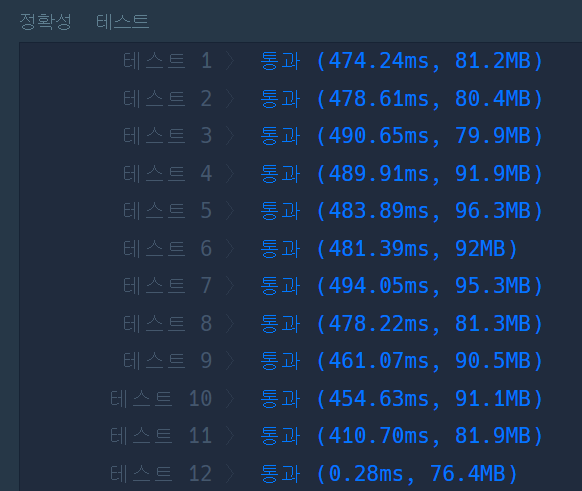
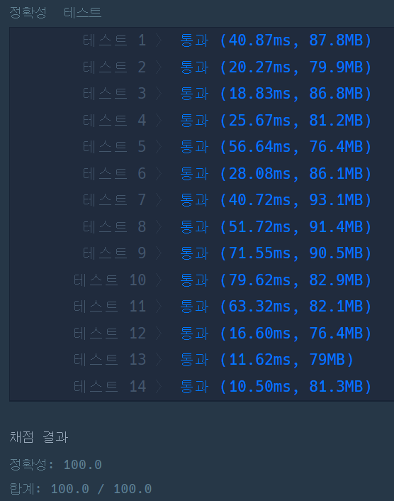

### **문제 : < 월간 코드 챌린지 시즌 2 > - 괄호 회전하기**

#### **문제 설명**

다음 규칙을 지키는 문자열을 올바른 괄호 문자열이라고 정의합니다.

* (), [], {} 는 모두 올바른 괄호 문자열입니다.
* 만약 A가 올바른 괄호 문자열이라면, (A), [A], {A} 도 올바른 괄호 문자열입니다. 예를 들어, [] 가 올바른 괄호 문자열이므로, ([]) 도 올바른 괄호 문자열입니다.
* 만약 A, B가 올바른 괄호 문자열이라면, AB 도 올바른 괄호 문자열입니다. 예를 들어, {} 와 ([]) 가 올바른 괄호 문자열이므로, {}([]) 도 올바른 괄호 문자열입니다.

대괄호, 중괄호, 그리고 소괄호로 이루어진 문자열 s가 매개변수로 주어집니다. 이 s를 왼쪽으로 x (0 ≤ x < (s의 길이)) 칸만큼 회전시켰을 때 s가 올바른 괄호 문자열이 되게 하는 x의 개수를 return 하도록 solution 함수를 완성해주세요.

#### **제한사항**

* s의 길이는 1 이상 1,000 이하입니다.

#### **문제 풀이**

괄호 문자열을 왼쪽으로 회전시키면서 올바른 괄호 문자열이 되는 문자열의 개수를 출력하는 문제이다.

**풀이 1**

* 열을 왼쪽으로 이동하여야 하므로 Queue 필요 > **LinkedList**
* 올바른 괄호 문자열을 판단 > **Stack**
* 괄호의 종류는 3가지 > **Switch**

```java
import java.util.*;

class Solution {
    public int solution(String s) {
        int answer = 0;
        int i = 0;

        LinkedList<Character> list = new LinkedList<>();
        Stack<Character> stack = new Stack<>();

        // 1. String to Character List
        for(i = 0; i<s.length(); i++)
            list.add(s.charAt(i));

        // 2. 문자열 길이만큼 반복
        for(i = 0; i < s.length(); i++){
            for(int j = 0; j < s.length(); j++){
                if(!stack.empty()){
                    switch (list.get(j)){
                        case ')':
                            if(stack.peek() == '(')
                                stack.pop();
                                break;
                        case ']':
                            if(stack.peek() == '[')
                                stack.pop();
                                break;
                        case '}':
                            if(stack.peek() == '{')
                                stack.pop();
                                break;
                        default:
                            stack.push(list.get(j));
                    }
                }else
                    stack.push(list.get(j));
            }

            if(stack.empty()) answer++;

            list.add(list.poll());
            stack.clear();
        }

        return answer;
    }
}
```

**풀이 2**

* 풀이 1에서 사용한 LinkedList을 대신하여 subString()메소드를 활용
* stack이 옮바르지 않을 경우, 다음 문자열 시작하도록 변경

```java
import java.util.Stack;

class Solution {
    public static int solution(String s) {
        int answer = 0;
        int length = s.length();

        String temp = s;            // 임시 복사

        // 2. 문자열 길이만큼 반복
        for(int i=0; i < s.length(); i++){
            if(checkString(temp)) answer++;

            temp = temp.substring(1, length) + temp.charAt(0);
        }

        return answer;
    }

    private static boolean checkString(String s) {
        Stack<Character> stack = new Stack<>();
        char ch;

        for(int i=0; i<s.length(); i++){
            ch = s.charAt(i);

            if(stack.empty()){
                stack.push(ch);
                continue;
            }

            switch (ch){
                case ')':
                    if(stack.peek() != '(') return false;
                    stack.pop(); break;
                case '}':
                    if (stack.peek() != '{') return false;
                    stack.pop(); break;
                case ']':
                    if(stack.peek() != '[') return false;
                    stack.pop(); break;
                default:
                    stack.push(ch);
            }
        }

        return stack.isEmpty();
    }
}
```

---

> 
> **Point : 6**  
> 이 문제를 풀면서 생각을 많이하게 되었다.  
> 가장 큰 것은 자료구조 선정 문제였다.  
>   
> 풀이 1는 성능이 좋지 못한 Trash 코드였다.  
> 풀이 2는 풀이 1을 리팩토링하여 성능을 향상 시킨 코드라 볼 수 있다.



풀이 1에 대한 성능 테스트



풀이 2에 대한 성능 테스트
