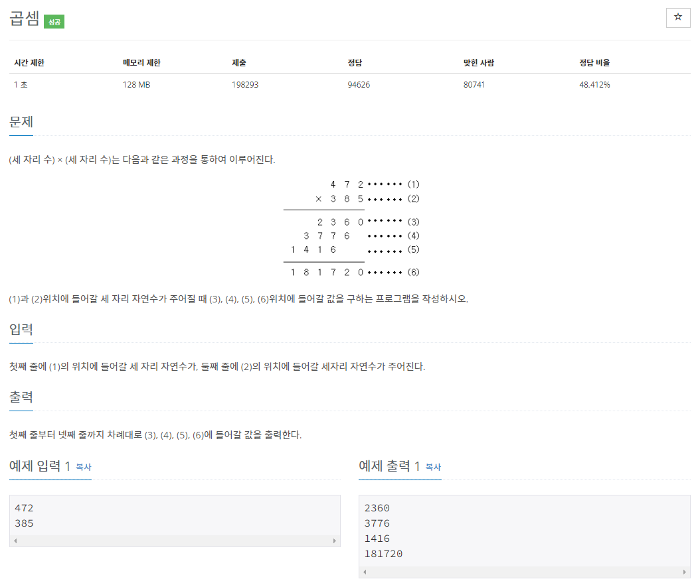
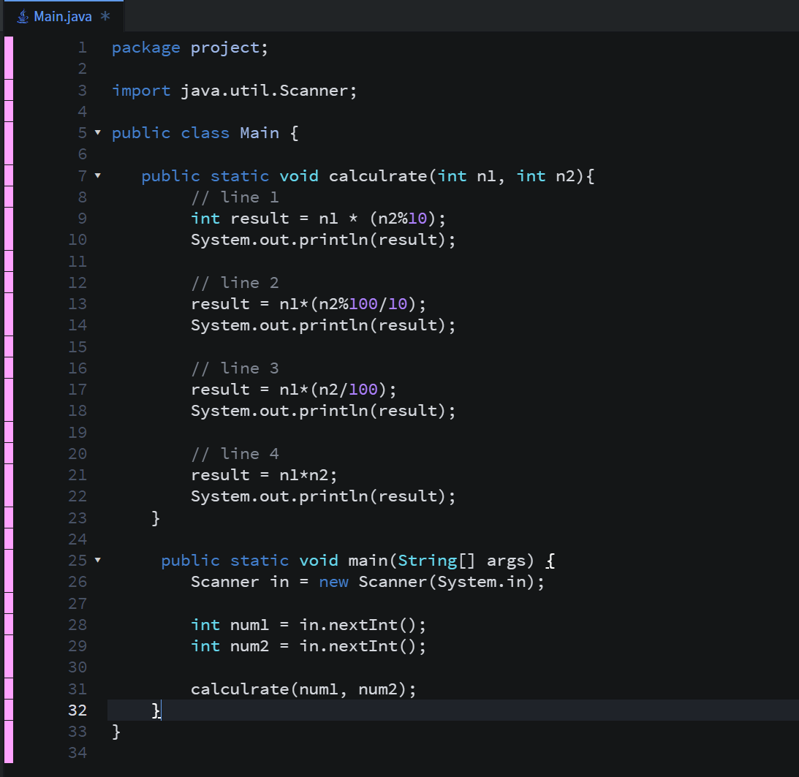
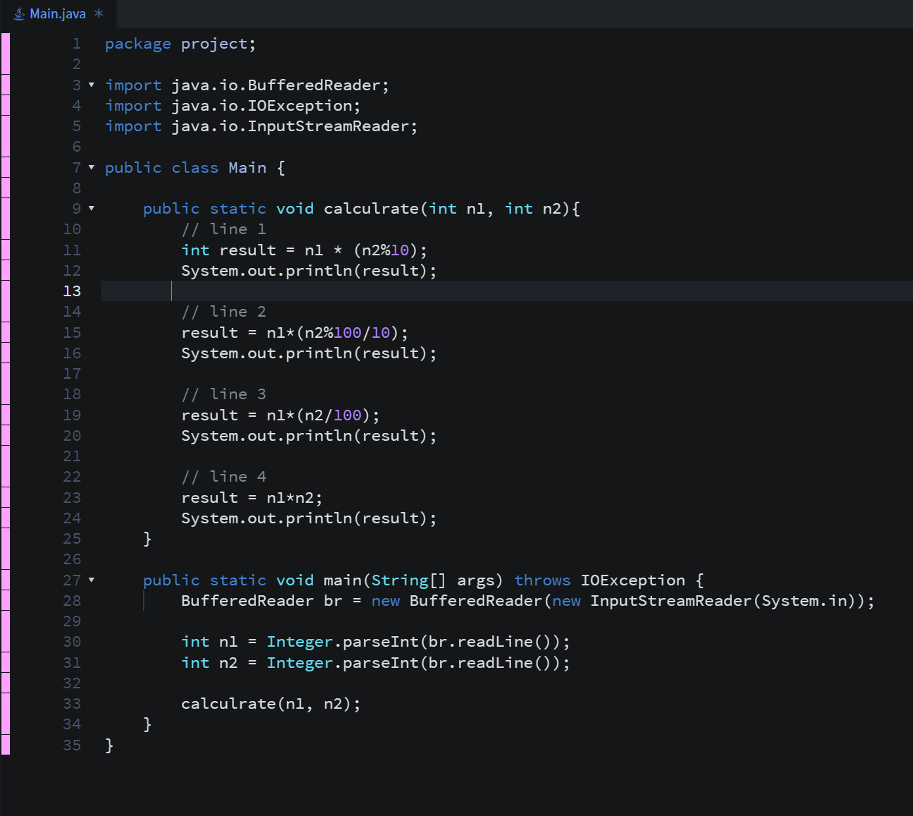
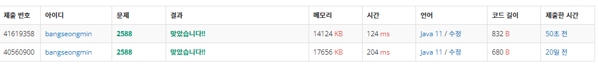

* **문제**

**- 문제가 다른 문제들에 비해서 길어보이시만.. 어려운 것 없습니다.**

* **간략 설명**

**- 두 수의 곱셈을 계산하는 문제입니다.**

* **풀이**

**- 방법 1(Scanner 클래스)**

**(1단계) Scanner 클래스를 이용하여 정수 값을 두번 입력 받는다.**

**(2단계) calculator 메소드로 두 정수 값을 전달한다**

**(3단계) 두 번째 매개변수와 곱셈을 할때 일의 자리, 십의 자리, 백의 자리를 분리하여 계산한 후,**

**마지막에 한번에 계산하여 출력한다.**

**- 방법 2(BufferedReader와 StringTokenizer)**

**값을 입력하는 부분만 변경되었으므로 설명 생략**

* **성능차이**

**보시는 것처럼 입력만 달라져도 성능이 이렇게나 차이납니다!! 대박~!!**

* **정리**

**- 오늘의 한마디 "작성한 코드도 다시보자!!"**
