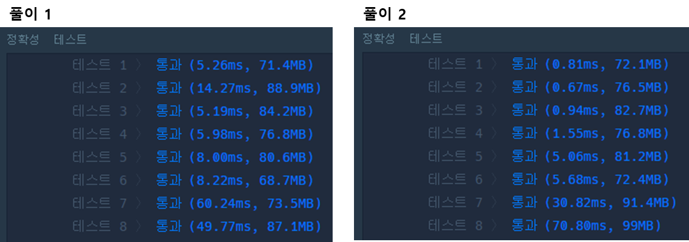

### **문제 : 2019 카카오 개발자 겨울 인턴십 > 튜플**

#### **문제 설명**

셀수있는 수량의 순서있는 열거 또는 어떤 순서를 따르는 요소들의 모음을 튜플(tuple)이라고 합니다. n개의 요소를 가진 튜플을 n-튜플(n-tuple)이라고 하며, 다음과 같이 표현할 수 있습니다.

* (a1, a2, a3, ..., an)

튜플은 다음과 같은 성질을 가지고 있습니다.

1. 중복된 원소가 있을 수 있습니다. ex : (2, 3, 1, 2)
2. 원소에 정해진 순서가 있으며, 원소의 순서가 다르면 서로 다른 튜플입니다. ex : (1, 2, 3) ≠ (1, 3, 2)
3. 튜플의 원소 개수는 유한합니다.

원소의 개수가 n개이고, **중복되는 원소가 없는** 튜플 (a1, a2, a3, ..., an)이 주어질 때(단, a1, a2, ..., an은 자연수), 이는 다음과 같이 집합 기호 '{', '}'를 이용해 표현할 수 있습니다.

* {{a1}, {a1, a2}, {a1, a2, a3}, {a1, a2, a3, a4}, ... {a1, a2, a3, a4, ..., an}}

예를 들어 튜플이 (2, 1, 3, 4)인 경우 이는

* {{2}, {2, 1}, {2, 1, 3}, {2, 1, 3, 4}}

와 같이 표현할 수 있습니다. 이때, 집합은 원소의 순서가 바뀌어도 상관없으므로

* {{2}, {2, 1}, {2, 1, 3}, {2, 1, 3, 4}}
* {{2, 1, 3, 4}, {2}, {2, 1, 3}, {2, 1}}
* {{1, 2, 3}, {2, 1}, {1, 2, 4, 3}, {2}}

는 모두 같은 튜플 (2, 1, 3, 4)를 나타냅니다.

특정 튜플을 표현하는 집합이 담긴 문자열 s가 매개변수로 주어질 때, s가 표현하는 튜플을 배열에 담아 return 하도록 solution 함수를 완성해주세요.````

#### **제한사항**

* s의 길이는 5 이상 1,000,000 이하입니다.
* s는 숫자와 '{', '}', ',' 로만 이루어져 있습니다.
* 숫자가 0으로 시작하는 경우는 없습니다.
* s는 항상 중복되는 원소가 없는 튜플을 올바르게 표현하고 있습니다.
* s가 표현하는 튜플의 원소는 1 이상 100,000 이하인 자연수입니다.
* return 하는 배열의 길이가 1 이상 500 이하인 경우만 입력으로 주어집니다.

#### **문제 풀이**

**풀이 1**

* 튜플의 집합에서 튜플 단위로 구분할 수 있게 변경( 1-2단계 )
* 문자열의 길이를 기준으로 정렬(3단계)
* 순차적으로 리스트에 삽입(4단계)

```java
import java.util.ArrayList;
import java.util.Arrays;
import java.util.Comparator;
import java.util.List;

class Solution {
    public static int[] solution(String s) {

        // 1. substring 을 통해 바깥 괄호를 삭제
        String temp = s.substring(1, s.length()-1);

        // 2. 튜플 사이를 구분하는 ','를 공백으로 변환(구분하기 위한 방법)하고 배열로 분리
        temp = temp.replaceAll("},", "} ");
        String[] tuples = temp.split(" ");


        // 3. 문자열의 길이를 기준으로 정렬
        Arrays.sort(tuples, Comparator.comparingInt(String::length));

        // 4. 앞에 숫자부터 순차적으로 리스트에 삽입
        List<Integer> answer = new ArrayList<>();

        for(String tuple : tuples){
            tuple = tuple.substring(1, tuple.length() - 1);     // 괄호 제거
            String[] nums = tuple.split(",");             // 숫자 분리

            for(String num : nums){
                int n = Integer.parseInt(num);
                if(!answer.contains(n))
                    answer.add(n);
            }
        }

        return answer.stream().mapToInt(Integer::intValue).toArray();
    }
}
```

**풀이 2**

```java
import java.util.*;

class Solution {
    public int[] solution(String s) {
        int[] answer = {};

        // 1. 정규식을 통해 괄호를 공백으로 변경
        s = s.replaceAll("[\\{,\\}]", " ");

        // 2. 문자열 나누기
        String[] tuples = s.split("[ ]+");
        Map<String, Integer> hashMap = new HashMap<>();

	// 3. 맵을 통해 문자열을 저장
        for(int j = 0; j < tuples.length; j++){
            if (!tuples[j].equals("")){
                if (hashMap.containsKey(tuples[j])){
                    hashMap.replace(tuples[j], hashMap.get(tuples[j]) + 1);
                }else{
                    hashMap.put(tuples[j], 1);
                }
            }
        }

	// 4. Map을 List로 전환
        List<Map.Entry<String, Integer>> list = new ArrayList<>(hashMap.entrySet());
        // 5. Value를 기준으로 정렬
        Collections.sort(list, (o1, o2) -> {return o2.getValue().compareTo(o1.getValue());});

        answer = new int[list.size()];

        for(int i = 0; i < answer.length; i++){
            answer[i] = Integer.parseInt(list.get(i).getKey());
        }


        return answer;
    }
}
```

---

> **Point : 2**풀이 1과 풀이 2를 비교했을 때  
> 비교적 풀이 2에 성능이 나은 것을 볼 수 있었다.  
>   
> 다른 분들의 코드를 보면서 느낀 것은 정규식 코드가 많다는 점이었다.  
> 정규식 사용에 부족함이 있기 때문에 이 점을 보완해야 할 것 같다.


