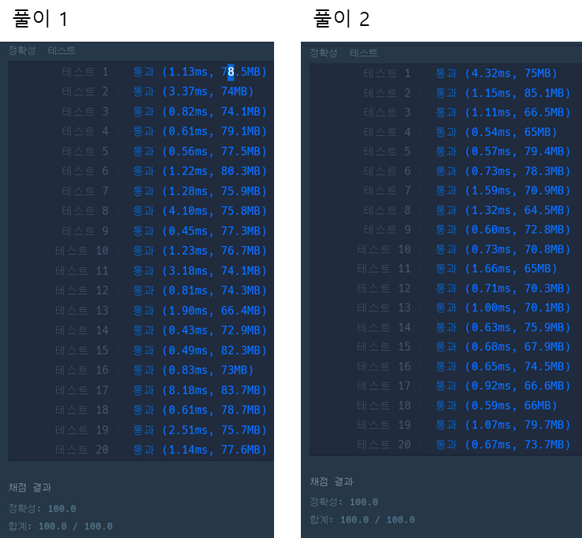

### **문제 : 스택/큐 > 프린터**

#### **문제 설명**

일반적인 프린터는 인쇄 요청이 들어온 순서대로 인쇄합니다. 그렇기 때문에 중요한 문서가 나중에 인쇄될 수 있습니다. 이런 문제를 보완하기 위해 중요도가 높은 문서를 먼저 인쇄하는 프린터를 개발했습니다. 이 새롭게 개발한 프린터는 아래와 같은 방식으로 인쇄 작업을 수행합니다.

> **1. 인쇄 대기목록의 가장 앞에 있는 문서(J)를 대기목록에서 꺼냅니다.**   
> **2. 나머지 인쇄 대기목록에서 J보다 중요도가 높은 문서가 한 개라도 존재하면 J를 대기목록의 가장 마지막에 넣습니다.**  
>  **3. 그렇지 않으면 J를 인쇄합니다.**

예를 들어, 4개의 문서(A, B, C, D)가 순서대로 인쇄 대기목록에 있고 중요도가 2 1 3 2 라면 C D A B 순으로 인쇄하게 됩니다. 내가 인쇄를 요청한 문서가 몇 번째로 인쇄되는지 알고 싶습니다. 위의 예에서 C는 1번째로, A는 3번째로 인쇄됩니다.   
현재 대기목록에 있는 문서의 중요도가 순서대로 담긴 배열 priorities와 내가 인쇄를 요청한 문서가 현재 대기목록의 어떤 위치에 있는지를 알려주는 location이 매개변수로 주어질 때, 내가 인쇄를 요청한 문서가 몇 번째로 인쇄되는지 return 하도록 solution 함수를 작성해주세요.

#### **제한 사항**

* 현재 대기목록에는 1개 이상 100개 이하의 문서가 있습니다.
* 인쇄 작업의 중요도는 1~9로 표현하며 숫자가 클수록 중요하다는 뜻입니다.
* location은 0 이상 (현재 대기목록에 있는 작업 수 - 1) 이하의 값을 가지며 대기목록의 가장 앞에 있으면 0, 두 번째에 있으면 1로 표현합니다.

#### **문제 풀이**

우선순위가 높은 순서대로 인쇄를 할때, 요청한 문서가 몇 번째로 인쇄되는지 반환하는 문제이다.

> **[규칙]**  
> 1. 인쇄 대기목록의 가장 앞에 있는 문서(J)를 대기목록에서 꺼냅니다.  
> 2. 나머지 인쇄 대기목록에서 J보다 중요도가 높은 문서가 한 개라도 존재하면 J를 대기목록의 가장 마지막에 넣습니다.  
> 3. 그렇지 않으면 J를 인쇄합니다.

#### 

#### **풀이 1**

* priorities와 index를 묶어 클래스로 정의
* Queue에서 가장 앞에 위치한 값을 뽑아낸 뒤, 큐에 남아 있는 값들과 비교하여**더 높은 우선순위를 가진 작업**이 존재하는지 확인하다.
  + 더 높은 우선순위의 작업이 존재하면 다시 큐에 넣는다.
  + 선택한 작업이 가장 높은 우선순위라면 다시 큐에 넣지 않고 인쇄요청한다

```java
import java.util.*;

class Solution {
    public int solution(int[] priorities, int location) {
        int answer = 0;
        int idx = 0;            // 우선순위
        boolean flag = false;

        LinkedList<Task> list = new LinkedList<>();

        // <위치, 우선순위>를 조합으로 삽입
        for(int i=0; i<priorities.length; i++)
            list.add(new Task(i, priorities[i]));


        while(!list.isEmpty()){
            Task curTask = list.poll();
            flag = false; 

            // 우선순위가 높은 작업 찾기
            for(Task t : list){
                if(t.priority > curTask.priority)
                    flag = true;
            }

            // 높은 작업 발견 시, 현재 작업 맨뒤로
            if(flag){
                list.add(curTask);
            }else{
            // 현재 작업이 제일 높을 경우, 요청한 자료의 위치와 동일한지 확인
                idx++;
                if(curTask.location == location){
                    answer = idx;
                    break;
                }
            }
        }

        return answer;
    }

    public class Task{
        int location;
        int priority;

        public Task(int location, int priority){
            this.location = location;
            this.priority = priority;
        }
    }
}
```

#### **풀이 2**

* 우선순위 큐를 내림차순으로 꺼낼 수 있도록 설정
* 큐의 요소와 배열의 요소를 비교하여 위치가 동일할 경우, 반환한다.

```java
import java.util.*;

class Solution {
    public int solution(int[] priorities, int location) {
        int answer = 1;         // 출력 순서

        // 우선순위는 내림차순으로 꺼낼 수 있다.
        PriorityQueue<Integer> queue = new PriorityQueue<>(Collections.reverseOrder());

        for(int p : priorities){
            queue.offer(p);
        }

        // 우선순위 높은 순으로 기존 배열에서 일치하는 것 찾기
        while (!queue.isEmpty()){
            for(int i=0; i<priorities.length; i++){
                // Queue에서 읽은 요소와 Location에 위치한 요소일 경우 출력순서 반환
                if(queue.peek() == priorities[i]) {
                    if (i == location)
                        return answer;

                    answer++;
                    queue.poll();
                }
            }
        }

        return answer;
    }

}
```

---

> Point : 3  
>   
> 문제의 난이도는 높지 않았다.   
> 풀이 1과 같이 클래스를 통해 접근하면 쉽게 풀이 할 수 있다.  
> 풀이 2번과 같이 우선순위큐를 통해 풀이할 경우, 간단하지만 떠오르기는 쉽지 않을 수 있다.  
> 풀이 1과 풀이 2를 비교했을 때 성능 차이는 크지 않을 것을 볼 수 있다.  
> 풀이 1이 성능이 빠른 경우도 있고, 풀이 2가 비교적 빠른 경우도 있다.


