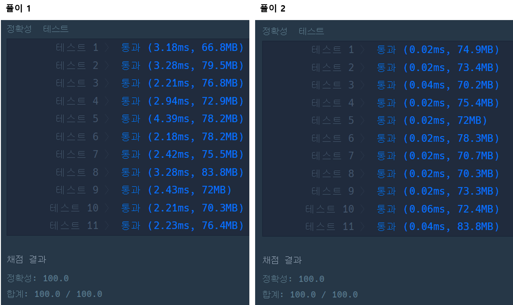

## **문제 : 스택/큐 > 기능개발**

### **문제 설명**

프로그래머스 팀에서는 기능 개선 작업을 수행 중입니다. 각 기능은 진도가 100%일 때 서비스에 반영할 수 있습니다.   

또, 각 기능의 개발속도는 모두 다르기 때문에 뒤에 있는 기능이 앞에 있는 기능보다 먼저 개발될 수 있고, 이때 뒤에 있는 기능은 앞에 있는 기능이 배포될 때 함께 배포됩니다.   

먼저 배포되어야 하는 순서대로 작업의 진도가 적힌 정수 배열 progresses와 각 작업의 개발 속도가 적힌 정수 배열 speeds가 주어질 때 각 배포마다 몇 개의 기능이 배포되는지를 return 하도록 solution 함수를 완성하세요.

### **제한 사항**

* 작업의 개수(progresses, speeds배열의 길이)는 100개 이하입니다.
* 작업 진도는 100 미만의 자연수입니다.
* 작업 속도는 100 이하의 자연수입니다.
* 배포는 하루에 한 번만 할 수 있으며, 하루의 끝에 이루어진다고 가정합니다. 예를 들어 진도율이 95%인 작업의 개발 속도가 하루에 4%라면 배포는 2일 뒤에 이루어집니다.

### **문제 풀이**

#### **풀이 1**

* 해당 기간에 할 수 있는 업무 횟수를 클래스로 만들어 풀이(Task)
* 이전 기간을 변수에 저장하여 현재 계산된 기간보다 짧을 경우 이전 기간에 횟수를 증가시킨다.
* 이전 기간보다 현재 계산된 기간이 많다면 해당 기간에 횟수를 1로 설정하여 리스트에 저장한다.
* 마지막 인덱스에 값에 쉽게 접근하기 위해 LinkedList를 사용하였다.

```java
import java.util.LinkedList;

class Solution {
    public int[] solution(int[] progresses, int[] speeds) {
        int[] answer = {};
        int leftPercent = 0;             // 잔여율
        int leftPeriod = 0;              // 남은 기간
        int tempPeriod = 0;              // 임시 기간

        LinkedList<Task> list = new LinkedList<>();

        for(int i=0; i < progresses.length; i++){
            leftPercent = 100 - progresses[i];          // 100% 에서 남은 잔여율
            leftPeriod = leftPercent / speeds[i];       // 남은 잔여율을 속도로 나눠 걸리는 시간

            if(tempPeriod < leftPeriod){
                tempPeriod = leftPeriod;
                list.add(new Task(tempPeriod, 1));
            }else{
                Task task = list.pollLast();
                task.count++;
                list.addLast(task);
            }
        }

        return list.stream().mapToInt(i->i.count).toArray();
    }

    public class Task{
        int period;
        int count;

        public Task(int period, int count){
            this.period = period;
            this.count = count;
        }
    }

}
```

풀이 2

* LinkedList 대신 배열로 전환(작업의 개수가 100개 이하라는 점을 이용)

```java
class Solution {

     public int[] solution(int[] progresses, int[] speeds) {
        int[] temp = new int[100];  // 작업의 개수는 100개 이하
        int day = 0;                // 배포일 수

         // 100% 에서 각 진행율을 제외한 후 걸리는 시간
        for(int i=0; i<progresses.length; i++){
            while(progresses[i] + (speeds[i] * day) < 100){
                day++;
            }
            temp[day]++;
        }

        int count = 0;

        // 날짜에 값을 더하기
        for(int n : temp){//temp배열 값을 하나식 n에 적용
            // 날짜 값이 0이 아닌 경우
            if(n != 0)
                count ++; //count 증가
        }

        int[] answer = new int[count]; 

        count = 0; //count 0 초기화
        for(int n : temp){
            if(n != 0){
                answer[count++] = n; //answer 배열에 temp 값 넣기
            }
        }

        return answer;
    }
}
```

---

> Point : 3  
>   
> 후기  
> 문제 자체는 어렵지 않았고,   
> 테스트 케이스 11번에서 해결되지 않아 시간이 조금 걸렸었다.  
>   
>   
> 성능  
> 풀이 1보다 풀이 2가 성능적으로 많은 차이를 보였다.  
> 배열과 반복문을 사용하는 것이  
> 자료구조와 stream을 사용하는 것보다 빠르기 때문이다.  
>   
> 
