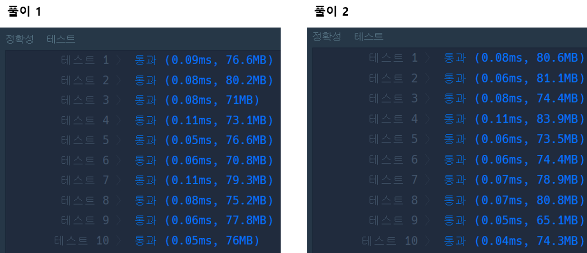

## **문제 : 해시 > 위장**

### **문제 설명**

스파이들은 매일 다른 옷을 조합하여 입어 자신을 위장합니다.  
예를 들어 스파이가 가진 옷이 아래와 같고 오늘 스파이가 동그란 안경, 긴 코트, 파란색 티셔츠를 입었다면 다음날은 청바지를 추가로 입거나 동그란 안경 대신 검정 선글라스를 착용하거나 해야 합니다.

스파이가 가진 의상들이 담긴 2차원 배열 clothes가 주어질 때 서로 다른 옷의 조합의 수를 return 하도록 solution 함수를 작성해주세요.

### **제한 사항**

* clothes의 각 행은 [의상의 이름, 의상의 종류]로 이루어져 있습니다.
* 스파이가 가진 의상의 수는 1개 이상 30개 이하입니다.
* 같은 이름을 가진 의상은 존재하지 않습니다.
* clothes의 모든 원소는 문자열로 이루어져 있습니다.
* 모든 문자열의 길이는 1 이상 20 이하인 자연수이고 알파벳 소문자 또는 '\_' 로만 이루어져 있습니다.
* 스파이는 하루에 최소 한 개의 의상은 입습니다.

### **문제 풀이**

**풀이 1**

* "같은 이름을 가진 의상은 존재하지 않습니다." → 중복을 허용하지 않으므로 Hash의 Value를 Integer 타입으로 선정
* 옷의 종류별로 입지 않은 경우를 고려해야 한다. → 계산 시 종류의 개수에 +1을 통해 입지 않은 경우를 적용

```java
import java.util.HashMap;
import java.util.Iterator;

class Solution {
    public int solution(String[][] clothes) {
        int answer = 1;
        HashMap<String, Integer> map = new HashMap<>();	// 옷의 종류와 개수

	// 1. 종류별로 옷을 구분
        for(String[] clothe : clothes){

            String type = clothe[1];    // 의상의 종류
            // 2. 기존에 해당 타입에 종류가 있으면 기존 값에 +1 없다면 0+1
            map.put(type, map.getOrDefault(type, 0) + 1);
        }

        // 3. 입지 않는 경우를 추가해서 모든 조합을 계산
        Iterator<Integer> it = map.values().iterator();

        while(it.hasNext()){
            answer *= it.next().intValue() + 1;
        }

        // 아무종류의 옷도 입지 않은 경우를 제외
        return answer-1;
    }
}
```

**풀이 2**

* Null일 경우를 계산하기 위해서 0에서 +1 을 하지 않고, 시작을 1로 설정
* Iterator를 대신 반복문을 이용하는 경우

```java
import java.util.HashMap;
import java.util.Iterator;

class Solution {
    public int solution(String[][] clothes) {
        int answer = 1;
        HashMap<String, Integer> map = new HashMap<>();

         // 1. 종류별로 옷을 구분
        for(String[] clothe : clothes){
            String type = clothe[1];    // 의상의 종류

            // 2. 기존에 해당 타입에 종류가 없으면 1, 있으면 +1
            map.put(type, map.getOrDefault(type, 1) + 1);
        }

        // 3. 종류별 조합
        for(String key : map.keySet()){
            answer *= map.get(key);
        }

        // 아무종류의 옷도 입지 않은 경우를 제외
        return answer-1;
    }
}
```

---


