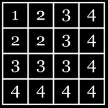
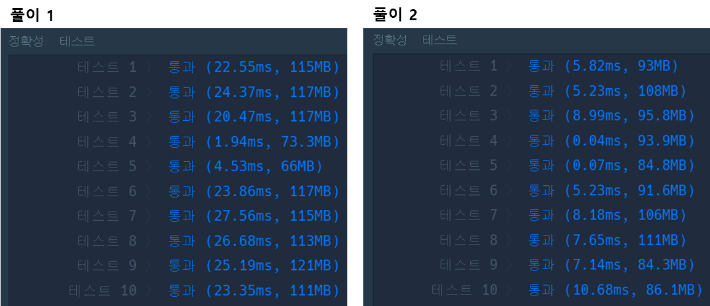

## 문제 :

### **문제 설명**

정수 n, left, right가 주어집니다. 다음 과정을 거쳐서 1차원 배열을 만들고자 합니다.

1. n행 n열 크기의 비어있는 2차원 배열을 만듭니다.
2. i = 1, 2, 3, ..., n에 대해서, 다음 과정을 반복합니다.
   * 1행 1열부터 i행 i열까지의 영역 내의 모든 빈 칸을 숫자 i로 채웁니다.
3. 1행, 2행, ..., n행을 잘라내어 모두 이어붙인 새로운 1차원 배열을 만듭니다.
4. 새로운 1차원 배열을 arr이라 할 때, arr[left], arr[left+1], ..., arr[right]만 남기고 나머지는 지웁니다.

정수 n, left, right가 매개변수로 주어집니다. 주어진 과정대로 만들어진 1차원 배열을 return 하도록 solution 함수를 완성해주세요.

### **제한사항**

* 1 ≤ n ≤ 107
* 0 ≤ left ≤ right < n2
* right - left < 105

### **문제 풀이**



**풀이 1**

* 행과 열의 규칙을 파악(Max(행, 열)의 값)
* 배열을 사용할 경우, "error: incompatible types: possible lossy conversion from long to int" 에러 발생하므로 List 사용

```java
import java.util.ArrayList;

class Solution {
    public static int[] solution(int n, long left, long right) {

        ArrayList<Long> list = new ArrayList<>();

        for(Long i=left; i <= right; i++){
            list.add(Math.max(i/n,i%n) + 1);
        }

        return list.stream().mapToInt(Long::intValue).toArray();
    }
}
```

**풀이 2**

* 배열을 사용하기 위해 Long to int 형 변환

```java
class Solution {
    public static int[] solution(int n, long left, long right) {

        int len = (int)right - (int)left;
        int[] answer = new int[len + 1];

        int idx = 0;
        for(long i = left; i<= right; i++){
            long row = i / n;
            long col = i % n;
            answer[idx++] = Math.max((int)row, (int)col) + 1;
        }

        return answer;
    }
}
```

---

> **Point : 8**  
>   
> 규칙을 찾지 않고 풀이한다면  
> 메모리 초과, 시간 초과를 겪을 가능성이 높다.  
>   
> 그림을 통해 쉽게 파악할 수 있어 다행인 문제였다.  
>   
> 
