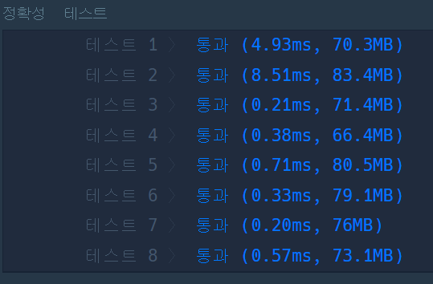

## **문제 : 깊이/너비 우선 탐색(DFS/BFS)  > 타겟 넘버**

### **문제 설명**

n개의 음이 아닌 정수들이 있습니다. 이 정수들을 순서를 바꾸지 않고 적절히 더하거나 빼서 타겟 넘버를 만들려고 합니다. 예를 들어 [1, 1, 1, 1, 1]로 숫자 3을 만들려면 다음 다섯 방법을 쓸 수 있습니다.

사용할 수 있는 숫자가 담긴 배열 numbers, 타겟 넘버 target이 매개변수로 주어질 때 숫자를 적절히 더하고 빼서 타겟 넘버를 만드는 방법의 수를 return 하도록 solution 함수를 작성해주세요.

### **제한사항**

* 주어지는 숫자의 개수는 2개 이상 20개 이하입니다.
* 각 숫자는 1 이상 50 이하인 자연수입니다.
* 타겟 넘버는 1 이상 1000 이하인 자연수입니다.

### **문제 풀이**

* 숫자의 개수는 2개 이상 20개 이하이므로 최악의 경우 2 \* 20 개, 즉 2 ^ 20 약 100만번 정도 탐색하므로 완전탐색 O

```java
class Solution {
    static int answer;

    public void dfs(int[] numbers,int target,int idx,int sum){
        // 1. 탈출 조건
        if(idx == numbers.length)
        {
            // 타겟과 합이 같은 경우
            if(sum == target) answer++;
            return;
        }
        // 2. 더하는 경우
        dfs(numbers, target, idx+1, sum + numbers[idx]);
        // 3. 빼는 경우
        dfs(numbers, target, idx+1, sum - numbers[idx]);
    }

    public int solution(int[] numbers, int target) {
        answer = 0;

        dfs(numbers, target, 0,0);

        return answer;
    }
}
```

---


