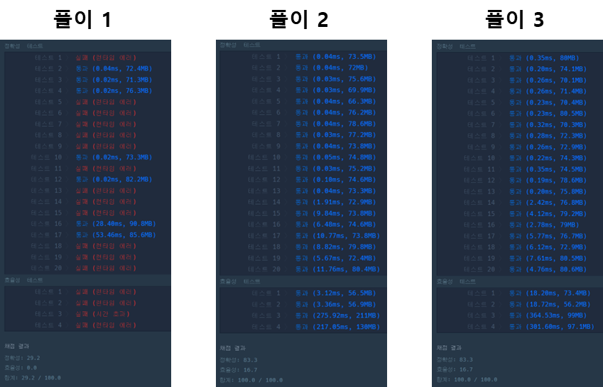

## **문제 : 해시 > 전화번호 목록**

### **문제 설명**

전화번호부에 적힌 전화번호 중, 한 번호가 다른 번호의 접두어인 경우가 있는지 확인하려 합니다.  
전화번호가 다음과 같을 경우, 구조대 전화번호는 영석이의 전화번호의 접두사입니다.

* 구조대 : 119
* 박준영 : 97 674 223
* 지영석 : 11 9552 4421

전화번호부에 적힌 전화번호를 담은 배열 phone\_book 이 solution 함수의 매개변수로 주어질 때, 어떤 번호가 다른 번호의 접두어인 경우가 있으면 false를 그렇지 않으면 true를 return 하도록 solution 함수를 작성해주세요.

### **제한 사항**

* phone\_book의 길이는 1 이상 1,000,000 이하입니다.
  + 각 전화번호의 길이는 1 이상 20 이하입니다.
  + 같은 전화번호가 중복해서 들어있지 않습니다.

### **문제 풀이**

**풀이 1**

* 이중 반복문을 통해 외부 반복문의 문자열에 길이만큼 내부 반복문 문자열을 잘라서 점검하는 방법
* 이중 반복문을 통한 문제 해결방법은 **런타임 에러로 실패**> 정렬을 시도하여 재 풀이하였지만, 시간만 더 늘어나게 된다.

```java
class Solution {
    public boolean solution(String[] phone_book) {

        for(int i=0; i< phone_book.length; i++){
            for(int j=0; j< phone_book.length; j++){
                // 동일 문자 제외
                if(i==j) continue;
                // 타겟 문자열을 자르기를 통해 접두어 크기만큼 비교
                String temp = phone_book[j].substring(0, phone_book[i].length());
                if(phone_book[i].equals(temp))
                    return false;
            }

        }

        return true;
    }
}
```

**풀이 2**

* HashMap을 통해 동일한 알고리즘

```java
import java.util.HashMap;

class Solution {
    public boolean solution(String[] phone_book) {
        // 1. HashMap 선언
        HashMap<String, Integer> map = new HashMap<>();

        // 2. 데이터 삽입
        for(String phone : phone_book)
            map.put(phone, 1);

        // 3. 전화번호의 substring이 HashMap에 존재하는지 확인
       for(String phone : phone_book){
           for(int i=1; i<phone.length(); i++){
               String temp = phone.substring(0, i);
               if(map.containsKey(temp))
                   return false;
           }
       }

        return true;
    }
}
```

**풀이 3**

* 이중반복문 -> 반복문 1개로 처리

```java
import java.util.Arrays;

class Solution {
    public boolean solution(String[] phone_book) {

         // 정렬
        Arrays.sort(phone_book);

        // 앞 번호가 뒷 번호의 접두어인지 확인
        for (int i = 0; i < phone_book.length - 1; i++)
            if (phone_book[i + 1].startsWith(phone_book[i]))
                return false;

        return true;
    }
}
```

---

> **Point : 4**다양한 방식으로 접근해볼수 있던 문제였다.  
> 풀이 1, 2, 3을 비교했을 때   
> HashMap을 사용한 풀이 2가 성능적으로 가장 우수하였다.


