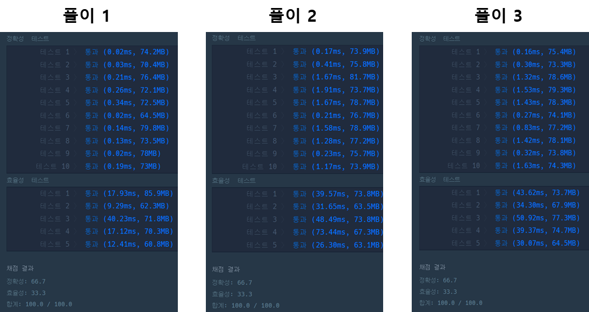

## **문제 : 스택/큐 > 주식가격**

### **문제 설명**

초 단위로 기록된 주식가격이 담긴 배열 prices가 매개변수로 주어질 때, 가격이 떨어지지 않은 기간은 몇 초인지를 return 하도록 solution 함수를 완성하세요.

### **제한 사항**

* prices의 각 가격은 1 이상 10,000 이하인 자연수입니다.
* prices의 길이는 2 이상 100,000 이하입니다.

### **문제 풀이**

> 입력문 [1,2,3,2,3] 일때  
> 1 : 2, 3, 2, 3 → 가격 하락 X → 총 4초동안 가격 하락X   
> 2 : 3, 2, 3 → 가격 하락 X → 총 3초동안 가격 하락X   
> 3 : 2, 3 → 1초 후 가격 하락 → 총 1초동안 가격 하락X   
> 2 : 3  → 가격 하락 X → 총 1초동안 가격 하락X   
> 3 : → 마지막 값은 측정X → 0초동안 가격 하락X  
> return 값은 [4,3,1,1,0]이 된다.

**풀이 1**

* 이중 반복문을 통해 순차탐색하여 현재 인덱스보다 작은 값이 있을 때까지 반복한다.

```java
class Solution {
    public int[] solution(int[] prices) {
        int[] answer = new int[prices.length];

        for(int i=0; i< prices.length; i++){
            // 현재 인덱스에 다음 인덱스 참조
            for(int j=i+1; j< prices.length; j++){
                // 1초 증가
                answer[i]++;
                // 가격하락 측정
                if(prices[i] > prices[i+1]) break;
            }
        }

        return answer;
    }
}
```

**풀이 2**

* 자료구조 스택을 이용하여 문제 풀이

```java
import java.util.Stack;

class Solution {
    public int[] solution(int[] prices) {
        int[] answer = new int[prices.length];

        Stack<Integer> stack = new Stack<>();

        for(int i=0; i< prices.length; i++){
            // stack 인덱스의 price값이 현재 인덱스의 price값보다 작다면
            while (!stack.isEmpty() && prices[i] < prices[stack.peek()]){
                // 얼마만에 찾았는지 넣어준다. 
                answer[stack.peek()] = i - stack.peek();
                // stack에서 해당값은 빼주고
                stack.pop();
            }
            stack.push(i);
        }

        // 값을 구하지 못한 index == 끝까지 가격이 떨어지지 않은 주식
        while (!stack.isEmpty()) { 
            answer[stack.peek()] = prices.length - stack.peek() - 1;
            stack.pop();
        }

        return answer;
    }
}
```

**풀이 3**

* 풀이 2에서 반복문이 3번 사용되어 2번으로 줄이는 과정

```java
import java.util.*;

class Solution {
    public int[] solution(int[] prices) {
        int[] answer = new int[prices.length];
		Stack<Integer[]> stack = new Stack<>();

        for(int i = 0; i < prices.length; i++){
            answer[i] = answer.length - 1 - i; // 최대기간으로 세팅
            Integer[] arr = {i, prices[i]}; // 인덱스, 가격

            while(!stack.empty() && stack.peek()[1] > prices[i]){ // 가격이 떨어진 경우
                Integer[] price = stack.pop();
                answer[price[0]] = i - price[0];
            }

            stack.push(arr);
        }

        return answer;
    }
}
```

---

> **Point : 3  
>   
> 구현은 오래 걸리지 않았지만...  
> 문제를 이해하는데 걸리는 시간이 오래걸렸다.  
>   
> 성능상으로는 풀이 1과 같이  
> 반복문을 이용한 풀이가 가장 성능이 최적화되어 있다.**
