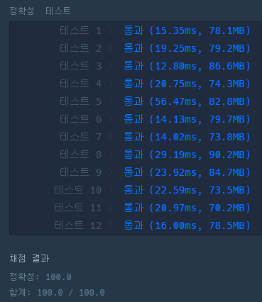

## **문제 : 완전 탐색 > 소수 찾기**

### **문제 설명**

한자리 숫자가 적힌 종이 조각이 흩어져있습니다. 흩어진 종이 조각을 붙여 소수를 몇 개 만들 수 있는지 알아내려 합니다.  
각 종이 조각에 적힌 숫자가 적힌 문자열 numbers가 주어졌을 때, 종이 조각으로 만들 수 있는 소수가 몇 개인지 return 하도록 solution 함수를 완성해주세요.

### **제한사항**

* numbers는 길이 1 이상 7 이하인 문자열입니다.
* numbers는 0~9까지 숫자만으로 이루어져 있습니다.
* "013"은 0, 1, 3 숫자가 적힌 종이 조각이 흩어져있다는 의미입니다.

### **문제 풀이**

**풀이 1**

* numbers를 분리하여 조합하고 조합한 숫자가 소수인지 판별하여 개수를 구한다.

```java
import java.util.HashSet;
import java.util.Iterator;

class Solution {
    HashSet<Integer> numbersSet = new HashSet<>();

    public boolean isPrime(int num) {
        // 1. 0과 1은 소수가 아니다
        if (num == 0 || num == 1)
            return false;

        // 2. 에라토스테네스의 체의 limit 숫자를 계산한다.
        int lim = (int)Math.sqrt(num);

        // 3. 에라토스테네스의 체에 따라 lim까지 배수 여부를 확인한다.
        for (int i = 2; i <= lim; i++)
            if (num % i == 0)
                return false;

        return true;
    }

    public void combination(String comb, String others) {
        // 1. 현재 조합을 set에 추가한다.
        if (!comb.equals(""))
            numbersSet.add(Integer.valueOf(comb));

        // 2. 남은 숫자 중 한 개를 더해 새로운 조합을 만든다.
        for (int i = 0; i < others.length(); i++)
            combination(comb + others.charAt(i), others.substring(0, i) + others.substring(i + 1));
    }

    public int solution(String numbers) {
        // 1. 모든 조합의 숫자를 만든다.
        combination("", numbers);

        // 2. 소수의 개수만 센다.
        int count = 0;
        Iterator<Integer> it = numbersSet.iterator();
        while (it.hasNext()) {
            int number = it.next();
            if (isPrime(number))
                count++;
        }

        // 3. 소수의 개수를 반환한다.
        return count;
    }
}
```

---

> Point : 2  
>   
> 문제 풀이의 핵심은   
> 소수 - 에라토스테네스의 체를 생각하고 구현하는 것이다.  
> 조합을 어떻게 구현할지도 관건이였다.  
> 조합을 머릿속으로는 쉽지만, 코드로 구현하는데 많은 시간이 걸렸다..


