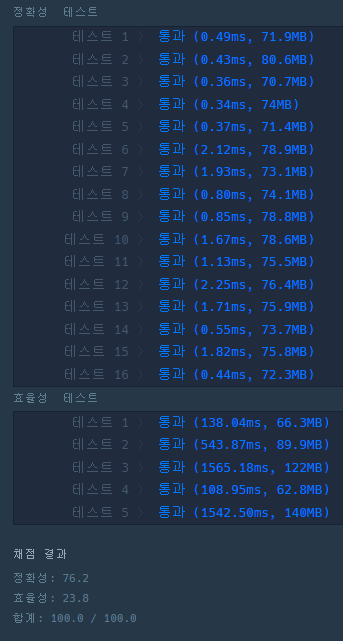

## **문제 : 힙(Heap) > 더 맵게**

### **문제 설명**

매운 것을 좋아하는 Leo는 모든 음식의 스코빌 지수를 K 이상으로 만들고 싶습니다. 모든 음식의 스코빌 지수를 K 이상으로 만들기 위해 Leo는 스코빌 지수가 가장 낮은 두 개의 음식을 아래와 같이 특별한 방법으로 섞어 새로운 음식을 만듭니다.

> **섞은 음식의 스코빌 지수 = 가장 맵지 않은 음식의 스코빌 지수 + (두 번째로 맵지 않은 음식의 스코빌 지수 \* 2)**

Leo는 모든 음식의 스코빌 지수가 K 이상이 될 때까지 반복하여 섞습니다.   
Leo가 가진 음식의 스코빌 지수를 담은 배열 scoville과 원하는 스코빌 지수 K가 주어질 때, 모든 음식의 스코빌 지수를 K 이상으로 만들기 위해 섞어야 하는 최소 횟수를 return 하도록 solution 함수를 작성해주세요.

### **제한 사항**

* scoville의 길이는 2 이상 1,000,000 이하입니다.
* K는 0 이상 1,000,000,000 이하입니다.
* scoville의 원소는 각각 0 이상 1,000,000 이하입니다.
* 모든 음식의 스코빌 지수를 K 이상으로 만들 수 없는 경우에는 -1을 return 합니다.

### **문제 풀이**

**풀이 1**

* 우선순위 큐를 통해 값을 순차적으로 접근

```java
import java.util.PriorityQueue;

class Solution {
    public int solution(int[] scoville, int K) {
        int answer = 0;

        PriorityQueue<Integer> q = new PriorityQueue<>();

        for(int s : scoville)
            q.add(s);

        while (q.peek() < K){
            if(q.size() == 1)
                return -1;
            q.add(q.poll() + q.poll() * 2);
            answer++;
        }

        return answer;
    }
}
```

### **추가 설명**

#### **우선순위 큐(Priority Queue)**

**Priority Queue**는 우선순위 큐로 **일반적인 큐**의 구조 **FIFO(First In First Out)**를 가지면서, 데이터가 들어온 순서대로 데이터가 나가는 것이 아닌 **우선순위를 먼저 결정하고 그 우선순위가 높은 데이터가 먼저 나가는 자료구조**이다.

**Priority Queue**를 사용하기 위해서 우선순위 큐에 저장할 객체는 필수적으로 **Comparable Interface**를 구현해야한다. Comparable Interface를 구현하면 compareTo 메서드를 override 하여 해당 객체에서 처리할 우선순위 조건을 리턴해주면 **Priority Queue**가 우선순위가 높은 객체를 먼저 추출한다.

**Priority Queue**는 **Heap**을 이용하여 구현하는 것이 일반적이다.

**데이터를 삽입할 때 우선순위를 기준으로 최대 힙 혹은 최소 힙**을 구성하고 데이터를 꺼낼 때 루트 노드를 얻어낸 뒤 루트 노드를 삭제할 때는 빈 루트 노드 위치에 맨 마지막 노드를 삽입한 후 아래로 내려가면서 적절한 자리를 찾아 옮기는 방식으로 진행된다.

> 즉, 최대 값이 우선순위인 큐 = 최대 힙, 최소 값이 우선순위인 큐 = 최소 힙

#### 

#### **우선순위 큐(Priority Queue)  특징**

1. 높은 우선순위의 요소를 먼저 처리하는 구조
2. 내부 요소는 힙으로 구성된 이진트리 구조
3. 힙으로 구성되어 있기 때문에 시간 복잡도는 O(NlogN)
4. 우선순위를 중요시해야 하는 상황에서 사용

#### **우선순위 큐(Priority Queue)  예시**

```java
import java.util.PriorityQueue;
import java.util.Collections;

public class Main{
	public void main(String[] args){
    	// 낮은 숫자가 우선 순위인 int 형 우선순위 큐 선언
        PriorityQueue<Integer> priorityQueueLowest = new PriorityQueue<>();

        // 높은 숫자가 우선 순위인 int 형 우선순위 큐 선언
        PriorityQueue<Integer> priorityQueueHighest = new PriorityQueue<>(Collections.reverseOrder());

        // add(value) 메서드의 경우 만약 삽입에 성공하면 true를 반환, 
        // 큐에 여유 공간이 없어 삽입에 실패하면 IllegalStateException을 발생
        priorityQueueLowest.add(1);
        priorityQueueLowest.add(10);
        priorityQueueLowest.offer(100);

        priorityQueueHighest.add(1);
        priorityQueueHighest.add(10);
        priorityQueueHighest.offer(100);
    }
}
```

---

> Point : 4  
>   
> 우선순위 큐를 사용하지 않고, 큐를 사용하다가  
> 우선순위 큐로 변경하여 쉽게 풀이할 수 있었다.


