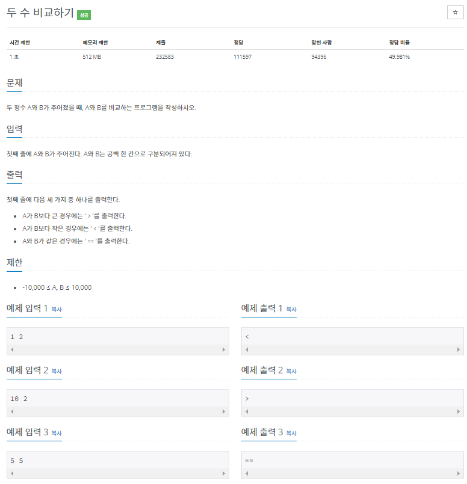
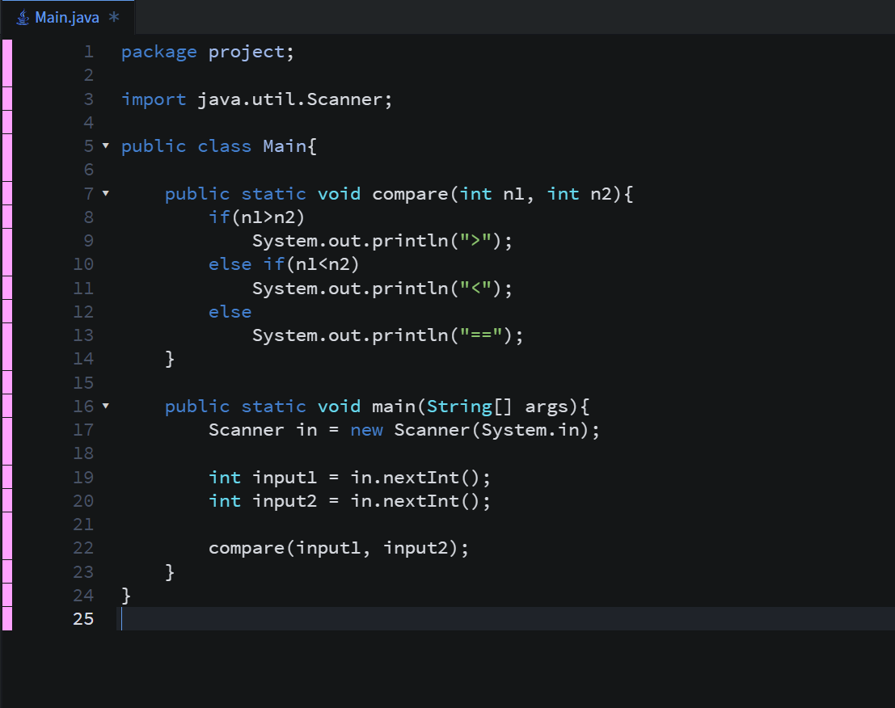
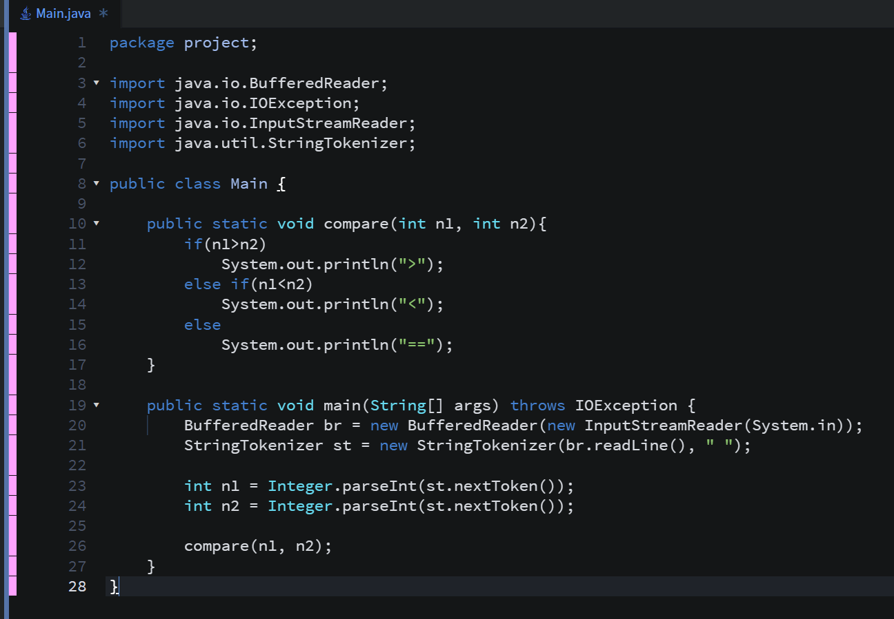
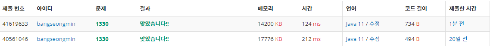

* **문제**

* **간략설명**

**- 두 수를 한줄로 입력받아 비교하여 부등호로 결과를 출력하는 문제입니다.**

**- 정답률은 생각보다 낮습니다!!! 맞으면 50%안에 드시는 것!!**

* **풀이**

**- 방법 1(Scanner)**

**(1 단계) Scanner클래스를 이용하여 값을 입력받는다.**

**(2 단계) 입력된 값은 compare함수로 전달한다.**

**(3 단계) 조건문을 통해서 결과를 출력한다.**

**- 방법 2(BufferedReader)**

**(1 단계) BufferedReader를 이용하여 값을 입력 받아, StringTokenizer로 값을 저장한다.**

**(2 단계) 입력된 값은 compare함수로 전달한다.**

**(3 단계) 조건문을 통해서 결과를 출력한다.**

* **성능 비교**

* **정리**

**위 방법 외에도 삼항 연산자 등 다양한 방법이 있습니다. 도전해보세요!!**

​
