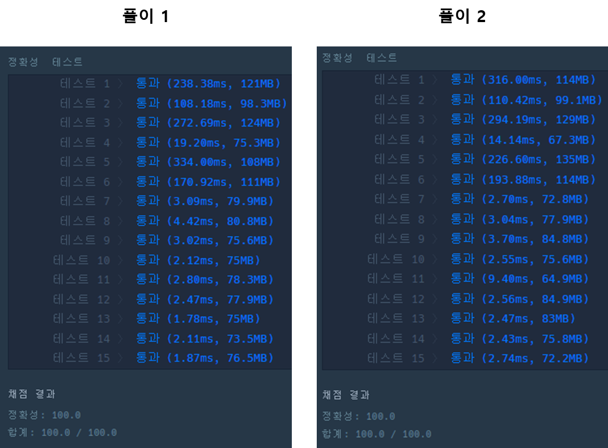

## **문제 - 정렬 > 가장 큰 수**

### **문제 설명**

0 또는 양의 정수가 주어졌을 때, 정수를 이어 붙여 만들 수 있는 가장 큰 수를 알아내 주세요.   

예를 들어, 주어진 정수가 [6, 10, 2]라면 [6102, 6210, 1062, 1026, 2610, 2106]를 만들 수 있고, 이중 가장 큰 수는 6210입니다.   

0 또는 양의 정수가 담긴 배열 numbers가 매개변수로 주어질 때, 순서를 재배치하여 만들 수 있는 가장 큰 수를 문자열로 바꾸어 return 하도록 solution 함수를 작성해주세요.

### **제한 사항**

* numbers의 길이는 1 이상 100,000 이하입니다.
* numbers의 원소는 0 이상 1,000 이하입니다.
* 정답이 너무 클 수 있으니 문자열로 바꾸어 return 합니다.

### **문제 풀이**

**풀이 1**

* 정수형 배열을 문자열로 배열로 전환   
  > 정수형일 때 자릿수 비교가 복잡해질 수 있기 때문
* Arrays.sort에 정렬 우선순위를 제어(두 수의 합친 수를 기준으로 정렬)

```java
import java.util.Arrays;
import java.util.Comparator;

class Solution {
    public String solution(int[] numbers) {
        String[] stringNums = new String[numbers.length];

        // 1. int형 배열을 string 배열로 전환
        for(int i=0; i< numbers.length; i++)
            stringNums[i] = Integer.toString(numbers[i]);

        // 2. 두 수를 번갈아가며 합친 수 중 큰 값을 앞으로 정렬(내림차순)
        Arrays.sort(stringNums, new Comparator<String>() {
            @Override
            public int compare(String o1, String o2) {
                return (o2+o1).compareTo(o1+o2);
            }
        });

        if(stringNums[0].equals("0")) return "0";

        return String.join("", stringNums);
    }
}
```

**풀이 2**

```java
import java.util.Arrays;
import java.util.Comparator;

class Solution {
    public String solution(int[] numbers) {
        String[] stringNums = new String[numbers.length];

        // 1. int형 배열을 string 배열로 전환
        for(int i=0; i< numbers.length; i++)
            stringNums[i] = Integer.toString(numbers[i]);

        // 2. 두 수를 번갈아가며 합친 수 중 큰 값을 앞으로 정렬(내림차순)
        Arrays.sort(stringNums, (o1, o2) -> (o2+o1).compareTo(o1+o2));

        StringBuilder sb = new StringBuilder();

        if(stringNums[0].equals("0")) return "0";
        else{
            for(String s : stringNums)
                sb.append(s);
        }

        return sb.toString();
    }
}
```

---

> **Point : 5**  
>   
> 풀이 1과 2의 차이는 String을 사용한 것과 StringBuilder를 사용했다는 점이다.  
> 생각으로 String을 사용할 때보다 StringBuilder를 사용하였을 때  
> 성능이 우수할 것이라고 생각을 하였지만,  
> 생각과 다른 결과가 나왔다.   
>   
> 배운 점 : String.join이 StringBuilder을 사용한 반복문 접근보다 전반적으로 성능이 우수하다.  
>   
> 
