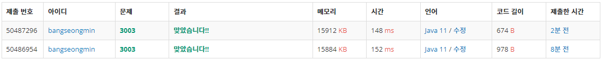

## **문제 :** 킹, 퀸, 룩, 비숍, 나이트, 폰

### **문제 설명**

동혁이는 오래된 창고를 뒤지다가 낡은 체스판과 피스를 발견했다.

체스판의 먼지를 털어내고 걸레로 닦으니 그럭저럭 쓸만한 체스판이 되었다. 하지만, 검정색 피스는 모두 있었으나, 흰색 피스는 개수가 올바르지 않았다.

체스는 총 16개의 피스를 사용하며, 킹 1개, 퀸 1개, 룩 2개, 비숍 2개, 나이트 2개, 폰 8개로 구성되어 있다.

동혁이가 발견한 흰색 피스의 개수가 주어졌을 때, 몇 개를 더하거나 빼야 올바른 세트가 되는지 구하는 프로그램을 작성하시오.

### **입력**

첫째 줄에 동혁이가 찾은 흰색 킹, 퀸, 룩, 비숍, 나이트, 폰의 개수가 주어진다. 이 값은 0보다 크거나 같고 10보다 작거나 같은 정수이다.

### **출력**

첫째 줄에 입력에서 주어진 순서대로 몇 개의 피스를 더하거나 빼야 되는지를 출력한다. 만약 수가 양수라면 동혁이는 그 개수 만큼 피스를 더해야 하는 것이고, 음수라면 제거해야 하는 것이다.

### **문제 풀이**

| 종류 | 킹 | 퀸 | 룩 | 비숍 | 나이트 | 폰 |
| --- | --- | --- | --- | --- | --- | --- |
| 조건 | 1 | 1 | 2 | 2 | 2 | 8 |
| 입력 | 0 | 1 | 2 | 2 | 2 | 7 |
| 출력 | 1 | 0 | 0 | 0 | 0 | 1 |

* 조건에 부합할 수 있도록 입력문에서 부족하거나 많은 것을 계산해주는 문제이다.

#### **풀이1**

* **BufferedReader를 사용하여 문자열을 한 줄로 입력**
* **StringTokenizer을 사용하여 문자열 공백을 분리**
* **정수형 변수를 여러 개 선언하여 일일이 나열하는 방식**

```java
import java.io.BufferedReader;
import java.io.InputStreamReader;
import java.io.IOException;
import java.util.StringTokenizer;

public class Main {
	public static void main(String[] args) throws IOException {

		BufferedReader br = new BufferedReader(new InputStreamReader(System.in));

		int king = 1;
		int queen = 1;
		int rook = 2;
		int bishop = 2;
		int knight = 2;
		int pawn = 8;

		StringTokenizer st = new StringTokenizer(br.readLine(), " ");
		king = king - Integer.parseInt(st.nextToken());
		queen = queen - Integer.parseInt(st.nextToken());
		rook = rook - Integer.parseInt(st.nextToken());
		bishop = bishop - Integer.parseInt(st.nextToken());
		knight = knight - Integer.parseInt(st.nextToken());
		pawn = pawn - Integer.parseInt(st.nextToken());

		System.out.print(king + " ");
		System.out.print(queen + " ");
		System.out.print(rook + " ");
		System.out.print(bishop + " ");
		System.out.print(knight + " ");
		System.out.print(pawn + " ");		

	}
}
```

#### **풀이2**

* **BufferedReader를 사용하여 문자열을 한 줄로 입력**
* **StringTokenizer을 사용하여 문자열 공백을 분리**
* **변수대신 배열을 사용하고, 동일한 반복 대신 반복문을 사용**

```java
import java.io.BufferedReader;
import java.io.IOException;
import java.io.InputStreamReader;
import java.util.StringTokenizer;

public class Main {

    public static void main(String[] args) throws IOException {
        BufferedReader br = new BufferedReader(new InputStreamReader(System.in));

        int[] chess = new int[]{1, 1, 2, 2, 2, 8};
        int idx = 0;    // 인덱스 참조용

        StringTokenizer st = new StringTokenizer(br.readLine(), " ");
        while (st.hasMoreTokens()){
            chess[idx] = chess[idx] - Integer.parseInt(st.nextToken());
            idx++;
        }

        for(int n : chess)
            System.out.print(n+" ");
    }
}
```

#### **성능**



**채점 번호 : 50487296 -  방법 2 : 배열과 반복문**

**채점 번호 : 50486954** **-  방법 1 : 반복된 코드**

**입력의 경우 Scanner보다 BufferedReader가 빠르다는 것은 알고 있기 때문에  
중복된 코드 사용보다 배열과 반복문 사용이 조금 더 성능이 우수하다는 것을 볼 수 있다.**

---

### **정리**

개발을 할때 가독성을 위해 변수를 사용한 처리를 할 경우가 많았는데,

어떤 것이 성능이 우수할지 예상이 되지 않았는데 이 문제를 통해 궁금증을 해소할 수 있었다.

혹시 이해되시지 않는 부분이 있으시다면 언제든 댓글을 남겨주시길 바랍니다.

또한 더 나은 성장을 위한 조언이 있으시면 아낌없이 부탁드립니다.
