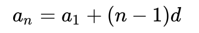
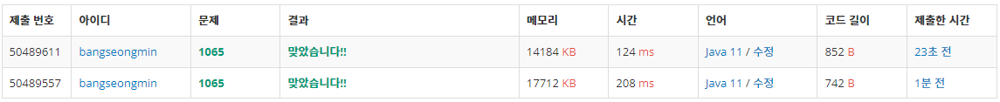

* [백준 1065번 - 함수 >  한수](https://www.acmicpc.net/problem/1065)

[1065번: 한수

어떤 양의 정수 X의 각 자리가 등차수열을 이룬다면, 그 수를 한수라고 한다. 등차수열은 연속된 두 개의 수의 차이가 일정한 수열을 말한다. N이 주어졌을 때, 1보다 크거나 같고, N보다 작거나

www.acmicpc.net](https://www.acmicpc.net/problem/1065)


---

### **문제**

어떤 양의 정수 X의 각 자리가 등차수열을 이룬다면, 그 수를 한수라고 한다. 등차수열은 연속된 두 개의 수의 차이가 일정한 수열을 말한다. N이 주어졌을 때, 1보다 크거나 같고, N보다 작거나 같은 한수의 개수를 출력하는 프로그램을 작성하시오. 

### **입력**

첫째 줄에 1,000보다 작거나 같은 자연수 N이 주어진다.

### **출력**

첫째 줄에 1보다 크거나 같고, N보다 작거나 같은 한수의 개수를 출력한다.

### **알고리즘**

문제를 이해하기 위해서는 등차수열에 대한 이해가 필요하다.

> 등차수열(arithmetic sequence)  
> 연속하는 두 항의 차이가 모두 일정한 수열을 의미한다.



즉 두 항의 차이를 d라고 할 때, n번째 항은 초항과 (n-1)\*d의 합과 같다는 의미이다.

문제는 각 자리수가 등차수열을 이루고 있는지를 검사하는 문제이다.

조건에 의하면 1 ~ 1000까지 수를 검사하면 된다.

* **1 ~ 99**는 모두 등차 수열이다.  
  + **1 ~ 9**는 자체로 수열에 속한다.
  + **10 ~ 99**는 각 자리수의 차가 공차이고 그 수 자체로 수열을 이룬다.  
    예시) 50은 공차가 5인 수열, 85는 공차가 3인 수열이다.
* 검사할 대상은 100 ~ 1000이다.

정리하면

1 단계 : 1000보다 작은 자연수 N을 입력받는다.

2 단계 : 한수의 개수를 카운팅 할 변수를 선언한다.

3 단계 : N이 100보다 작을 경우, N자체를 반환하면 된다.

4 단계 : N이 100보다 큰 경우, 한수를 99개를 최솟값으로 설정한다.

5단계 : N의 각 자리수를 입력받아 각 자릿수의 차를 계산하여 동일한지 확인한다.

---

### **풀이**

**풀이 1 [Scanner]**

```java
import java.io.IOException;
import java.util.Scanner;

public class Main {

    public static void main(String[] args) throws IOException {
        System.out.println(solution1());
    }

    private static int solution1() {
        Scanner input = new Scanner(System.in);

        int N = input.nextInt();

        int cnt = 0;

        if(N < 100)
            return N;
        else{
            cnt = 99;

            for(int i=100; i<=N; i++){
                int hun = i / 100;  // 백의 자리
                int ten = (i/10) % 10;  // 십의 자리
                int one = i % 10;       // 일의 자리

                if((hun - ten) == (ten - one))
                    cnt++;
            }
        }

        return cnt;
    }
}
```

**풀이 2 [BufferedReader]**

```java
import java.io.BufferedReader;
import java.io.IOException;
import java.io.InputStreamReader;

public class Main {

    public static void main(String[] args) throws IOException {
        System.out.println(solution2());
    }

    private static int solution2() throws IOException {
        BufferedReader br = new BufferedReader(new InputStreamReader(System.in));

        int N = Integer.parseInt(br.readLine());

        int cnt = 0;

        if(N < 100)
            return N;
        else{
            cnt = 99;

            for(int i=100; i<=N; i++){
                int hun = i / 100;  // 백의 자리
                int ten = (i/10) % 10;  // 십의 자리
                int one = i % 10;       // 일의 자리

                if((hun - ten) == (ten - one))
                    cnt++;
            }
        }

        return cnt;
    }
}
```

### **성능**



**채점 번호 : 50489611 -  BufferedReader**

**채점 번호 : 50489557  -  Scanner**

**입력의 경우 Scanner보다 BufferedReader가 성능이 우수한 것을 볼 수 있다.**

---

### **정리**

위 문제를 풀이하면 처음에는 문제를 이해하지 못하였었다.

입력과 출력을 먼저 보는 습관이 이러한 문제를 초래하였다. 문제를 읽고 직접 풀이하면서 문제를 이해할 수 있게 되었다.

혹시 이해되시지 않는 부분이 있으시다면 언제든 댓글을 남겨주시길 바랍니다.

또한 더 나은 성장을 위한 조언이 있으시면 아낌없이 부탁드립니다.


