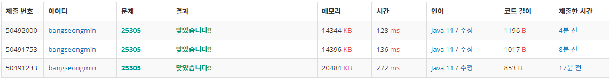

* [25305번 - 정렬 > 커트라인](https://www.acmicpc.net/problem/25305)

[25305번: 커트라인

시험 응시자들 가운데 1등은 100점, 2등은 98점, 3등은 93점이다. 2등까지 상을 받으므로 커트라인은 98점이다.

www.acmicpc.net](https://www.acmicpc.net/problem/25305)

---

### **문제**

2022 연세대학교 미래캠퍼스 슬기로운 코딩생활에 N 명의 학생들이 응시했다.

이들 중 점수가 가장 높은 K 명은 상을 받을 것이다. 이 때, 상을 받는 커트라인이 몇 점인지 구하라.

커트라인이란 **상을 받는 사람들 중 점수가 가장 가장 낮은 사람의 점수**를 말한다.

### **입력과 출력**

* 입력
  + 첫째 줄에는 응시자의 수 N과 상을 받는 사람의 수 K가 공백을 사이에 두고 주어진다.
  + 둘째 줄에는 각 학생의 점수 x가 공백을 사이에 두고 주어진다.
* 출력
  + 상을 받는 커트라인을 출력하라.

### **알고리즘**

응시자의 수 N명과 상을 받는 사람의 수 K가 주어지게 된다.

이때 상을 받는 사람 중 가장 낮은 사람을 추출하면 되는 문제이다.

1 단계 : N명의 점수를 입력받는다.

2 단계 : 점수를 내림차순으로 정렬한다.

3 단계 : 정렬된 점수 중 K번째에 해당하는 점수를 반환한다.

### **풀이**

#### **풀이 1 [**Array +** Scanner]**

* **Scanner**를 통해 입력
* **Arrays.sort()**를 통해 내림차순으로 정렬

```java
import java.io.BufferedReader;
import java.io.IOException;
import java.io.InputStreamReader;
import java.util.Arrays;
import java.util.Collections;
import java.util.Scanner;
import java.util.StringTokenizer;

public class Main {

    public static void main(String[] args) throws IOException {
        solution1();
    }

    private static void solution1() {
        Scanner input = new Scanner(System.in);

        int N = input.nextInt();        // 응시자 수 : N
        int K = input.nextInt();        // 상을 받는 사람의 수 : K

        Integer[] points = new Integer[N];      // 응시자들의 점수

        for(int i=0; i < N; i++)
            points[i] = input.nextInt();

        Arrays.sort(points, Collections.reverseOrder());

        System.out.println(points[K-1]);        // 0부터 시작하므로 K번째는 K-1
    }
}
```

#### **풀이 2 [**Array** + BufferedReader + StringTokenizer]**

* **BufferedReader와 StringTokenizer**를 통해 입력
* **Arrays.sort()**를 통해 내림차순으로 정렬

```java
import java.io.BufferedReader;
import java.io.IOException;
import java.io.InputStreamReader;
import java.util.Arrays;
import java.util.Collections;
import java.util.StringTokenizer;

public class Main {

    public static void main(String[] args) throws IOException {
        solution1();
    }

    private static void solution1() throws IOException  {
        BufferedReader br = new BufferedReader(new InputStreamReader(System.in));
        StringTokenizer st = new StringTokenizer(br.readLine(), " ");

        int N = Integer.parseInt(st.nextToken());
        int K = Integer.parseInt(st.nextToken());


        Integer[] points = new Integer[N];      // 응시자들의 점수

        st = new StringTokenizer(br.readLine());
        int idx = 0;
        while (st.hasMoreTokens()){
            points[idx++] = Integer.valueOf(st.nextToken());
        }

        Arrays.sort(points, Collections.reverseOrder());

        System.out.println(points[K-1]);        // 0부터 시작하므로 K번째는 K-1
    }
}
```

#### **풀이 3 [**Array**+ BufferedReader + StringTokenizer]**

* **BufferedReader와 StringTokenizer**를 통해 입력
* **카운팅 정렬(점수가 최대 10000점)**

```java
import java.io.BufferedReader;
import java.io.IOException;
import java.io.InputStreamReader;
import java.util.StringTokenizer;

public class Main {

    public static void main(String[] args) throws IOException {
        solution1();
    }

    private static void solution1() throws IOException  {
        BufferedReader br = new BufferedReader(new InputStreamReader(System.in));
        StringTokenizer st = new StringTokenizer(br.readLine(), " ");

        int N = Integer.parseInt(st.nextToken());
        int K = Integer.parseInt(st.nextToken());

        // 카운팅 정렬
        int[] points = new int[10001];      // 응시자들의 점수

        st = new StringTokenizer(br.readLine());

        int index = -1;
        while (st.hasMoreTokens()){
            index = Integer.parseInt(st.nextToken());
            points[index]++;
        }

        for(int i=10000; i>=0; i--){
            while (points[i] > 0){
                points[i]--;
                K--;

                if(K == 0)
                {
                    System.out.println(i);
                    break;
                }

            }
        }
    }
}
```

### **성능**



**채점 번호 : 50492000 - **BufferedReader + Quick Sort****

**채점 번호 : 50491753 -  BufferedReader + Arrays.sort()**

**채점 번호 : 50491233 -  Scanner + **Arrays.sort()****

**입력의 경우 Scanner보다 BufferedReader가 성능이 우수하다.**

**정렬은 Arrays.sort를 사용하는 것보다 Quick정렬을 이용하는 것이 성능이 우수하다.**

---

### **정리**

이 문제를 풀면서 풀이 2가 백준에서 실행하면 오류가 나는 것을 볼 수 있었다...

그래서 계속 고쳐가면서 시도했는데 작은 실수가 있었던 것을 알 수 있었다...

문제 난이도는 어렵지 않았기 때문에 쉽게 사용할 수 있는 퀵 정렬 방법을 사용해보았다.

혹시 이해되시지 않는 부분이 있으시다면 언제든 댓글을 남겨주시길 바랍니다.

또한 더 나은 성장을 위한 조언이 있으시면 아낌없이 부탁드립니다.
