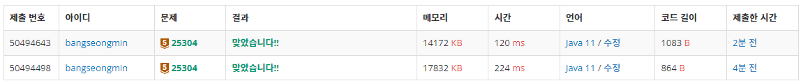

* [반복문 - 25304번 영수증](https://www.acmicpc.net/problem/25304)

[25304번: 영수증

준원이는 저번 주에 살면서 처음으로 코스트코를 가 봤다. 정말 멋졌다. 그런데, 몇 개 담지도 않았는데 수상하게 높은 금액이 나오는 것이다! 준원이는 영수증을 보면서 정확하게 계산된 것

www.acmicpc.net](https://www.acmicpc.net/problem/25304)

---

### **문제**

준원이는 저번 주에 살면서 처음으로 코스트코를 가 봤다. 정말 멋졌다. 그런데, 몇 개 담지도 않았는데 수상하게 높은 금액이 나오는 것이다! 준원이는 영수증을 보면서 정확하게 계산된 것이 맞는지 확인해보려 한다.

영수증에 적힌,

* 구매한 각 물건의 가격과 개수
* 구매한 물건들의 총 금액

을 보고, 구매한 물건의 가격과 개수로 계산한 총 금액이 영수증에 적힌 총 금액과 일치하는지 검사해보자.

### **입력과 출력**

* 입력
  + 첫째 줄에는 영수증에 적힌 총 금액 X가 주어진다.
  + 둘째 줄에는 영수증에 적힌 구매한 물건의 종류의 수 N이 주어진다.
  + 이후 N개의 줄에는 각 물건의 가격 a와 개수 b가 공백을 사이에 두고 주어진다.
* 출력
  + 구매한 물건의 가격과 개수로 계산한 총 금액이 영수증에 적힌 총 금액과 일치하면 Yes를 출력한다. 일치하지 않는다면 No를 출력한다.
* 제한
  + 1 ≤ X ≤ 1000000000
  + 1 ≤ N ≤ 100
  + 1 ≤ a ≤ 1000000
  + 1 ≤ b ≤ 10

### **알고리즘**

총 금액 X과 N개의 영수증에 대한 금액과 개수를 입력받아 총금액과 동일한지 확인하는 문제이다.

1 단계 : 총 금액 X을 입력받는다.

2 단계 : 물건의 종류의 수 N을 입력받는다.

3 단계 : N개의 물건의 가격을 저장할 변수를 선언한다.

4 단계 : N개의 줄에 물건의 가격 a와 개수 b를 입력받는다.

5 단계 : 입력받은 물건의 합을 계산하여 총 금액과 비교한다.

### **풀이**

#### **풀이 1 [Scanner]**

```java
import java.util.Scanner;

public class Main {

    public static void main(String[] args) {
        solution1();
        // solution2();
    }

    private static void solution1() {
        Scanner input = new Scanner(System.in);

        int X = input.nextInt();                // 영수증에 적힌 총 금액
        int N = input.nextInt();                // 영수증에 적힌 구매한 물건의 종류의 수

        int sum = 0;
        for(int i=0; i<N; i++)
        {
            int a = input.nextInt();            // 물건의 가격
            int b = input.nextInt();            // 물건의 개수

            sum += (a * b);
        }

        System.out.println(sum == X ? "Yes" : "No");
    }
}
```

#### **풀이 2 **[BufferedReader + StringTokenizer********]****

```java
import java.io.BufferedReader;
import java.io.IOException;
import java.io.InputStreamReader;
import java.util.StringTokenizer;

public class Main {

    public static void main(String[] args) throws IOException {
        solution2();
    }

    private static void solution2() throws IOException {
        BufferedReader br = new BufferedReader(new InputStreamReader(System.in));
        StringTokenizer st;

        int X = Integer.parseInt(br.readLine());                // 영수증에 적힌 총 금액
        int N = Integer.parseInt(br.readLine());                // 영수증에 적힌 구매한 물건의 종류의 수

        int sum = 0;
        for(int i=0; i<N; i++)
        {
            st = new StringTokenizer(br.readLine());
            int a = Integer.parseInt(st.nextToken());           // 물건의 가격
            int b = Integer.parseInt(st.nextToken());            // 물건의 개수

            sum += (a * b);
        }

        System.out.println(sum == X ? "Yes" : "No");
    }
}
```

### **성능**



25304번 문제 풀이 실행 결과

**채점 번호 : 50494643 -  BufferedReader**

**채점 번호 : 50494498  -  Scanner**

입력의 경우 Scanner보다 BufferedReader가 성능이 우수한 것을 볼 수 있다.

### **정리**

위 문제는 백준 티어가 표시되는 것을 기념하기 위해 풀이하게 되었다.

난이도가 최하로 반복문에 대한 이해가 있다면 금방 풀수 있는 문제이다.

혹시 이해되시지 않는 부분이 있으시다면 언제든 댓글을 남겨주시길 바랍니다.

또한 더 나은 성장을 위한 조언이 있으시면 아낌없이 부탁드립니다.
