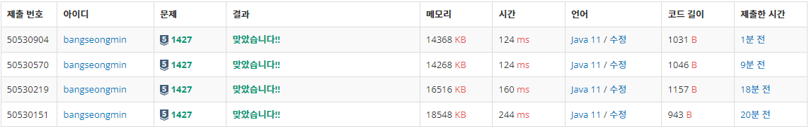

* [**정렬 - (1427번) 소트인사이드**](https://www.acmicpc.net/problem/1427)

---

### **문제**

배열을 정렬하는 것은 쉽다. 수가 주어지면, 그 수의 각 자리수를 내림차순으로 정렬해보자.

### **입력과 출력**

* 입력
  + 첫째 줄에 정렬하려고 하는 수 N이 주어진다. N은 1,000,000,000보다 작거나 같은 자연수이다.
* 출력
  + 첫째 줄에 자리수를 내림차순으로 정렬한 수를 출력한다.

### **알고리즘**

1,000,000,000보다 작거나 같은 자연수 N이 주어지면 숫자들을 내림차순으로 정렬하는 문제이다.

1 단계 : 자연수 N을 입력받는다.

2 단계 : 자연수 N을 자리수마다 잘라서 분리한다.

3 단계 : 분리된 수를 내림차순으로 정렬한다.

### **풀이**

#### **풀이 1 [Scanner]**

* Collection 정렬을 위해 ArrayList 사용
* 자연수를 10으로 나누어 나머지를 저장하는 구조
* 순자열을 순서대로 문자열에 저장하여 출력

```java
private static void solution1() {
    Scanner input = new Scanner(System.in);

    // 1. 자연수 N을 정수에 저장
    int N = input.nextInt();

    // 2. 정수형 리스트 선언
    ArrayList<Integer> list = new ArrayList<>();

    // 3. 일의 자리부터 순차적으로 저장
    while (N > 0){
        int rest = N % 10;
        N = N / 10;
        list.add(rest);
    }

    // 4. Collection 내림차순 정렬
    Collections.sort(list, Collections.reverseOrder());

    // 5. 순차적으로 문자열에 저장
    String answer = "";
    for(int n : list){
        answer += n;
    }

    System.out.println(answer);
}
```

#### **풀이 2 [BufferedReader]**

* Collection 정렬을 위해 ArrayList 사용
* 자연수를 10으로 나누어 나머지를 저장하는 구조
* 순자열을 순서대로 문자열에 저장하여 출력

```java
private static void solution2() throws IOException {
    BufferedReader br = new BufferedReader(new InputStreamReader(System.in));
    StringTokenizer st;

    // 자연수 N을 정수에 저장
    int N = Integer.parseInt(br.readLine());

    // 정수형 리스트 선언
    ArrayList<Integer> list = new ArrayList<>();

    // 일의 자리부터 순차적으로 저장
    while (N > 0){
        int rest = N % 10;
        N = N / 10;
        list.add(rest);
    }

    // Collection 내림차순 정렬
    Collections.sort(list, Collections.reverseOrder());

    // 순차적으로 문자열에 저장
    String answer = "";
    for(int n : list){
        answer += n;
    }

    System.out.println(answer);
}
```

#### **풀이 3 [BufferedReader + Quick Sort]**

* 크기 10인 정수형 배열 사용
* 배열에 나머지 값을 저장하여 Quick 정렬

```java
private static void solution2() throws IOException {
    BufferedReader br = new BufferedReader(new InputStreamReader(System.in));
    StringTokenizer st;

    // 자연수 N을 정수에 저장
    int N = Integer.parseInt(br.readLine());

    // 1~9를 저장할 배열 선언
    int[] nums = new int[10];

    // 일의 자리부터 순차적으로 저장
    while (N > 0){
        int rest = N % 10;
        N = N / 10;
        nums[rest]++;
    }

    // 순차적으로 숫자를 문자열에 저장
    StringBuilder s = new StringBuilder();
    for(int i=9; i>=0; i--){
        while (nums[i]>0){
            nums[i]--;
            s.append(i);
        }
    }

    System.out.println(s.toString());
}
```

#### **풀이 4 [BufferedReader + PriorityQueue]**

* 정렬 기능이 적용된 우선순위 큐를 사용

```java
private static void solution2() throws IOException {
    BufferedReader br = new BufferedReader(new InputStreamReader(System.in));
    StringTokenizer st;

    // 자연수 N을 정수에 저장
    int N = Integer.parseInt(br.readLine());

    // 우선순위 큐(내림 차순으로 정렬)
    PriorityQueue queue = new PriorityQueue(Comparator.reverseOrder());

    // 일의 자리부터 순차적으로 저장
    while (N > 0){
        int rest = N % 10;
        N = N / 10;
        queue.add(rest);
    }

    // 순차적으로 숫자를 문자열에 저장
    StringBuilder sb = new StringBuilder();
    while (!queue.isEmpty()){
        sb.append(queue.poll());
    }
    System.out.println(sb.toString());
}
```

### **성능**



**채점 번호 : 50530904 - **BufferedReader + Priority Queue****

**채점 번호 : 50530570 -  BufferedReader + Quick Sort**

**채점 번호 : 50530219 -  ****BufferedReader + **Collection**.sort()**********

**채점 번호 : 50530151 -  Scanner + Collection**.sort()****

입력의 경우 Scanner보다 BufferedReader가 성능이 우수하다.

**정렬**은 Priority Queue =  Quick Sort > Collection.sort 으로 순서가 정해지는 것 같다.

---

### **정리**

이 문제를 풀면서 배열을 통한 풀이를 선호하였으므로 List를 통해 Collection.sort()를 사용하기로 했다.

Collection의 정렬과 Quick Sort를 비교해보니 속도 차이가 많이 나는 것 같다.

이를 비교하기 위해 이진 트리구조인 우선순위 큐를 사용해 보았다.

이를 통해 우선순위 큐와 퀵 정렬의 성능이 비슷하다는 것을 알 수 있게 되었다.
