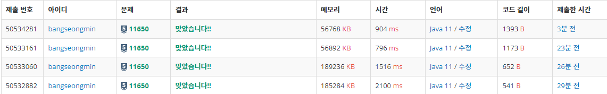

* [정렬 - 11650번 좌표 정렬하기](https://www.acmicpc.net/problem/11650)

---

### **문제**

2차원 평면 위의 점 N개가 주어진다. 좌표를 x좌표가 증가하는 순으로, x좌표가 같으면 y좌표가 증가하는 순서로 정렬한 다음 출력하는 프로그램을 작성하시오.

### **입력과 출력**

* 입력
  + 첫째 줄에 점의 개수 N (1 ≤ N ≤ 100,000)이 주어진다. 둘째 줄부터 N개의 줄에는 i번점의 위치 xi와 yi가 주어진다. (-100,000 ≤ xi, yi ≤ 100,000) 좌표는 항상 정수이고, 위치가 같은 두 점은 없다.
* 출력
  + 첫째 줄부터 N개의 줄에 점을 정렬한 결과를 출력한다.

### **알고리즘**

문제 풀이 방식이 여러 가지가 있겠지만, 이 문제는 람다식을 사용하여 Array.sort() 확장할 수 있어야 한다.

**람다식**

함수 이름 없이 람다식으로 구현한 함수를 일명 익명 함수라고 하기도 한다.

만약 어떤 변수 a와 b의 합을 구하고 싶다면 다음과 같이 하면 된다.

```java
// 람다식 X
public int sum(int a, int b) {
	return a + b;
}

// 람다식 O
(int a, int b) -> {return a + b;}

// 람다식 X
int c = sum(a, b);
public int sum(int a, int b) {
	return a + b;
}

// 람다식 O
int c = (int a, int b) -> {return a + b;}
```

장점은 람다식을 쓰지 않을 때보다 코드가 간결해진다는 점이 있고, 특히 일회성으로 함수를 써야할 경우 굳이 메소드를 하나 작성하기보다는 람다식으로 구현하는 것이 가독성 등에서 좋아진다는 장점이 있다.

> **Array.sort()**  
> Array.sort()는 두가지 인자를 받을 수 있다.  
> 첫 번째 T[] a. 제네릭타입이다.  
> 객체배열. 클래스, 오브젝트, 자료형 등 어떠한 타입이든 상관없이 배열의 형태로 받을 수 있다는 의미이다.  
> 2차원 배열을 사용할 것이므로 int[][]가 될 것이다. 이 의미는 다른의미로 int[]가 하나의 타입이고, int[] 타입의 배열형태인 int[][]라는 1차원 배열이라고 볼 수 있다.  
>   
> 두 번째 Comparator<?Super T> C  
> <?Super T>는 상속관계에 있는 타입만 자료형으로 받겠다는 의미다. 즉, T 타입이 자식클래스가 되고, T의 상속관계에 있는 타입까지만 허용하겠다는 의미다. 이 문제에서는 상속관계에 있는 데이터를 정렬하지 않기 때문에 이를 생략하여 <T>라고 생각해도 된다.

arr[N][2] 배열이 있을 때, 두 좌표를 모두 입력받았다고 가정했을 때, arr[i][0]과 arr[i+1]][0]을 정렬할 것이고 만약 두 값이 같다면, arr[i][1]과 arr[i+1][1]을 비교할 것이다.

(여기서 T는 int[]가 될 것이고, arr[]의 [1] (arr[i][1])을 비교하기 위해 사용화해야한다.

```java
// 람다식 X
Arrays.sort(arr, new Comparator<int[]>() {		
	@Override
	public int compare(int[] e1, int[] e2) {
		if(e1[0] == e2[0]) {		
			return e1[1] - e2[1];
		}
		else {
			return e1[0] - e2[0];
		}
	}
});

// 람다식 O
Arrays.sort(arr, (e1, e2) -> {
	if(e1[0] == e2[0]) {
		return e1[1] - e2[1];
	}
	else {
		return e1[0] - e2[0];
	}
});
```

---

### **풀이**

**풀이 1 : [Scanner + **System.out.println()]****

```java
import java.util.Scanner;
import java.util.Arrays;

public class Main {
	public static void main(String[] args) {

		Scanner in = new Scanner(System.in);

		int N = in.nextInt();

		int[][] arr = new int[N][2];

		for(int i = 0; i < N; i++) {
			arr[i][0] = in.nextInt();
			arr[i][1] = in.nextInt();
		}

		Arrays.sort(arr, (e1, e2) -> {
			if(e1[0] == e2[0]) {
				return e1[1] - e2[1];
			} else {
				return e1[0] - e2[0];
			}
		});

		for(int i = 0; i < N; i++) {
			System.out.println(arr[i][0] + " " + arr[i][1]);
		}
	}
}
```

**풀이 2 : [Scanner + **StringBuilder****]****

```java
import java.util.Scanner;
import java.util.Arrays;

public class Main {
	public static void main(String[] args) {

		Scanner in = new Scanner(System.in);

		int N = in.nextInt();

		int[][] arr = new int[N][2];

		for(int i = 0; i < N; i++) {
			arr[i][0] = in.nextInt();
			arr[i][1] = in.nextInt();
		}

		Arrays.sort(arr, (e1, e2) -> {
			if(e1[0] == e2[0]) {
				return e1[1] - e2[1];
			} else {
				return e1[0] - e2[0];
			}
		});

        StringBuilder sb = new StringBuilder();

        for(int i=0; i < N; i++){
            sb.append(arr[i][0] + " " + arr[i][1]).append("\n");
        }
        System.out.println(sb);
	}
}
```

**풀이 3 : [**BufferedReader**+ StringBuilder]**

```java
import java.io.BufferedReader;
import java.io.IOException;
import java.io.InputStreamReader;
import java.util.*;

public class Main {

    public static void main(String[] args) throws IOException {
        solution2();
    }

    private static void solution2() throws IOException {
        BufferedReader br = new BufferedReader(new InputStreamReader(System.in));
        StringTokenizer st;

        // 자연수 N을 정수에 저장
        int N = Integer.parseInt(br.readLine());

        int[][] arr = new int[N][2];    // (x, y)좌표가 N개

        for(int i = 0; i < N; i++) {
            st = new StringTokenizer(br.readLine());
            arr[i][0] = Integer.parseInt(st.nextToken());
            arr[i][1] = Integer.parseInt(st.nextToken());
        }

        Arrays.sort(arr, (e1, e2) -> {
            if(e1[0] == e2[0]) {
                return e1[1] - e2[1];
            } else {
                return e1[0] - e2[0];
            }
        });

        StringBuilder sb = new StringBuilder();

        for(int i=0; i < N; i++){
            sb.append(arr[i][0] + " " + arr[i][1]).append("\n");
        }

        System.out.println(sb);
    }

}
```

**풀이 4 : [**BufferedReader**+ StringBuilder]**

* 2차원 배열의 복잡함을 상쇄시키기 위한 방법으로 inner 클래스를 사용

```java
import java.io.BufferedReader;
import java.io.IOException;
import java.io.InputStreamReader;
import java.util.*;

public class Main {
    static class Point {
        int x;
        int y;

        public Point(int x, int y) {
            this.x = x;
            this.y = y;
        }
    }

    public static void main(String[] args) throws IOException {
        solution3();
    }

    private static void solution3() throws IOException {
        BufferedReader br = new BufferedReader(new InputStreamReader(System.in));
        StringTokenizer st;

        // 자연수 N을 정수에 저장
        int N = Integer.parseInt(br.readLine());

        // int[][] 을 대신하여 클래스를 만들어 배열 사용
        Point[] points = new Point[N];

        for(int i = 0; i < N; i++) {
            st = new StringTokenizer(br.readLine());
            int x = Integer.parseInt(st.nextToken());
            int y = Integer.parseInt(st.nextToken());
            points[i] = new Point(x, y);
        }

        Arrays.sort(points, (e1, e2) -> {
            if(e1.x == e2.x) {
                return e1.y - e2.y;
            } else {
                return e1.x - e2.x;
            }
        });

        StringBuilder sb = new StringBuilder();

        for(int i=0; i < N; i++){
            sb.append(points[i].x + " "+points[i].y+"\n");
        }

        System.out.println(sb);
    }
}
```

---

### **성능**



위에서 부터 순서대로

**채점 번호 : 50534281  -  **************풀이**************4 : BufferedReader + StringBuilder + inner 클래스**

**채점 번호 : 50533161  -  **************풀이**************3 : BufferedReader + StringBuilder + 2차원 배열**

**채점 번호 : 50533060**-  **************풀이**************2 : Scanner + StringBuilder **+ 2차원 배열******

**채점 번호 : 50532882**-  **************풀이**************1 : Scanner + System.out.println()******+ 2차원 배열**********

**1. System.out.println을 반복해서 사용하는 것보다 StringBuilder를 통해 한번에 출력하는 것이 **성능이 훨씬 좋다.****

**2. Scanner보다 BufferedReader를 사용하는 것이 성능이 훨씬 좋다.**

**3. 내부 클래스보다 2차원 배열을 사용하는 것이 성능이 조금 더 좋다.**
