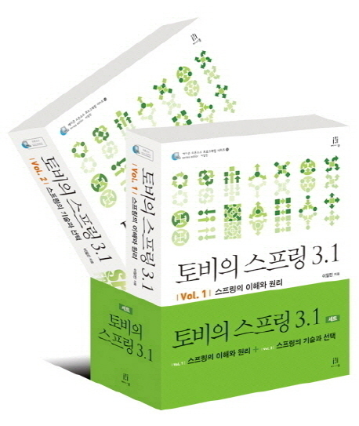
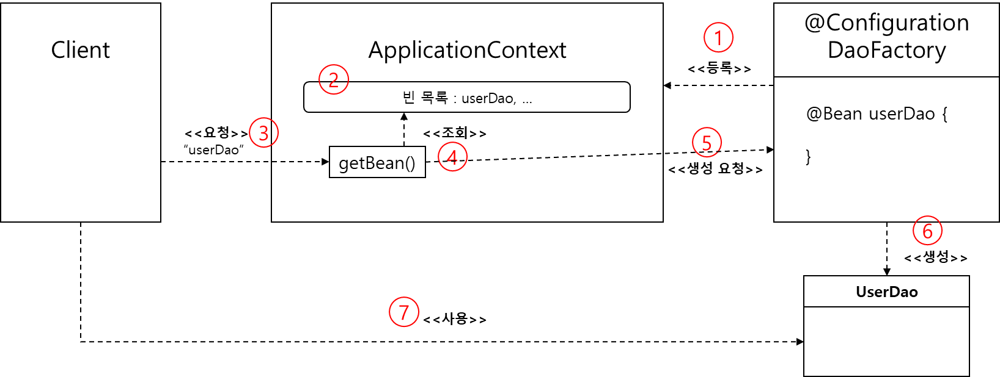
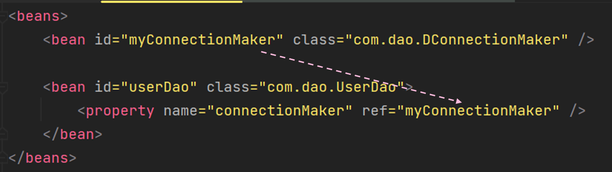

## **오브젝트와 의존관계**

### [초난감 DAO](tistory-178.html)

### [DAO의 분리](tistory-178.html)

### [DAO의 확장](tistory-178.html)

### [제어의 역전](tistory-178.html)

위 내용은 오브젝트와 의존관계 페이지에서 다루어져 있습니다.

---

### **스프링의 IOC**

> 스프링은 애플리케이션 개발의 다양한 영역과 기술에 관여하고 많은 기능을 제공하지만, **스프링의 핵심**은 **빈 팩토리** 또는 **애플리케이션 콘텍스트이다.** 이 두 가지는 DaoFactory가 하는 일을 일반화한 것이라고 설명할 수 있다.

#### **오브젝트 팩토리를 이용한 스프링 IoC**

**애플리케이션 컨텍스트와 설정 정보**

스프링에서는 스프링이 제어권을 가지고 직접 만들고 관계를 부여하는 오브젝트를 **빈(Bean)**이라고 부른다. 자바빈 또는 엔터프라이즈 자바빈(EJB)에서 말하는 빈과 비슷한 오브젝트 단위의 애플리케이션 컴포넌트를 말한다.

동시에 **스프링 빈**은 **스프링 컨테이너**가 **생성과 관계 설정,** **사용** 등을 **제어해주는 제어의 역전이 적용된 오브젝트**를 가리키는 말이다.

* **빈 팩토리(bean factory)**스프링에서 빈의 생성과 관계 설정 같은 제어를 담당하는 IoC 오브젝트를 **빈 팩토리(bean factory)**라고 부른다. 보통 빈 팩토리보다는 이를 좀 더 확장한 **애플리케이션 컨텍스트(application context)**를 주로 사용한다.
* **애플리케이션 컨텍스트(application context)****애플리케이션 컨텍스트**는 IoC 방식을 따라 만들어진 일종의 빈 팩토리라고 생각하면 된다.
* **빈 팩토리**와 **애플리케이션 컨텍스트**라는 용어를 함께 사용할 텐데, 두 가지가 동일하다고 생각하면 된다.
  + **빈 팩토리**는 빈을 생성하고 관계를 설정하는 IoC의 기본 기능에 초점을 맞춘 것
  + **애플리케이션 컨텍스트**라고 말할 때는 애플리케이션 전반에 걸쳐 모든 구성요소의 제어 작업을 담당하는 IoC 엔진이라는 의미가 부각된 것  

    **애플리케이션 컨텍스트**는 별도의 정보를 참고해서 빈(오브젝트)의 생성, 관계 설정 등의 제어 작업을 총괄한다.  
    (예시) 기존 DaoFactory 코드에는 설정 정보, 예를 들어 어떤 클래스의 오브젝트를 생성하고 어디에서 사용하도록 연결해줄 것인가 등에 관한 정보가 평범한 자바 코드로 만들어져 있다.   
    **애플리케이션 컨텍스트**는 직접 이런 정보를 담고 있지는 않지만 별도로 설정 정보를 담고 있는 무엇인가를 가져와 이를 활용하는 범용적인 IoC라고 볼 수 있다.

빈 팩토리 또는 애플리케이션 컨텍스트가 사용하는 설정 정보를 만드는 방법은 여러 가지가 있는데, 우리가 앞에서 만든 오브젝트 팩토리인 DaoFactory도 조금만 손을 보면 설정 정보로 사용할 수 있다. DaoFactory자체가 설정정보까지 담고 있는 IoC 엔진이었는데 자바 코드로 만든 애플리케이션 컨텍스트의 설정정보로 활용될 것이다.


그림 1-8. 오브젝트 팩토리를 활용한 구조

그림 1-8에서 애플리케이션의 로직을 담고 있는 컴포넌트와 설계도 역할을 하는 팩토리를 구분했었다. 설계도가 애플리케이션 컨텍스트와 그 설정정보를 말한다고 보면 된다. 그 자체로는 애플리케이션 로직을 담당하지는 않지만 IoC 방식을 이용해 애플리케이션 컴포넌트를 생성하고, 사용할 관계를 맺어주는 등의 책임을 담당하는 것이다. 마치 건물이 설계도면을 따라서 만들어지듯이, 애플리케이션도 애플리케이션 컨텍스트와 그 설정정보를 따라서 만들어지고 구성된다고 생각할 수 있다.

**DaoFactory를 사용하는 애플리케이션 컨텍스트**

* 스프링이 빈 팩토리를 위한 오브젝트 설정을 담당하는 클래스라고 인식할 수 있도록 **@Configuration** 어노테이션을 추가한다.
* 오브젝트를 만들어주는 메서드에는 **@Bean**이라는 어노테이션을 추가한다.
* userDao() 메서드는 UserDao 타입 오브젝트를 생성하고 초기화해서 돌려주는 것이니 당연히 **@Bean**이 붙는다.
* ConnectionMaker 타입의 오브젝트를 생성해주는 connectionMaker() 메서드에도 **@Bean**이 붙는다.

두 어노테이션만으로 스프링 프레임워크의 빈 팩토리 또는 애플리케이션 컨텍스트가 IoC방식의 기능을 제공할 때 사용할 완벽한 설정 정보가 된 것이다. [1] 참고

```java
package com.dao;

import org.springframework.context.annotation.Bean;
import org.springframework.context.annotation.Configuration;

@Configuration  // 애플리케이션 컨텍스트 또는 빈 팩토리가 사용할 설정정보라는 표시
public class DaoFactory {

    // 오브젝트 생성을 담당하는 IoC용 메소드라는 표시
    @Bean
    public UserDao userDao(){
        UserDao userDao = new UserDao(connectionMaker());
        return userDao;
    }

    @Bean
    public ConnectionMaker connectionMaker(){
        DConnectionMaker connectionMaker = new DConnectionMaker();
        return connectionMaker;
    }
}
```

* 애플리케이션 컨텍스트는 ApplicationContext 타입의 오브젝트다.   
  ApplicationContext를 구현한 클래스는 여러 가지가 있는데 DaoFactory처럼 @Configuaration이 붙은 자바 코드를 설정 정보로 사용하려면 AnnotationConfigApplicationContext를 이용하면 된다. 애플리케이션 콘텍스트를 만들 때 생성자 파라미터로 DaoFactory 클래스를 넣어주면, ApplicationContext의 getBean()이라는 메서드를 이용해 UserDao의 오브젝트를 가져올 수 있다.

```java
// 1-19. 애플리케이션 컨텍스트를 적용한 UserDaoTest
public class UserDaoTest {

    @Test
    public void addAndGet() throws SQLException, ClassNotFoundException {
        ApplicationContext context = new AnnotationConfigApplicationContext(DaoFactory.class);
        UserDao userDao = context.getBean("userDao", UserDao.class);

        ...
    }
}
```

* getBean() 메소드
  + getBean() 메서드는 ApplicationContext 가 관리하는 오브젝트를 요청하는 메소드다.
  + getBean()의 파라미터인 "userDao"는 ApplicationContext에 등록된 빈의 이름이다.  
    DaoFactory에서 @Bean이라는 어노테이션을 userDao 메소드에 붙였는데, 이 메소드 이름이 빈의 이름이 된다.  

    userDao라는 이름의 빈을 가져오는 것은 DaoFactory의 userDao() 메서드를 호출해서 그 결과를 가져온다고 생각하면 된다.
  + getBean()은 기본적으로 Object타입으로 리턴하게 되어 있어서 매번 리턴되는 오브젝트에 다시 캐스팅을 해줘야 하는 부담이 있다. 자바 5이상의 제네릭 메소드 방식을 사용해 getBean()의 두 번째 파라미터에 리턴 타입을 주면 지저분한 캐스팅 코드를 사용하지 않아도 된다.

> UserDao를 가져오는 메소드는 하나뿐인데 왜 굳이 이름을 사용할까?  
>   
> UserDao를 생성하는 방식이나 구성을 다르게 가져가는 메소드를 추가할 수 있기 때문이다.

> 💡 추가할 라이브러리  
> com.springsource.net.sf.cglib-2.2.0.jar  
> com.springsource.org.apache.commons.logging-1.1.1.jar  
> org.springframework.asm-3.0.7.RELEASE.jar  
> org.springframework.beans-3.0.7.RELEASE.jar  
> org.springframework.context-3.0.7.RELEASE.jar  
> org.springframework.core-3.0.7.RELEASE.jar  
> org.springframework.expression-3.0.7.RELEASE.jar  
>   
> **\* 현재 Spring Context Gradle를 추가하였을 때 문제가 없다.**

스프링을 적용하긴 했지만 DaoFactory를 직접 사용한 것과 기능적으로 다를 바 없다. 오히려 DaoFactory를 만들어서 바로 사용한 것보다 번거로운 준비작업과 코드가 필요하다.

---

#### **애플리케이션 컨텍스트의 동작 방식**

> 기존에 오브젝트 팩토리를 이용했던 방식과 스프링의 애플리케이션 컨텍스트를 사용한 방식을 비교해보자.

오브젝트 팩토리에 대응되는 것이 스프링의 애플리케이션 컨텍스트다. 스프링에서 애플리케이션 컨텍스트를 IoC 컨텍스트라 하기도 하고, 간단히 스프링 컨테이너 또는 빈 팩토리이라고 한다.


애플리케이션 컨텍스트는 일종의 빈 팩토리인 셈이다. 애플리케이션 컨텍스트가 스프링의 가장 대표적인 오브젝트이므로, 애플리케이션 컨텍스트를 그냥 스프링이라고 부른 사람도 있다.

* 비교
  + DaoFactory가 userDao를 비롯한 DAO 오브젝트를 생성하고 DB 생성 오브젝트와 관계를 맺어주는 제한적인 역할
  + ApplicationContext는 애플리케이션에서 IoC를 적용해서 관리한 모든 오브젝트에 대한 생성과 관계 설정을 담당하는데, ApplicationContext에는 DaoFactory와 달리 직접 오브젝트를 생성하고 관계를 맺어주는 코드가 없고, 생성 정보와 연관관계 정보를 별도의 설정 정보를 통해 얻는다. 때로는 외부의 오브젝트 팩토리에 그 작업을 위임하고 결과를 가져다가 사용하기도 한다.

**@Configuration**이 붙은 **DaoFactory**는 **애플리케이션 컨텍스트**가 활용하는 **IoC 설정 정보이다.** 내부적으로는 **애플리케이션 컨텍스트**가 **DaoFactory**의 **userDao()** 메서드를 호출해서 오브젝트를 가져온 것을 클라이언트가 **getBean()**으로 요청할 때 전달해준다.



그림 1-9. 애플리케이션 컨텍스트가 동작하는 방식

* **🎈애플리케이션 컨텍스트가 사용되는 방식**
  1. 애플리케이션 컨텍스트는 DaoFactory 클래스 설정 정보를 등록
  2. DaoFactory 클래스에 @Bean이 붙은 메소드의 이름을 가져와 빈 목록을 만든다.
  3. 클라이언트가 애플리케이션 컨텍스트의 getBean() 메소드를 호출
  4. 자신의 빈 목록에서 요청한 이름이 있는지 조회
  5. 빈을 생성하는 메소드(예: userDao)를 호출해서 오브젝트를 생성
  6. 오브젝트를 클라이언트에 돌려준다.
  7. 클라이언트는 오브젝트를 사용한다.
* **📖 DaoFactory와 같은 오브젝트 팩토리에서 사용했던 IoC 원리를 그대로 적용하는데 애플리케이션 컨텍스트를 사용하는 이유**  
  ▶ 범용적이고 유연한 방법으로 IoC 기능을 확장하기 위해서이다.

* ****🎈** DaoFactory를 오브젝트 팩토리로 직접 사용했을 때와 비교해서 애플리케이션 컨텍스트를 사용했을 때 얻을 수 있는 장점**
  1. **클라이언트는 구체적인 팩토리 클래스를 알 필요가 없다!  
     [**DaoFactory를 오브젝트 팩토리로 직접 사용했을 때**]**애플리케이션이 발전하면 DaoFactory처럼 IoC를 적용한 오브젝트도 계속 추가될 것이다. 클라이언트가 필요한 오브젝트를 가져오려면 어떤 팩토리 클래스를 사용해야 할지 알아야 하고, 필요할 때마다 팩토리 오브젝트를 생성해야 하는 번거로움이 있다.  

     [**애플리케이션 컨텍스트를 사용했을 때**]  
     오브젝트 팩토리가 아무리 많아져도 이를 알아야 하거나 직접 사용할 필요가 없다. 애플리케이션 컨텍스트를 이용하면 일관된 방식으로 원한느 오브젝트를 가져올 수 있고, DaoFactory처럼 자바 코드를 작성하는 대신 XML처럼 단순한 방식을 사용해 애플리케이션 컨텍스트가 사용할 IoC 설정정보를 만들 수 있다.
  2. **애플리케이션 컨텍스트는 종합 IoC 서비스를 제공한다.  
     **[**DaoFactory를 오브젝트 팩토리로 직접 사용했을 때**]****DaoFactory의 역할은 오브젝트 생성과 다른 오브젝트와의 관계설정뿐이다.  

     [**애플리케이션 컨텍스트를 사용했을 때**]  
     1. 다양한 기능 제공  
     오브젝트 생성과 다른 오브젝트와의 관계설정만이 아니라 오브젝트가 만들어지는 방식, 시점과 전략을 다르게 가져갈 수 있고, 이에 부가적으로 자동생성, 오브젝트에 대한 후처리, 정보의 조합, 설정 방식의 다변화, 인터셉팅 등 오브젝트를 효과적으로 활용할 수 있게 도와준다.  

     2. 빈이 사용할 수 있는 기반기술 서비스나 외부 시스템과의 연동 등을 컨테이너 차원에서 제공해준다.
  3. **애플리케이션 컨텍스트는 빈을 검색하는 다양한 방법을 제공한다.**애플리케이션 컨텍스트의 getBean() 메소드는 빈의 이름을 이용해 빈을 찾아준다. 타입만으로 빈을 검색하거나 특별한 어노테이션 설정이 되어 있는 빈을 찾을 수도 있다.

---

#### **🔑 스프링 IoC의 용어 정리**

* **빈(Bean)**- 의미 : 빈 또는 빈 오브젝트는 스프링이 IoC 방식으로 관리하는 오브젝트로 관리되는 오브젝트(managed object)라고 부르기도 한다.   

  **※ 주의**스프링을 사용하는 애플리케이션에서 만들어지는 모든 오브젝트가 다 빈은 아니라는 사실이다. 그중에서 스프링이 직접 그 생성과 제어를 담당하는 오브젝트만을 빈이라고 한다.
* **빈 팩토리(Bean Factory)****의미** : 스프링의 IoC를 담당하는 핵심 컨테이너  

  **기능**  
  빈을 등록하고, 생성하고, 조회하고 돌려주고, 그 외에 부가적인 빈을 관리하는 기능을 담당한다. 보통은 빈 팩토리를 바로 사용하지 않고 이를 확장한 애플리케이션 컨텍스트를 이용한다.   

  **※ 추가 정보**  
  **BeanFactory라고 붙여 쓰면 빈 팩토리가 구현하고 있는 가장 기본적인 인터페이스의 이름이 된다. 이 인터페이스에 getBean()과 같은 메소드가 정의되어 있다.**
* **애플리케이션 컨텍스트(Application context)**  
  **의미** : 빈 팩토리를 확장한 IoC 컨테이너  

  **기능**- 빈을 등록하고 관리하는 기본적인 기능은 빈 팩토리와 동일하다.   
  - 스프링이 제공하는 각종 부가 서비스를 추가로 제공한다.   
  - 빈 팩토리라고 부를 때는 주로 빈의 생성과 제어의 관점에서 이야기하는 것이고, 애플리케이션 컨텍스트라고 할 때는 스프링이 제공하는 애플리케이션 지원 기능을 모두 포함해서 이야기하는 것이라고 볼 수 있다.  
  - 스프링에서는 애플리케이션 컨텍스트라는 용어를 빈 팩토리보다 더 많이 사용한다.  
   **※ 추가 정보**  
  **- ApplicationContext라고 적으면 애플리케이션 컨텍스트가 구현해야 하는 기본 인터페이스를 가리키는 것이다.**  
  **- ApplicationContext는 BeanFactory를 상속한다.**
* **설정 정보/설정 메타정보(Configuration metadata)  
  의미 :**스프링의 설정 정보는 애플리케이션 컨텍스트 또는 빈 팩토리가 IoC를 적용하기 위해 사용하는 메타정보를 말한다. 영어로 'configuration'이라고 하는데, 이는 구성정보 내지는 형상정보를 의미한다.   

  **기능**  
  실제로 스프링의 설정정보는 컨테이너에 어떤 기능을 세팅하거나 조정하는 경우에도 사용하지만, 그보다 IoC 컨테이너에 의해 관리되는 애플리케이션 오브젝트를 생성하고 구성할 때 사용된다.   

  **※ 추가 정보**  
  **애플리케이션의 형상 정보라고 불리기도 한다. 또는 애플리케이션의 전체 그림이 그려진 청사진(blueprints)이라고도 한다.**
* **컨테이너(container) 또는 IoC 컨테이너**  
  **의미** : IoC 방식으로 빈을 관리한다는 의미에서 애플리케이션 컨텍스트나 빈 팩토리를 컨테이너 또는 IoC 컨테이너라고 한다.   

  IoC 컨테이너라는 의미는 주로 빈 팩토리의 관점에서 이야기하는 것이고,   
  컨테이너 또는 스프링 컨테이너라고 할 때는 애플리케이션 컨텍스트를 가리키는 것이라고 보면 된다.  

  1. 컨테이너라는 말 자체가 IoC의 개념을 담고 있기 때문에 이름이 긴 애플리케이션 컨텍스트 대신 스프링 컨테이너라고 부르는 걸 선호하는 사람들도 있다. 또 컨테이너라는 말은 애플리케이션 컨텍스트보다 추상적인 표현이기도 하다.  

  2. 애플리케이션 컨텍스트는 그 자체로 ApplicationContext 인터페이스를 구현한 오브젝트를 가리키기도 하는데, 애플리케이션 오브젝트는 하나의 애플리케이션에서 보통 여러 개가 만들어져 사용된다. 이를 통틀어서 스프링 컨테이너라고 부를 수 있다.  

  **※ 추가 정보**  
  때로는 컨테이너라는 말을 떼고 스프링이라고 부를 때도, 바로 스프링 컨테이너를 가리키는 것일 수 있다. 예를 들어 '스프링에 빈을 등록하고'라는 식으로 말하는 경우에 스프링이라는 말은 스프링 컨테이너 또는 애플리케이션 컨테스트를 가리키는 말이다.
* 스프링 프레임워크  
  의미 : 스프링 프레임워크는 IoC 컨테이너, 애플리케이션 컨텍스트를 포함해서 스프링이 제공하는 모든 기능을 통틀어 말할때 주로 사용한다.

---

### **싱글톤 레지스트리와 오브젝트 스코프**

* **DaoFactory를 직접 사용하는 것과 스프링의 애플리케이션 컨텍스트 비교**  
  + **공통점**  
    테스트 결과는 동일하다. 애플리케이션 컨텍스트에 userDao라는 이름의 빈을 요청하면 DaoFactory의 userDao() 메소드를 호출해서 그 결과를 돌려주는 것은 동일하다.
  + **차이점**  
    **애플리케이션 컨텍스트**는 **동일한 오브젝트**를 반환해주고, **DaoFactory**는 매번 **새로운 오브젝트**를 반환해준다.

> ******📖**** 오브젝트의 동일성과 동등성  
>   
> 동일성(identity)**- 두 개의 오브젝트가 완전히 같은 동일한(identical) 오브젝트이며 동일성은 eqauls() 메소드를 이용해 비교한다.   
> - 두 개의 오브젝트가 동일하다면 사실은 하나의 오브젝트만 존재하는 것이고 두개의 오브젝트 레퍼런스 변수를 갖고 있을 뿐이다.  
>   
> **동등성(equivalence)**  
> - 동일한 정보를 담고 있는(equivalent) 오브젝트이며 동등성은 ==연산자로 비교한다.  
> - 두 개의 오브젝트가 동일하지는 않지만 동등한 경우에는 두 개의 각기 다른 오브젝트가 동일한 값을 가지고 메모리상에 존재하는 것이다.


동일성과 동등성

**💡 DaoFactory의 userDao()를 여러 번 호출했을 때 동일한 오브젝트가 돌아올까?**

```java
// 1-20, 21. 직접 생성한 DaoFactory와 스프링 컨텍스트로부터 가져온 오브젝트 출력 코드

@Test
public void checkIdentity() {

    DaoFactory factory = new DaoFactory();
    UserDao dao1 = factory.userDao();
    UserDao dao2 = factory.userDao();

    ApplicationContext context = new AnnotationConfigApplicationContext(DaoFactory.class);
    UserDao dao3 = context.getBean("userDao", UserDao.class);
    UserDao dao4 = context.getBean("userDao", UserDao.class);

    System.out.println("dao1 - "+dao1);
    System.out.println("dao2 - "+dao2);
    System.out.println("dao3 - "+dao3);
    System.out.println("dao4 - "+dao4);
}
```

> 💻 출력 결과  
> dao1 - com.dao.UserDao@3e74829   
> dao2 - com.dao.UserDao@4f6f416f   
> dao3 - com.dao.UserDao@3b8f0a79   
> dao4 - com.dao.UserDao@3b8f0a79

출력 결과에서 알 수 있듯이,   
**dao1**과 **dao2**는 각기 다른 값을 가진 동일하지 않은 오브젝트다. 즉 오브젝트가 두 개가 생겼다는 사실을 알 수 있다.    
**dao3**과 **dao4** 두 오브젝트의 출력 값이 같으므로 getBean()을 호출해서 가져온 오브젝트가 동일하다는 사실을 알 수 있다.

> **📌직접 만들었던 오브젝트 팩토리와 스프링의 애플리케이션 컨텍스트의 동작방식의 차이점**직접 만들었던 오브젝트 팩토리는 요청할때마다 새로운 오브젝트를 생성하지만,  
> 스프링의 애플리케이션 컨텍스트은 여러 번에 걸쳐 빈을 요청하더라도 매번 동일한 오브젝트를 돌려준다.

#### **싱글톤 레지스트리로서의 애플리케이션 컨텍스트**

**애플리케이션 컨텍스트**는 우리가 만들었던 오브젝트 팩토리와 비슷한 방식으로 동작하는 IoC 컨테이너다. 동시에 **애플리케이션 컨텍스트**는 **싱글톤**으로 저장하고 관리하는 **싱글톤 레지스트리(singleton registry)**이기도 하다.

스프링은 기본적으로 별다른 설정을 하지 않아도 내부에서 생성하는 빈 오브젝트를 모두 **싱글톤**으로 만든다. 여기서 **싱글톤**이라는 것은 디자인 패턴에서 나오는 **싱글톤 패턴**과 비슷한 개념이지만 그 구현 방법은 확연히 다르다.

**서버 애플리케이션과 싱글톤**

> **💡 스프링은 싱글톤으로 빈을 만드는 이유는 무엇일까?  
> >** 스프링이 주로 적용되는 대상이 자바 엔터프라이즈 기술을 사용하는 서버환경이기 때문이다.

스프링이 처음 설계됐던 대규모의 엔터프라이즈 서버환경은 서버 하나당 최대로 초당 수입에서 수백 번씩 브라우저나 여타 시스템으로부터의 요청을 받아 처리할 수 있는 높은 성능이 요구되는 환경이었다. 또 하나의 요청을 처리하기 위해 데이터 액세스 로직, 서비스 로직, 비즈니스 로직, 프레젠테이션 로직 등의 다양한 기능을 담당하는 오브젝트들이 참여하는 계층형 구조로 이뤄진 경우가 대부분이다. 비즈니스 로직도 복잡한 경우가 많다.

그런데 매번 클라이언트에서 요청이 올때마다 각 로직을 담당하는 오브젝트를 새로만들어서 사용한다고 생각해보자. 요청 한번에 500개의 요청이 들어오면, 초당 2500개의 새로운 오브젝트가 생성된다. 1분이면 십오만 개, 한 시간이면 9백만 개의 새로운 오브젝트가 만들어진다. 아무리 자바의 오브젝트 생성과 가비지 컬렉션(GC)의 성능이 좋아졌다고 한들 이렇게 부하가 걸리면 서버가 감당하기 힘들다.

그래서 엔터프라이즈 분야에서는 서비스 오브젝트라는 개념을 일찍부터 사용해왔다. 서블릿은 자바 엔터프라이즈 기술의 가장 기본이 되는 서비스 오브젝트라고 할 수 있다. 스펙에서 강제하지 않지만, 서블릿은 대부분 멀티스레드 환경에서 싱글톤으로 동작한다. 서블릿 클래스당 하나의 오브젝트만 만들어두고, 사용자의 요청을 담당하는 여러 스레드에서 하나의 오브젝트를 공유해 동시에 사용한다.

이렇게 애플리케이션 안에 제한된 수, 대개 한 개의 오브젝트만 만들어서 사용하는 것이 싱글톤 패턴의 원리다. 따라서 서버환경에서는 서비스 싱글톤의 사용이 권장된다. 하지만 디자인 패턴에 소개된 싱글톤 패턴은 사용하기가 까다롭고 여러 가지 문제점이 있다.

**💣싱글톤 패턴의 한계**

자바에서 싱글톤을 구현하는 방법

* 클래스 밖에서는 오브젝트를 생성하지 못하도록 생성자를 private으로 만든다.
* 생성된 싱글톤 오브젝트를 저장할 수 있는 자신과 같은 타입의 static 필드를 정의한다.
* static 팩토리 메소드인 getInstance()를 만들고 이 메소드가 최초로 호출되는 시점에서 한 번만 오브젝트가 만들어지게 한다. 생성된 오브젝트는 static 필드에 저장된다. 또는 static 필드의 초기값으로 오브젝트를 미리 만들어둘 수 도 있다.
* 한번 오브젝트(싱글톤)가 만들어지고 난 후에는 getInstance() 메소드를 통해 이미 만들어져 static 필드에 저장해둔 오브젝트를 넘겨준다.

```java
// 1-22. 싱글톤 패턴을 적용한 UserDao

public class UserDao {

    // 인터페이스를 통해 오브젝트에 접근하므로 구체적인 클래스 정보를 알 필요가 없다.
    private ConnectionMaker connectionMaker;

    private static UserDao INSTANCE;

    private UserDao(ConnectionMaker connectionMaker) {
        this.connectionMaker = connectionMaker;
    }

    public static synchronized UserDao getInstance(){
        if(INSTANCE == null) INSTANCE = new UserDao(new DConnectionMaker());
        return INSTANCE;
    }
}
```

🩺 **Effect**

* UserDao에 싱글톤을 위한 코드가 추가되어 코드가 상당히 지저분해졌다는 느낌이 든다.
* private으로 바뀐 생성자는 외부에서 호출할 수가 없기 때문에 DaoFactory에서 UserDao를 생성하며 ConnectionMaker 오브젝트를 넣어주는게 불가능해졌다.

#### 💣**싱글톤 패턴 구현 방식에 문제**

* **Private 생성자를 갖고 있기 때문에 상속할 수 없다.**싱글톤 패턴은 생성자를 private으로 제한하여 싱글톤 클래스 자신만이 자기 오브젝트를 만들도록 제한하는 것이다. private 생성자를 가진 클래스는 다른 생성자가 없다면 상속이 불가능하므로 객체지향의 장점인 상속과 이를 이용한 다형성을 적용할 수 없다.  
  **예시 1.** 기술적인 서비스만 제공하는 경우라면 상관없겠지만, 애플리케이션의 로직을 담고 있는 일반 오브젝트의 경우 싱글톤으로 만들었을 때 객체지향적인 설계의 장점을 적용하기가 어렵다.  
  **예시 2.** 상속과 다형성 같은 객체지향의 특징이 적용되지 않는 스택틱 필드와 메소드를 사용하는 것도 동일한 문제를 발생시킨다.
* **싱글톤은 테스트하기 힘들다.**싱글톤은 테스트하기가 어렵거나 테스트 방법에 따라 아예 테스트가 불가능하다.   
  **예시 1**. 싱글톤은 만들어지는 방식이 제한적이기 때문에 테스트에서 사용될 때 목 오브젝트 등으로 대체하기 힘들다.   
  **예시 2**. 싱글톤은 초기화 과정에서 생성자 등을 통해 사용할 오브젝트를 다이내믹하게 주입하기도 힘들기 때문에 필요한 오브젝트는 직접 오브젝트를 만들어 사용할 수 없어 테스트용 오브젝트로 대체하기가 힘들다.   
  테스트는 엔터프라이즈 개발의 핵심인데 애플리케이션 코드를 싱글톤으로 만들면 테스트를 만드는 데 지장이 있다는 것은 가장 큰 단점이다.
* **서버환경에서는 싱글톤이 하나만 만들어지는 것을 보장하지 못한다.  
  예시 1.** 서버에서 클래스 로더를 어떻게 구성하고 있느냐에 따라서 싱글톤 클래스임에도 하나 이상의 오브젝트가 만들어질 수 있다. 따라서 자바 언어를 이용한 싱글톤 패턴 기법은 서버환경에서는 싱글톤이 꼭 보장된다고 볼 수 없다.   
  **예시 2.** 여러 개의 JVM에 분산돼서 설치가 되는 경우에도 각각 독립적으로 오브젝트가 생기기 때문에 싱글톤으로서의 가치가 떨어진다.
* **싱글톤의 사용은 전역 상태를 만들 수 있기 때문에 바람직하지 못하다.**  
  싱글톤은 사용하는 클라이언트가 정해져 있지 않다. 싱글톤의 스태틱 메소드를 이용해 언제든지 싱글톤에 쉽게 접근할 수 있기 때문에 애플리케이션 어디서든지 사용될 수 있고, 자연스럽게 전역 상태(global state)로 사용되기 쉽다.  
  아무 객체나 자유롭게 접근하고 수정하고 공유할 수 있는 전역 상태를 갖는 것은 객체지향 프로그래밍에서는 권장되지 않는 프로그래밍 모델이다.

**싱글톤 레지스트리(singleton registry)**

* **싱글톤 레지스트리가 필요한 이유**스프링은 서버환경에서 싱글톤이 만들어져서 서비스 오브젝트 방식으로 사용되는 것은 적극 지지한다. 하지만 자바의 기본적인 싱글톤 패턴의 구현 방식은 여러 가지 단점이 있기 때문에, 스프링은 직접 싱글톤 형태의 오브젝트를 만들고 관리하는 기능을 제공한다.  
   **스프링 컨테이너**는 **싱글톤**을 **생성**하고, **관리**하고, **공급**하는 **싱글톤 관리 컨테이너**이기도 하다.
* **스프링 레지스트리의 장점**
  1. **스태틱 메소드와 private 생성자를 사용해야 하는 비정상적인 클래스가 아니라 평범한 자바 클래스를 싱글톤으로 활용하게 해준다.**  
     평범한 자바 클래스라도 IoC 방식의 컨테이너를 사용해서 생성과 관계설정, 사용 등에 대한 제어권을 컨테이너에게 넘기면 손쉽게 싱글톤 방식으로 만들어져 관리되게 할 수 있다. 오브젝트 생성에 관한 모든 권한은 IoC 기능을 제공하는 애플리케이션 컨텍스트에게 있기 때문이다.
  2. **싱글톤 방식으로 사용될 애플리케이션 클래스라도 public 생성자를 가질 수 있다.**싱글톤으로 사용돼야 하는 환경이 아니라면 간단히 오브젝트를 생성해서 사용할 수 있다. 따라서 테스트 환경에서 자유롭게 오브젝트를 만들 수 있고, 테스트를 위한 목 오브젝트로 대체하는 것도 간단하다.   
     **예)** DaoFactory에서 UserDao에 ConnectionMaker 오브젝트를 사용하도록 관계를 설정해주듯이, 생성자 파라미터를 이용해서 사용할 오브젝트를 넣어주게 할 수 있다.
  3. **싱글톤 패턴과 달리 스프링이 지지하는 객체지향적인 설계 방식과 원칙, 디자인 패턴 등을 적용하는 데 아무런 제약이 없다.**스프링은 IoC 컨테이너일 뿐만 아니라, 고전적인 싱글톤 패턴을 대신해서 싱글톤을 만들고 관리해주는 싱글톤 레지스트리이기 때문이다. 스프링이 빈을 싱글톤으로 만드는 것은 결국 오브젝트의 생성 방법을 제어하는 IoC 컨테이너로서의 역할이다.  
     **예)** UserDao는 스프링 IoC를 적용하면서 싱글톤으로 만들어진다. getBean()을 여러 번 호출해서 UserDao를 요청하더라도 매번 동일한 오브젝트를 받게 된다. 만약 스프링 없이 DaoFactory만 사용한다면 싱글톤 방식으로 UserDao를 한 번만 만들어두고 매번 같은 오브젝트를 리턴하게 하려면 DaoFactory가 상당히 지저분해질 것이다.

#### **싱글톤과 오브젝트의 상태**

> **📣 학습 주제 -** 싱글톤은 멀티스레드 환경이라면 여러 스레드가 동시에 접근해서 사용할 수 있으므로 상태 관리에 주의를 기울여야 한다.

* **싱글톤이 멀티스레드 환경에서 서비스의 형태의 오브젝트로 사용되는 경우에는 상태정보를 내부에 갖고 있지 않은 무상태(stateless) 방식으로 만들어져야 한다.**  
   **근거)** 다중 사용자의 요청을 한꺼번에 처리하는 스레드들이 동시에 싱글톤 오브젝트의 신스턴스 변수를 수정하는 것은 매우 위험하다. 저장할 공간이 하나뿐이니 서로 값을 덮어쓰고 자신이 저장하지 않은 값을 읽어올 수 있기 때문이다.  

  **=> 싱글톤은 기본적으로 인스턴스 필드의 값을 변경하고 유지하는 상태유지(stateful) 방식으로 만들지 않는다.**   
  **※ 예외**  
  **읽기전용의 값이라면 초기화 시점에서 인스턴스 변수에 저장해두고 공유하는 것은 문제가 없다.**

> ****💡** 상태가 없는 방식으로 클래스를 만드는 경우에 각 요청에 대한 정보나, DB나 서버의 리소스로부터 생성한 정보는 어떻게 다뤄야 할까?  
> > 파라미터와 로컬 변수, 리턴 값 등을 이용하면 된다.   
> 메소드 파라미터나, 메소드 안에서 생성되는 로컬 변수는 매번 새로운 값을 저장할 독립적인 공간이 만들어지기 때문에 싱글톤이라도 해도 여러 스데르가 변수의 값을 덮어쓸 일은 없다.**

```java
package com.dao;

public class UserDao {

    // 초기에 설정하면 사용 중에는 바뀌지 않는 읽기전용 인스턴스 변수
    private ConnectionMaker connectionMaker;
    // 매번 새로운 값으로 바뀌는 정보를 담은 인스턴스 변수. 심각한 문제가 발생한다.
    private Connection connection;
    private User user;


    public User get(String id) throws ClassNotFoundException, SQLException {
        this.connection = connectionMaker.makeConnection();

	...

        this.user = new User();
        this.user.setId(rs.getString("id"));
        this.user.setName(rs.getString("name"));
        this.user.setPassword(rs.getString("password"));

	...

        return this.user;
    }
}
```

* **기존에 만들었던 UserDao와 다른 점**   
  로컬 변수로 선언하고 사용했던 Connection과 User를 클래스의 인스턴스 필드로 선언했다는 점이다.  

  **=>** 싱글톤으로 만들어져서 멀티쓰레드 환경에서 사용하면 위에서 설명한 대로 심각한 문제가 발생한다.  
  **=>** 스프링의 싱글톤 빈으로 사용되는 클래스를 만들 때는 기존의 UserDao처럼 개별적으로 바뀌는 정보는 로컬 변수로 정의하거나, 파라미터로 주고받으면서 사용하게 해야 한다.
* ConnectionMaker 인터페이스 타입의 connectionMaker은 읽기전용의 정보이기 때문에 인스턴스 변수를 사용해도 문제가 없고, 변수에는 ConnectionMaker 타입의 싱글톤 오브젝트가 들어 있다.  

  connectionMaker도 DaoFactory에 @Bean을 붙여서 만들었으므로 스프링이 관리하는 빈이 될 것이고, 별다른 설정이 없다면 기본적으로 오브젝트 한 개만 만들어져서 UserDao의 connectionMaker 인스턴스 필드에 저장된다. 이렇게 자신이 사용하는 다른 싱글톤 빈을 저장하려는 용도라면 인스턴스 변수를 사용해도 좋다. 스프링이 한 번 초기화해주고 나면 이후에는 수정되지 않기 때문에 멀티스레드 환경에서 사용해도 아무런 문제가 없다.
* 동일하게 일기 전용의 속성을 가진 정보라면 싱글톤에서 인스턴스 변수로 사용해도 좋다.  
  단순한 읽기전용 값이라면 static final 이나 final로 선언하는 편이 나을 것이다.

#### **스프링 빈의 스코프**

> **📣학습 주제 -** 스프링이 관리하는 오브젝트, 즉 빈이 생성되고 존재하고, 적용되는 범위에 대해 알아야 한다.

* **빈의 스코프(scope)**스프링이 관리하는 오브젝트, 즉 빈이 생성되고, 존재하고, 적용되는 범위를 말한다.
  + 스프링 빈의 기본 스코프는 싱글톤이다.   
    싱글톤 스코프는 컨테이너 내에 한 개의 오브젝트만 만들어져서, 강제로 제거하지 않는 한 스프링 컨테이너가 존재하는 동안 계속 유지된다. 스프링에서 만들어지는 대부분의 빈은 싱글톤 스코프를 갖는다.
  + 싱글톤 외의 스코프를 갖는 경우  
    **1. 프로토(prototype) 스코프**프로토타입은 싱글톤과 달리 컨테이너에 빈을 요청할 때마다 새로운 오브젝트를 만들어준다.  
     **2. 요청(request) 스코프** 웹을 통해 새로운 HTTP 요청이 생길때마다 생성되는 스코프를 말한다.

---

### **의존관계 주입(DI)**

#### **제어의 역전(IoC)과 의존관계 주입**

> DaoFactroy처럼 객체를 생성하고 관계를 맺어주는 등의 작업을 담당하는 기능을 일반화한 것이 스프링의 IoC 컨테이너다.

* 💣 **문제점**IoC가 매우 느슨하게 정의돼서 폭넓게 사용되는 용어라는 점이다. 때문에 스프링을 IoC 컨테이너라고만 해서는 스프링이 제공하는 기능의 특징을 명확하게 설명하지 못한다.   
  1. 스프링이 서블릿 컨테이너처럼 서버에서 동작하는 서비스 컨테이너라는 뜻인지  
  2. IoC 개념이 적용된 템플릿 메소드 패턴을 이용해 만들어진 프레임워크인지  
  3. 다른 IoC 특징을 지닌 기술이라는 것인지  
  파악하기 힘들다.
* ****💉** 해결**새로운 용어를 만드는 데 탁월한 재능이 있는 몇몇 사람의 제안으로 스프링이 제공하는 IoC 방식을 핵심을 짚어주는 의존관계 주입(Dependency Injection)이라는 의도가 명확히 드러나는 이름을 사용하기 시작했다.   

  스프링 IoC 기능의 대표적인 동작원리는 주로 의존관계 주입이라고 불린다. 물론 스프링이 컨테이너이고 프레임워크이니 기본적인 동작원리가 모두 IoC 방식이라고 할 수 있지만, 스프링이 여타 프레임워크와 차별화돼서 제공해주는 기능은 의존관계 주입이라는 새로운 용어를 사용할 때 분명하게 드러난다. 그래서 초기에는 주로 IoC 컨테이너라고 불리던 스프링이 지금은 의존관계 주입 컨테이너 또는 영문약자를 써서 DI 컨테이너라고 불리고 있다.

> **📖 의존관계 주입, 의존성 주입, 의존 오브젝트 주입?**  
>   
> 'Dependency Injection'은 여러 가지 우리말로 번역돼서 사용된다.   
>   
> 첫번째,가장 흔히 사용되는 용어가 의존성 주입이다. 하지만 의존성이란 말은 DI의 의미가 무엇인지 잘 드러내주지 못한다.   
> 두번째, 의존(종속) 오브젝트 주입이라고도 부르기도 하는데, 이때는 DI가 일어나는 방법에 초점을 맞춘 것이다. 엄밀히 말해서 오브젝트는 다른 오브젝트에 주입할 수 있는 게 아니다. 오브젝트의 레퍼런스가 전달될 뿐이다. DI는 오브젝트 레퍼런스를 외부로부터 제공(주입)받고 이를 통해 여타 오브젝트와 다이내믹하게 의존관계가 만들어지는 것이 핵심이다.  
> 세번째, 의존관계 주입는 동작방식(메커니즘)보다는 의도를 잘 드러내고 있다.

---

#### **런타임 의존관계 설정**

**의존 관계**

**두 개의 클래스 또는 모듈이 의존관계에 있다고 말할 때는 항상 방향성**을 부여해줘야 한다.

즉 **누가 누구에게 의존하는 관계**에 있다는 식이어야 한다. UML 모델에서는 **두 클래스의 의존관계(dependency relationship)**를 다음과 같이 점선으로 된 화살표로 표현한다.


1-10. 클래스의 의존관계 다이어그램

> **📖 의존하고 있다는 것은 무슨 의미일까?**  
> 의존한다는 건 의존대상, B가 변하면 그것이 A에 영향을 미친다는 뜻이다.  
> 쉽게 말하면 B의 기능이 추가되거나 변경되거나, 형식이 바뀌거나 하면 그 영향이 A로 전달된다는 것이다.  
>   
> **1. "사용에 대한 의존관계"**  
> 대표적인 예는 A가 B를 사용하는 경우, 예를 들어 A에서 B에 정의된 메소드를 호출해서 사용하는 경우다.  
> 만약 B에 새로운 메소드가 추가되거나 기존 메소드의 형식이 바뀌면 A도 그에 따라 수정되거나 추가돼야 할 것이다.  
> 또는 B의 형식은 그대로지만 기능이 내부적으로 변경되면, 결과적으로 A의 기능이 수행되는 데도 영향을 미칠 수 있다. 이렇게 사용의 관게에 있는 경우에 A와 B는 의존관계가 있다고 말할 수 있다.  
>   
> => 의존관계에는 방향성이 있다. A가 B에 의존하고 있지만, 반대로 B는 A에 의존하지 않는다. 의존하지 않는다는 말은 B는 A의 변화에 영향을 받지 않는다는 뜻이다.

**UserDao의 의존관계**

UserDao는 ConnectionMaker에 의존하고 있는 형태다. 그림 1-11은 앞에서 작업했던 UserDao가 ConnectionMaker 인터페이스를 사용하는 것을 타나낸다. 이 그림에서 UserDao가 ConnectionMaker 인터페이스에만 의존하고 있다.

따라서 ConnectionMaker 인터페이스가 변하면 그 영향을 UserDao가 직접적으로 받게 되지만 ConnectionMaker 인터페이스를 구현한 클래스, 즉 DConnectionMaker 등이 다른 것으로 바뀌거나 그 내부에서 사용하는 메소드에 변화가 생겨도 UserDao에 영향을 주지 않는다. **인터페이스에 대해서만 의존관계를 만들어두면 인터페이스 구현 클래스와의 관계는 느슨해지면서 변화에 영향을 덜 받는 상태가 된다.** **즉 결합도가 낮아진다**.

> 💡 의존관계란 한쪽의 변화가 다른 쪽에 영향을 주는 것이라고 했으니, 인터페이스를 통해 의존관계를 제한해주면 그만큼 변경에서 자유로워진다.


1-11. 인터페이스를 통한 느슨한 결합을 갖는 의존관계

* UserDao 클래스는 ConnectionMaker 인터페이스에게만 직접 의존한다.
* UserDao는 DConnectionMaker 라는 클래스의 존재도 알지 못한다.  
  > 모델의 관점에서 보면 UserDao는 DConnectionMaker 클래스에 의존하지 않기 때문이다.  

  **UML 에서 말하는 의존관계**란 **설계 모델의 관점**에서 이야기하는 것이다.   
  그런데 모델이나 코드에서 클래스와 인터페이스를 통해 드러나는 의존관계 말고, **런타임 시에 오브젝트 사이에서 만들어지는 의존관계**도 있다. **런타임 의존관계** 또는 **오브젝트 의존관계**인데, 설계 시점의 의존관계가 실체화된 것이라고 볼 수 있다. **런타임 의존관계는 모델링 시점의 의존관계와는 성격이 분명히 다르다.**
* 인터페이스를 통해 설계 시점에 느슨한 의존관계를 갖는 경우에는 UserDao의 오브젝트가 런타임 시에 사용할 오브젝트가 어떤 클래스로 만든 것인지 미리 알 수 없다. 개발자나 운영자가 사전에 어떤 클래스의 오브젝트를 쓸지 미리 정해놓을 수는 있지만 그것이 UserDao나 ConnectionMaker 드으이 설계와 코드 속에선느 드러나지 않는다는 말이다. 프로그램이 시작되고 UserDao 오브젝트가 만들어지고 나서 런타임 시에 의존관계를 맺는 대상, 즉 실제 사용대상인 오브젝트를 **의존 오브젝트(dependent object)**라고 말한다.
* **의존관계 주입**은 구체적인 의존 오브젝트와 그것을 사용할 주체, 보통 클라이언트라고 부르는 오브젝트를 런타임 시에 연결해주는 작업을 말한다.  
  예) UserDao는 ConnectionMaker 인터페이스라는 매우 단순한 조건만 만족하면 어떤 클래스로부터 만들어졌든 상관없이 오브젝트를 받아들이고 사용한다.

정리하면 의존관계 주입이란 다음과 같은 세 가지 조건을 충족하는 작업을 말한다.

1. 클래스 모델이나 코드에는 런타임 시점의 의존관계가 드러나지 않는다. 그러기 위해서는 인터페이스에만 의존하고 있어야 한다.
2. 런타임 시점의 의존관게는 컨테이너 팩토리 같은 제 3의 존재가 결정한다.
3. 의존관계는 사용할 오브젝트에 대한 러퍼런스를 외부에서 제공(주입)해줌으로써 만들어진다.

**의존관계 주입의 핵심**

* **설계 시점에는 알지 못했던 두 오브젝트의 관계를 맺도록 도와주는 제 3의 존재가 있다는 것**  
  DI에서 말하는 제 3의 존재는 바로 관계설정 책임을 가진 코드를 분리해서 만들어진 오브젝트라고 볼 수있다. 전략 패턴에 등장하는 클라이언트나 앞에서 만들었던 DaoFactory, 또 DaoFactory와 같은 작업을 일반화해서 만들어졌다는 스프링의 애플리케이션 컨텍스트, 빈 팩토리, IoC 컨테이너 등이 외부에서 오브젝트 사이의 런타임 관계를 맺어주는 책임을 지닌 제 3의 존재라고 볼수 있다.

**UserDao의 의존관계 주입**

 인터페이스를 사이에 두고 UserDao와 ConnectionMaker 구현 클래스 간에 의존관계를 느슨하게 만들긴 했지만, 마지막으로 남은 문제가 있었는데 그것은 UserDao가 사용할 구체적인 클래스를 알고 있어야 한다는 점이었다.

```java
// 1-24. 관계설정 책임 분리 전의 생성자

public UserDao() {
  connectionMaker = new DConnectionMaker();
}
```

> 🔎 **코드 분석**   
> UserDao는 이미 설계 시점에서 DConnectionMaker라는 구체적인 클래스의 존재를 알고 있다. 따라서 모델링 때의 의존관계, 즉 ConnectionMaker 인터페이스의 관계뿐 아니라 런타임 의존관계, 즉 DConnectionMaker 오브젝트를 사용하겠는 것까지 UserDao가 결정하고 관리하고 있는 셈이다.  
>   
> **💣 코드의 문제**이미 런타임 시의 의존관계가 코드 속에 다 미리 결정되어 있다는 점이다.  
>   
> 💉 **해결 - DI**  
> IoC 방식을 써서 UserDao로부터 런타임 의존관계를 드러내는 코드를 제거하고, 제 3의 존재에 런타임 의존관계 결정 권한을 위임하여 최종적으로 만들어진 것이 DaoFactory이다. DaoFactory는 런타임 시점에 UserDao가 사용할 ConnectionMaker 타입의 오브젝트를 결정하고 이를 생성한 후에 UserDao의 생성자 파라미터로 주입해서 UserDao가 DConnectionMaker의 오브젝트와 런타임 의존관계를 맺게 해준다.


1-12. 클래스/코드 레벨의 의존관계

그림 1-12와 같이 UserDao의 의존관계는 ConnectionMaker 인터페이스뿐이다. 이것은 클래스 모델의 의존관계이므로 코드에 반영되고, 런타임 시점에서도 변경되지 않는다.

> **🔊 DaoFactory는 DI 컨테이너다.**  
>   
> 런타임 시점의 의존관계를 결정하고 만들려면 제 3의 존재가 필요하다. DaoFactory가 그 역할을 담당한다고 했을 때, DaoFactory는 두 오브젝트 사이의 런타임 의존관계를 설정해주는 의존관계 주입 작업들 주도하는 존재이며, 동시에 IoC(제어의 역전)방식으로 오브젝트의 생성과 초기화, 제공 등의 작업을 수행하는 컨테이너다.  
>   
> 따라서 의존관계 주입을 담당하는 컨테이너라고 볼 수 있고, 줄여서 DI 컨테이너라고 불러도 된다. 보통 DI는 근간이 되는 개념이 IoC와 함께 사용해서 IoC/DI 컨테이너라는 식으로 함께 사용하기도 한다.

**DI 컨테이너**는 UserDao를 만드는 시점에서 생성자의 파라미터로 이미 만들어진 DConnectionMaker의 오브젝트를 전달한다. 정확히는 DConnectionMaker 오브젝트의 레퍼런스가 전달되는 것이다. 주입이라는 건 외부에서 내부로 무엇인가를 넘겨줘야 하는 것인데, 자바에서 오브젝트에 무엇인가를 넣어준다는 개념은 메소드를 실행하면서 파라미터로 오브젝트의 레퍼런스를 전달해주는 방법뿐이다. 가장 손쉽게 사용할 수 있는 파라미터 전달이 가능한 메소드는 생성자다.

 DI 컨테이너는 자신이 결정한 의존관계를 맺어줄 클래스의 오브젝트를 만들고 이 생성자의 파라미터로 오브젝트의 레퍼런스를 전달해준다.(코드 1-25가 이 과정의 작업을 위해 필요한 전형적인 코드)

```java
// 1-25. 의존관계 주입을 위한 코드
public class UserDao {

    private ConnectionMaker connectionMaker;

    private UserDao(ConnectionMaker connectionMaker) {
        this.connectionMaker = connectionMaker;
    }
    ...
}
```

> 💡 **정리**  
>  DI 컨테이너에 의해 런타임 시에 의존 오브젝트를 사용할 수 있도록 그 레퍼런스를 전달받는 과정이 메소드(생성자)를 통해 DI 컨테이너가 UserDao에게 주입해주는 것과 같다고 해서 이를 의**존관계 주입**이라고 한다.  
> 그림 1-13은 이런 객체에 대한 런타임 의존관계 주입과 그것으로 발생하는 런타임 사용 의존관계의 모습을 보여준다.


그림 1-13 런타임 시의 의존관계 주입과 사용 의존관계

> 💡 **정리**  
> DI는 자신이 사용할 오브젝트에 대한 선택과 생성 제어권을 외부로 넘기고 자신은 수동적으로 주입받은 오브젝트를 사용한다는 점에서 IoC의 개념에 잘 들어맞는다. 스프링 컨테이너의 IoC는 주로 의존관계 주입 또는 DI라는 데  초점이 맞춰져 있다. 그래서 스프링을 IoC 컨테이너 외에도 DI 컨테이너 또는 DI 프레임워크라고 부르는 것이다.

---

#### **의존관계 검색과 주입**

> **스프링이 제공하는 IoC 방법에는 의존관계 주입만 있는 것이 아니다.**

**의존관계 검색(dependency lookup)**

코드에서는 구체적인 클래스에 의존하지 않고, 런타임 시에 의존관계를 결정하는 점에서 의존관계와 비슷하지만,   
의존관계를 맺는 방법이 외부로부터의 주입이 아니라 스스로 검색을 이용하기 때문에 **의존관계 검색(dependency lookup)**이라 불린다.

* **의존관계 검색은 자신이 필요로 하는 의존 오브젝트를 능동적으로 찾는다.**   
  자신이 어떤 클래스의 오브젝트를 이용할지 결정하지는 않는다.
* **의존관계 검색**은 **런타임 시 의존관계를 맺을 오브젝트를 결정하는 것**과 **오브젝트의 생성작업**은 **외부 컨테이너에게 IoC로 맡기지만**, 이를 **가져올 때**는 **메소드**나 **생성자**를 통한 주입 대신 **스스로 컨테이너에게 요청하는 방법만** 사용한다.

```java
// 1-26. DaoFactory를 이용하는 생성자
public UserDao() {
   DaoFactory daoFactory = new DaoFactory();
   this.connectionMaker = daoFactory.connectionMaker();
}
```

> **🔎 코드 분석**1. UserDao는 여전히 자신이 어떤 ConnectionMaker 오브젝트를 사용할지 미리 알지 못한다.  
> 2. 코드의 의존대상은 ConnectionMaker 인터페이스 뿐이다.  
> 3. 런타임 시에 DaoFactory가 만들어서 돌려주는 오브젝트와 다이내믹하게 런타임 의존관계를 맺는다.  
>   
> ****🔎** 원리 이해**  
> 적용 방법은 외부로부터의 주입이 아니라 스스로 IoC 컨테이너인 DaoFactory에게 요청하는 것이다.  
> DaoFactory의 경우라면 미리 준비된 메소드를 호출하면 단순히 요청으로 보이겠지만, 이런 작업을 일반화한 스프링의 애플리케이션 컨텍스트라면 미리 정의해놓은 이름을 전달해서 그 이름에 해당하는 오브젝트를 찾게 된다.  
>   
> 따라서 이를 일종의 검색이라고 볼 수 있고, 또한 그 대상이 런타임 의존관계를 가질 오브젝트이므로 **의존관계 검색**이라고 부르는 것이다.

스프링의 IoC 컨테이넌인 애플리케이션 컨텍스트는 getBean()이라는 메소드를 제공한다. 바로 이 메소드가 의존관계 검색에 사용되는 것이다.

```java
// 1-27. 의존관계 검색을 이용한 UserDao 생성자
public UserDao() {
    AnnotationConfigApplicationContext context = new AnnotationConfigApplicationContext(DaoFactory.class);
    this.connectionMaker = context.getBean("connectionMaker", ConnectionMaker.class);
}
```

**의존관계 검색**은 기존 의존관계 주입의 거의 모든 장점을 가지고 있으며, IoC 원칙에도 잘 들어맞는다.

> **💡 궁금한 점  
> Q. 의존관계 검색과 앞에서 살펴봤던 의존관계 주입 방법 중 어떤 것이 더나을까?  
> A. (코드측면) 의존관계 주입이 의존관계 검색보다 훨씬 단순하고 깜끔하다.  
> 의존관계 검색 방법**은 코드 안에 **오브젝트 팩토리**나 **스프링 API**가 나타난다. **애플리케이션 컴포넌트**가 **컨테이너**와 같이 성격이 다른 오브젝트에 **의존**하게 되는 것이므로 그다지 바람직하지 않다. 사용자에 대한 DB 정보를 어떻게 가져올 것인가에 집중해야 하는 UserDao에서 스프링이나 오브젝트 팩토리를 만들고 API를 이용하는 코드가 섞여 있는 것은 어색하다. 따라서 대개는 의존관계 주입 방식을 사용하는 편이 낫다.  
>   
> **Q. 의존관계 검색은 언제 사용하는 것이 좋을까?**  
> **A. 서버에서 스프링 컨테이너에 담긴 오브젝트를 사용하려면 한 번은 의존관계 검색 방식을 사용해 오브젝트를 가져와야 한다.**  
> UserDaoTest 테스트 코드에서 이미 의존관계 검색 방식인 getBean()을 사용했다. 스프링의 IoC와 DI 컨테이너를 적용했다고 하더라도 애플리케이션의 기동 시점에서 적어도 한 번은 의존관계 검색 방식을 사용해 오브젝트를 가져와야 한다. 스태틱 메소드인 main()에서는 DI를 이용해 오브젝트를 주입받을 방법이 없기 때문이다. 서버에서 마찬가지다. 서버에서 main()와 같은 기동 메소드는 없지만, 사용자의 요청을 받을 때마다 main()메소드와 비슷한 역할을 하는 서블릿에서 스프링 컨테이너에 담긴 오브젝트를 사용하려면 한 번은 의존관계 검색 방식을 사용해 오브젝트를 가져와야 한다.  
> (서블릿은 스프링이 미리 만들어서 제공하기 때문에 직접 구현할 필요는 없음)

> **📖 의존관계 검색과 의존관계 주입을 적용할 때  발견할 수 있는 중요한 차이점  
> **🔊** 의존관계 검색 방식에서는 검색하는 오브젝트는 자신이 스프링의 빈일 필요가 없다.**   
> **(근거)** UserDao에 스프링의 getBean()을 사용한 의존관계 검색 방법을 적용할 때, UserDao는 굳이 스프링이 만들고 관리하는 빈일 필요가 없고 직접 new UserDao() 해서 만들어서 사용해도 된다. 이때는 ConnectionMaker만 스프링의 빈이기만 하면 된다.  
>   
> **🔊 DI를 원하는 오브젝트는 먼저 자기 자신이 컨테이너가 관리하는 빈이 돼야 한다.**  
> **(근거) 의존관계 주입**에서는 **UserDao**와 **ConnectionMaker** 사이에 **DI**가 적용되려면 UserDao도 **반드시** **컨테이너가 만드는 빈 오브젝트여야 한다**. 컨테이너가 UserDao에 ConnectionMaker 오브젝트를 주입해주려면 UserDao에 대한 생성과 초기화 권한을 갖고 있어야 하고, 그러려면 UserDao는 IoC 방식으로 컨테이너에서 생성되는 오브젝트, 즉 빈이어야 하기 떄문이다. 이럼 점에서 DI와 DL(의존관계 검색)은 적용 방법에 차이가 있다.

> **📖 DI 받는다.**DI 작동방식은 이름 그대로 외부로부터의 주입이다. 하지만 단지 외부에서 파라미터로 오브젝트를 넘겨줬다고 해서, 즉 주입했다고 해서 다 DI가 아니라는 점을 주의해야 한다. 주입 받는 메소드 파라미터가 이미 특정 클래스 타입으로 고정되어 있다면 DI가 일어날 수 없다. DI에서 말하는 주입은 다이내믹하게 구현 클래스를 결정해서 제공받을 수있도록 인터페이스 타입의 파라미터를 통해 이뤄져야 한다.

---

#### **의존관계 주입과 응용**

**DI 기술의 장점**

* 코드에는 런타임 클래스에 대한 의존관계가 나타나지 않는다.
* 인터페이스를 통해 결합도가 낮은 코드를 만들므로, 다른 책임을 가진 사용 의존관계에 있는 대상이 바뀌거나 변경되더라도 자신은 영향을 받지 않은다.
* 변경을 통한 다양한 확장 방법에는 자유롭다.

**기능 구현의 교환**

실제 운영에 사용할 데이터베이스는 매우 중요한 자원이다. 평상시에도 항상 부하를 많이 받고 있어서 개발 중에는 절대 사용하지 말아야 한다. 대신 개발 중에는 개발자 PC에 설치한 로컬 DB로 사용해야 한다고 해보자. 그리고 개발이 진행되다가 어느 시점이 되면 지금까지 개발한 것을 그대로 운영서버로 배치해서 사용할 것이다.

**(1) DI를 적용하지 않은 경우**

개발 중에는 로컬 DB를 사용하도록 해야 하니 로컬 DB에 대한 연결 기능이 있는 LocalDBConnectionMaker라는 클래스를 만들고, 모든 DAO에서 이 클래스의 오브젝트를 매번 생성해서 사용하게 했을 것이다. 그런데 서버에 배포할 때는 다시 서버가 제공하는 특별한 DB 연결 클래스를 사용해야 한다. DI를 안 했으니 모든 DAO는 코드에서 이미 클래스인 LocalDBConnectionMaker에 의존하고 있다. new LocalDBConnectionMaker()라는 코드가 모든 DAO에 들어 있을 것이다. 이를 서버에 배치하는 시점에서 운영서버에서 DB에서 연결할 때 필요한 ProductionDBConnectionMaker라는 클래스로 변경해줘야 한다. DAO가 100개라면 최소한 100군데의 코드를 수정해야 한다. 하나라도 빼먹거나 잘못 고치면 서버에서 오류가 발생할 것이다. 그리고 다시 개발을 더 진행하려고 ㄷ하면 다시 DAO 코드를 LocalDBConnectionMaker를 사용하도록 수정해야 한다.

**(2) DI를 적용한 경우**

모든 DAO는 생성 시점에 ConnectionMaker 타입의 오브젝트를 컨테이너로부터 제공받는다 . 구체적인 사용 클래스 이름은 컨테이너가 사용할 설정정보에 들어 있다. @Configuration이 붙은  DaoFactory를 사용한다고 하면 개발자 PC에서는 DaoFactory의 코드를 리스트 1-28과 같이 만들어서 사용하면 된다.

```java
// 리스트 1-28. 개발용 ConnectionMaker 생성 코드
@Bean
public ConnectionMaker connectionMaker(){
	return new LocalDBConnectionMaker();
}
```

이를 서버에 배포할 때는 어떤 DAO클래스와 코드도 수정할 필요가 없다. 단시 서버에서 사용할 DaoFactory를 리스트 1-29와 같이 수정해주기만 하면 된다.

```java
// 리스트 1-29. 운영용 ConnectionMaker 생성 코드
@Bean
public ConnectionMaker connectionMaker(){
	return new ProductionDBConnectionMaker();
}
```

 개발환경과 운영환경에서 DI의 설정정보에 해당하는 DaoFactory만 다르게 만들어두면 나머지 코드에는 전혀 손대지 않고 개발 시와 운영 시에 각각 다른 런타임 오브젝트에 의존관계를 갖게 해줘서 문제를 해결할 수 있다.

 또한 QA팀이 테스트용으로 별도의 테스트 DB를 만들어서, 개발한 코드를 테스트할 때 쓴다고 하자. 이 경우에도 DAO 코드에는 전혀 손댈 필요가 없다. 테스트 DB에 접속하는 방법을 가진 ConnectionMaker 구현 클래스를 만들고, 그것을 테스트에서 사용할 DaoFactory 설정에 넣어주기만 하면 된다. 테스트가 수행되는 시점에서 테스트용 DB에 연결해주는 오브젝트를 DI 컨테이너가 만들어 모든 DAO가 사용할 수있도록 DI 해줄 것이다.

**부가 기능 추가**

(가정) DAO가 DB를 얼마나 많이 견결해서 사용하는지 파악하고 싶다고 해보자.

DB 연결횟수를 카운팅하기 위해 무식한 방법으로, 모든 DAO의 makeConnection() 메소드를 호출하는 부분에 새로 추가한 카운터를 증가시키는 코드를 넣아야 할까? 그리고 분석 작업이 끝나면 모두 제거하고? 그것은 엄청난 낭비이고 노가다다. 게다가 DAO 코드를 수정한다는 것은 지금까지 피하려고 했던 일이 아닌가. 또한 DB 연결횟수를 셍는 일은 DAO의 관심사항이 아니다. 어떻게든 분리돼야 할 책임이기도 하다.

 DI 컨테이너에서라면 아주 간단한 방법으로 가능하다. DAO와, DB 커넥션을 만드는 오브젝트 사이에 연결횟서ㅜ를 카운팅하는 오브젝트를 하나 더 추가하는 것이다. 뭔가 새로운 기능을 호출 과정에 추가하려고 한다면 분명 그 앞뒤의 코드를 같이 수정해야 하는 것이 아닐까? 꼭 그럴 필요는 없다. DI의 개념을 으용하는 것으로 충분하다. DI를 이용한다고 했으니 당연히 기존 코드는 수정하지 않아도 된다. 그리고 컨테이너가 사용하는 설정정보만 수정해서 런타임 의존관계만 새롭게 정의해주면 된다.

CountingConnectionMaker클래스를 만들 때 중요한 것은 ConnectionMaker 인터페이스를 구현해서 만든다는 점이다. DAO가 의존할 대상이 될 것이기 때문이다.

```java
// 1-30. 연결횟수 카운팅 기능이 있는 클래스

package com.dao;

import java.sql.Connection;
import java.sql.SQLException;

public class CountingConnectionMaker implements ConnectionMaker{
    int counter = 0;
    private ConnectionMaker realconnectionMaker;

    public CountingConnectionMaker(ConnectionMaker realconnectionMaker) {
        this.realconnectionMaker = realconnectionMaker;
    }

    @Override
    public Connection makeConnection() throws ClassNotFoundException, SQLException {
        this.counter++;
        return realconnectionMaker.makeConnection();
    }

    public int getCounter() {
        return this.counter;
    }
}
```

> **🔎 코드 분석**  
>  CountingConnectionMaker 클래스는 ConnectionMaker 인터페이스를 구현했지만 내부에서 직접 DB 커넥션을 만들지 않는다. 대신 DAO가 DB 커넥션을 가져 올때마다 호출하는 makeConnection()에서 DB 연결횟수 카운터를 증가시킨다.  
> CountingConnectionMaker는 자신의 관심사인 DB 연결횟수 카운팅 작업을 마치면 실제 DB 커넥션을 만들어주는 makeConnection()을 호출해서 그 결과를 DAO에게 돌려준다. 그래야만 DAO가 DB 커넥션을 사용해서 정상적으로 동작할 수 있다.  
>   
>  생성자를 보면 CountingConnectionMaker 도 DI를 받는 것을 알 수 있다. CountingConnectionMaker 의 오브젝트가 DI 받을 오브젝트 역시 ConnectionMaker 인터페이스를 구현한 오브젝트다. 실제 DB 커넥션을 돌려주는 DConnectionMaker클래스의 오브젝트일 것이다.

 CountingConnectionMaker 가 추가되면서 런타임 의존관계가 어떻게 바뀌는지 살펴보자. 그림 1-14는 CountingConnectionMaker를 사용하기 전의 런타임 의존관계다. UserDao 오브젝트는 ConnectionMaker 타입의 DConnectionMaker 오브젝트에 의존한다.


1-14. CountingConnectionMaker를 적용하기 전의 런타임 오브젝트 의존관계

UserDao는 ConnectionMaker의 인터페이스에만 의존하고 있기 때문에, ConnectionMaker 인터페이스를 구현하고 있다면 어떤 것이든 DI가 가능하다. 그래서 UserDao 오브젝트가 DI 받는 대상의 설정을 조정해서 DConnection 오브젝트 대신 CountingConnectionMaker 오브젝트로 바꿔치기로 하는 것이다. 이렇게 해두면 UserDao가 DB 커넥션을 가져오려고 할 때마다 CountingConnectionMaker의 makeConnection() 메소드가 실행되고 카운터는 하나씩 증가할 것이다.

 그렇다고 해서 DB 커넥션을 제공해주지 않으면 DAO가 동작하지 않을 테니 CountingConnectionMaker가 다시 실제 사용할 DB 커넥션을 제공해주는 DConnectionMaker를 호출하도록 만들어야 한다.


1-15. CountingConnectionMaker를 적용한 후의 런타임 오브젝트 의존관계

> **새로운 의존관계를 컨테이너가 사용할 설정정보를 이용해 만들어보자.  
> 1 단계**. CountingDaoFactory라는 이름의 설정용 클래스 생성  
> **2 단계**. 기존 DaoFactory와 달리, connectionMaker() 메소드에서 CountingConnectionMaker 타입 오브젝트를 생성하도록 만든다.  
> **3 단계.** 실제 DB 커넥션을 만들어주는 DConnectionMaker는 이름이 realConnectionMaker()인 메소드에서 생성하게 한다.  
> **4 단계.** realConnectionMaker() 메소드가 만들어주는 오브젝트는 connectionMaker()에서 만드는 오브젝트의 생성자를 통해 DI 해준다.

```java
// 1-31. CountingConnectionMaker 의존관계가 추가된 DI 설정용 클래스
package com.dao;

import org.springframework.context.annotation.Bean;
import org.springframework.context.annotation.Configuration;

@Configuration
public class CountingDaoFactory {

    @Bean
    public UserDao userDao(){
        // 모든 DAO는 여전히 connectionMaker()에서 만들어지는 오브젝트를 DI 받는다.
        return new UserDao(connectionMaker());
    }
    @Bean
    public ConnectionMaker connectionMaker() {
        return new CountingConnectionMaker(realConnectionMaker());
    }
    @Bean
    public ConnectionMaker realConnectionMaker() {
        return new DConnectionMaker();
    }
}
```

**커넥션 카운팅을 위한 실행 코드**

1. 기본적으로 UserDaoTest와 같지만 설정용 클래스를 CountingDaoFacotory로 변경해줘야 한다.
2. DAO를 DL 방식으로 가져와 어떤 작업이든 여러 번 실행시킨다.
3. CountingConnectionMaker 빈을 가져온다.
4. 카운터 값을 가져와서 화면에 출력해보고 DAO의 사용횟수와 일치하는지 확인한다.

```java
// 1-32. CountingConnectionMaker에 대한 테스트 클래스

package com.dao;

import com.domain.User;
import org.junit.jupiter.api.DisplayName;
import org.junit.jupiter.api.Test;
import org.springframework.context.ApplicationContext;
import org.springframework.context.annotation.AnnotationConfigApplicationContext;

import java.sql.SQLException;

import static org.junit.jupiter.api.Assertions.assertEquals;


public class UserDaoConnectionCountingTest {

    @DisplayName("CountingConnectionMaker에 대한 테스트")
    @Test
    public void counting() throws SQLException, ClassNotFoundException{
        ApplicationContext context = new AnnotationConfigApplicationContext(CountingDaoFactory.class);
        UserDao userDao = context.getBean("userDao", UserDao.class);

        // DAO 사용 코드
        CountingConnectionMaker connectionMaker = context.getBean("connectionMaker", CountingConnectionMaker.class);
        User result = userDao.get("0");
        assertEquals("0", result.getId());

        System.out.println("Connection counter : "  + connectionMaker.getCounter());
    }

}
```

> **🔎 코드 분석**  
> **DI의 장점**은 **관심사의 분리(SoC)**를 통해 얻어지는 **높은 응집도**에서 나온다.   
> 모든 DAO가 직접 의존해서 사용할 ConnectionMaker 타입 오브젝트는 리스트 1-17의 connectionMaker() 메소드에서 만든다. 따라서 CountingConnectionMaker의 의존관계를 추가하려면 이 메소드만 수정하면 그만이다.   
> 또한 CountingConnectionMaker를 이용한 분석 작업이 끝나면, 다시 CountingDaoFactory 설정 클래스를 DaoFactory로 변경하거나 connectionMaker() 메소드를 수정하는 것만으로 DAO의 런타임 의존관계는 이전 상태로 복구된다.

---

#### **메소드를 이용한 의존관계 주입**

> 📣 학습 주제   
> 의존관계 주입 시 반드시 생성자를 사용해야 하는 것은 아니다. 생성자가 아닌 일반 메소드를 사용할 수 도 있을 뿐만 아니라, 생성자를 사용하는 방법보다 더 자주 사용된다. 일반 메소드를 이용해 의존 오브젝트와의 관계를 주입해주는 데는 크게 두 가지 방법이 있다.

일반 메소드를 이용해 의존 오브젝트와의 관계를 주입해주는 데는 크게 두 가지 방법이 있다.

* **수정자 메소드를 이용한 주입**
  + **수정자(setter) 메소드**는 외부에서 오브젝트 내부의 애트리뷰트 값을 변경하려는 용도로 주로 사용된다.
  + 메소드는 항상 set으로 시작하고 간단히 수정자라고 불리기도 한다.
  + **수정자 메소드**의 **핵심기능**은 **파라미터로 전달된 값을 보통 내부의 인스턴스 변수에 저장하는 것**이다.  
    부가적으로, 입력 값에 대한 검증이나 그 밖의 작업을 수행할 수 도 있다.
  + 수정자 메소드는 외부로부터 제공받은 오트젝트 레퍼런스를 저장해뒀다가 내부의 메소드에서 사용하게 하는 DI 방식에서 활용하기가 적당하다.
* **일반 메소드를 이용한 주입**
  + 수정자 메소드처럼 set으로 시작해야 하고 한 번에 한 개의 파라미터만 가질 수 있다는 제약이 싫다면 여러 개의 파라미터를 갖는 일반 메소드를 DI용으로 사용할 수 있다.

> **🔊** **생성자가 수정자 메소드보다 나은 점은 한 번에 여러 개의 파라미터를 받을 수 있다는 점이다.**하지만 파라미터의 개수가 많아지고 비슷한 타입이 여러 개라면 실수하기 쉽다. 임의의 초기화 메소드를 이용하는 DI는 적절한 개수의 파라미터를 가진 여러 개의 초기화 메소드를 만들 수도 있기 때문에 한 번에 모든 필요한 파리미터로를 다 받아야 하는 생성자보다 낫다.

> **💡 UserDao도 수정자 메소드를 이용해 DI 하는 과정**  
> 1 단계. 기존 생성자는 제거한다.  
> 2 단계. 생성자를 대신할 setConnectionMaker()라는 메소드를 하나 추가하고 파라미터로 ConnectionMaker 타입의 오브젝트를 받오록 선언한다.  
> 3 단계. 파라미터로 받은 오브젝트는 인스턴스 변수에 저장해두도록 한다.

```java
// 1-33 수정자 메소드 DI 방식을 사용한 UserDao

package com.dao;

public class UserDao {

    // 인터페이스를 통해 오브젝트에 접근하므로 구체적인 클래스 정보를 알 필요가 없다.
    private ConnectionMaker connectionMaker;

    public void setConnectionMaker(ConnectionMaker connectionMaker) {
        this.connectionMaker = connectionMaker;
    }
}
```

UserDao를 수정자 메소드 DI 방식이 가능하도록 변경했으니 DI를 적용하는 DaoFactory의 코드도 함께 수정해줘야 한다.

```java
// 1-34. 수정자 메소드 DI를 사용하는 팩토리 메소드
package com.dao;

import org.springframework.context.annotation.Bean;
import org.springframework.context.annotation.Configuration;

@Configuration  // 애플리케이션 컨텍스트 또는 빈 팩토리가 사용할 설정정보라는 표시
public class DaoFactory {


    @Bean       // 오브젝트 생성을 담당하는 IoC용 메소드라는 표시
    public UserDao userDao(){
        UserDao userDao = new UserDao();
        userDao.setConnectionMaker(connectionMaker());
        return userDao;
    }

	...
}
```

---

### **XML을 이용한 설정**

> DaoFactory는 DI의 동작원리를 잘 활용한 독립적인 오브젝트 팩토리 클래스로 시작했지만, DI 컨테이너인 스프링을 도입하면서부터는 애노테이션을 추가해서 DI 작업에 참고하는 일종의 참고정보로 사용되고 있다.  
>   
> 💣 **문제점**  
> 1. 범용 DI 컨테이너를 사용하면서 오브젝트 사이의 의존정보는 일일이 자바 코드로 만들어주려면 번거롭다.  
> 2. DaoFactory를 자세히 살펴보면 알 수 있겠지만 대부분 틀에 박힌 구조가 반복된다.  
> 3. DI 구성이 바뀔 때마다 자바 코드를 수정하고 클래스를 다시 컴파일하는 것도 귀찮은 작업이다.  
>   
> **💉 해결 방법**  
>  스프링은 DaoFactory와 같은 자바 클래스를 이용하는 것 외에도, 다양한 방법을 통해 DI 의존관계 설정정보를 만들 수 있다. 가장 대표적인 것이 바로 XML이다.

**XML의 장점**

* 단순한 텍스트 파일이기 때문에 다루기 쉽다.
* 쉽게 이해할 수 있으며 컴파일과 같은 별도의 빌드 작업이 없다.
* 환경이 달라져서 오브젝트의 관계가 바뀌는 경우에도 빠르게 변경사항을 반영할 수 있다.
* 스키마나 DTD를 이용해서 정해진 포맷을 따라 작성됐는지 손쉽게 확인할 수 있다.

#### **XML 설정**

**스프링**의 **애플리케이션 컨텍스트**는 **XML**에 담긴 **DI 정보**를 활용할 수 있다.

> **💡 정리**  
> DI 정보가 담긴 XML 파일은 <beans>를 루트 엘리먼트로 사용한다. 이름에서 알 수 있듯이 <beans> 안에 여러 개의 <bean>을 정의할 수 있다. XML 설정은 @Configuration과 @Bean이 붙은 자바 클래스로 만든 설정과 내용이 동일하다.  
>   
> **@Configuration을 <bean>, @Bean을 <bean>에 대응**해서 생각하면 이해하기 쉬울 것이다.

**하나의 @Bean 메소드를 통해 얻을 수 있는 빈의 DI 정보**

* 빈의 이름 : @Bean 메소드 이름이 빈의 이름이다. 이 이름은 getBean()에서 사용된다.
* 빈의 클래스 : 빈 오브젝트를 어떤 클래스를 이용해서 만들지를 정의한다.
* 빈의 의존 오브젝트 : 빈의 생성자나 수정자 메소드를 통해 의존 오브젝트를 넣어준다. 의존 오브젝트도 하나의 빈이므로 이름이 있을 것이고, 그 이름에 해당하는 메소드를 호출해서 의존 오브젝트를 가져온다. 의존 오브젝트는 하나 이상일 수 있다.

> 1.  XML에서 bean을 사용해도 이 세가지 정보를 정의할 수 있다.  
> 2. ConnectionMaker처럼 더 이상 의존하고 있는 오브젝트가 없는 경우, 세 번째 의존 오브젝트 정보는 생략할 수 있다. 3. XML은 자바 코드처럼 유연하게 정의될 수 있는 것이 아니므로, 핵심 요소를 잘 짚어서 그에 해당하는 태그와 애트리뷰트가 무엇인지 알아야 한다.

**connectionMaker() 전환**

DaoFactory의 connectionMaker() 메소드에 해당하는 빈을 XML로 정의해보자.

> connectionMaker()로 정의되는 빈은 의존하는 다른 오브젝트는 없으니 DI 정보 세 가지 중 두가지만 있으면 된다.

|  | 자바 코드 설정정보 | XML 설정정보 |
| --- | --- | --- |
| 빈 설정파일 | @Configuration | <beans> |
| 빈의 이름 | @Bean methodName() | <bean id="methodName" |
| 빈의 클래스 | return new BeanClass(); | class="a.b.c... BeanClass" > |

>  DaoFactory의 @Bean 메소드에 담긴 정보를 1:1로 XML의 태그와 애트리뷰트로 전환해주기만 하면 된다.  
>   
> **🔥 주의 사항  
> 1.** **<bean>** 태그의 **class 애트리뷰트**에 지정하는 것은 자바 메소드에서 **오브젝트를 만들 때 사용하는 클래스 이름**이다.  
> **2.** 메소드의 리턴 타입을 class 애트리뷰트에 사용하지 않아야 한다.  
> **3.** XML에서는 리턴하는 타입을 지정하지 않아도 된다.  
> **4.** class 애트리뷰트에 넣은 클래스 이름은 패키지까지 모두 포함해야 한다.

 connectionMaker() 메소드를 bean 태그로 전환해보자.

@Bean

**리스트 1-35 connectionMaker() 메소드의 <bean> 태그 전환**

```java
@Bean  ---------------------------------------------> <bean
public ConnectionMaker 
connectionMaker(){  --------------------------------> id="connectionMaker"
    return new DConnectionMaker(); -----------------> class="springbook...DConnectionMaker" />
}
```

**userDao() 전환**

>   userDao에는 DI 정보의 세 가지 요소가 모두 들어 있다. 여기서 관심을 가질 것은 수정자 메소드를 사용해 의존관계를 주입해주는 부분이다. 스프링 개발자가 수정자 메소드를 선호하는 이유 중에는 XML로 의존관계 정보를 만들 때 편리하다는 점도 있다. **자바빈의 관례를 따라서 수정자 메소드는 프로퍼티가 된다**. 프로퍼티 이름은 메소드 이름에서 set을 제외한 나머지 부분을 사용한다.  
>   
> **예.** 오브젝트에 **setConnectionMaker()** 라는 이름의 메소드가 있다면 **connectionMaker**라는 프로퍼티를 갖는다.

 XML에서 **<property>** 태그를 사용해 **의존 오브젝트와의 관계를 정의**한다.

* **<property> 태그**는 **name**과 **ref**라는 두 개의 애트리뷰트를 갖는다.
  + **name**은 프로퍼티의 이름이고, 프로퍼티의 이름으로 수정자 메소드를 알 수 있다.
  + **ref**는 수정자 메소드를 통해 주입해줄 오브젝트의 빈 이름이다. DI 할 오브젝트도 역시 빈이다. 그 빈의 이름을 지정해주면 된다.

**1. 어노테이션을 사용한 경우**

@Bean 메소드에서라면 다음과 같이 다른 @Bean 메소드를 호출해서 주입할 오브젝트를 가져온다.

```java
userDao.setConnectionMaker(connectionMaker());
```

> 🔎 **분석**  
> **1. userDao.setConnectionMaker()**는 **userDao 빈의 connectionMaker 프로퍼티를 이용해 의존관계 정보를 주입한다**는 뜻이다.  
> **2. 메소드의 파라미터로 넣는** **connectionMaker**()는 **connectionMaker() 메소드를 호출해서 리턴하는 오브젝트**를 **주입**하라는 의미다.  
> 이 두가지 정보를 <property>의 name 애트리뷰트와 ref 애트리뷰트로 지정해주면 된다. 각 정보를 <property> 태그에 대응하면 다음과 같이 전환이 가능하다.


userDao 전환

 마지막으로 이 <property> 태그를 suerDao 빈을 정의한 <bean> 태그 안에 넣어주면 된다.

**리스트 1-36. userDao 빈 설정**

```java
<bean id="userDao" class="com.dao.UserDao">
    <property name="connectionMaker" ref="connectionMaker" />
</bean>
```

#### **XML의 의존관계 주입 정보**

**리스트 1-37. 완성된 XML 설정정보**

```java
<beans>
    <bean id="connectionMaker" class="com.dao.DConnectionMaker" />
    <bean id="userDao" class="com.dao.UserDao">
        <property name="connectionMaker" ref="connectionMaker" />
    </bean>
</beans>
```

**💡 꿀팁**

**1. <property> 태그의 name과 ref는 그 의미가 다르므로 이름이 같더라도 어떤 차이가 있는지 구별할 수 있어야 한다.**

> **name 애트리뷰트**는**DI에 사용할 수정자 메소드의 프로퍼티 이름  
> ref 애트리뷰트**는 **주입할 오브젝트를 정의한 빈의  ID**

**2. 보통 프로퍼티 이름과 DI 되는 빈의 이름이 같은 경우가 많다.**

> **프로퍼티 이름**은 주입할 빈 오브젝트의 인터페이스를 따르는 경우가 많고, **빈 이름**도 역시 인터페이스 이름을 사용하는 경우가 많기 때문이다. 바뀔 수 있는 클래스 이름보다는 대표적인 인터페이스 이름을 따르는 편이 자연스럽다.

**3. 프로퍼티 이름이나 빈의 이름은 인터페이스 이름과 다르게 정해도 상관없다.**

> 의미를 좀 더 잘 드러낼 수 있는 이름이 있다거나, 같은 이름이 중복되는 상황이라면 적절한 다른 이름을 부여해주자.  
> 빈의 이름을 바꾸는 경우 그 이름을 참조하는 다른 빈의 <property> ref 애트리뷰트의 값도 함께 변경해줘야 한다.  
>   
>  만약 **connectionMaker** 빈을 **myConnectionMaker** 라는 이름으로 변경했다면 리스트 1-38과 같이 userDao 빈의 **connectionMaker** 프로퍼티 **ref** 값도 따라셔 변경해줘야 한다. **connectionMaker 빈을 DI 하는 DAO가 여러 개라면 모두 변경해야 한다.**



리스트 1-38 빈의 이름과 참조 ref의 변경

**같은 인터페이스를 구현한 의존 오브젝트를 여러 개 정의하고 원하는 것을 골라서 DI 하는 경우**

> 각 빈의 이름을 독립적으로 만들어두고 ref 애트리뷰트를 이용해 DI 받을 빈을 지정해주면 된다. 리스트 1-39는 LocalDB와 TestDB, ProductionDB를 사용하는 ConnectionMaker 인터페이스 구현 클래스를 각각 정의해두고 DAO에서 하나를 선택해서 사용할 수 있도록 구성한 XML 설정이다. 이때는 같은 인터페이스를 구현한 빈이 여러 개이므로 빈의 이름을 의미 있게 구분해서 정해줄 필요가 있다.

**리스트 1-39. 같은 인터페이스 타입의 빈을 여러 개 정의한 경우**

```java
<beans>
    <bean id="localDBConnectionMaker" class="...LocalDBConnectionMaker" />
    <bean id="testDBConnectionMaker" class="...TestDBDConnectionMaker" />
    <bean id="productionDBConnectionMaker" class="...ProductionDBConnectionMaker" />

    <bean id="userDao" class="com.dao.UserDao">
        <property name="connectionMaker" ref="productionDBConnectionMaker" />
    </bean>
</beans>
```

 개발용 PC에서는 리스트 1-39와 같이 설정된 XML을 사용하고, 테스트 장비나 운영서버에서는 userDao 빈의 ref 값을 다르게 지정한 XML 파일을 두고 사용하면 된다.

> **📖 DTD와 스키마**XML 문서는 미리 정해진 구조를 따라서 작성됐는지 검사할 수 있다. XML 문서의 구조를 정의하는 방법에는 DTD와 스키마(schema)가 있다. 스프링의 XML 설정파일은 이 두가지 방식을 모두 지원한다.  
> ****DTD를 사용할 경우에는 <beans> 엘리먼트 앞에 다음과 같은 DTD 선언을 넣어준다.  
> <!DOCTYPE bean PUBLIC "-//SPRING//DTD BEAN 2.0//EN" "http:www.springframework.org/dtd/spring-beans-2.0.dtd">  
>  스프링은 DI를 위한 기본 태그인 <beans>, <bean> 외에도 특별한 목적을 위해 별도의 태그를 사용할 수 있는 방법을 제공한다. 이 태그들은 각각의 별개의 스키마 파일에 정의되어 있고 독립적인 네임스페이스를 사용해야만 한다. 따라서 이런 태그를 사용하려면 DTD 대신 네임스페이스가 지원되는 스키마를 사용해야 한다. <beans> 태그를 기본 네임스페이스로 하는 스키마 선언은 다음과 같다.****  
>
> ```java
> <beans xmlns="http://www.springframework.org/schema/beans"
>        xmlns:xsi="http://www.w3.org/2001/XMLSchema-instance"
>        xsi:schemaLocation="http://www.springframework.org/schema/beans http://www.springframework.org/schema/beans/spring-beans.xsd">
> ```
>
>   
>  특별한 이유 없다면 DTD보다는 스키마를 사용하는 편이 바람직하다.

---

#### **XML을 이용하는 애플리케이션 컨텍스트**

> 📣 애플리케이션 컨텍스트가 DaoFactory 대신 XML 설정정보를 활용하도록 만들어보자.

XML에서 빈의 의존관계 정보를 이용하는 IoC/DI 작업에는 GenericXmlApplicationContext를 사용한다.

> GenericXmlApplicationContext의 생성자 파라미터로 XML 파일의 클래스패스를 지정해주면 된다.  
> XML 설정파일은 클래스 패스 최상단에 두면 편하다.

**1단계. 애플리케이션 컨텍스트가 사용하는 XML 설정파일을 작성한다.**

**리스트 1-40. XML 설정정보를 담은 applicationContext.xml**

> 애플리케이션 컨텍스트가 사용하는 XML 설정파일의 이름은 관례들 따라 applicationContext.xml이라고 만든다.  
> DaoFactory의 DI 정보를 전환해서 만든, <beans>로 시작하는 XML에 스프링 스키마까지 적용해서 리스트 1-40과 같이 만들어 applicationContext.xml로 저장해둔다.

```java
<?xml version="1.0" encoding="UTF-8" ?>
<beans xmlns="http://www.springframework.org/schema/beans"
       xmlns:xsi="http://www.w3.org/2001/XMLSchema-instance"
       xsi:schemaLocation="http://www.springframework.org/schema/beans
        http://www.springframework.org/schema/beans/spring-beans.xsd">

    <bean id="connectionMaker" class="com.dao.DConnectionMaker" />

    <bean id="userDao" class="com.dao.UserDao">
        <property name="connectionMaker" ref="connectionMaker" />
    </bean>
</beans>
```

**2단계. UserDaoTest의 애플리케이션 컨텍스트 생성 부분을 수정한다.**

* DaoFactory를 설정정보로 사용했을 때 썼던 AnnocationConfigApplicationContext 대신 GenericXmlApplicationContext를 이용해 다음과 같이 애플리케이션 컨텍스트를 생성하게 만든다.
* 생성자에는 applicationContext.xml의 클래스 패스를 넣는다. 클래스 패스를 시작하는 /는 넣을 수도 있고 생략할 수도 있다.
* 시작하는 /가 없는 경우에는 항상 루트에서부터 시작하는 클래스패스라는 점을 기억해두자.

```java
ApplicationContext context = new GenericApplicationContext("applicationContext.xml");
```

 이제 UserDaoTest를 실행해서 동일한 결과가 나오는지 확인해보자. 성공한다면 이제 XML 설정파일을 사용하도록 변환하는 작업을 모두 마친것이다.

**GenericXmlApplicationContext과 ClassPathXmlApplicationContext 비교**

* **GenericXmlApplicationContext**
  + 클래스 패스뿐 아니라 다양한 소스로부터 설정파일을 읽어올 수 있다.
* **ClassPathXmlApplicationContext**
  + XML 파일을 클래스패스에서 가져올 때 사용할 수 있는 편리한 기능이 추가된 것이다.
  + ClassPathXmlApplicationContext의 기능 중에는 클래스패스의 경로정보를 클래스에서 가져오게 하는 것이 있다.

예를 들어 springbook.user.dao 패키지 안에 daoContext.xml이라는 설정파일을 있다고 했을 때, GenericXmlApplcationContext가 이 XML 설정파일을 사용하게 하려면 클래스패스 루트로부터 파일의 위치를 지정해야 하므로 다음과 같이 작성해야 한다. 패키지가 길어지면 클래스패스를 모두 적기가 귀찮을 수 있다.

```java
new GenericApplicationContext("springbook/user/dao/daoContext.xml");
```

 반면에 ClassPathXmlApplicationContext는 XML 파일과 같은 클래스패스에 있는 클래스 오브젝트를 넘겨서 클래스패스에 대한 힌트를 제공할 수있다. UserDao는 springbook.user.dao 패키지에 있으므로 daoContext.xml과 같은 클래스 패스 위에 있다. 이 UserDao를 함께 넣어주면 XML 파일의 위치를 UserDao의 위치로부터 상대적으로 지정할 수있다.

```java
new ClassPathXmlApplicationContext("daoContext.xml", UserDao.class);
```

이 방법으로 클래스패스를 지정해야 할 경우가 아니라면 GenericXmlApplicationContext 를 사용하는 편이 무난하다.

---

#### **DataSource 인터페이스로 변환**

**DataSource 인터페이스 적용**

    ConnectionMaker는 DB 커넥션을 생성해주는 기능 하나만을 정의한 매우 단순한 인터페이스다. IoC와 DI의 개념을 설명하기 위해 직접 이 인터페이스를 정의하고 사용했지만, 사실 자바에서는 DB 커넥션을 가져오는 오브젝트의 기능을 추상화해서 비슷한 용도로 사용할 수 있게 만들어진 **DataSource**라는 인터페이스가 이미 존재한다. 따라서 실전에서 ConnectionMaker와 같은 인터페이스를 만들어서 사용할 일은 없을 것이다. 단, DataSource는 getConnection()이라는 DB 커넥션을 가져오는 기능 외에도 여러 개의 메소드를 갖고 있어서 인터페이스를 직접 구현하기는 부담스럽다.

    일반적으로 **DataSource**를 구현해서 DB 커넥션을 제공하는 클래스를 만들 일은 거의 없다. 이미 다양한 방법으로 DB 연결과 풀링(pooling) 기능을 갖춘 많은 DataSource 구현 클래스가 존재하고, 이를 가져다 사용하면 충분하기 때문이다. 대부분의 DataSource 구현 클래스는 DB의 종류나 아이디, 비밀번호 정도는 DataSource 구현 클래스를 다시 만들지 않고도 지정할 수 있는 방법을 제공한다.

**리스트 1-41. DataSource 인터페이스**

> **리스트 1-41**의 DataSource 인터페이스에서 실제로 관심을 가질 것은 getConnection() 메소드 하나뿐이다. 이름만 다르지 ConnectionMaker 인터페이스의 makeConnection()과 목적이 동일한 메소드다. DAO에서는 DataSource의 getConnection() 메소드를 사용해 DB 커넥션을 가져오면 된다.

```java
package javax.sql;

public interface DataSource  extends CommonDataSource, Wrapper {

  Connection getConnection() throws SQLException;
}
```

**리스트 1-42. DataSource를 사용하는 UserDao**

> **DataSource 인터페이스와 다양한 DataSource 구현 클래스를 사용할 수 있도록 UserDao를 리팩토링하는 과정**  
> 일단 UserDao에 주입될 의존 오브젝트의 타입을 ConnectionMaker에서 DataSource로 변경하다. 그리고 DB 커넥션을 가져오는 코드를 makeConnection()에서 getConnection() 메소드로 바꿔준다. 리스트 1-42는 이렇게 수정된 UserDao클래스다. DataSource의 getConnection()은 SQLException만 던지기 때문에 makeConnection() 메소드의 throws에 선언했던 ClassNotFoundException은 제거해도 된다.

```java
public class UserDao {

    private DataSource dataSource;

    public void setDataSource(DataSource dataSource) {
        this.dataSource = dataSource;
    }

    public void add(User user) throws SQLException{
        Connection c = dataSource.getConnection();
        ...
    }

    public User get(String id) throws SQLException {
        Connection c = dataSource.getConnection();
        ...
    }
}
```

다음은 DataSource 구현 클래스가 필요하다. 앞에서 만들었던 DriverManager를 사용하는 SimpleConnectionMaker 처럼 단순한 DataSource 구현 클래스를 하나 가져다 사용하자. 스프링이 제공해주는 DataSource 구현 클래스 중에 테스트환경에서 간단히 사용할 수 있는 SimpleDriverDataSource 라는 것이 있다. 이 클래스를 사용하도록 DI를 재구성할 것이다.

  SimpleDriverDataSource는 DB 연결에 필요한 필수 정보를 제공받을 수 있도록 여러 개의 수정자 메소들르 갖고 있다. 예를 들어 JDBC 드라이버 클래스, JDBC URL, 아이디, 비밀번호 등이다.

> **추가할 라이브러리**org.springframework.jdbc-3.0.7.RELEASE.jar

**자바 코드 설정 방식**

**리스트 1-43. DataSource 타입의 dataSource 빈 정의 메소드**

> 기존의 connectionMaker() 메소드를 dataSource()로 변경하고 SimpleDriverDataSource의 오브젝트를 리턴하게 한다. 이 오브젝트를 너믹기 전에 DB 연결과 관련된 정보를 수정자 메소드를 이용해 지정해줘야 한다. 리스트 1-43은 SimpleDriverDataSource를 사용하도록 만든 DataFactory의 dataSource() 메소드이다.

```java
@Bean
public DataSource dataSource(){
    SimpleDriverDataSource dataSource = new SimpleDriverDataSource();

    // DB 연결정보를 수정자 메소드를 통해 넣어준다. 이렇게 하면 오브젝트 레벨에서 DB 연결방식을 변경할 수 있다.
    dataSource.setDriverClass(com.mysql.jdbc.Driver.class);
    dataSource.setUrl("jdbc:mysql://localhost/springbook");
    dataSource.setUsername("spring");
    dataSource.setPassword("book");

    return dataSource;
}
```

**리스트 1-44. DataSource 타입의 빈을 DI 받는 userDao() 빈 정의 메소드**

>   DaoFactory의 userDao() 메소드를 리스트 1-44와 같이 수정한다. UserDao는 이제 DataSource 타입의 dataSource()를 DI 받는다.

```java
@Bean
public UserDao userDao(){
    UserDao userDao = new UserDao();
    userDao.setDataSource(dataSource());
    return userDao;
}
```

    이렇게 해서 UserDao에 DataSource 인터페이스를 적용하고 SimpleDriverDataSource의 오브젝트를 DI로 주입해서 사용할 수 있는 준비가 끝났다. UserDaoTest를 DaoFactory를 사용하도록 수정하고 테스트를 실행해보자.

**XML 설정 방식**

이번에는 XML 설정 방식으로 변경해보자.

    먼저 id가 connectionMaker인 <bean>을 없애고 dataSource라는 이름의 <bean>을 등록한다. 그리고 클래스를 SimpleDriverDataSource로 변경해주면 리스트 1-45와 같은 <bean>설정이 만들어진다.

**리스트 1-45. dataSource 빈**

```java
<bean id="dataSource" class="org.springframework.jdbc.datasource.SimpleDriverDataSource" />
```

 그런데 문제는 이 <bean> 설정으로 SimpleDriverDataSource의 오브젝트를 만드는 것까지는 가능하지만, dataSource() 메소드에서 SimpleDriverDataSource 오브젝트의 수정자로 넣어준 DB 접속정보는 나타나있지 않다는 점이다. UserDao 처럼 다른 빈에 의존하는 경우에는 <property> 태그와 ref 애트리뷰트로 의존할 빈 이름을 넣어주면 된다. 하지만 SimpleDriverDataSource 오브젝트의 경우는 단순 Class 타입의 오브젝트나 텍스트 값이다. 그렇다면 XML에서는 어떻게 해서 dataSource() 메소드에서처럼 DB 연결정보를 넣도록 설정을 만들 수 있을까?

---

#### **프로퍼티 값의 주입**

**값 주입**

   이미 DaoFactory의 dataSource() 메소드에서 본 것처럼, 수정자 메소드에는 다른 빈이나 오브젝트뿐 아니라 스트링 같은 단순 값을 넣어줄 수도 있다. setDriverClass() 메소드의 경우에는 Class 타입의 오브젝트이긴 하지만 다른 빈 오브젝트를 DI 방식으로 가져와서 넣는 것은 아니다.

  이렇게 다른 빈 오브젝트의 레퍼런스가 아닌 단순 정보도 오브젝트를 초기화하는 과정에서 수정자 메소드에 넣을 수 있다. 이때는 DI에서처럼 오브젝트의 구현 클래스를 다이내믹하게 바꿀 수 있게 해주는 것이 목적이 아니다. 대신 클래스 외부에서 DB 연결정보와 같이 변경 가능한 정보를 설정해줄 수 있도록 만들기 위해서다. 예를 들어 DB 접속 아이디가 바뀌었더라도 클래스 코드는 수정해줄 필요가 없게 해주는 것이다.

  텍스트나 단순 오브젝트 등을 수정자 메소드에 넣어주는 것을 스프링에서는 '값을 주입한다'고 말한다. 이것도 성격은 다르지만 일종의 DI라고 볼 수 있다. 사용할 오브젝트 자체를 바꾸지는 않지만 오브젝트의 특성은 외부에서 변경할 수 있기 때문이다.

  스프링의 빈으로 등록될 클래스에 수정자 메소드가 정의되어 있다면 <property>를 사용해 주입할 정보를 지정할 수 있다는 점에서는  <property ref="">와 동일하다. 하지만 다른 빈 오브젝트의 레퍼런스(ref)가 아니라 단순 값(value)을 주입해주는 것이기 때문에 ref 애트리뷰트 대신 value 애트리뷰트를 사용한다.

  따라서 dataSource() 메소드에서 다음과 같이 수정자 메소드를 호출해서 DB 연결 정보를 넣었던 리스트 1-46은 리스트 1-47과 같이 XML로 전환할 수 있다.

**리스트 1-46 코드를 통한 DB 연결정보 주입**

```java
dataSource.setDriverClass(com.mysql.cj.jdbc.Driver.class);
dataSource.setUrl("jdbc:mysql://localhost/spring_book");
dataSource.setUsername("root");
dataSource.setPassword("root");
```

**리스트 1-47 XML을 이용한 DB 연결정보 설정**

```java
<property name="driverClass" value="com.mysql.cj.jdbc.Driver" />
<property name="url" value="jdbc:mysql://localhost/spring_book"/>
<property name="username" value="root" />
<property name="password" value="root" />
```

**🔎 코드 분석**

>   ref 대신에 value를 사용했을 뿐이지 기존의 <property> 태그를 사용했던 것과 내용과 방법은 동일하다. value 애트리뷰트에 들어가는 것은 다른 빈의 이름이 아니라 실제로 수정자 메소드의 파라미터로 전달되는 스트링 그 자체다.

**value 값의 자동 변환**

url, username, password는 모두 스트링 타입이니 원래 텍스트로 정의되는 value 애트리뷰트의 값을 사용하는 것은 문제없다. 그런데 driverClass는 스트링 타입이 아니라 java.lang.Class 타입이다. DaoFactory에 적용한 예를 보면 Driver.class라는 Class 타입 오브젝트를 전달하다. 그런데 XML에서는 별다른 타입정보 없이 클래스의 이름이 텍스트 형태로 value에 들어가 있다.

  그렇다면 어떻게 이 "co[m.mysql.cj.jdbc.Driver](http://m.mysql.cj.jdbc.Driver)"라는 스트링 값이 Class 타입의 파라미터를 갖는 수정자 메소드에 사용될 수 있는 것일까? 스트링 값을 Class 타입 변수에 넣을 수 없다. 다음과 같은 코드는 컴파일조차 안 될 것이 분명하다.

```java
Class driverClass = "com.mysql.cj.jdbc.Driver";
```

> 리스트 1-47과 같이 해두고 테스트를 실행하면 아무런 문제 없이 성공적으로 끝날 것이다.  
> 이러한 설정이 가능한 **이유**는 **스프링이 프로퍼티의 값을, 수정자 메소드의 파라미터 타입을 참고로 해서 적절한 형태로 변환해주기 때문이다**. setDriverClass() 메소드의 파라미터 타입이 Class임을 확인하고 "co[m.mysql.cj.jdbc.Driver](http://m.mysql.cj.jdbc.Driver)"라는 텍스트 값을 co[m.mysql.cj.jdbc.Driver](http://m.mysql.cj.jdbc.Driver) 오븥젝트로 자동 변경해주는 것이다. 내부적으로 다음과 같이 변환 작업이 일어난다고 생각하면 된다.

```java
  Class driverClass = Class.forName("com.mysql.jdbc.Driver");
  dataSource.setDriverClass(driverClass);
```

>   스프링은 value에 지정한 텍스트 값을 적절한 자바 타임으로 변환해준다. Integer, Double, String, Boolean 같은 기본 타입은 물론이고 Class, URL, File, Charset 같은 오브젝트로 변환할 수도 있다. 또한 값이 여러 개라면 List, Map, Set, Properties나 배열 타입으로도 값의 주입이 가능하다.

**리스트 1-48. DataSource를 적용 완료한 applicationContext.xml**

```java
<?xml version="1.0" encoding="UTF-8" ?>
<beans xmlns="http://www.springframework.org/schema/beans"
       xmlns:xsi="http://www.w3.org/2001/XMLSchema-instance"
       xsi:schemaLocation="http://www.springframework.org/schema/beans
        http://www.springframework.org/schema/beans/spring-beans.xsd">

    <bean id="dataSource" class="org.springframework.jdbc.datasource.SimpleDriverDataSource">
        <property name="driverClass" value="com.mysql.cj.jdbc.Driver" />
        <property name="url" value="jdbc:mysql://localhost/spring_book"/>
        <property name="username" value="root" />
        <property name="password" value="root" />
    </bean>

    <bean id="userDao" class="com.dao.UserDao">
        <property name="dataSource" ref="dataSource" />
    </bean>
</beans>
```

 XML을 이용하는 애플리케이션 컨텍스트를 만들어 사용하도록 UserDaoTest를 수정하고 실행해보자. 이전과 다를 바 없는 동일한 결과를 볼 수 있는 것이다.

---

### **정리**

**1장에서 사용한 정보를 DB에 등록하거나 아이디로 조회하는 기능을 가진 간단한 DAO 코드를 만들고, 그 코드의 문제점을 살펴본 뒤, 이를 다양한 방법과 패턴, 원칙, IoC/DI 프레임워크까지 적용해서 개선해왔다.**

* 먼저 책임이 다른 코드를 분리해서 두 개의 클래스로 만들었다(**관심사의 분리, 리팩토링**)
* 바뀔 수 있는 쪽의 클래스는 인터페이스를 구현하도록 하고, 다른 클래스에서 인터페이스를 통해서만 접근하도록 만들었다. 이렇게 해서 인터페이스를 정의한 쪽의 구현 방법이 달라져 클래스가 바뀌더라도, 그 기능을 사용하는 클래스의 코드는 같이 수정할 필요가 없도록 만들었다(**전략 패턴**).
* 자신의 책임 자체가 변경되는 경우 외에는 불필요한 변화가 발생하지 않도록 막아주고, 자신이 사용하는 외부 오브젝트의 기능은 자유롭게 확장하거나 변경할 수 있게 만들었다(**개방 폐쇄 원칙**).
* 한쪽의 기능 변화가 다른 쪽의 변경을 요구하지 않아도 되게 했고(**낮은 결합도**), 자신의 책임과 관심사에만 순수하게 집중하는(**높은 응집도**) 깔끔한 코드를 만들 수 있었다.
* 오브젝트가 생성되고 여타 오브젝트와 관계를 맺는 작업의 제어권을 별도의 오브젝트 팩토리를 만들어 넘겼다. 또는 오브젝트 팩토리의 기능을 일반화한 IoC 컨테이너로 넘겨서 오브젝트가 자신이 사용할 대상의 생성이나 선택에 관한 책임으로부터 자유롭게 만들어줬다(**제어의 역전, IoC**)
* 전통적인 싱글톤 패턴 구현 방식의 단점을 살펴보고, 서버에서 사용되는 서비스 오브젝트로서의 장점을 살릴 수 있는 싱글톤을 사용하면서도 싱글톤 패턴의 단점을 극복할 수 있도록 설계된 컨테이너를 활용하는 방법에 대해 알아봤다(**싱글톤 레지스트리**).
* 설계 시점과 코드에는 클래스와 인터페이스 사이의 느슨한 의존관계만 만들어놓고, 런타임 시에 실제 사용할 구체적인 의존 오브젝트를 제3자(DI 컨테이너)의 도움으로 주입받아서 다이내믹한 의존관계를 갖게 해주는 IoC의 특별한 케이스를 알아봤다(**의존관계 주입/DI**).
* 의존 오브젝트를 주입할 때 생성자를 이용하는 방법과 수정자 메소드를 이용하는 방법을 알아봤다(**생성자 주입과 수정자 주입**).
* XML을 이용해 DI 설정정보를 만드는 방법과 의존 오브젝트가 아닌 일반 값을 외부에서 설정해서 런타임 시에 주입하는 방법을 알아봤다(**XML 설정**)

> 1장을 끝내기 전에, 스프링이란 '어떻게 오브젝트가 설계되고, 만들어지고, 어떻게 관계를 맺고 사용되는지에 관심을 갖는 프레임워크'라는 사실을 꼭 기억해두자. 스프링의 관심은 오브젝트와 그 관계다. 하지만 오브젝트를 어떻게 설계하고, 분리하고, 개선하고, 어떤 의존관계를 가질지 결정하는 일은 스프링이 아니라 개발자의 역할이며 책임이다. 스프링은 단일 원칙을 잘 따르는 설계를 적용하려고 할때 필연적으로 등장하는 번거로운 작업을 편하게 할 수 있도록 도와주는 도구일 뿐임을 잊지 말자.

---

### **추가 설명**

#### **싱글톤 패턴**

> 소프트웨어 디자인 패턴에서 싱글톤 패턴(Singletone pattern)을 따르는 클래스는, 생성자가 여러 차례 호출되더라도 실제로 생성되는 객체는 하나이고 최소 생성 이후에 호출된 생성자는 최초의 생성자가 생성한 객체를 리턴한다.  
> [참고 : [위키백과](https://ko.wikipedia.org/wiki/%EC%8B%B1%EA%B8%80%ED%84%B4_%ED%8C%A8%ED%84%B4)]  
>   
> 싱글톤 패턴은 GoF가 소개한 디자인 패턴 중의 하나다. 디자인 패턴 중에서 가장 자주 활용되는 패턴이기도 하지만 가장 많은 비판을 받는 패턴이기도 하다. 심지어 디자인 책을 쓴 GoF 멤버조차도 싱글톤 패턴은 매우 조심해서 사용해야 하거나 피해야 할 패턴이라고 말하기도 한다.  
>   
> 싱글톤 패턴은 어떤 클래스를 애플리케이션 내에서 제한된 인스턴스 개수, 이름처럼 주로 하나만 존재하도록 강제하는 패턴이다. 이렇게 하나만 만들어지는 클래스의 오브젝트는 애플리케이션 내에서 전역적으로 접근이 가능하다. 단일 오브젝트만 존재해야 하고, 이를 애플리케이션의 여러 곳에서 공유하는 경우에 주로 사용한다.

#### **Dedepncy Injection**

> 외부에서 두 객체 간의 관계를 결정해주는 디자인 패턴으로, 인터페이스를 사이에 둬서 클래스 레벨에서는 의존관계가 고정되지 않도록 하고 런타임 시에 관계를 동적으로 주입하여 유연성을 확보하고 결합도를 낮출 수 있게 해준다.  
>   
> \* 의존성이란?   
> 한 객체가 다른 객체를 사용할 때 의존성이 있다고 한다.   
> 예를 들어, Store 객체가 Pencil 객체를 사용하고 있는 경우 Store 객체가 Pencil 객체에 의존성이 있다고 표현한다.  
> 두 객체 간의 관계를 맺어주는 것을 의존성 주입이라고 하며 생성자 주입, 필드 주입, 수정자 주입 등 다양한 주입 방법이 있다.   
>   
> \* 의존성 주입이 필요한 이유  
> 예를 들어 연필이라는 상품과 1개의 연필을 판매하는 판매하는 Store클래스가 있다고 가정하자.  
>
> ```java
> public class Store {
>
>     private Pencil pencil;
>
>     public Store() {
>         this.pencil = new Pencil();
>     }
>
> }​
> ```
>
> 💣 **문제점**
>
> **1. 두 클래스가 강하게 결합되어 있다.**  
> 두 클래스가 강하게 결합되어 있어서 만약 Store에 Pencil이 아닌 Food와 같은 다른 상품을 판매하고자 한다면 Store 클래스의 생성자에 변경이 필요하다. 즉, 유연성이 떨어진다. 각각의 다른 상품들을 판매하기 위해 생성자만 다르고 나머지는 중복되는 Store 클래스들이 팡생되는 것은 좋지 못하다. 이에 대한 해결책으로 상속을 떠올릴 수 있지만, 상속은 제약이 많고 확장성이 떨어지므로 피하는 것이 좋다.  
>   
> **2. 객체들 간의 관계가 아니라 클래스 간의 관계가 맺어진다.**위의 Store과 Pencil는 객체들 간의 관계가 아니라 클래스들 간의 관계가 맺어져 있다. 올바른 객체지향적 설계라면 객체들간에 관계가 맺어져야 한다. 객체들 간에 관계가 맺어졌다면 다른 객체의 구체 클래스를 전혀 알지 못하더라도, 인터페이스 타입으로 사용할 수 있다.  
>   
> 위와 같은 문제점이 발생하는 근본적인 이유는 Sotre에서 불필요하게 어떤 제품을 판매할 지에 대한 관심이 분리되지 않았기 때문이다.  
>   
> 💉 **해결 방법**문제를 해결하기 위해 다형성이 필요하다. Pencil, Food 등 여러 가지 제품을 하나로 표현하기 위해서는 Product라는 Interface가 필요하다. 그리고 Pencil이나 Product 인터페이스를 우선 구현해주도록 하자.  
>
> ```java
> public interface Product {
>
> }
>
> public class Pencil implements Product {
>
> }​
> ```
>
>   
>   
> Store와 Pencil이 강하게 결합되어 있는 부분을 제거해주어야 한다. 이를 제거하기 위해서는 다음과 같이 **외부에서 상품을 주입(Injection)** 받아야 한다. 그래야 Store에서 구체 클래스에 의존하지 않게 된다.  
>
> ```java
> public class Store {
>
>     private Product product;
>
>     public Store(Product product) {
>         this.product = product;
>     }
>
> }​
> ```
>
> Spring이 DI 컨테이너를 필요로 하는 이유를 알 수 있는데, 우선 Store에서 Product 객체를 주입하기 위해서는 **애플리케이션 실행 시점에 필요한 객체(빈)를 생성**해야 하며, **의존성이 있는 두 객체를 연결하기 위해 한 객체를 다른 객체로 주입**시켜야 하기 때문이다.  
>   
> Pencil이라는 객체를 만들고, 그 객체를 Store로 주입시켜주는 역할을 위해 DI 컨테이너가 필요하게 된 것이다.
>
> ```java
> public class BeanFactory {
>
>     public void store() {
>         // Bean의 생성
>         Product pencil = new Pencil();
>     
>         // 의존성 주입
>         Store store = new Store(pencil);
>     }
>     
> }
> ```
>
> 이러한 개념은 제어의 역전(Inversion of Control, IoC)라고 불리기도 한다. 어떠한 객체를 사용할지에 대한 책임은 프레임워크에게 넘어갔고, 자신은 수동적으로 주입받는 객체를 사용하기 때문이다.  
>   
> **[의존성 관계 주입]**  
> 한 객체가 어떤 객체(구체 클래스)에 의존할 것인지는 별도의 관심사이다. Spring은 의존성 주입을 도와주는 DI 컨테이너로써, **강하게 결합된 클래스들을 분리**하고, 애플리케이션 실행 시점에 **객체 간의 관계를 결정**해 줌으로써 **결합도를 낮추고 유연성을 확보**해준다. 이러한 방법은 상속보다 훨씬 유연하다. 단, 한 객체가 다른 객체를 주입받으려면 반드시 DI 컨테이너에 의해 관리되어야 한다는 것이다.  
>   
> - 두 객체 간의 관계라는 관심사 분리  
> - 두 객체 간의 결합도 낮춤  
> - 객체의 유연성을 높임  
> - 테스트 작성을 용이하게 함

---

**[참고자료]**

* [1]  [Annotation을 추가하기 위해서는 Gradle에서 Spring Context를 추가해주어야한다.](https://jar-download.com/artifacts/org.springframework/spring-context/5.1.5.RELEASE/source-code/org/springframework/context/annotation/Configuration.java)
* [2] [의존성 주입(Dependency Injection, DI)이란? 및 Spring이 의존성 주입을 지원하는 이유](https://mangkyu.tistory.com/150)
