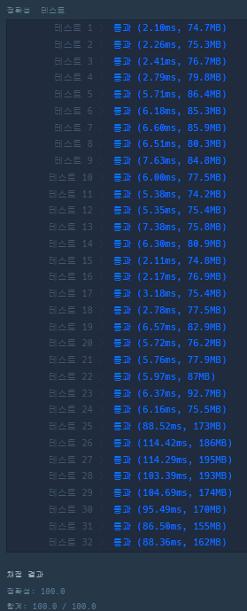

### **문제 : < 2019 KAKAO BLIND RECRUITMENT >  오픈 채팅방**

#### **문제 설명**

카카오톡 오픈채팅방에서는 친구가 아닌 사람들과 대화를 할 수 있는데, 본래 닉네임이 아닌 가상의 닉네임을 사용하여 채팅방에 들어갈 수 있다.

신입사원인 김크루는 카카오톡 오픈 채팅방을 개설한 사람을 위해, 다양한 사람들이 들어오고, 나가는 것을 지켜볼 수 있는 관리자창을 만들기로 했다. 채팅방에 누군가 들어오면 다음 메시지가 출력된다.

"[닉네임]님이 들어왔습니다."

채팅방에서 누군가 나가면 다음 메시지가 출력된다.

"[닉네임]님이 나갔습니다."

채팅방에서 닉네임을 변경하는 방법은 다음과 같이 두 가지이다.

* 채팅방을 나간 후, 새로운 닉네임으로 다시 들어간다.
* 채팅방에서 닉네임을 변경한다.

닉네임을 변경할 때는 기존에 채팅방에 출력되어 있던 메시지의 닉네임도 전부 변경된다.

예를 들어, 채팅방에 "Muzi"와 "Prodo"라는 닉네임을 사용하는 사람이 순서대로 들어오면 채팅방에는 다음과 같이 메시지가 출력된다.

"Muzi님이 들어왔습니다."  
"Prodo님이 들어왔습니다."

채팅방에 있던 사람이 나가면 채팅방에는 다음과 같이 메시지가 남는다.

"Muzi님이 들어왔습니다."  
"Prodo님이 들어왔습니다."  
"Muzi님이 나갔습니다."

Muzi가 나간후 다시 들어올 때, Prodo 라는 닉네임으로 들어올 경우 기존에 채팅방에 남아있던 Muzi도 Prodo로 다음과 같이 변경된다.

"Prodo님이 들어왔습니다."  
"Prodo님이 들어왔습니다."  
"Prodo님이 나갔습니다."  
"Prodo님이 들어왔습니다."

채팅방은 중복 닉네임을 허용하기 때문에, 현재 채팅방에는 Prodo라는 닉네임을 사용하는 사람이 두 명이 있다. 이제, 채팅방에 두 번째로 들어왔던 Prodo가 Ryan으로 닉네임을 변경하면 채팅방 메시지는 다음과 같이 변경된다.

"Prodo님이 들어왔습니다."  
"Ryan님이 들어왔습니다."  
"Prodo님이 나갔습니다."  
"Prodo님이 들어왔습니다."

채팅방에 들어오고 나가거나, 닉네임을 변경한 기록이 담긴 문자열 배열 record가 매개변수로 주어질 때, 모든 기록이 처리된 후, 최종적으로 방을 개설한 사람이 보게 되는 메시지를 문자열 배열 형태로 return 하도록 solution 함수를 완성하라.

#### **제한사항**

* record는 다음과 같은 문자열이 담긴 배열이며, 길이는 1 이상 100,000 이하이다.
* 다음은 record에 담긴 문자열에 대한 설명이다.
  + 모든 유저는 [유저 아이디]로 구분한다.
  + [유저 아이디] 사용자가 [닉네임]으로 채팅방에 입장 - "Enter [유저 아이디] [닉네임]" (ex. "Enter uid1234 Muzi")
  + [유저 아이디] 사용자가 채팅방에서 퇴장 - "Leave [유저 아이디]" (ex. "Leave uid1234")
  + [유저 아이디] 사용자가 닉네임을 [닉네임]으로 변경 - "Change [유저 아이디] [닉네임]" (ex. "Change uid1234 Muzi")
  + 첫 단어는 Enter, Leave, Change 중 하나이다.
  + 각 단어는 공백으로 구분되어 있으며, 알파벳 대문자, 소문자, 숫자로만 이루어져있다.
  + 유저 아이디와 닉네임은 알파벳 대문자, 소문자를 구별한다.
  + 유저 아이디와 닉네임의 길이는 1 이상 10 이하이다.
  + 채팅방에서 나간 유저가 닉네임을 변경하는 등 잘못 된 입력은 주어지지 않는다.

#### **문제 풀이**

* HashMap의 Key : Id, Value : 닉네임으로 저장
* ArrayList에 Id+"님이 들어왔습니다."를 저장하여 닉네임 변경되는 것을 마지막에 변경시키는 방식

```java
import java.util.ArrayList;
import java.util.HashMap;
import java.util.List;

class Solution {
    public String[] solution(String[] record) {
        List<String> result = new ArrayList<>();
        HashMap<String, String> map = new HashMap<>();

        for(String s : record){
            String[] temp = s.split(" ");
            // Enter
            if(temp[0].equals("Enter")){
                map.put(temp[1], temp[2]);
                result.add(temp[1]+"님이 들어왔습니다.");
            }else if(temp[0].equals("Leave")){
                result.add(temp[1]+"님이 나갔습니다.");
            }else{
                map.replace(temp[1], temp[2]);
            }
        }

        String[] answer = new String[result.size()];

        for(int i=0; i< result.size(); i++){
            int idx = result.get(i).indexOf("님");
            String id = result.get(i).substring(0, idx);
            answer[i] =map.get(id) + result.get(i).substring(idx);
        }

        return answer;
    }
}
```

---

> Point : 2  
>   
> 어렵지 않은 문제였다.  
> 풀이 방법이 다양하겠지만, 단순하게 접근하면 쉬운 것 같다.


