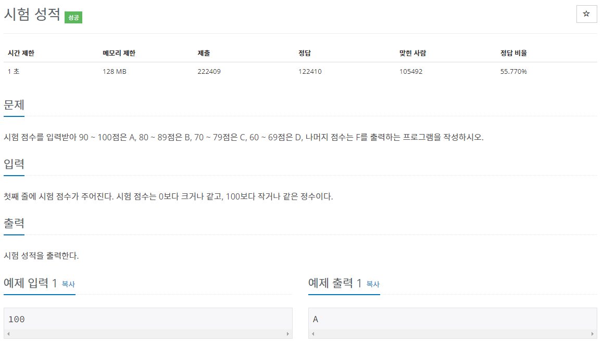
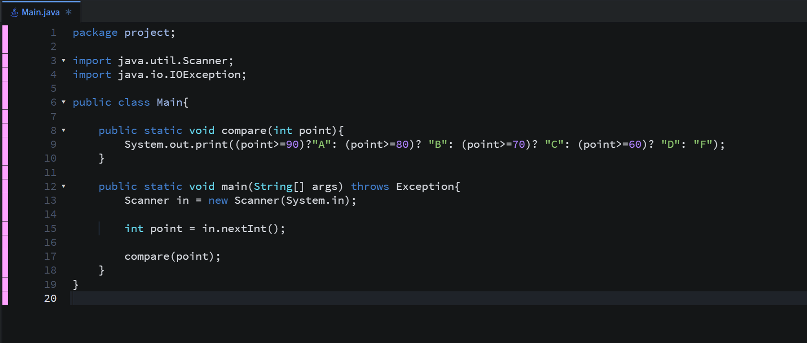
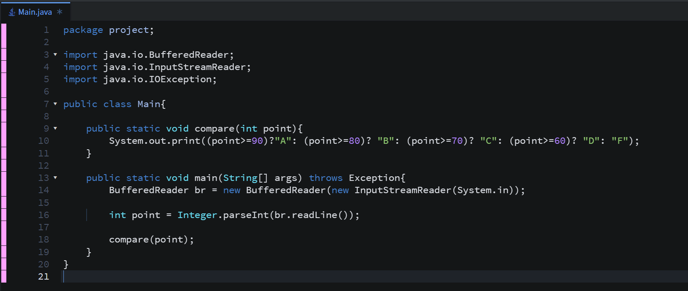
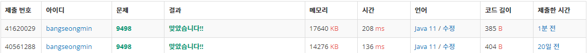

* **문제**

* **간략 설명**

**이 문제는 수를 입력받아서 점수에 맞는 성적을 출력하는 문제입니다.**

**(1 단계) 점수를 입력받는다.**

**(2 단계) 입력된 점수를 compare 메소드로 전달한다.**

**(3 단계) 삼항 연산자를 통해 입력된 값에 맞는 점수를 출력한다.**

* **풀이**

**- 방법 1(Scanner)**

**- 방법 2(BufferedReader)**

* **성능 비교**

**다른 게시글과 다르게 Scanner를 사용한 코드가 없어서 추가하였습니다.(2022-04-06)**

**방법 1 - 208ms**

**방법 2 - 136ms**

* **정리**

**삼항연산자를 사용한 경험이 적어서 사용하여 풀이하였지만, 가독성은 switch문을 사용하는 것이 좋을 것 같습니다.**
