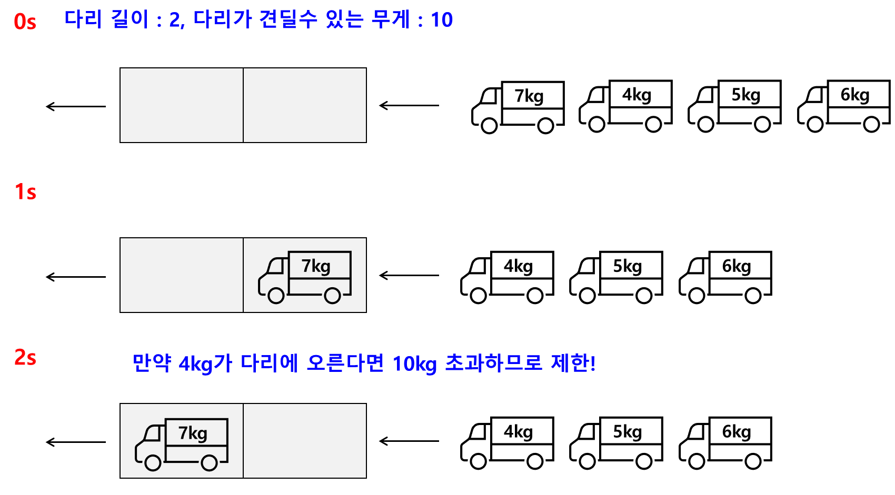
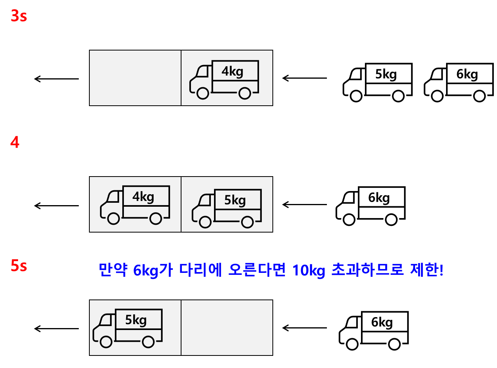
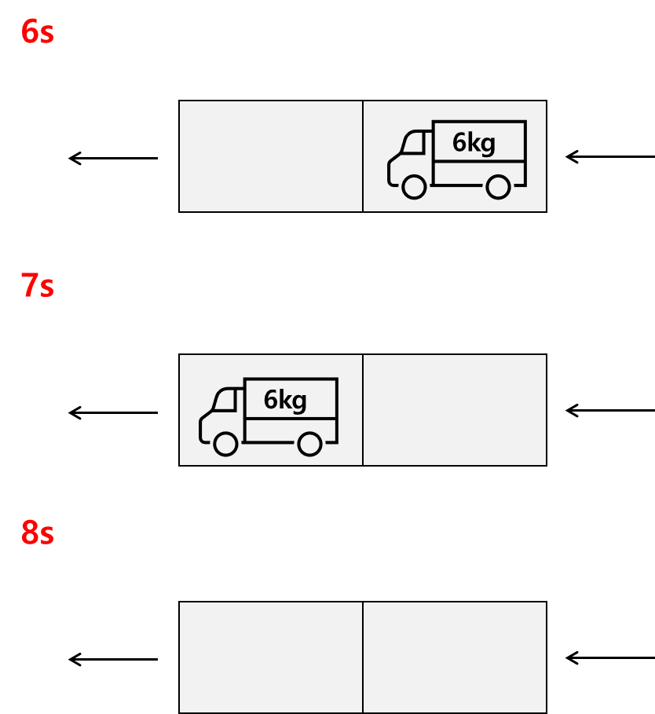
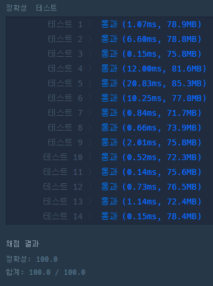

* [문제 : 스택/큐 > 다리를 지나는 트럭](https://school.programmers.co.kr/learn/courses/30/lessons/42583)

[프로그래머스

코드 중심의 개발자 채용. 스택 기반의 포지션 매칭. 프로그래머스의 개발자 맞춤형 프로필을 등록하고, 나와 기술 궁합이 잘 맞는 기업들을 매칭 받으세요.

programmers.co.kr](https://school.programmers.co.kr/learn/courses/30/lessons/42583)

---

### **문제 설명**

트럭 여러 대가 강을 가로지르는 일 차선 다리를 정해진 순으로 건너려 합니다. 모든 트럭이 다리를 건너려면 최소 몇 초가 걸리는지 알아내야 합니다. 다리에는 트럭이 최대 bridge\_length대 올라갈 수 있으며, 다리는 weight 이하까지의 무게를 견딜 수 있습니다. 단, 다리에 완전히 오르지 않은 트럭의 무게는 무시합니다.  

예를 들어, 트럭 2대가 올라갈 수 있고 무게를 10kg까지 견디는 다리가 있습니다. 무게가 [7, 4, 5, 6]kg인 트럭이 순서대로 최단 시간 안에 다리를 건너려면 다음과 같이 건너야 합니다.

| 경과 시간 | 다리를 지난 트럭 | 다리를 건너는 트럭 | 대기 트럭 |
| --- | --- | --- | --- |
| 0 | [] | [] | [7,4,5,6] |
| 1~2 | [] | [7] | [4,5,6] |
| 3 | [7] | [4] | [5,6] |
| 4 | [7] | [4, 5] | [6] |
| 5 | [7,4] | [5] | [6] |
| 6~7 | [7,4,5] | [6] | [] |
| 8 | [7,4,5,6] | [] | [] |

따라서, 모든 트럭이 다리를 지나려면 최소 8초가 걸립니다.  
solution 함수의 매개변수로 다리에 올라갈 수 있는 트럭 수 bridge\_length, 다리가 견딜 수 있는 무게 weight, 트럭 별 무게 truck\_weights가 주어집니다. 이때 모든 트럭이 다리를 건너려면 최소 몇 초가 걸리는지 return 하도록 solution 함수를 완성하세요.

### **제한 조건**

* bridge\_length는 1 이상 10,000 이하입니다.
* weight는 1 이상 10,000 이하입니다.
* truck\_weights의 길이는 1 이상 10,000 이하입니다.
* 모든 트럭의 무게는 1 이상 weight 이하입니다.

### **알고리즘**

* 고려사항
  1. 다리에 트럭이 최대 bridge\_length대 올라갈 수 있다.
  2. 다리는 weight 이하까지의 무게를 견딜 수 있다.
  3. 트럭이 다리에 올라가면 1초가 시작되는 것과 1칸씩 움직 일 때마다 1초가 지나간다





**정리하면**

* 트럭은 순차적으로 도로에 **진입**한다.
* 도로에 진입할 차량과 도로에 있는 차의 합이 도로가 견딜수 있는 무게를 초과할 경우, **대기!**
* 도로에 들어갈 수 있는 트럭 수가 꽉찰 경우 **대기!**

위와 같이 경우의 수를 계산하여 풀이하면 된다.

### **문제 풀이**

```java
import java.util.LinkedList;
import java.util.Queue;

class Solution {
    public int solution(int bridge_length, int weight, int[] truck_weights) {
        Queue<Integer> queue = new LinkedList<>();

        int sum = 0;
        int time = 0;

        for(int i=0; i<truck_weights.length; i++){

            int truck = truck_weights[i];

            while (true){
                Queue<Integer> queue = new LinkedList<>();

        int sum = 0;
        int time = 0;

        for(int i=0; i<truck_weights.length; i++){

            int truck = truck_weights[i];

            while (true){
            	// 다리가 가득찬 경우
                if(queue.size() == bridge_length){
                    sum -= queue.poll();
                // 트럭이 추가적으로 들어와도 문제 없는 경우
                }else if(sum + truck <= weight){
                    queue.add(truck);
                    sum += truck;
                    time++;
                    break;
                }else{
                    queue.add(0);
                    time++;
                }
            }

        }

        return time + bridge_length;
    }
}
```

---

> Point : 2  
>   
> 처음에 이해하는데 시간이 좀 걸렸다...  
> 문제 이해를 위해 그림을 그려서 이해하게 되었다.  
> 순차적으로 공통된 구조를 발견하여  
> 문제를 풀이하게 되었다.


