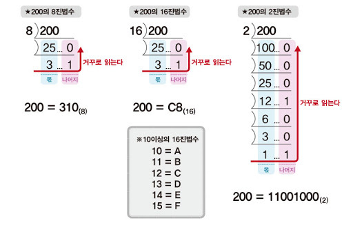
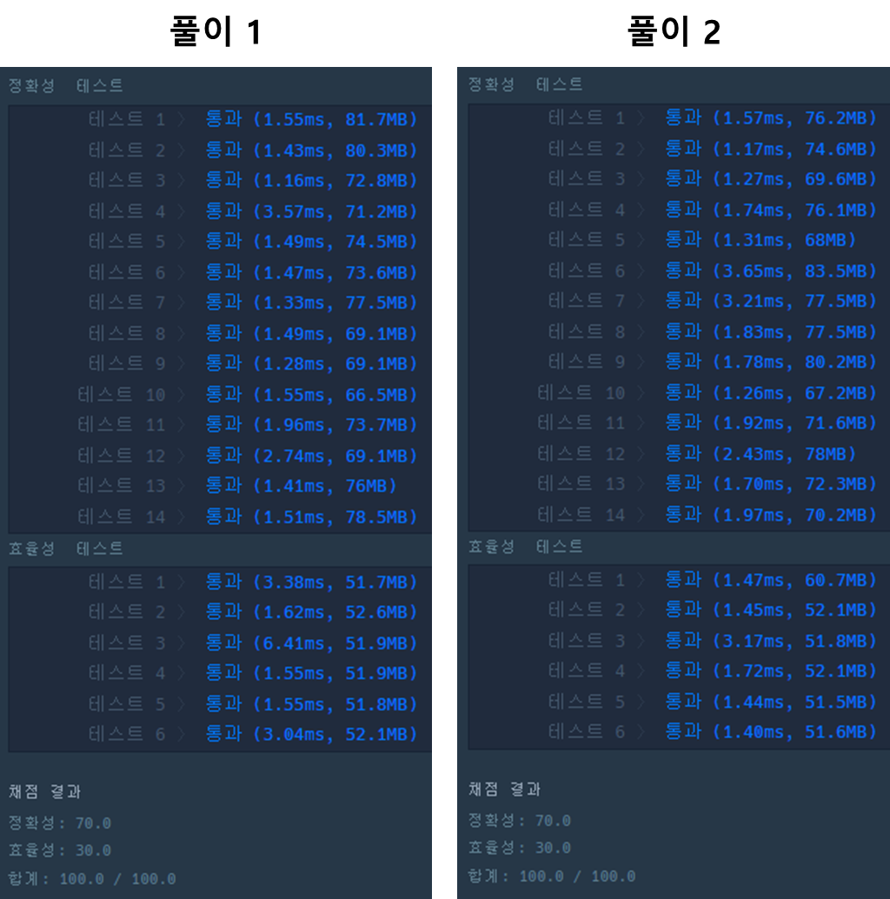

* [문제 : 124 나라의 숫자](https://school.programmers.co.kr/learn/courses/30/lessons/12899)

[프로그래머스

코드 중심의 개발자 채용. 스택 기반의 포지션 매칭. 프로그래머스의 개발자 맞춤형 프로필을 등록하고, 나와 기술 궁합이 잘 맞는 기업들을 매칭 받으세요.

programmers.co.kr](https://school.programmers.co.kr/learn/courses/30/lessons/12899)

---

### **문제 설명**

124 나라가 있습니다. 124 나라에서는 10진법이 아닌 다음과 같은 자신들만의 규칙으로 수를 표현합니다.

1. 124 나라에는 자연수만 존재합니다.
2. 124 나라에는 모든 수를 표현할 때 1, 2, 4만 사용합니다.

예를 들어서 124 나라에서 사용하는 숫자는 다음과 같이 변환됩니다.

| 10 진법 | 124나라 | 10진법 | 124나라 |
| --- | --- | --- | --- |
| 1 | 1 | 6 | 14 |
| 2 | 2 | 7 | 21 |
| 3 | 4 | 8 | 22 |
| 4 | 11 | 9 | 24 |
| 5 | 12 | 10 | 41 |

자연수 n이 매개변수로 주어질 때, n을 124 나라에서 사용하는 숫자로 바꾼 값을 return 하도록 solution 함수를 완성해 주세요.

### **제한 사항**

* n은 50,000,000이하의 자연수 입니다.

### **알고리즘**

**풀이의 핵심은 3진법이다.**

* 일반적인 3진법  
  0, 1, 2, 10, 11, 12, 20, 21, 22 ...
* 124의 나라 3진법  
  1, 2, 4, 11, 12, 14, 21, 22, 24, 41 ,42, 44 ...

자리숫자에 사용할 수 있는 숫자가 한 개 더있다는 차이가 있다.

일반적으로 진법을 계산할 때, 아래와 같이 나머지 연산을 통해 거꾸로 출력하는 방법을 사용한다.



**1 = 1 % 3 = 1**  
**2 =  2 % 3 = 2**  
**3 = 3 % 3 = 0 → 4**

단, 자리수가 하나 더 사용된다.

* 고려사항
  + 6의 표현  
    6 = 6 % 3 = 0 → 4, (6/3) % 3 = 2  => **24(정답은 14)**
  + 9의 표현  
    9 = 9 % 3 = 0 → 4, (9/3) % 3 = 0 => **44(정답은 24)** **값의 차이는 1, 2, 4 모두 일의 자리외에 모든 숫자에 올 수 있기 때문이다.  
    즉, 앞 자리 계산시 1을 빼주면 된다는 것이다.**

### **문제 풀이**

**풀이 1**

```java
public static String solution(int n){
    String[] numbers = {"4", "1", "2"};
    String answer = "";

    while (n > 0){
        int left = n % 3;
        n /= 3;

        if(left == 0) n--;
        answer = numbers[left] + answer;
    }

    return answer;
}
```

**풀이 2**

```java
public static String solution(int n){
    String[] num = {"4", "1", "2"};
    String answer = "";

    while (n > 0){
        answer = num[n % 3] + answer;
        n = (n-1) / 3;
    }

    return answer;
}
```

---

> Point : 9  
>   
> 이 문제를 이해하는데 시간이 오래걸렸다...  
> 문제적 남자를 자주 시청하는데, 그러한 문제를 푸는 느낌이 들었다.  
> 어려운 문제는 아니였지만, 사칙연산을 하면서   
> 다양한 방법으로 접근하고 있는 본인을 볼 수 있었다..  
>   
> 이 문제가 난이도가 높지 않지만, 풀면서 재미있었다!


