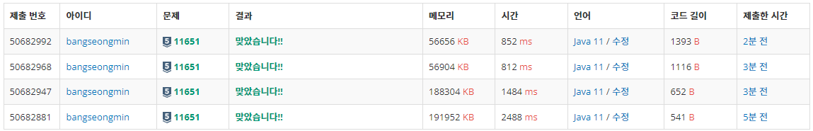

* [정렬 - 11651번 좌표 정렬하기 2](https://www.acmicpc.net/problem/11651)

[11651번: 좌표 정렬하기 2

첫째 줄에 점의 개수 N (1 ≤ N ≤ 100,000)이 주어진다. 둘째 줄부터 N개의 줄에는 i번점의 위치 xi와 yi가 주어진다. (-100,000 ≤ xi, yi ≤ 100,000) 좌표는 항상 정수이고, 위치가 같은 두 점은 없다.

www.acmicpc.net](https://www.acmicpc.net/problem/11651)

---

### **문제**

2차원 평면 위의 점 N개가 주어진다. 좌표를 y좌표가 증가하는 순으로, y좌표가 같으면 x좌표가 증가하는 순서로 정렬한 다음 출력하는 프로그램을 작성하시오.

### **입력과 출력**

* 입력
  + 첫째 줄에 점의 개수 N (1 ≤ N ≤ 100,000)이 주어진다. 둘째 줄부터 N개의 줄에는 i번점의 위치 xi와 yi가 주어진다. (-100,000 ≤ xi, yi ≤ 100,000) 좌표는 항상 정수이고, 위치가 같은 두 점은 없다.
* 출력
  + 첫째 줄부터 N개의 줄에 점을 정렬한 결과를 출력한다.

### **알고리즘**

[11650번 문제](tistory-197.html)와 동일한 문제입니다. 

람다식을 사용하여 Arrays.sort()를 확장하는 방법에  대해 11650번에서 다루었으므로 생략하도록 하겠습니다.

11650번과 비교하면 11650번은 1순위 X, 2순위 Y좌표 였다면 11651번 문제는 1순위 Y, 2순위 X 좌표로 우선순위가 변동되었다.

### **풀이**

**풀이 1 : [Scanner + **System.out.println()]****

```java
import java.util.Scanner;
import java.util.Arrays;

public class Main {
	public static void main(String[] args) {

		Scanner in = new Scanner(System.in);

		int N = in.nextInt();

		int[][] arr = new int[N][2];

		for(int i = 0; i < N; i++) {
			arr[i][0] = in.nextInt();
			arr[i][1] = in.nextInt();
		}

		Arrays.sort(arr, (e1, e2) -> {
			if(e1[1] == e2[1]) {
				return e1[0] - e2[0];
			} else {
				return e1[1] - e2[1];
			}
		});

		for(int i = 0; i < N; i++) {
			System.out.println(arr[i][0] + " " + arr[i][1]);
		}
	}
}
```

**풀이 2 : [Scanner + **StringBuilder****]****

```java
import java.util.Scanner;
import java.util.Arrays;

public class Main {
	public static void main(String[] args) {

		Scanner in = new Scanner(System.in);

		int N = in.nextInt();

		int[][] arr = new int[N][2];

		for(int i = 0; i < N; i++) {
			arr[i][0] = in.nextInt();
			arr[i][1] = in.nextInt();
		}

		Arrays.sort(arr, (e1, e2) -> {
			if(e1[1] == e2[1]) {
				return e1[0] - e2[0];
			} else {
				return e1[1] - e2[1];
			}
		});

        StringBuilder sb = new StringBuilder();

        for(int i=0; i < N; i++){
            sb.append(arr[i][0] + " " + arr[i][1]).append("\n");
        }
        System.out.println(sb);
	}
}
```

**풀이 3 : [**BufferedReader**+ StringBuilder]**

```java
import java.io.BufferedReader;
import java.io.IOException;
import java.io.InputStreamReader;
import java.util.*;

public class Main {

    public static void main(String[] args) throws IOException {
        solution2();
    }

    private static void solution2() throws IOException {
        BufferedReader br = new BufferedReader(new InputStreamReader(System.in));
        StringTokenizer st;

        // 자연수 N을 정수에 저장
        int N = Integer.parseInt(br.readLine());

        int[][] arr = new int[N][2];    // (x, y)좌표가 N개

        for(int i = 0; i < N; i++) {
            st = new StringTokenizer(br.readLine());
            arr[i][0] = Integer.parseInt(st.nextToken());
            arr[i][1] = Integer.parseInt(st.nextToken());
        }

        Arrays.sort(arr, (e1, e2) -> {
			if(e1[1] == e2[1]) {
				return e1[0] - e2[0];
			} else {
				return e1[1] - e2[1];
			}
		});

        StringBuilder sb = new StringBuilder();

        for(int i=0; i < N; i++){
            sb.append(arr[i][0] + " " + arr[i][1]).append("\n");
        }

        System.out.println(sb);
    }

}
```

**풀이 4 : [**BufferedReader**+ StringBuilder]**

```java
import java.io.BufferedReader;
import java.io.IOException;
import java.io.InputStreamReader;
import java.util.*;

public class Main {
    static class Point {
        int x;
        int y;

        public Point(int x, int y) {
            this.x = x;
            this.y = y;
        }
    }

    public static void main(String[] args) throws IOException {
        solution3();
    }

    private static void solution3() throws IOException {
        BufferedReader br = new BufferedReader(new InputStreamReader(System.in));
        StringTokenizer st;

        // 자연수 N을 정수에 저장
        int N = Integer.parseInt(br.readLine());

        // int[][] 을 대신하여 클래스를 만들어 배열 사용
        Point[] points = new Point[N];

        for(int i = 0; i < N; i++) {
            st = new StringTokenizer(br.readLine());
            int x = Integer.parseInt(st.nextToken());
            int y = Integer.parseInt(st.nextToken());
            points[i] = new Point(x, y);
        }

        Arrays.sort(points, (e1, e2) -> {
            if(e1.y == e2.y) {
                return e1.x - e2.x;
            } else {
                return e1.y - e2.y;
            }
        });

        StringBuilder sb = new StringBuilder();

        for(int i=0; i < N; i++){
            sb.append(points[i].x + " "+points[i].y+"\n");
        }

        System.out.println(sb);
    }
}
```

---

### **성능**



11651번 문제 풀이 실행 결과

**채점 번호 : 50682992  -  **************풀이**************4 : BufferedReader + StringBuilder + inner 클래스**

**채점 번호 : 50682968  -  **************풀이**************3 : BufferedReader + StringBuilder + 2차원 배열**

**채점 번호 : 50682947**-  **************풀이**************2 : Scanner + StringBuilder **+ 2차원 배열******

**채점 번호 : 50682881**-  **************풀이**************1 : Scanner + System.out.println()******+ 2차원 배열**********

**1. System.out.println을 반복해서 사용하는 것보다 StringBuilder를 통해 한번에 출력하는 것이 **성능이 훨씬 좋다.****

**2. Scanner보다 BufferedReader를 사용하는 것이 성능이 훨씬 좋다.**

**3. 내부 클래스보다 2차원 배열을 사용하는 것이 성능이 조금 더 좋다.**

3번과 4번을 비교하면 4번은 클래스에 객체를 지속적으로 생성해야하는 점이 시간을 더 늘어나게 만든것으로 추측된다.
