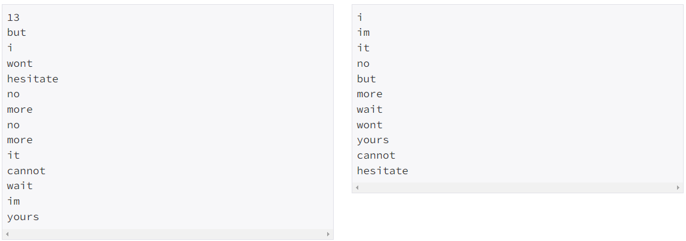
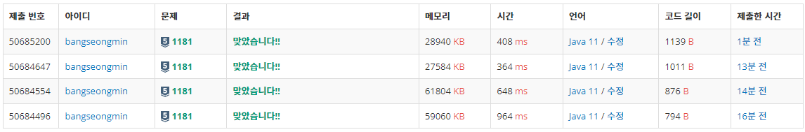

* 정렬 - [1181번, 단어 정렬](https://www.acmicpc.net/problem/1181)

[1181번: 단어 정렬

첫째 줄에 단어의 개수 N이 주어진다. (1 ≤ N ≤ 20,000) 둘째 줄부터 N개의 줄에 걸쳐 알파벳 소문자로 이루어진 단어가 한 줄에 하나씩 주어진다. 주어지는 문자열의 길이는 50을 넘지 않는다.

www.acmicpc.net](https://www.acmicpc.net/problem/1181)

---

### **문제**

알파벳 소문자로 이루어진 N개의 단어가 들어오면 아래와 같은 조건에 따라 정렬하는 프로그램을 작성하시오.

1. 길이가 짧은 것부터
2. 길이가 같으면 사전 순으로

### **입력과 출력**

* **입력**
  + 첫째 줄에 단어의 개수 N이 주어진다. (1 ≤ N ≤ 20,000) 둘째 줄부터 N개의 줄에 걸쳐 알파벳 소문자로 이루어진 단어가 한 줄에 하나씩 주어진다. 주어지는 문자열의 길이는 50을 넘지 않는다.
* **출력**
  + 조건에 따라 정렬하여 단어들을 출력한다. 단, 같은 단어가 여러 번 입력된 경우에는 한 번씩만 출력한다.

### **알고리즘**

출력 조건 중 "단, 같은 단어가 여러 번 입력된 경우에는 한 번씩만 출력한다."라는 조건을 유의해야한다.



입력과 출력을 비교했을 때, 정렬 순서는 글자 길이 + 알파벳 순서대로 정렬되는 것을 볼 수 있다.

이 문제는 람다식을 사용하여 풀이하여야 한다. ([11650](tistory-197.html)번에서 람다식에 관련된 설명을 이미 하였으므로 생략하겠다.)

---

### **풀이**

#### **풀이 1 : [Scanner + System.out.println]**

* **Scanner 주의 사항****Scanner는 기본적으로 서로 다른 자료형을 받고싶은 경우 어떤 형을 먼저 받냐에 따라 에러가 날 수 있다.  
  콘솔창에서도 실행해보면 알겠지만, nextInt()로 정수를 받은 뒤, nextLine()을 사용하게 되면 개행문자가 저장된다.   
  이 점을 유의하여 개발해야한다.**

```java
import java.util.*;

public class Main {
    public static void main(String[] args) {
       solution();
    }

    public static void solution(){
        Scanner in = new Scanner(System.in);

        int N = in.nextInt();

        in.nextLine();      // 개행 문자 제거

        String[] arr = new String[N];

        for(int i=0; i<N; i++){
            arr[i] = in.nextLine();
        }

        Arrays.sort(arr, (o1, o2) -> {
            if(o1.length() == o2.length()){
                return o1.compareTo(o2);
            }else
                return o1.length() - o2.length();
        });

        System.out.println(arr[0]);

        for(int i=1; i<N; i++){
            if(!arr[i].equals(arr[i-1])){
                System.out.println(arr[i]);
            }
        }
    }
}
```

#### **풀이 2 :****[Scanner + StringBuilder]**

```java
import java.util.*;

public class Main {
    public static void main(String[] args) {
       solution();
    }

    public static void solution(){
        Scanner in = new Scanner(System.in);

        int N = in.nextInt();

        in.nextLine();      // 개행 문자 제거

        String[] arr = new String[N];

        for(int i=0; i<N; i++){
            arr[i] = in.nextLine();
        }

        Arrays.sort(arr, (o1, o2) -> {
            if(o1.length() == o2.length()){
                return o1.compareTo(o2);
            }else
                return o1.length() - o2.length();
        });


        StringBuilder sb = new StringBuilder();
        sb.append(arr[0]).append("\n");

        for(int i=1; i<N; i++){
            if(!arr[i].equals(arr[i-1])){
                sb.append(arr[i]).append("\n");
            }
        }

        System.out.println(sb);
    }
}
```

#### **풀이 3 : [BufferedReader + StringBuilder]**

```java
import java.io.BufferedReader;
import java.io.IOException;
import java.io.InputStreamReader;
import java.util.*;

public class Main {
    public static void main(String[] args) throws IOException {
       solution();
    }

    public static void solution() throws IOException {
        BufferedReader br = new BufferedReader(new InputStreamReader(System.in));

        int N = Integer.parseInt(br.readLine());

        String[] arr = new String[N];

        for(int i=0; i<N; i++){
            arr[i] = br.readLine();
        }

        Arrays.sort(arr, (o1, o2) -> {
            if(o1.length() == o2.length()){
                return o1.compareTo(o2);
            }else
                return o1.length() - o2.length();
        });


        StringBuilder sb = new StringBuilder();
        sb.append(arr[0]).append("\n");

        for(int i=1; i<N; i++){
            if(!arr[i].equals(arr[i-1])){
                sb.append(arr[i]).append("\n");
            }
        }

        System.out.println(sb);
    }
}
```

#### **풀이 4 : [BufferedReader + StringBuilder + List]**

* 배열 대신 ArrayList 사용
* 반복문에서 체크하였던 중복 제거 작업을 stream을 통한 제거

```java
import java.io.BufferedReader;
import java.io.IOException;
import java.io.InputStreamReader;
import java.util.*;
import java.util.stream.Collectors;

public class Main {
    public static void main(String[] args) throws IOException {
       solution();
    }

    public static void solution() throws IOException {
        BufferedReader br = new BufferedReader(new InputStreamReader(System.in));

        int N = Integer.parseInt(br.readLine());

        ArrayList<String> list = new ArrayList<>();

        // 문자열 저장
        for(int i=0; i<N; i++){
            list.add(br.readLine());
        }

        // 중복 제거
        List<String> newList = list.stream().distinct().collect(Collectors.toList());

        // 정렬
        newList.sort((o1, o2) -> {
            if (o1.length() == o2.length()) {
                return o1.compareTo(o2);
            } else
                return o1.length() - o2.length();
        });

        // 출력
        StringBuilder sb = new StringBuilder();

        for(String temp : newList){
            sb.append(temp).append("\n");
        }

        System.out.println(sb);
    }
}
```

---

### **성능**



**채점 번호 : 50685200 -  ************풀이************ 4 : BufferedReader + StringBuilder +** **List**

**채점 번호 : **50684647** -  **************풀이**************3 : BufferedReader + StringBuilder**

**채점 번호 : 50684554 -  **************풀이**************2 : Scanner + StringBuilder**

**채점 번호 : 50684496  -  **************풀이**************1 : Scanner + System.out.println**

입력의 경우 : Scanner < BufferedReader

출력의 경우 : 반복문 < StringBuilder 

자료구조 : List < 배열

배열을 이용한 풀이가 성능이 가장 우수한 것으로 판단된다.

배열에서 중복을 제거하기 위한 방법중 리스트로 전환하는 작업이 있긴하지만, 결론적으로 List를 사용하는 것이므로 List를 사용한 풀이와 비교한 풀이방법을 선택하게 되었다.
