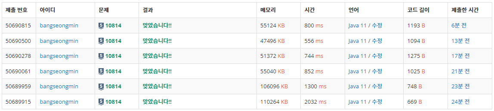

* 정렬 - [10814번, 나이순 정렬](https://www.acmicpc.net/problem/10814)

---

### **문제**

온라인 저지에 가입한 사람들의 나이와 이름이 가입한 순서대로 주어진다. 이때, 회원들을 나이가 증가하는 순으로, 나이가 같으면 먼저 가입한 사람이 앞에 오는 순서로 정렬하는 프로그램을 작성하시오.

### **입력과 출력**

* **입력**
  + 첫째 줄에 온라인 저지 회원의 수 N이 주어진다. (1 ≤ N ≤ 100,000)
  + 둘째 줄부터 N개의 줄에는 각 회원의 나이와 이름이 공백으로 구분되어 주어진다. 나이는 1보다 크거나 같으며, 200보다 작거나 같은 정수이고, 이름은 알파벳 대소문자로 이루어져 있고, 길이가 100보다 작거나 같은 문자열이다. 입력은 가입한 순서로 주어진다.
* **출력**
  + 첫째 줄부터 총 N개의 줄에 걸쳐 온라인 저지 회원을 나이 순, 나이가 같으면 가입한 순으로 한 줄에 한 명씩 나이와 이름을 공백으로 구분해 출력한다.

### **알고리즘**

**출력 조건을 보게 되면 우선순위 순서를 알 수 있다.**

**"온라인 저지 회원을 나이순, 나이가 같으면 가입한 순으로 한줄에 한 명씩 나이와 이름을 구분해 출력한다."**

**이 문제의 경우 다양한 방법이 존재한다.**

1. **String 2차원 배열 구조**  
   각 배열에 나이와 이름을 저장한 뒤, 나이 순으로 정렬하는 방법이다.
2. **클래스 구조**나이와 이름을 갖는 클래스를 생성하여 정렬하는 방법이다.
3. **StringBuilder을 배열처럼 사용하는 구조**이 경우 Counting Sort를 통해 정렬할 수 있다.

---

### **풀이**

#### **풀이 1 : **[String[][] + Scanner + System.out.println]****

```java
import java.util.Arrays;
import java.util.Comparator;
import java.util.Scanner;

public class Main {
    public static void main(String[] args) {
       solution();
    }

    public static void solution() {
        Scanner in = new Scanner(System.in);

        int N = in.nextInt();
        String[][] arr = new String[N][2];

        for(int i=0; i<N; i++){
            arr[i][0] = in.next();  // 나이
            arr[i][1] = in.next();  // 이름
        }

        Arrays.sort(arr, Comparator.comparingInt(o -> Integer.parseInt(o[0])));

        for(int i=0; i<N; i++){
            System.out.println(arr[i][0] + " " +arr[i][1]);
        }
    }
}
```

#### **풀이 2 : **[String[][] + Scanner + StringBuilder]****

```java
import java.util.Arrays;
import java.util.Comparator;
import java.util.Scanner;

public class Main {
    public static void main(String[] args) {
       solution();
    }

    public static void solution() {
        Scanner in = new Scanner(System.in);

        int N = in.nextInt();
        String[][] arr = new String[N][2];

        for(int i=0; i<N; i++){
            arr[i][0] = in.next();  // 나이
            arr[i][1] = in.next();  // 이름
        }

        Arrays.sort(arr, Comparator.comparingInt(o -> Integer.parseInt(o[0])));


        StringBuilder sb = new StringBuilder();
        for(int i=0; i<N; i++){
            sb.append(arr[i][0] + " " +arr[i][1]).append("\n");
        }

        System.out.println(sb);
    }
}
```

#### **풀이 3 : **[String[][] + BufferedReader + StringBuilder]****

```java
import java.io.BufferedReader;
import java.io.IOException;
import java.io.InputStreamReader;
import java.util.Arrays;
import java.util.Comparator;
import java.util.StringTokenizer;

public class Main {
    public static void main(String[] args) throws IOException {
       solution();
    }

    public static void solution() throws IOException {
        BufferedReader br = new BufferedReader(new InputStreamReader(System.in));
        StringTokenizer st;

        int N = Integer.parseInt(br.readLine());
        String[][] arr = new String[N][2];

        for(int i=0; i<N; i++){
            st = new StringTokenizer(br.readLine());
            arr[i][0] = st.nextToken();  // 나이
            arr[i][1] = st.nextToken();  // 이름
        }

        Arrays.sort(arr, Comparator.comparingInt(o -> Integer.parseInt(o[0])));


        StringBuilder sb = new StringBuilder();
        for(int i=0; i<N; i++){
            sb.append(arr[i][0] + " " +arr[i][1]).append("\n");
        }

        System.out.println(sb);
    }
}
```

#### **풀이 4 : **[Person[] + BufferedReader + StringBuilder]****

```java
import java.io.BufferedReader;
import java.io.IOException;
import java.io.InputStreamReader;
import java.util.Arrays;
import java.util.Comparator;
import java.util.StringTokenizer;

public class Main {
    public static void main(String[] args) throws IOException {
       solution();
    }

    public static void solution() throws IOException {
        BufferedReader br = new BufferedReader(new InputStreamReader(System.in));
        StringTokenizer st;

        int N = Integer.parseInt(br.readLine());
        Person[] people = new Person[N];

        for(int i=0; i<N; i++){
            st = new StringTokenizer(br.readLine());
            int age = Integer.parseInt(st.nextToken());  // 나이
            String name = st.nextToken();  // 이름
            people[i]= new Person(age, name);
        }

        Arrays.sort(people, Comparator.comparingInt(o -> o.age));


        StringBuilder sb = new StringBuilder();
        for(int i=0; i<N; i++){
            sb.append(people[i].age + " " + people[i].name).append("\n");
        }

        System.out.println(sb);
    }

    public static class Person{
        int age;
        String name;

        public Person(int age, String name) {
            this.age = age;
            this.name = name;
        }
    }
}
```

#### **풀이 5 : **[StringBuilder[] + BufferedReader + StringBuilder]****

```java
import java.io.BufferedReader;
import java.io.IOException;
import java.io.InputStreamReader;
import java.util.StringTokenizer;

public class Main {
    public static void main(String[] args) throws IOException {
       solution();
    }

    public static void solution() throws IOException {
        BufferedReader br = new BufferedReader(new InputStreamReader(System.in));
        StringTokenizer st;

        int N = Integer.parseInt(br.readLine());

        // 나이의 범위 : 1 ~ 200
        StringBuilder[] people = new StringBuilder[201];
        for(int i=0; i< people.length; i++){
            people[i] = new StringBuilder();
        }

        for(int i=0; i<N; i++){
            st = new StringTokenizer(br.readLine());

            int age = Integer.parseInt(st.nextToken());
            String name = st.nextToken();

            people[age].append(age+" "+name).append("\n");
        }

        StringBuilder sb = new StringBuilder();
        for(StringBuilder temp : people){
            sb.append(temp);
        }

        System.out.println(sb);
    }
}
```

#### **풀이 6 : **[LinkedList[] + BufferedReader + StringBuilder]****

```java
import java.io.BufferedReader;
import java.io.IOException;
import java.io.InputStreamReader;
import java.util.*;

public class Main {
    public static void main(String[] args) throws IOException {
       solution();
    }

    public static void solution() throws IOException {
        BufferedReader br = new BufferedReader(new InputStreamReader(System.in));
        StringTokenizer st;

        int N = Integer.parseInt(br.readLine());

        LinkedList<Person> people = new LinkedList<>();

        for(int i=0; i<N; i++){
            st = new StringTokenizer(br.readLine());

            int age = Integer.parseInt(st.nextToken());
            String name = st.nextToken();
            people.add(new Person(age, name));
        }

        people.sort(Comparator.comparingInt(o -> o.age));

        StringBuilder sb = new StringBuilder();
        for(Person person : people){
            sb.append(person.age + " " + person.name).append("\n");
        }

        System.out.println(sb);
    }

    public static class Person{
        int age;
        String name;

        public Person(int age, String name) {
            this.age = age;
            this.name = name;
        }
    }
}
```

#### 

---

### **성능**



10814번 나이순 정렬 문제 풀이 결과

**채점 번호 : 50690815 - **풀이 6 ; [********LinkedList[] + BufferedReader + StringBuilder********]****

****채점 번호 : **50690500**- ****풀이**** **5 ; [**********StringBuilder[] + BufferedReader + StringBuilder**********]******

******채점 번호 : **50690278**  - ********풀이**********4 : [************Person[] + BufferedReader + StringBuilder************]********

********채점 번호 : **50690061**  - ********풀이**********3 : [**************String[][] + BufferedReader + StringBuilder**************]**********

**채점 번호 : **50689959**  - ********풀이**********2 : [********String[][] + Scanner + StringBuilder********]****

****채점 번호 : **50689915**  - ********풀이**********1 : [******String[][] + Scanner + System.out.println]****

**입력의 경우** : Scanner < BufferedReader

**출력의** **경우** : 반복문 < StringBuilder 

**자료구조** : String[][] < LinkedList < Person 클래스 < StringBuilder

이 문제를 풀이하면서 나이가 200까지 제한되었다는 점에서 카운팅 정렬이 생각나게 되었다.

이를 통해 더 효율적인 풀이를 할 수 있었다.
