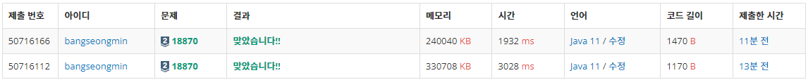

* 정렬 - [18870번, 좌표 압축](https://www.acmicpc.net/problem/18870)

---

### **문제**

수직선 위에 N개의 좌표 X1, X2, ..., XN이 있다. 이 좌표에 좌표 압축을 적용하려고 한다.

Xi를 좌표 압축한 결과 X'i의 값은 Xi > Xj를 만족하는 서로 다른 좌표의 개수와 같아야 한다.

X1, X2, ..., XN에 좌표 압축을 적용한 결과 X'1, X'2, ..., X'N를 출력해보자.

### **입력과 출력**

* 입력  
  첫째 줄에 N이 주어진다.  
  둘째 줄에 공백 한 칸으로 구분된 X1, X2, ..., XN이 주어진다.
* 출력  
  첫째 줄에 X'1, X'2, ..., X'N을 공백 한 칸으로 구분해서 출력한다.
* 제한  
  첫째 줄에 X'1, X'2, ..., X'N을 공백 한 칸으로 구분해서 출력한다.

### **알고리즘**

배열의 각 원소값에 대한 '순위'를 매기는 것이다.

문제 예시를 보면, arr = {2, 4, -10, 4, -9} 에서 각 원수를 순위를 매기는 것이다.

이때, 순위는 값이 낮을수록 높다는 점을 유의해야 한다.

순위를 정리하면, rank {2, 3, 0, 3, 1}이다.

문제의 조건은

1. 낮은 값이 높은 순위를 갖는다.(0 순위부터 시작)
2. 중복되는 원소는 같은 순위를 갖는다.

낮은 값이 높은 순위를 갖는다는 것, 결국 순위를 정한다는 것은 오름차순으로 **'정렬'**을 했을 때 **첫 번째 인덱스에 있는 원소가 가장 높은 순위를 갖고, 반대로 가장 마지막에 있는 원소가 가장 낮은 순위를 갖는다**는 것을 의미한다.

중복되는 원소는 같은 순위를 갖는다는 것은 앞선 예제에서도 보았듯이 4라는 값에 대응되는 순위는 모두 3으로 같은 순위로 매칭이 되어야 한다는 것이다.

> 💡 중복되는 원소를 하나만 갖고 있을 수 있도록 하는 자료구조인 Set 혹은 Map 자료구조를 활용하면 되지 않을까?  
> > 순위를 매겨야하므로, 중복되지 않으면서 각 원소에 대한 순위를 매길 수 있는 자료구조인 HashMap자료구조를 활용할 것이다.

정리하면

1. 원본 배열을 입력받는다.
2. 배열을 정렬한다.
3. 정렬된 배열과 순위를 조합한 값을 저장한다.
4. 원본 배열과 동일한 순서대로 순위를 배열로 저장한다.

### **풀이**

**풀이 1 : [Scanner + StringBuilder]**

```java
import java.util.Arrays;
import java.util.HashMap;
import java.util.Scanner;

public class Main {
    public static void main(String[] args) {
       solution();
    }

    public static void solution() {
        Scanner in = new Scanner(System.in);

        int N = in.nextInt();

        int[] origin = new int[N];                              // 원본 배열
        int[] sorted = new int[N];                              // 정렬 할 배열
        HashMap<Integer, Integer> ranking = new HashMap<>(); // value, rank

        // 1. 입력
        for(int i=0; i<N; i++){
            sorted[i] = origin[i] = in.nextInt();
        }

        // 2. 정렬
        Arrays.sort(sorted);

        // 3. 정렬 된 배열을 순회하면서 저장(중복 제외)
        int rank = 0;
        for(int v: sorted){
            if(!ranking.containsKey(v)){
                ranking.put(v, rank);
                rank++;
            }
        }


        // 4. 출력
        StringBuilder sb = new StringBuilder();
        for(int key : origin){
            rank = ranking.get(key);
            sb.append(rank).append(' ');
        }

        System.out.println(sb);
    }
}
```

**풀이 2 : [BufferedReader + StringBuilder]**

```java
import java.io.BufferedReader;
import java.io.IOException;
import java.io.InputStreamReader;
import java.util.Arrays;
import java.util.HashMap;
import java.util.StringTokenizer;

public class Main {
    public static void main(String[] args) throws IOException {
       solution();
    }

    public static void solution() throws IOException {
        BufferedReader br = new BufferedReader(new InputStreamReader(System.in));
        StringTokenizer st;

        int N = Integer.parseInt(br.readLine());

        int[] origin = new int[N];                              // 원본 배열
        int[] sorted = new int[N];                              // 정렬 할 배열
        HashMap<Integer, Integer> ranking = new HashMap<>(); // value, rank

        // 1. 입력
        st = new StringTokenizer(br.readLine());
        for(int i=0; i<N; i++){
            sorted[i] = origin[i] = Integer.parseInt(st.nextToken());
        }

        // 2. 정렬
        Arrays.sort(sorted);

        // 3. 정렬 된 배열을 순회하면서 저장(중복 제외)
        int rank = 0;
        for(int v: sorted){
            if(!ranking.containsKey(v)){
                ranking.put(v, rank);
                rank++;
            }
        }


        // 4. 출력
        StringBuilder sb = new StringBuilder();
        for(int key : origin){
            rank = ranking.get(key);
            sb.append(rank).append(' ');
        }

        System.out.println(sb);
    }
}
```

---

### **성능**



**채점 번호 : 50716166  -  방법 2 : BufferedReader + StringBuilder**

**채점 번호 : 50716112****-  방법 1 : Scanner + StringBuilder**

**이 문제는 StringBuilder를 통해서 출력문을 저장해서 풀지 않을 경우, 시간 초과가 되므로 StringBuilder를 통해 출력문을 한 번에 출력해야 한다.**
