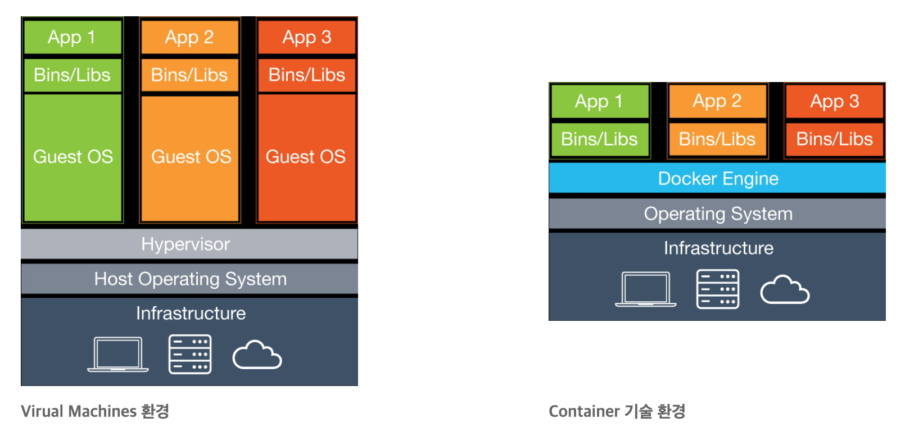
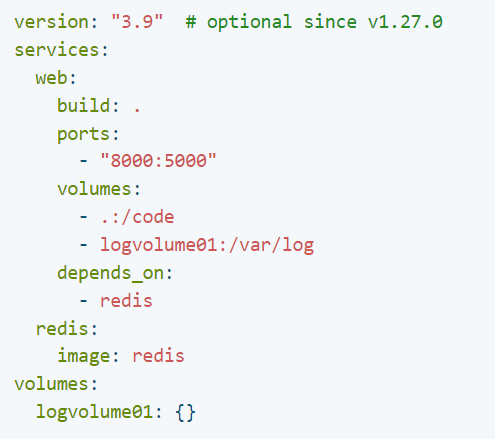
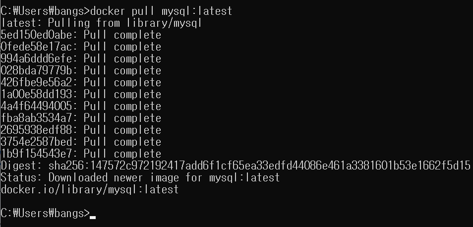
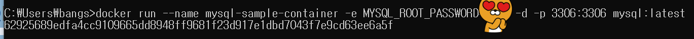
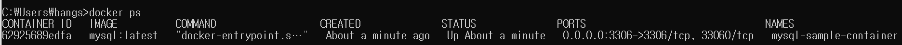
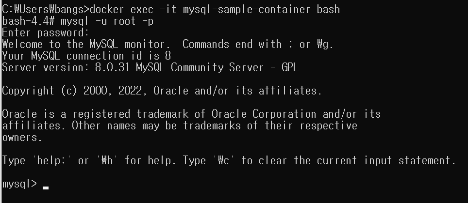

### **강의 소개**

* 강의명 : 나만의 MVC 프레임워크 만들기
* 강의 목표
  + 객체지향 프로그래밍에 대한 이해
  + HTTP 프로토콜 및 HTTP 웹 서버 동작 원리 이해
  + MVC 구조 및 DI 내부 동작 원리 이해

---

### **개발 환경 구축**

#### **JDK & 통합 개발 환경 & 톰캣 설치**

**1. [JDK 설치](https://adoptium.net/temurin/releases/?version=11)**

[Latest Releases | Adoptium

adoptium.net](https://adoptium.net/temurin/releases/?version=11)
> 💡 JDK 설치 확인 방법  
> CMD 창에서 java -version을 쳐서 자바 버전을 확인하다.

**2. JDK 구조**

JDK 구조

* **JDK(Java Development Kit)**
  + JRE + Java Development Tools
  + 소스코드를 작성할 때 사용하는 자바 언어는 플랫폼에 독립적이다.
  + 올라클은 자바 11부터 JDK만 제공하고 있다. 모듈 시스템을 사용할 수 있으므로 JRE를 따로 제공하지 않는다.
* **JRE(Java Runtime Enviroment)**
  + 자바 애플리케이션을 실행할 수 있도록 구성된 배포판
  + JVM과 핵심 라이브러리 및 자바 런타임 환경에서 사용하는 프로퍼티 세팅이나 리소스 파일을 가지고 있다.
  + 개발하는데 필요한 툴은 제공되지 않는다.
* **JVM(Java Virtual Machine) - 참고[1]**  
  + class file 안에 들어있는 자바 바이트코드를 인터프리터나 JIT 컴파일러를 실행해 OS에 특화된 코드로 변환하여 실행한다.
  + 플랫폼에 종속적이다.
  + 바이트 코드를 어떻게 실행하는지에 대한 스팩이며 구현체는 다양하다.
  + JVM 벤더 : 오라클, 아마존, Azul etc  
    \* JVM은 단독으로 제공되지 않으며 최소한의 배포 단위는 JRE이다.
* **Java Development Tools**
  + Compiler
  + Debugger
  + etc

**3. temurin JDK 특징**

* **OpenJDK - 참고[2]**
* 일반적으로 제일 많이 사용되는 핫스팟 JVM을 사용하고 있다.
* Eclipse에서 제공하는 JDK
* 커뮤니티에 의해 빌드되고 있는 구현체이다.

**4. 통합 개발환경 - [IntelliJ Ultimate](https://www.jetbrains.com/ko-kr/idea/download/#section=mac)**

**5. [톰캣 - Tomcat 9](https://tomcat.apache.org/)**

* Servlet Interface(Spec) 구현체
* Servlet Container 중 하나  
  Servlet Container : 서블릿의 라이프사이클을 관리한다는 의미
* Window : zip, Mac : tar.gz 파일 다룬로드

> **💡 Tomcat 서버 실행 방법  
> 1. bin 폴더로 이동  
> 2-1. cmd창을 통해 startup.bat(windows)를 실행**시킨다.**  
> 2-2. mac의 경우 startup.sh 파일을 실행시킨다.  
> 3. localhost:8080를 통해 정상적인 서버 상태를 확인할 수 있다.  
> 4. 종료하는 방법은 shutdown.bat(window) 또는 .sh(Mac)을 실행시킨다.**

---

#### **도커 및 도커 컴포즈 소개**

**도커**

* 컨테이너 기반의 가상화 플랫폼
* 컨테이너 기반의 가상화 vs 하이퍼바이저 기반의 가상화(OS 가상화) **참고 [3]**

하이퍼바이저 기반의 가상화 vs 컨테이너 기반의 가상화

* Virtual Machine 환경
  + Host Operating System : 물리 서버
  + Guest OS : 가상 서버
  + Hypervisor : 서버 가상화 기술로서 호스트 서버에 설치되고, 호스트와 게스트를 나누는 역할을 하며 각각의 게스트는 Hypervisor에 의해 관리되며 시스템 자원을 할당받게 된다.
* Container 기반 가상화
  + Operating System : 물리 서버
  + 프로세스를 실행시키는 기술

> 💡 요약  
> **Hypervisor 기반에 가상화**- 격리된 환경에서 또 하나의 가상 서버를 실행하는 기술이라 볼수 있다.  
> - Guest OS로는 다양한 OS 선택이 가능하며, Guest OS에서 실행되는 애플리케이션이 Host 자원을 사용하기 위해서는 반드시 Guest OS를 거쳐야 하기 때문에 속도적인 측면에서 느릴 수 있다.  
>   
> **Container 기반 가상화**- 격리된 환경에서 프로세스를 실행하는 기술이라고 볼 수 있다.  
> - 애플리케이션은 Docker Engine을 통해 사용할 수 있고, 구조적으로 Guest OS가 없기 때문에 용량도 매우 가볍다.

[**도커 허브**](https://hub.docker.com/)

* 도커에서 제공하는 이미지 저장소(흔히 알고 있는 Github라고 유사)

[**도커 컴포즈**](https://docs.docker.com/compose/)

* 다중 컨테이너를 정의하고 실행하기 위한 도구
* YAML 파일을 사용하여 다중 컨테이너를 구성한다.

도커 컴포즈 - docker-comose.yml

그림과 같이 여려 개의 서비스(web, redis 등)를 정의하고, 한번에 실행하기 위한 도구이다.

---

#### **도커를 이용한 개발 환경 구성하기**

**도커 설치**

* [도커 사이트](https://www.docker.com/products/docker-desktop/)에 접속해서 자신의 OS에 맞는 Docker Desktop을 설치한다.
* 설치가 완료되면 아래 명령어를 통해 설치가 제대로 되었는지 확인한다.

> 💻  출력 예시  
> C:\Users\bangs>docker -v   
> Docker version 20.10.17, build 100c701

[**MySQL 도커 이미지 다운로드**](https://hub.docker.com/)

* docker pull mysql:{version}

Docker - MySQL 도커 이미지 다운로드

**MySQL 도커 컨테이너 생성 및 실행**

* docker run --name {생성할 컨테이너 이름} -e MYSQL\_ROOT\_PASSWORD=<password> -d -p 3306:3306 mysql:   
  {version}

Docker - MySQL 도커 컨테이너 생성 및 실행 결과

**현재 실행중인 도커 컨테이너 목록 출력**

* docker ps -a

Docker - 현재 실행중인 도커 컨테이너 목록 출력

**MySQL 도커 컨테이너 접속**

* docker exec -it {도커 컨테이너 이름} bash

**MySQL 접속**

* mysql -u root -p

Docker - MySQL 도커 컨테이너에 접속하는 과정

---

**참고 자료**

* [1] [JVM 구조](https://github.com/bang-star/TIL/blob/main/Java/JVM%20Structure.md)
* [2] [Oracle JDK와 OpenJDK의 차이점 비교](https://github.com/bang-star/TIL/blob/main/Java/Difference%20Of%20Oracle%20JDK%20and%20Open%20JDK.md)
* [3] [하이퍼바이저 기반의 가상화와 컨테이너 기반의 기상화 비교](https://github.com/bang-star/TIL/blob/main/backend/Virtualization.md#%ED%81%B4%EB%9D%BC%EC%9A%B0%EB%93%9C-%EA%B0%80%EC%83%81%ED%99%94-%EC%BB%A8%ED%85%8C%EC%9D%B4%EB%84%88-%EC%A0%95%EB%A6%AC)
