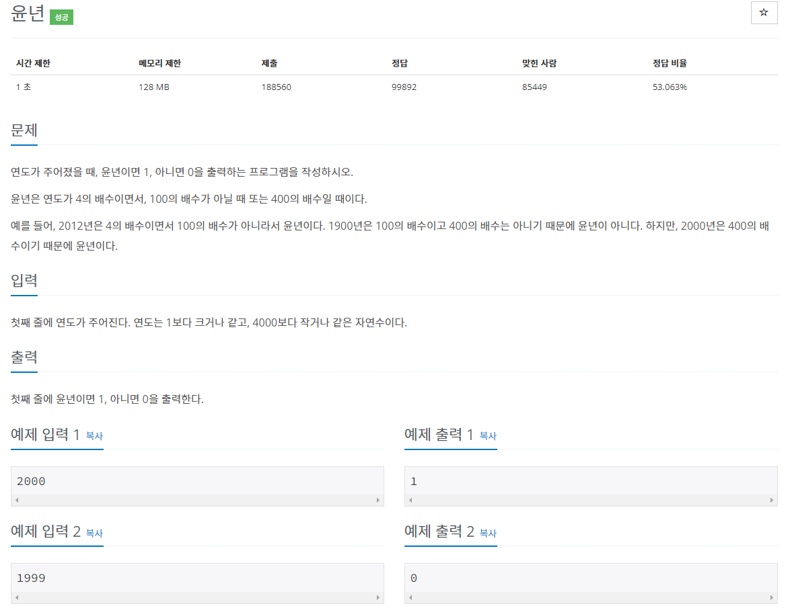
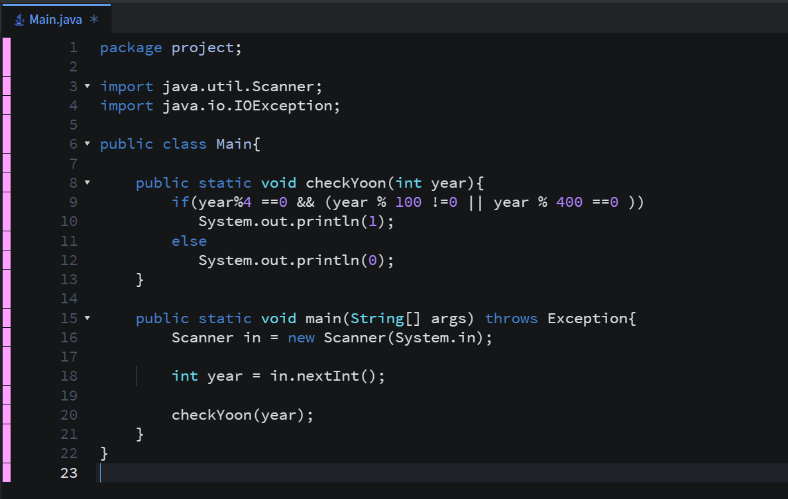
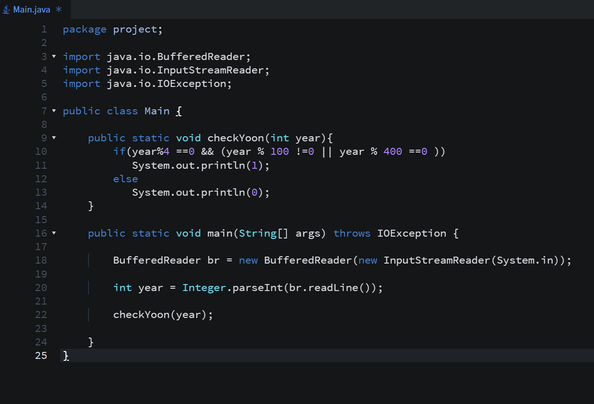
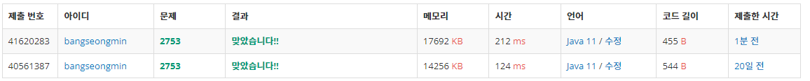

* **문제**

* **간단 설명**

**- 연도를 입력하여 윤년이면 1을 아니면 0을 출력하는 문제입니다.**

**(1 단계) 정수 값을 입력받는다.**

**(2 단계) 입력된 정수가 4의 배수이면서 100의 배수가 아닐 때 또는 400의 배수일때 1을 출력**

**위 조건을 만족시키지 못할 경우 0을 출력**

**말로 설명하면 길지만... 코드로 간략하게 작성하면 다음과 같습니다.**

**(year%4 ==0 && (year % 100 !=0 || year % 400 ==0 ))**

* **풀이**

**- 방법 1(Scanner)**

**코드의 재사용을 위해 메소드를 사용하였습니다.**

**- 방법 2(BufferedReader)**

* **성능 분석**

**방법 1 - 212ms**

**방법 2 - 124ms**

* **정리**

**윤년 계산하는 문제는 C언어부터 시작해서 많은 서적을 공부하면서 수도 없이 봤습니다.**

**처음에는 윤년이 뭔지도 모르고 살았는데.. 개발을 하면서 제가 많은 것을 배울 수 있게 되는 것 같습니다**

**똑똑한 사람이 되기 위해서는 개발자가 되어야 한다????!!!**

