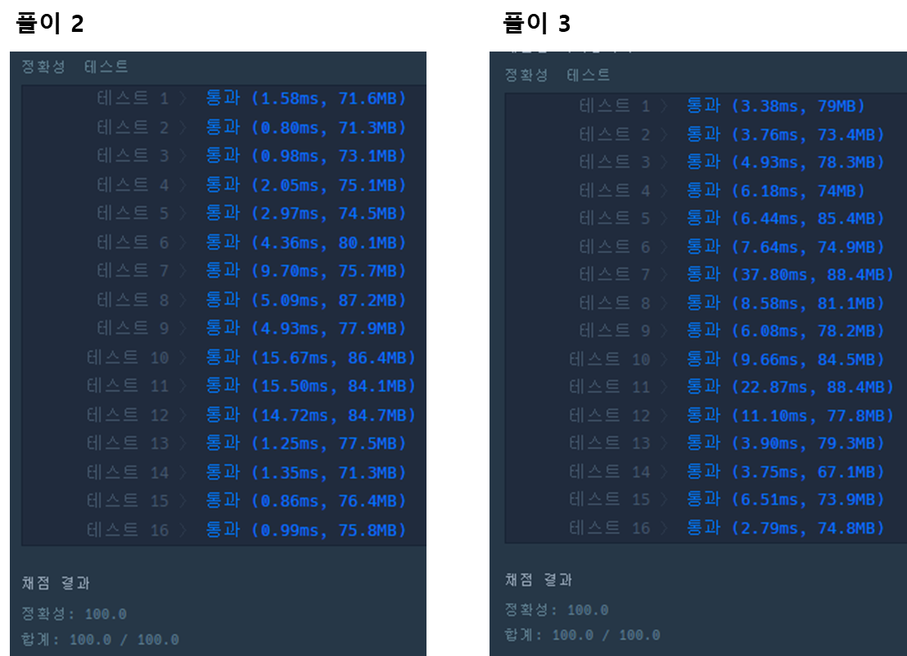

* [2022 KAKAO BLIND RECRUITMENT > 주차 요금 계산](https://school.programmers.co.kr/learn/courses/30/lessons/92341)

[프로그래머스

코드 중심의 개발자 채용. 스택 기반의 포지션 매칭. 프로그래머스의 개발자 맞춤형 프로필을 등록하고, 나와 기술 궁합이 잘 맞는 기업들을 매칭 받으세요.

programmers.co.kr](https://school.programmers.co.kr/learn/courses/30/lessons/92341)

---

### **문제**

**주차장의 요금표와 차량이 들어오고(입차) 나간(출차) 기록이 주어졌을 때, 차량별로 주차 요금을 계산하려고 합니다. 아래는 하나의 예시를 나타냅니다.**

* **요금표**

| 기본 시간(분) | 기본 요금(원) | 단위 시간(분) | 단위 요금(원) |
| --- | --- | --- | --- |
| 180 | 5000 | 10 | 600 |

* **입/출차 기록**

| 시각(시:분) | 차량 번호 | 내역 |
| --- | --- | --- |
| 05:34 | 5961 | 입차 |
| 06:00 | 0000 | 입차 |
| 06:34 | 0000 | 출차 |
| 07:59 | 5961 | 출차 |
| 07:59 | 0148 | 입차 |
| 18:59 | 0000 | 입차 |
| 19:09 | 0148 | 출차 |
| 22:59 | 5961 | 입차 |
| 23:00 | 5961 | 출차 |

* **자동차별 주차 요금**

| 차량 번호 | 누적 주차 시간(분) | 주차 요금(원) |
| --- | --- | --- |
| 0000 | 34 + 300 = 334 | 5000 + [(334-180) / 10] x 600 = 14600 |
| 0148 | 670 | 5000 + [(670-180) / 10] x 600 = 34400 |
| 5961 | 145 + 1 = 146 | 5000 |

* 어떤 차량이 입차된 후에 출차된 내역이 없다면, 23:59에 출차된 것으로 간주합니다.
  + 0000번 차량은 18:59에 입차된 이후, 출차된 내역이 없습니다. 따라서, 23:59에 출차된 것으로 간주합니다.
* 00:00부터 23:59까지의 입/출차 내역을 바탕으로 차량별 누적 주차 시간을 계산하여 요금을 일괄로 정산합니다.
* 누적 주차 시간이 기본 시간이하라면, 기본 요금을 청구합니다.
* 누적 주차 시간이 기본 시간을 초과하면, 기본 요금에 더해서, 초과한 시간에 대해서 단위 시간 마다 단위 요금을 청구합니다.
  + 초과한 시간이 단위 시간으로 나누어 떨어지지 않으면, 올림합니다.
  + ⌈a⌉ : a보다 작지 않은 최소의 정수를 의미합니다. 즉, 올림을 의미합니다.

주차 요금을 나타내는 정수 배열 fees, 자동차의 입/출차 내역을 나타내는 문자열 배열 records가 매개변수로 주어집니다. 차량 번호가 작은 자동차부터 청구할 주차 요금을 차례대로 정수 배열에 담아서 return 하도록 solution 함수를 완성해주세요.

### **제한사항**

* fees의 길이 = 4
  + fees[0] = 기본 시간(분)
  + 1 ≤ fees[0] ≤ 1,439
  + fees[1] = 기본 요금(원)
  + 0 ≤ fees[1] ≤ 100,000
  + fees[2] = 단위 시간(분)
  + 1 ≤ fees[2] ≤ 1,439
  + fees[3] = 단위 요금(원)
  + 1 ≤ fees[3] ≤ 10,000
* 1 ≤ records의 길이 ≤ 1,000
  + records의 각 원소는 "시각 차량번호 내역" 형식의 문자열입니다.
  + 시각, 차량번호, 내역은 하나의 공백으로 구분되어 있습니다.
  + 시각은 차량이 입차되거나 출차된 시각을 나타내며, HH:MM 형식의 길이 5인 문자열입니다.
    - HH:MM은 00:00부터 23:59까지 주어집니다.
    - 잘못된 시각("25:22", "09:65" 등)은 입력으로 주어지지 않습니다.
  + 차량번호는 자동차를 구분하기 위한, `0'~'9'로 구성된 길이 4인 문자열입니다.
  + 내역은 길이 2 또는 3인 문자열로, IN 또는 OUT입니다. IN은 입차를, OUT은 출차를 의미합니다.
  + records의 원소들은 시각을 기준으로 오름차순으로 정렬되어 주어집니다.
  + records는 하루 동안의 입/출차된 기록만 담고 있으며, 입차된 차량이 다음날 출차되는 경우는 입력으로 주어지지 않습니다.
  + 같은 시각에, 같은 차량번호의 내역이 2번 이상 나타내지 않습니다.
  + 마지막 시각(23:59)에 입차되는 경우는 입력으로 주어지지 않습니다.
  + 아래의 예를 포함하여, 잘못된 입력은 주어지지 않습니다.
    - 주차장에 없는 차량이 출차되는 경우
    - 주차장에 이미 있는 차량(차량번호가 같은 차량)이 다시 입차되는 경우

### **알고리즘**

* 주차요금 출력 순서를 보면 자동차 번호 순서대로 오름차순으로 출력되는 것을 볼 수 있다.
* 입/출차 기록을 통해 2번 이상 입차할 수 있다.
* 만약 입차된 자동차가 출차된 기록이 없을 경우, 23:59분에 출차된 것으로 간주된다.  

  문제 설명과 제한 조건을 통해 위 3가지 정보를 얻을 수 있다.

**정리하면**

1. 자동차가 입차된 시각, 번호판을 저장한다.
2. 자동차의 출차 기록이 있을 경우, 입차된 시간과의 차를 저장한다.
3. 자동차의 출차 기록이 없을 경우, 자동차의 출차기록을 23:59으로 설정하여 시간을 계산한다.
4. 자동차 번호판별 주차요금을 계산한다.

### **문제 풀이**

#### **풀이 1**

* records 배열을 순차적으로 탐색하여 시간과 자동차 번호판을 저장한다.
* 입차 시, timeMap에 저장
* 출차 시, timeMap에 현재 정보를 저장하고, feeMap에 총 주차 시간을 계산하여 저장한다.
* feeMap을 탐색하면서 출차되지 않은 차의 경우, 23:59로 출차처리한다.
* feeMap을 탐색하면서 출차된 차량의 경우, 주차 요금을 계산한다.

```java
package main.test;

import java.util.Arrays;
import java.util.HashMap;

public class Main{

    static int default_time;
    static int default_fee;
    static int unit_time;
    static int unit_fee;

    public static void main(String[] args){

        // 예상 결과 [14600, 34400, 5000]
        System.out.println(solution(new int[]{180, 5000, 10, 600}, new String[]{"05:34 5961 IN", "06:00 0000 IN", "06:34 0000 OUT", "07:59 5961 OUT", "07:59 0148 IN", "18:59 0000 IN", "19:09 0148 OUT", "22:59 5961 IN", "23:00 5961 OUT"}));
        System.out.println(solution(new int[]{120, 0, 60, 591}, new String[]{"16:00 3961 IN","16:00 0202 IN","18:00 3961 OUT","18:00 0202 OUT","23:58 3961 IN"}));
    }

    public static int[] solution(int[] fees, String[] records) {
        int[] answer = {};

        // 가독성을 위해 변수로 변경
        default_time = fees[0];     // 기본 시간(분)
        default_fee = fees[1];      // 기본 요금(원)
        unit_time = fees[2];        // 단위 시간(분)
        unit_fee = fees[3];         // 단위 요금(원)

        HashMap<Integer, String> timeMap = new HashMap<>();     // 번호판, IN/OUT + 시간
        HashMap<Integer, Integer> feeMap = new HashMap<>();     // 번호판, IN/OUT + 총 주차 시간 -> 총 요금

        for(String s : records){
            String[] temp = s.split(" ");

            int plate = Integer.parseInt(temp[1]);  // 자동차 번호판
            String info = temp[2] + " " + temp[0];  // IN/OUT + 시간

            if(timeMap.containsKey(plate) && temp[2].equals("OUT")){

                String[] record = timeMap.get(plate).split(" ");

                int minute = calculateTime(record[1], temp[0]);

                feeMap.put(plate, minute);
                timeMap.replace(plate, info);
            }else{
                timeMap.put(plate, info);
            }
        }

        // 출차되지 않은 경우에 대한 처리
        for(Integer plate : timeMap.keySet()){
            String[] state = timeMap.get(plate).split(" ");
            int minute = 0;
            if(state[0].equals("IN")){
                minute = calculateTime(state[1], "23:59");
                feeMap.put(plate, feeMap.getOrDefault(plate, 0) + minute);
            }

            minute = feeMap.get(plate);

            // 주차 요금 계산
            int price = calculateFee(minute);
            feeMap.replace(plate, price);
        }

        Object[] mapKey = feeMap.keySet().toArray();
        Arrays.sort(mapKey);

        answer = new int[mapKey.length];

        // Hashmap to Array
        int idx = 0;
        for(Object key : mapKey){
            answer[idx] = feeMap.get(key);
            idx++;
        }


        return answer;
    }

    private static int calculateFee(int totalMinute) {
        if(totalMinute <= default_time)
            return default_fee;
        else
            return default_fee + (int) Math.ceil((double) (totalMinute - default_time) / unit_time) * unit_fee;
    }

    private static int calculateTime(String s, String s1) {

        int Front_hour = Integer.parseInt(s.substring(0, 2));
        int Front_minute = Integer.parseInt(s.substring(3));

        int Back_hour = Integer.parseInt(s1.substring(0, 2));
        int Back_minute = Integer.parseInt(s1.substring(3));

        int total = 0;

        if(Front_hour == Back_hour){
            return Back_minute - Front_minute;
        }

        if(Front_minute > Back_minute){
                Back_minute += 60;
                Back_hour -= 1;
        }

        total = ((Back_hour - Front_hour) * 60) + (Back_minute - Front_minute);

        return total;
    }
}
```

#### **풀이 2**

```java
import java.util.*;

class Solution {

    public int[] solution(int[] fees, String[] records) {
        int[] answer = {};

        Map<String, String> map = new HashMap<>();
        Map<String, Integer> feeMap = new HashMap<>();

        for(int i = 0; i < records.length; i++){
            feeMap.put(records[i].split(" ")[1], 0);
        }

        for(int i = 0; i < records.length; i++){
            String[] infos = records[i].split(" ");

            if(map.containsKey(infos[1])){
                String[] inTime = map.remove(infos[1]).split(":");
                String[] outTime = infos[0].split(":");

                int hour = Integer.parseInt(outTime[0]) - Integer.parseInt(inTime[0]);
                int minute = Integer.parseInt(outTime[1]) - Integer.parseInt(inTime[1]);

                feeMap.replace(infos[1], feeMap.get(infos[1]) + 60 * hour + minute);

            }else{
                map.put(infos[1], infos[0]); // 차 번호, 시간
            }
        }

        for(String key : map.keySet()){
            String[] inTime = map.get(key).split(":");

            int hour = 23 - Integer.parseInt(inTime[0]);
            int minute = 59 -Integer.parseInt(inTime[1]);

            feeMap.replace(key, feeMap.get(key) + 60 * hour + minute);
        }

        List<Map.Entry<String, Integer>> list = new ArrayList(feeMap.entrySet());
        Collections.sort(list, (o1, o2) -> {
            return Integer.parseInt(o1.getKey()) > Integer.parseInt(o2.getKey())?1 : 
            Integer.parseInt(o1.getKey()) < Integer.parseInt(o2.getKey())?-1 : 0;
        });


        answer = new int[list.size()];

        for(int i = 0; i < answer.length; i++){
            if(list.get(i).getValue() > fees[0]){
                answer[i] = fees[1] + (int) Math.ceil((list.get(i).getValue() - fees[0]) / (double)fees[2]) * fees[3];
            }else{
                answer[i] = fees[1];
            }
        }

        return answer;
    }
}
```

#### **풀이 3**

* 차량번호, 주차시간, 입차시간, 입/출차 상태를 갖는 클래스

```java
package main.test;

import java.util.*;

public class Main{

    static int default_time;
    static int default_fee;
    static int unit_time;
    static int unit_fee;

    public static void main(String[] args){

        // 예상 결과 [14600, 34400, 5000]
        System.out.println(solution(new int[]{180, 5000, 10, 600}, new String[]{"05:34 5961 IN", "06:00 0000 IN", "06:34 0000 OUT", "07:59 5961 OUT", "07:59 0148 IN", "18:59 0000 IN", "19:09 0148 OUT", "22:59 5961 IN", "23:00 5961 OUT"}));
        System.out.println(solution(new int[]{120, 0, 60, 591}, new String[]{"16:00 3961 IN","16:00 0202 IN","18:00 3961 OUT","18:00 0202 OUT","23:58 3961 IN"}));
    }

    public static int[] solution(int[] fees, String[] records) {
        int[] answer = {};
        final String END_TIME = "23:59";

        Map<String, Car> logs = new HashMap<>();

        for(String record : records){
            String[] temp = record.split(" ");
            int timeInfo = convertMinute(temp[0]);
            String carPlate = temp[1];
            String status = temp[2];

            recordLogs(logs, timeInfo, carPlate, status);
        }

        default_time = fees[0];     // 기본 시간(분)
        default_fee = fees[1];      // 기본 요금(원)
        unit_time = fees[2];        // 단위 시간(분)
        unit_fee = fees[3];         // 단위 요금(원)

        List<String> cars = new ArrayList<>();
        Collections.sort(cars);

        List<Integer> payments = new ArrayList<>();
        for(String carPlate : cars){
            Car car = logs.get(carPlate);
            int parkingMinute = car.parkingMinute;

            if(!car.status)
                parkingMinute += (convertMinute(END_TIME) - car.entranceTime);

            int fee = calculateFee(parkingMinute);

            payments.add(fee);
        }

        return payments.stream().mapToInt(Integer::intValue).toArray();
    }

    private static void recordLogs(Map<String, Car> logs, int timeInfo, String carPlate, String status) {
        if(!logs.containsKey(carPlate)){
            logs.put(carPlate, new Car(carPlate, 0, timeInfo, false));
        }else{
            Car car = logs.get(carPlate);
            if(status.equals("IN")){
                logs.replace(carPlate, new Car(carPlate, car.parkingMinute, timeInfo, false));
            }else{
                int parkingMinute = car.parkingMinute + (timeInfo - car.entranceTime);

                logs.replace(carPlate, new Car(carPlate, parkingMinute, 0, true));
            }
        }
    }

    private static int convertMinute(String time) {
        String[] temp = time.split(" ");
        int hour = Integer.parseInt(temp[0]);
        int minute = Integer.parseInt(temp[1]);
        return hour * 60 + minute;
    }

    private static int calculateFee(int totalMinute) {
        if(totalMinute <= default_time)
            return default_fee;
        else
            return default_fee + (int) Math.ceil((double) (totalMinute - default_time) / unit_time) * unit_fee;
    }

    static class Car {
        String carNumber;   // 차량번호
        int parkingMinute;  // 주차시간
        int entranceTime;   // 입차시간
        boolean status;     // false : 입차 / true : 출차

        public Car(String carNumber, int parkingMinute, int entranceTime, boolean status) {
            this.carNumber = carNumber;
            this.parkingMinute = parkingMinute;
            this.entranceTime = entranceTime;
            this.status = status;
        }
    }
}
```

---

### **성능**



문제 풀이 실행 결과

풀이 1은 시간 초과로 사용할 수 없는 알고리즘이다.

> Point : 1  
>   
> 처음 문제에 접근할 때 쉬울 것이라 생각했는데,  
> 코드를 순차적으로 접근하다보면 너무 복잡해져서  
> 새로 작성한 시도가 몇번인지 모르겠다...
