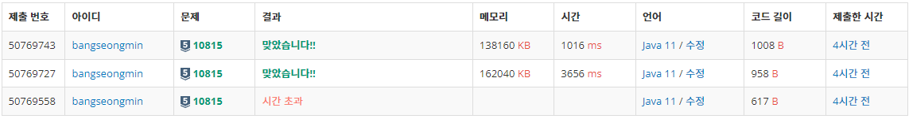

* [10815번, 집합과 맵 - 숫자 카드](https://www.acmicpc.net/problem/10815)

[10815번: 숫자 카드

첫째 줄에 상근이가 가지고 있는 숫자 카드의 개수 N(1 ≤ N ≤ 500,000)이 주어진다. 둘째 줄에는 숫자 카드에 적혀있는 정수가 주어진다. 숫자 카드에 적혀있는 수는 -10,000,000보다 크거나 같고, 10,

www.acmicpc.net](https://www.acmicpc.net/problem/10815)

---

### **문제**

숫자 카드는 정수 하나가 적혀져 있는 카드이다. 상근이는 숫자 카드 N개를 가지고 있다. 정수 M개가 주어졌을 때, 이 수가 적혀있는 숫자 카드를 상근이가 가지고 있는지 아닌지를 구하는 프로그램을 작성하시오.

### **입력과 출력**

* **입력**
  + 첫째 줄에 상근이가 가지고 있는 숫자 카드의 개수 N(1 ≤ N ≤ 500,000)이 주어진다. 둘째 줄에는 숫자 카드에 적혀있는 정수가 주어진다. 숫자 카드에 적혀있는 수는 -10,000,000보다 크거나 같고, 10,000,000보다 작거나 같다. 두 숫자 카드에 같은 수가 적혀있는 경우는 없다.
  + 셋째 줄에는 M(1 ≤ M ≤ 500,000)이 주어진다. 넷째 줄에는 상근이가 가지고 있는 숫자 카드인지 아닌지를 구해야 할 M개의 정수가 주어지며, 이 수는 공백으로 구분되어져 있다. 이 수도 -10,000,000보다 크거나 같고, 10,000,000보다 작거나 같다
* **출력**
  + 첫째 줄에 입력으로 주어진 N개의 수에 대해서, 각 수가 적힌 숫자 카드를 상근이가 가지고 있으면 1을, 아니면 0을 공백으로 구분해 출력한다.

### **알고리즘**

이 문제는 N개의 정수를 입력받아 저장하고, M개를 추가적으로 입력받은 값이 N개 중에 존재하는지 판별하는 문제이다.

1. 입력 횟수 N을 입력 받는다.
2. N개의 정수를 입력 받는다.
3. 입력 횟수 M을 입력 받는다.
4. M개의 정수를 입력 받는다.
5. N개 정수 중 M1, M2, .... Mx가 존재하면 1, 존재하지 않으면 0을 출력

### **풀이**

#### **풀이 1 : [**Scanner + System.out.println**]**

```java
package main.test;

import java.util.HashSet;
import java.util.Scanner;

public class Main{

    public static void main(String[] args){

        Scanner in = new Scanner(System.in);

        int N = in.nextInt();
        HashSet<Integer> set = new HashSet<>();

        for(int i=0; i<N; i++){
            int num = in.nextInt();
            set.add(num);
        }

        int M = in.nextInt();

        for(int i=0; i<M; i++){
            int num = in.nextInt();
            if(set.contains(num))
                System.out.print(1+" ");
            else
                System.out.print(0+" ");

        }

    }
}
```

#### **풀이 2 : [BufferedReader **+ System.out.println**]**

```java
import java.io.BufferedReader;
import java.io.IOException;
import java.io.InputStreamReader;
import java.util.HashSet;
import java.util.StringTokenizer;

public class Main{

    public static void main(String[] args) throws IOException {

        BufferedReader br = new BufferedReader(new InputStreamReader(System.in));
        StringTokenizer st;
        int N = Integer.parseInt(br.readLine());
        HashSet<Integer> set = new HashSet<>();

        st = new StringTokenizer(br.readLine());

        while (st.hasMoreTokens()){
            set.add(Integer.valueOf(st.nextToken()));
        }

        int M = Integer.parseInt(br.readLine());
        st = new StringTokenizer(br.readLine());

        while (st.hasMoreTokens()){
            int temp = Integer.parseInt(st.nextToken());
            if(set.contains(temp))
                System.out.print(1+" ");
            else
                System.out.print(0+" ");

        }
    }
}
```

#### **풀이 3 : [BufferedReader **+ StringBuilder**]**

```java
import java.io.BufferedReader;
import java.io.IOException;
import java.io.InputStreamReader;
import java.util.HashSet;
import java.util.StringTokenizer;

public class Main{

    public static void main(String[] args) throws IOException {

        BufferedReader br = new BufferedReader(new InputStreamReader(System.in));
        StringTokenizer st;
        int N = Integer.parseInt(br.readLine());
        HashSet<Integer> set = new HashSet<>();

        st = new StringTokenizer(br.readLine());

        while (st.hasMoreTokens()){
            set.add(Integer.valueOf(st.nextToken()));
        }

        int M = Integer.parseInt(br.readLine());
        st = new StringTokenizer(br.readLine());

        StringBuilder sb = new StringBuilder();
        while (st.hasMoreTokens()){
            int temp = Integer.parseInt(st.nextToken());
            if(set.contains(temp))
                sb.append(1+" ");
            else
                sb.append(0+" ");
        }

        System.out.println(sb);
    }
}
```

---

### **성능**



**채점 번호 : 50769743  -  방법 3 : BufferedReader + StringBuilder**

**채점 번호 : 50769727  -  방법 2 : BufferedReader + **System.out.println****

**채점 번호 : 50769558****-  방법 1 : Scanner + System.out.println (시간초과)**
