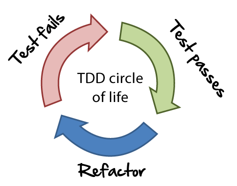
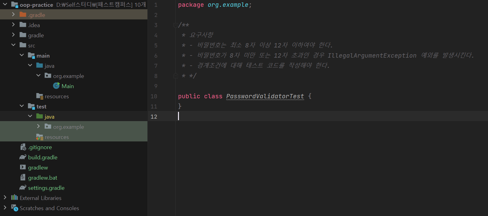
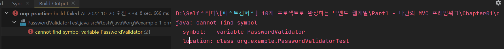
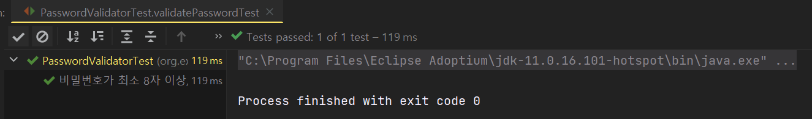
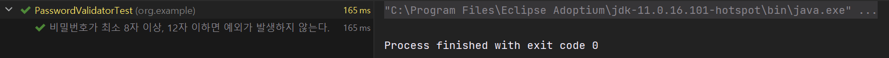
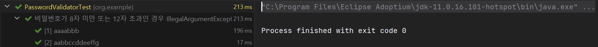

## **객체지향 패러다임**

### **테스트 코드 실습**

**자바 단위 테스팅 프레임워크**

* [JUnit5 사용](https://junit.org/junit5/docs/current/user-guide/#writing-tests)

[**AssertJ**](https://assertj.github.io/doc/#assertj-core-assertions-guide)

* 테스트 코드 가독성을 높여주는 자바 라이브러리
* JUnit의 단언에 대한 **표현력 부족을 보완**
* spring-boot-starter-test에 기본적으로 포함

**💡 테스트 코드를 작성하는 이유**

> **1. 문서화 역할  
> 2. 코드에 결함을 발견하기 위함  
> 3. 리팩토링 시 (심리적) 안전성 확보  
> 4. 테스트 하기 쉬운 코드를 작성하다 보면 더 낮은 결합도를 가진 설계를 얻을 수 있음**

#### **TDD(Test Driven Development = 테스트 주도 개발)**



TDD 개발 원리

* 프로덕션 코드보다 테스트 코드를 먼저 작성하는 개발 방법
* TFD(Test First Development) + 📌**리팩토링**
* 기능 동작을 검증(메소드 단위)

#### **BDD(Behavior Driven Development = 행위 주도 개발)**

* 행위에 대한 테스트 코드를 작성하는 개발 방법
* 유저 시나리오 동작을 검증(시나리오 단위)
* 하나의 시나리오는 Given, When, Then 구조를 가짐

> [참고] 보통은 TDD와 BDD를 혼용하여 사용하는 경우가 많다.

#### **실습 예제 : 비밀번호 유효성 검증기**

* **요구사항**
  1. 비밀번호는 최소 8자 이상 12자 이하여야 한다.
  2. 비밀번호가 8자 미만 도는 12자 초과일 경우 **IIegalArgumentException**예외를 발생시킨다.
  3. 경계조건에 대해 테스트 코드를 작성해야 한다.

> 💡 **실행 속도 향상 Tip**  
> File - Settings - Build, Execution, Deployment > Gradle > Build and run using, Run test using 둘다 InteliJ IDEA로 변경

**TDD 방식**

**1 단계 : 프로젝트 생성 시 JUnit5는 설치되어있으나, assertJ는 설치되어 있지 않으므로 추가해주어야 한다.**

```java
dependencies {
    testImplementation 'org.junit.jupiter:junit-jupiter-api:5.8.1'
    testRuntimeOnly 'org.junit.jupiter:junit-jupiter-engine:5.8.1'
    // assertJ 라이브러리 추가
    testImplementation 'org.assertj:assertj-core:3.23.1'
}
```

**2 단계 : 프로덕션 코드 패키지와 테스트 코드 패키지를 일치시키고 PasswordValidatorTest 클래스를 생성한다.**



2단계

**3 단계 : Test Method를 추가시키고 DisplayName 어노테이션을 통해 테스트 코드의 의도를 나타낸다.**

```java
public class PasswordValidatorTest {

    // 테스트 코드의 의도
    @DisplayName("비밀번호가 최소 8자 이상, 12자 이하면 예외가 발생하지 않는다.")
    @Test
    void validatePasswordTest() {
    }
}
```

> **테스트 코드의 의도를 드러냄으로써 문서화 역할을 할 수 있다.**  
> 

**4 단계 : 테스트 메소드 내부에 테스트 코드를 작성하고 실행한다. < Fail >**

```java
public class PasswordValidatorTest {

    // 테스트 코드의 의도
    @DisplayName("비밀번호가 최소 8자 이상, 12자 이하면 예외가 발생하지 않는다.")
    @Test
    void validatePasswordTest() {
        assertThatCode(() -> PasswordValidator.validate("serverwizard"))
                .doesNotThrowAnyException();
    }
}
```



테스트 메소드 실행 결과(Fail)

**5 단계 : 객체 클래스와 메소드를 생성코드를 프로덕션 코드에 추가하고 테스트를 실행한다. < Pass >**

```java
package org.example;

public class PasswordValidator {

    public static void validate(String password) {

    }
}
```



테스트 메소드 실행 결과(Pass)

**6 단계 : 요구사항에 만족하는 메소드로 리팩토링하고, 테스트 코드를 실행한다.   < Refactor >**

```java
package org.example;

public class PasswordValidator {
    public static void validate(String password) {

        if(password.length() < 8 || password.length() > 12)
            throw new IllegalArgumentException("비밀번호는 최소 8자 이상 12자 이하여야 한다.");
    }
}
```



테스트 메소드 실행 결과(Refactor)

**7 단계 : 기능 구현 메소드 리팩토링**

* 중복 제거(password.length() 메소드 → 정수형 변수로 치환)
* 에러 메시지를 문자열 변수로 치환

> **💡 꿀팁**  
> **1. 중복 제거** - **ctrl + alt + V**를 통해 한 번에 변경 가능  
> **2. 문자열을 변수로 치환**-**ctrl + alt + C**를 누르고 글자를 입력하면 해당 문자열에 대한 변수가 생성된다.

```java
public class PasswordValidator {
    private static final String WRONG_PASSWORD_LENGTH_EXCEPTION_MESSAGE  = "비밀번호는 최소 8자 이상 12자 이하여야 한다.";

    public static void validate(String password) {

        int length = password.length();

        if(length < 8 || length > 12)
            throw new IllegalArgumentException(WRONG_PASSWORD_LENGTH_EXCEPTION_MESSAGE);
    }
}
```

> **리팩토링을 통해 안전성 확보**  
> 

**8 단계 : 요구사항 2번째를 테스트할 수 있는 메소드를 구현한다.**

```java
@DisplayName("비밀번호가 8자 미만 또는 12자 초과인 경우 IllegalArgumentException 예외를 발생시킨다.")
@Test
void validatePasswordTest2() {
    assertThatCode(() -> PasswordValidator.validate("aabb"))
            .isInstanceOf(IllegalArgumentException.class)
            .hasMessage("비밀번호는 최소 8자 이상 12자 이하여야 한다.");
}
```

* isInstanceOf 메소드를 통해 원하는 에러의 종류를 발생시키는지 확인한다.
* hasMessage를 통해 원하는 에러 메시지가 출력되는지 확인할 수 있다.

**9 단계 : 요구사항 3번째 경계값 점검을 실시한다.**

> **ParameterizedTest, ValueSource 어노테이션 사용을 위해 위해 의존성을 추가**  
> testImplementation 'org.junit.jupiter:junit-jupiter-params:5.8.2'

```java
@DisplayName("비밀번호가 8자 미만 또는 12자 초과인 경우 IllegalArgumentException 예외를 발생시킨다.")
@ParameterizedTest
@ValueSource(strings = {"aaaabbb", "aabbccddeeffg"})
void validatePasswordTest2(String password) {
    assertThatCode(() -> PasswordValidator.validate(password))
            .isInstanceOf(IllegalArgumentException.class)
            .hasMessage("비밀번호는 최소 8자 이상 12자 이하여야 한다.");
}
```

* @ParameterizedTest 어노테이션과 @ValueSource 어노테이션을 통해 테스트 값을 임의로 지정할 수 있다.
* 경계값 7자리, 13자리 두 가지 경우를 임의값으로 지정한다.
* [ParameterizedTest에 대한 자세한 정보](https://www.petrikainulainen.net/programming/testing/junit-5-tutorial-writing-parameterized-tests/)



경계값 테스트 결과

> **📖 정리**  
> 테스트 코드의 장점을 현재 증명하였다.  
> 1. 문서화 역할 - DisplayName 어노테이션 등을 통해 문서화가 가능해진다.  
> 2. 코드에 결함을 발견하기 위함 - TDD를 통해 문제를 보완하고 리팩토링을 통해 문제를 쉽게 발견할 수 있다.  
> 3. 리팩토링 시 안정성 확보 - 리팩토링을 통해 더 나은 코드를 두 차례 발전시켰다.  
> 4. 테스트 하기 쉬운 코드를 작성하다 보면 더 낮은 결합도를 가진 설계를 얻을 수 있음 - **아직 증명 X**

**테스트 코드의 장점 증명(**BDD 방식**)**

> 패스워드를 생성해주는 자바 라이브러리를 통해 더 낮은 결합도를 갖을 수 있음을 보여주려 한다.  
> implementation 'org.passay:passay:1.6.1'

**1 단계 : 랜덤으로 패스워드를 생성하는 책임을 갖는 객체 클래스를 생성한다.**

```java
package org.example;

import org.passay.CharacterData;
import org.passay.CharacterRule;
import org.passay.EnglishCharacterData;
import org.passay.PasswordGenerator;

public class RandomPasswordGenerator {
    /**
     * Special characters allowed in password.
     */
    public static final String ALLOWED_SPL_CHARACTERS = "!@#$%^&*()_+";

    public static final String ERROR_CODE = "ERRONEOUS_SPECIAL_CHARS";


    public String generatePassword() {
        PasswordGenerator gen = new PasswordGenerator();

        CharacterData lowerCaseChars = EnglishCharacterData.LowerCase;
        CharacterRule lowerCaseRule = new CharacterRule(lowerCaseChars);
        lowerCaseRule.setNumberOfCharacters(2);

        CharacterData upperCaseChars = EnglishCharacterData.UpperCase;
        CharacterRule upperCaseRule = new CharacterRule(upperCaseChars);
        upperCaseRule.setNumberOfCharacters(2);

        CharacterData digitChars = EnglishCharacterData.Digit;
        CharacterRule digitRule = new CharacterRule(digitChars);
        digitRule.setNumberOfCharacters(2);

        CharacterData specialChars = new CharacterData() {
            public String getErrorCode() {
                return ERROR_CODE;
            }

            public String getCharacters() {
                return ALLOWED_SPL_CHARACTERS;
            }
        };
        CharacterRule splCharRule = new CharacterRule(specialChars);
        splCharRule.setNumberOfCharacters(2);

        // 0 ~ 12
        return gen.generatePassword((int) (Math.random() * 13), splCharRule, lowerCaseRule, upperCaseRule, digitRule);
    }
}
```

**2 단계 : 테스트를 위해 User 객체 클래스를 생성하고 패스워드를 저장할 수 있는  멤버변수와 메소드를 생성한다.**

```java
package org.example;

public class User {
    private String password;

    public void initPassword(){
        RandomPasswordGenerator randomPasswordGenerator = new RandomPasswordGenerator();
        String randomPassword = randomPasswordGenerator.generatePassword();
        /**
         * 비밀번호는 최소 8자 이상 12자 이하여야 한다.
         * */
        int length = randomPassword.length();
        if(length >= 8 && length <= 12){
            this.password = randomPassword;
        }
    }
}
```

**3 단계 : User 클래스에 작성된 initPassword 메소드가 정상적으로 작동하는지 판변하기 위해 테스트 코드 작성한다.**

> 현재 **BDD** 방식으로 프로덕션 코드(User)를 작성하고, 테스트 코드(UserTest)를 작성하고 있다.

```java
package org.example;

import org.junit.jupiter.api.DisplayName;
import org.junit.jupiter.api.Test;

import static org.assertj.core.api.Assertions.assertThat;

class UserTest {

    @DisplayName("패스워드를 초기화한다.")
    @Test
    void passwordTest() {
        // given
        User user = new User();

        // when
        user.initPassword();

        // then
        assertThat(user.getPassword()).isNotNull();
    }
}
```

> 💣 **문제 발생**  
> 현재 코드를 테스트할 경우 BufferOverflowException을 발생하거나 성공하는 경우가 랜덤하게 발생한다..  
>   
> **원인**randomPassoword에서 0 ~ 12자 사이로 만들어질 때, initPassword() 메소드 내부에서 8자 이상 12자 이하가 아닌 경우 초기화되지 않기 때문이다. 현재 가장 큰 문제는 randomPasswordGenerator에서 몇글자를 생성할지 모른다는 점이다.

**💉 문제 해결**

**1 단계 : PasswordGenerator 인터페이스 생성**

```java
package org.example;

public interface PasswordGenerator {
    String generatePassword();
}
```

**2 단계 : RandomPasswordGenerator가 PasswordGenerator 인터페이스를 구현하도록 설계**

```java
package org.example;

public class RandomPasswordGenerator implements org.example.PasswordGenerator {
   ...
}
```

**3단계 : User가 컨트롤할 수 없는 RandomPasswordGenerator를 생성자로 주입받도록 변경(DI)**

```java
package org.example;

public class User {

    public void initPassword(PasswordGenerator passwordGenerator){
        // RandomPasswordGenerator randomPasswordGenerator = randomPasswordGenerator;
        String randomPassword = passwordGenerator.generatePassword();
		...
    }

}
```

**4 단계 : 테스트 코드 패키지에 요구사항과 일치하거나 일치하지 않는 경우에 대한 테스트 코드를 생성한다.**

만약, 현재 UserTest에서 RandomPasswordGenerator를 생성하게 되면 동일한 문제가 발생할 것이다.

```java
public class CorrectFixedPasswordGenerator implements PasswordGenerator{
    @Override
    public String generatePassword() {
        return "abcdefg";   // 8 글자
    }
}

public class WrongFixedPasswordGenerator implements PasswordGenerator{
    @Override
    public String generatePassword() {
        return "ab";   // 2 글자
    }
}
```

```java
package org.example;

import org.junit.jupiter.api.DisplayName;
import org.junit.jupiter.api.Test;

import static org.assertj.core.api.Assertions.assertThat;

class UserTest {

    @DisplayName("패스워드를 초기화한다.")
    @Test
    void passwordTest() {
        // given
        User user = new User();

        // when
        user.initPassword(new CorrectFixedPasswordGenerator());

        // then
        assertThat(user.getPassword()).isNotNull();
    }

    @DisplayName("패스워드가 요구사항에 부합되지 않아 항상 초기화가 되지 않는다.")
    @Test
    void passwordTest2() {
        // given
        User user = new User();

        // when
        user.initPassword(new WrongFixedPasswordGenerator());

        // then
        assertThat(user.getPassword()).isNull();
    }
}
```

> 📖 **변경된 점**기존 코드는 내부에서 RandomPasswordGenerator를 가지고 있어, 패스워드가 초기화 되거나 되지 않는 경우가 발생하였다. 메소드 내에서 해당 객체를 컨트롤 할 수 없기 때문에 테스트 코드가 성공할 수도 있고, 실패할수도 있었다.  
> 이를 해결하기 위해 PasswordGenerator 인터페이스를 선언하여 PasswordGenerator 인터페이스를 적용한 CorrectFixedPasswordGenerator와 WrongFixedPasswordGenerator 클래스를 통해 항상 조건에 부합하는 테스트 코드를 만들 수 있었다.  
>   
> **이를 통해  테스트 하기 쉬운 코드를 작성하다 보면 더 낮은 결합도를 가진 설계를 얻을 수 있음을 알 수 있다.**  
> **내부 결합 - 강한 결합도 / 외부 결합 - 낮은 결합도**

```java
public void initPassword(PasswordGenerator passwordGenerator){
    // as-is
    // RandomPasswordGenerator randomPasswordGenerator = randomPasswordGenerator;

    // to be
    String randomPassword = passwordGenerator.generatePassword();
    /**
     * 비밀번호는 최소 8자 이상 12자 이하여야 한다.
     * */
    int length = randomPassword.length();
    if(length >= 8 && length <= 12){
        this.password = randomPassword;
    }
}
```

> **테스트 하기 쉬운 코드를 작성하다 보면**  
>  **더 낮은 결합도를 가진 설계를 얻을 수 있음을 배울 수 있다.**  
> 

**추가적인 리팩토링**

* FunctionalInterface 어노테이션을 통해 직접적으로 메소드를 호출하지 않아도 된다.

```java
@FunctionalInterface
public interface PasswordGenerator {
    String generatePassword();
}

class UserTest {

    @DisplayName("패스워드를 초기화한다.")
    @Test
    void passwordTest() {
        // given
        User user = new User();

        // when
        // as-is
        // user.initPassword(new CorrectFixedPasswordGenerator());

        // to-be
        user.initPassword(() -> "abcdabcd");

        // then
        assertThat(user.getPassword()).isNotNull();
    }

}
```

---

### **개념 정리**

#### **객체 지향이란?**

> 적절한 객체에게 적절한 책임을 할당하여 서로 메시지를 주고 받으며 협력하도록 하는 것을 객체지향이라 생각하고  
> 객체지향이 등장한 배경은 점점 증가하는 SW 복잡도를 낮추기 위해 객체지향 패러라임이 대두되었다고 생각한다.  
>   
> 개인적으로 생각하는 두 가지 중요 포인트는 **객체지향에 맞게 클래스가 아닌 객체에 초점을 맞추는 것**과 **객체들에게 얼마나 적절한 역할과 책임을 할당하는지**가  중요하다고 생각한다.

#### **객체지향 4가지 특징**

**1. 추상화(Abstraction)**

불필요한 부분을 제거함으로써 필요한 핵심만 나타내는 것을 의미한다.

흔히, 일반화 또는 단순화라고도 하며 사용하는 목적은 복잡성을 낮추는 도구로 사용한다.

**2. 다형성(Polymorphism)**

다양한 형태를 갖은 것을 의미한다.

쉽게 말해, 하나의 타입으로 여러 종류에 객체를 참조하는 것을 말한다.

**3. 캡슐화(Encapsulation)**

객체 내부의 세부사항을 외부로부터 감추는 것을 의미한다.

캡슐화의 목적은 인터페이스만 공개하여 변경하기 쉬운 코드를 만들기 하기 위함이다.

**4. 상속(Inheritance)**

부모로부터 물려받은 것을 의미한다.

#### **객체지향의 5가지 설계 원칙(SOLID) [ 참고 1 ]**

객체지향의 5가지 설계 원칙인 SOLID는 훌륭한 객체지향 코드를 작성할 수 있는 원칙이다.

**1. SRP : Single Responsibility Principle (단일 책임의 원칙)**

> **하나의 책임을 갖는다.**

**2. OCP : Open/Closed Principle (개방 폐쇄의 원칙)**

> 확장에는 열려있고, 변경에는 닫혀있다.  
> 즉 기존 코드를 변경하지 않고, 기능을 추가할 수 있어야 한다.

**3. LSP : Liskov’s Substitution Principle (리스코프 치환의 원칙)**

> 상위 타입의 객체를 하위 타입의 객체로 치환하여도 동작에 전혀 문제가 없어야 한다.

**4. ISP : Interface Segregation Principle (인터페이스 분리의 원칙)**

> 많은 기능을 가진 인터페이스를 작은 단위로 분리시킴으로써 클라이언트에게 필요한 인터페이스 구현체만 구현하도록 한다. 즉 클라이언트가 사용하지 않는 기능에 의존하게 되면 예상하지 못한 문제가 발생할 수 있는데, 이를 예방할 수 있다.

**5. DIP : Dependency Inversion Principle (의존성 역전의 원칙)**

> 의존 관계를 맺을 때, 자주 변경되는 쪽이 아니라 변경이 거의 일어나지 않는 쪽에 의존하라는 의미이며  
> 자기보다 변하기 쉬운 것에 의존하게 되면 변화에 영향을 많이 받기 때문에 추상화된 인터페이스나 상위 클래스를 둬서 변화에 영향을 받지 않게 하기 위함이다.

#### **절차지향 프로그래밍 vs 객체지향 프로그래밍 [참조 2]**

* 책임이 한곳에 집중돼 있는 방식(getter) > 절차지향 프로그래밍
* 책임이 여러 객체로 적절히 분산돼 있는 방식 > 객체지향 프로그래밍

> **🔊 정리**  
> 하나의 메소드에서 getter를 통해 값을 가져와 이곳에서 모든 처리가 집중되어 있다면 절차지향 방식이라고 생각하고,  
> getter로 무언가를 가져와서 처리하는 방식이 아닌 해당 책임을 갖은 객체에게 메시지를 통해 협력하도록 구현하는 방식을 객체지향 방식이라고 생각한다.

> 객체지향 설계에 있어서 가장 좋아하는 표현은  
> **high cohesion, low coupling**이다.  
>   
> 즉 높은 응집도와 낮은 결합도를 뜻한다.   
> 이것을 쉽게 표현할 수 있는 예가 서랍 정리라고 생각한다.  
>   
> 응집도가 높은 것끼리 즉 비슷한 것끼리는 한 곳에 모아둔다.   
> 그리고 다른 성격에 것들은 분리시킴으로써   
> 비슷한 것들끼리 응집도를 높이고, 다른 것들끼리는 분리시킨다는 것이  
> 높은 응집도와 낮은 결합도라고 생각한다.  
>   
> 
>
> 참고 : fast compus 강의 자료

**높은 응집도와 낮은 결합도의 장점은 ?**

> 응집도가 높은 것끼리 모아두면 어떠한 변경이 생겼을 때, 변경에 포인트가 하나로 집중될 수 있다는 부분이다.   
> 즉 영향 범위를 파악하는 것이 굉장히 한 곳에 집중되어있다는 것이다.

>  프로그래밍을 하다보면 수정에 대한 요구사항을 받을 때가 있는데  
>  "영향범위가 어디까지인지 모르겠어요! " 또는   
> "어디까지 영향을 주는지도 모르겠어요! "라는 표현을 쓴다.   
> 그러한 표현을 쓰는 것 자체가 **객체지향적으로 설계되지 않았다**는 것에 대한 **반증**이다.

💡**정리**

> 객체지향에 있어서 변경에 대한 요구사항이 들어왔을 때, 특정 한 부분만 수정하면 된다는 것은 응집도가 높다는 것을 의미하고, 어떠한 변화가 생겼을 때, 다른 곳에 영향을 미치지 않는다면 낮은 결합도를 의미한다.   
>   
> **즉 어떠한 변화가 생겼을 때 다른 곳에 영향을 끼치지 않는다면 높은 응집도와 낮은 결합도라고 할 수 있다.**  
> 이 표현은 유지보수와 관련이 크다고 생각한다. 즉 **객체지향 설계를 한다 하는 이유**는 **어떠한 변경이 생겼을 때 아주 빠르게 그리고 높은 응집도와 낮은 결합도를 가지고 유연하게 대응할 수 있음을 의미**한다고 생각한다.

#### **객체지향 설계 순서**

1. 설계에 앞서 **도메인을 구성하는 객체에는 어떤 것들이 있는지 고민**

2. 객체들이 파악이 되었을 때, **객체들 간의 관계를 고민**

3. **동적인 객체를 정적인 타입으로 추상화해서 도메인 모델링 하기**

> 즉 객체들이 어떠한 상태와 행동을 갖는지 결정되면 공통적인 상태와 행동을 갖는 객체들을 타입으로 분류할 수 있고, 타입을 기준으로 클래스를 분류하는 편이다. 즉 **클래스는 공통적인 상태와 행동을 가지는 객체들을 추상화하는 것**이다.   
> 이를 통해 복잡성을 낮출 수 있다.

4. 적절한 객체에게 적절한 책임을 할당하여 **협력을 설계**

5. 객체들을 포괄하는 타입(클래스)에 적절한 책임을 할당

> 즉 **클라이언트와 협력할 수 있는 public 인터페이스를 정의한다**고 생각하면 된다.

6.  public 인터페이스를 **구현**하기

> 참고 - 객체지향 설계에서는 모든 객체가 능동적인 존재

---

**참고 자료**

1. [[객체지향 설계 원칙](https://github.com/bang-star/TIL/blob/main/backend/SOLID%20Principle.md)]
2. [[절차지향 프로그래밍과 객체지향 프로그래밍](https://github.com/bang-star/TIL/blob/main/programming/procedural%20and%20object_oriented%20.md)]
