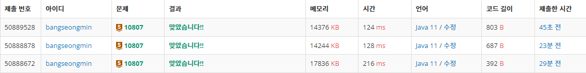

* [10807번, 1차 배열 - 개수 세기](https://www.acmicpc.net/step/6)

[1차원 배열 단계

OX 퀴즈의 결과를 일차원 배열로 입력받아 점수를 계산하는 문제

www.acmicpc.net](https://www.acmicpc.net/step/6)

---

### **문제**

총 N개의 정수가 주어졌을 때, 정수 v가 몇 개인지 구하는 프로그램을 작성하시오.

### **입력과 출력**

* **입력**
  + **첫째 줄에 정수의 개수 N(1 ≤ N ≤ 100)이 주어진다. 둘째 줄에는 정수가 공백으로 구분되어져있다. 셋째 줄에는 찾으려고 하는 정수 v가 주어진다. 입력으로 주어지는 정수와 v는 -100보다 크거나 같으며, 100보다 작거나 같다.**
* **출력**
  + **첫째 줄에 입력으로 주어진 N개의 정수 중에 v가 몇 개인지 출력한다.**

### **알고리즘**

백준 10807번 개수 세기는 브론즈 5 난이도의 구현 문제이다. 이 문제에서는 n개의 정수가 입력으로 주어진다. 그리고 정수 v가 주어졌을 때, v가 입력으로 몇 번 나왔는지를 출력하면 된다.

다양한 방법이 있겠지만, Counting Sort를 이용하는 방법으로 풀이할 것이다.

**※ 주의사항 - 입력으로 주어지는 정수와 v는 -100보다 크거나 같으며, 100보다 작거나 같다.**

### **풀이**

#### **풀이 1 : [Scanner + int[]]**

> 배열의 인덱스 조정을 위해 값에 100을 더하여 인덱스의 위치를 조정

```java
import java.util.Scanner;

public class Main{

    public static void main(String[] args){

        Scanner sc = new Scanner(System.in);

        int N = sc.nextInt();
        int[] arr = new int[201];

        for(int i=0; i<N; i++){
            int temp = sc.nextInt() + 100;
            arr[temp]++;
        }

        int k = sc.nextInt();

        System.out.println(arr[k+100]);
    }
}
```

#### **풀이 2 **: [BufferedReader **+ int[]** ]****

> **🔥 주의 사항**  
> 반복문을 While문으로 변경하면서 StringTokenizer로 받는 정수의 개수가 더 많을 수 있다는 문제를 보완하기 위해 N의 개수 파악하는 것이 중요하다.

```java
import java.io.BufferedReader;
import java.io.IOException;
import java.io.InputStreamReader;
import java.util.StringTokenizer;

public class Main{

    public static void main(String[] args) throws IOException {

        BufferedReader br = new BufferedReader(new InputStreamReader(System.in));
        StringTokenizer st;

        int N = Integer.parseInt(br.readLine());
        int[] arr = new int[201];

        st = new StringTokenizer(br.readLine());
        while (st.hasMoreTokens() && N >=0){
            int temp = Integer.parseInt(st.nextToken())+100;
            arr[temp]++;
            N--;
        }

        int k = Integer.parseInt(br.readLine());

        System.out.println(arr[k+100]);
    }
}
```

#### **풀이 3 **: [BufferedReader **+ HashMap**]****

****가장 쉽게 접근할 수 있는 방법은 HashMap일 것 같다.****

****Key에 값을 저장하고 Value에 개수를 저장하는 단순한 구조이다.****

```java
import java.io.BufferedReader;
import java.io.IOException;
import java.io.InputStreamReader;
import java.util.HashMap;
import java.util.StringTokenizer;

public class Main{

    public static void main(String[] args) throws IOException {

        BufferedReader br = new BufferedReader(new InputStreamReader(System.in));
        StringTokenizer st;

        int N = Integer.parseInt(br.readLine());
        HashMap<Integer, Integer> map = new HashMap<>();

        st = new StringTokenizer(br.readLine());
        while (st.hasMoreTokens() && N >=0){
            int temp = Integer.parseInt(st.nextToken());
            map.put(temp, map.getOrDefault(temp, 0) + 1);
            N--;
        }

        int k = Integer.parseInt(br.readLine());

        System.out.println(map.getOrDefault(k, 0));
    }
}
```

---

### **성능**



10807 - 실핼 결과

**채점 번호 : 50889528 - 방법 3 : BufferedReader + HashMap**

**채점 번호 : 50888878 -  방법 2 : BufferedReader + int[]**

**채점 번호 : 50888672****-  방법 1 : **Scanner****+ int[]****

**Scanner 보다 **BufferedReader 가 성능적으로 우수하다.****

**배열을 사용하는 것보다 HashMap을 사용하는 것이 성능 상으로 조금 더 빠르다.**
