## **객체지향 패러다임**

---

### **실습 1. 사칙 연산 계산기**

#### **사칙연산 계산기 구현**

**요구사항**

* 간단한 사칙연산을 할 수 있다.
* 양수로만 계산할 수 있다.
* 나눗셈에서 0을 나누는 경우 **illegalArgument** 예외를 발생시킨다.
* **MVC 패턴(Model-View-Controller)** 기반으로 구현한다.
* **참고 :**[**실습 코드**](https://github.com/serverwizard/oop-practice/tree/master/src/main/java/org/example/calculator)

**개발 방법 - TDD 방식**

**1 단계 : 프로덕션 코드 패키지와 테스트 코드 패키지를 동일하게 일치시키고 CalculateTest 클래스를 생성한다.**

> 패키지를 일치시켜 코드를 체계적으로 관리하기 위해서이다.

```java
package org.example;

/*
* 간단한 사칙연산을 할 수 있다.
* 양수로만 계산할 수 있다.
* 나눗셈에서 0을 나누는 경우 illegalArgument 예외를 발생시킨다.
* MVC 패턴(Model-View-Controller) 기반으로 구현한다.
* */

import org.junit.jupiter.api.DisplayName;
import org.junit.jupiter.api.Test;

public class CalculatorTest {

}
```

**2 단계 : 덧셈 메소드를 생성하고 DisplayName 어노테이션을 통해 테스트 코드의 의도를 작성한다.**

```java
package org.example;

/*
* 간단한 사칙연산을 할 수 있다.
* 양수로만 계산할 수 있다.
* 나눗셈에서 0을 나누는 경우 illegalArgument 예외를 발생시킨다.
* MVC 패턴(Model-View-Controller) 기반으로 구현한다.
* */

import org.junit.jupiter.api.DisplayName;
import org.junit.jupiter.api.Test;

public class CalculatorTest {

    // 피연산자 + 피연산자를 Calculator에 전달하여 그에 대한 결과값을 반환받는다.
    @DisplayName("덧셈 연산을 수행한다.")
    @Test
    void additionTest() {
    }
}
```

**3 단계 : 연산을 수행하는 퍼블릭 인터페이스를 생성하고, 연산을 수행할 메소드를 정의한다.**

```java
package org.example;

/*
* 간단한 사칙연산을 할 수 있다.
* 양수로만 계산할 수 있다.
* 나눗셈에서 0을 나누는 경우 illegalArgument 예외를 발생시킨다.
* MVC 패턴(Model-View-Controller) 기반으로 구현한다.
* */

import org.junit.jupiter.api.DisplayName;
import org.junit.jupiter.api.Test;

public class CalculatorTest {

    // 피연산자 + 피연산자를 Calculator에 전달하여 그에 대한 결과값을 반환받는다.
    @DisplayName("덧셈 연산을 수행한다.")
    @Test
    void additionTest() {
        Calculator.calculate(1, "+", 2);
    }
}
```

```java
package org.example;

public class Calculator {
    public static int calculate(int operand1, String operator,int operand2) {
    }
}
```

**4 단계 : 연산을 수행시키고, 결과를 정상적으로 반환하는지 확인한다. (Fail)**

> 결과는 무조건적으로 실패가 될것이다. 현재 연산을 수행하는 메소드를 구체적으로 작성하지 않았기 때문이다.

```java
package org.example;

/*
* 간단한 사칙연산을 할 수 있다.
* 양수로만 계산할 수 있다.
* 나눗셈에서 0을 나누는 경우 illegalArgument 예외를 발생시킨다.
* MVC 패턴(Model-View-Controller) 기반으로 구현한다.
* */

import org.junit.jupiter.api.DisplayName;
import org.junit.jupiter.api.Test;

import static org.assertj.core.api.Assertions.assertThat;

public class CalculatorTest {

    // 피연산자, 연산자, 피연산자를 Calculator에 전달하여 그에 대한 결과값을 반환받는다.
    @DisplayName("덧셈 연산을 수행한다.")
    @Test
    void additionTest() {
        int result = Calculator.calculate(1, "+", 2);
        assertThat(result).isEqualTo(3);
    }
}
```

**5 단계 : 테스트 코드를 성공시키기 위해 연산 처리에 맞는 알고리즘을 작성한다. (Success)**

> 테스트 코드를 성공시키기 위해 임시적으로 작성한 코드이다.

> **테스트를 성공하여 심리적 안정감을 획득!!**


```java
public class Calculator {
    public static int calculate(int operand1, String operator, int operand2) {
        return operand1 + operand2;
    }
}
```

**6 단계 : 연산을 담당하는 calculate 메소드를 알맞게 리팩토링하고, 테스트 코드를 실행한다 (Refactor)**

```java
package org.example;

public class Calculator {
    public static int calculate(int operand1, String operator, int operand2) {
        if("+".equals(operator)){
            return operand1 + operand2;
        }else
            return 0;
    }
}
```

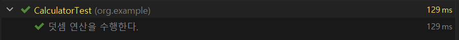

리팩토링 후 실행결과

**7 단계 : 뺄셈 연산을 테스트할 수 있는 테스트 메소드를 작성하고, 테스트를 실행한다. (Fail)**

> 뺄셈 연산에 대한 처리를 구현하지 않았기 때문에 무조건적으로**실패**할 것이다.

```java
package org.example;

public class CalculatorTest {
    ... 

    @DisplayName("뺄셈 연산을 수행한다.")
    @Test
    void subtractionTest() {
        int result = Calculator.calculate(1, "-", 2);
        assertThat(result).isEqualTo(-1);
    }
}
```

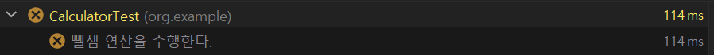

뺄셈 연산 테스트 실핼 결과

**8 단계 : 뺄셈 연산에 대해 리팩토링하고, 테스트를 실행한다. (Success)**

> **테스트를 성공하여 심리적 안정감을 획득!!**


```java
package org.example;

public class Calculator {
    public static int calculate(int operand1, String operator, int operand2) {
        if("+".equals(operator)){
            return operand1 + operand2;
        }else if("-".equals(operator))
            return operand1 - operand2;
        else 
            return 0;
    }
}
```

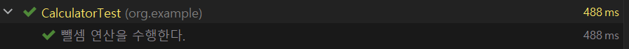

뺄셈 연산 구현 후 테스트 코드 실행결과

**9 단계 : 사칙연산마다 테스트 메소드를 나눠서 작성하는 것이 아니라 하나로 수행하도록 리팩토링**

> MethodSource 어노테이션에 함수를 지정하여 실행시킬수 있다. 다음과 같이 지정된 메소드에 매개변수를 매칭시켜 순서대로 입력될 수 있도록 설정할 수 있다.

```java
package org.example;

/*
* 간단한 사칙연산을 할 수 있다.
* 양수로만 계산할 수 있다.
* 나눗셈에서 0을 나누는 경우 illegalArgument 예외를 발생시킨다.
* MVC 패턴(Model-View-Controller) 기반으로 구현한다.
* */

import org.junit.jupiter.api.DisplayName;
import org.junit.jupiter.params.ParameterizedTest;
import org.junit.jupiter.params.provider.Arguments;
import org.junit.jupiter.params.provider.MethodSource;

import java.util.stream.Stream;

import static org.assertj.core.api.Assertions.assertThat;

public class CalculatorTest {

    // 피연산자, 연산자, 피연산자를 Calculator에 전달하여 그에 대한 결과값을 반환받는다.
    @DisplayName("간단한 사칙연산을 할 수 있다.")
    @ParameterizedTest
    @MethodSource("formulaAndResult")
    void additionTest(int operand1, String operator, int operand2, int result) {
        int calculateResult = Calculator.calculate(operand1, operator, operand2);
        assertThat(result).isEqualTo(calculateResult);
    }

    private Stream<Arguments> formulaAndResult(){
        return Stream.of(
                Arguments.arguments(1, "+", 2, 3),
                Arguments.arguments(2, "-", 3, -1),
                Arguments.arguments(2, "*", 3, 6),
                Arguments.arguments(4, "/", 2, 2)
        );
    }
}
```

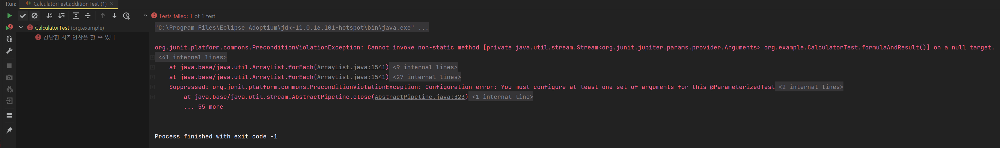

실행 결과

> 💻 출력 결과  
> org.junit.platform.commons.PreconditionViolationException: Cannot invoke non-static method [private java.util.stream.Stream<org.junit.jupiter.params.provider.Arguments> org.example.CalculatorTest.formulaAndResult()] on a null target.  
>   
> formulaAndResult가 static 메소드가 아니기 때문에 발생한 에러로 static으로 전환하면 문제가 없다.

**10 단계 : formulaAndResult 메소드 static 메소드로 전환하고 테스트를 실행한다.**

> 🔥 현재 곱셈과 나눗셈에 대해 정의하지 않았으므로 에러가 발생한다.

```java
package org.example;

/*
* 간단한 사칙연산을 할 수 있다.
* 양수로만 계산할 수 있다.
* 나눗셈에서 0을 나누는 경우 illegalArgument 예외를 발생시킨다.
* MVC 패턴(Model-View-Controller) 기반으로 구현한다.
* */

public class CalculatorTest {

    // 피연산자, 연산자, 피연산자를 Calculator에 전달하여 그에 대한 결과값을 반환받는다.
    @DisplayName("간단한 사칙연산을 할 수 있다.")
    @ParameterizedTest
    @MethodSource("formulaAndResult")
    void additionTest(int operand1, String operator, int operand2, int result) {
        int calculateResult = Calculator.calculate(operand1, operator, operand2);
        assertThat(result).isEqualTo(calculateResult);
    }

    private static Stream<Arguments> formulaAndResult(){
        return Stream.of(
                Arguments.arguments(1, "+", 2, 3),
                Arguments.arguments(2, "-", 3, -1),
                Arguments.arguments(2, "*", 3, 6),
                Arguments.arguments(4, "/", 2, 2)
        );
    }
}
```

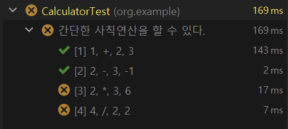

사칙연산 메소드 실행 결과

**11 단계 : 곱셈과 나눗셈에 대하여 정의하고, 테스트 메소드를 실행시킨다.**

```java
package org.example;

public class Calculator {
    public static int calculate(int operand1, String operator, int operand2) {
        if("+".equals(operator)){
            return operand1 + operand2;
        }else if("-".equals(operator))
            return operand1 - operand2;
        else if("*".equals(operator))
            return operand1 * operand2;
        else if("/".equals(operator)) 
            return operand1 / operand2;
        else
            return 0;
    }
}
```

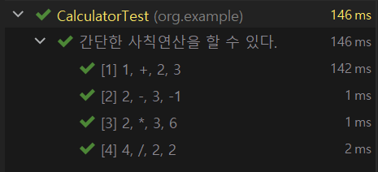

사칙연산 메소드 실행 결과

**12 단계 : 테스트가 정상적으로 동작하므로, 사칙연산 구현 코드를 리팩토링한다.**

* 사칙연산에 사용되는 연산자를 Enum 클래스로 정의

```java
public enum ArithmeticOperator {
    ADDITION("+"), SUBTRACTION("-"), MULTIPLICATION("*"), DIVISION("/");

    private final String operator;

    ArithmeticOperator(String operator) {
        this.operator = operator;
    }
}
```

* 사칙연산 메소드를 추상화하여 각각에 Enum에서 구현시키도록 한다.

```java
package org.example;

public enum ArithmeticOperator {
    ADDITION("+"){
        @Override
        public int calculate(int operand1, int operand2) {
            return operand1 + operand2;
        }
    }, SUBTRACTION("-"){
        @Override
        public int calculate(int operand1, int operand2) {
            return operand1 - operand2;
        }
    }, MULTIPLICATION("*")
    {
        @Override
        public int calculate(int operand1, int operand2) {
            return operand1 * operand2;
        }
    }, DIVISION("/"){
        @Override
        public int calculate(int operand1, int operand2) {
            return operand1 / operand2;
        }
    };

    private final String operator;

    ArithmeticOperator(String operator) {
        this.operator = operator;
    }

    public abstract int calculate(final int operand1, final int operand2);
}
```

* 외부에서 calculate 메소드를 통해 동일하게 접근할 수 있도록 리팩토링하고, 테스트 메소드를 실행시킨다.

```java
package org.example;

import java.util.Arrays;

public enum ArithmeticOperator {
    ADDITION("+"){
        @Override
        public int arithmeticCalculate(int operand1, int operand2) {
            return operand1 + operand2;
        }
    }, SUBTRACTION("-"){
        @Override
        public int arithmeticCalculate(int operand1, int operand2) {
            return operand1 - operand2;
        }
    }, MULTIPLICATION("*")
    {
        @Override
        public int arithmeticCalculate(int operand1, int operand2) {
            return operand1 * operand2;
        }
    }, DIVISION("/"){
        @Override
        public int arithmeticCalculate(int operand1, int operand2) {
            return operand1 / operand2;
        }
    };

    private final String operator;

    ArithmeticOperator(String operator) {
        this.operator = operator;
    }

    public abstract int arithmeticCalculate(final int operand1, final int operand2);

    public static int calculate(int operand1, String operator, int operand2) {
        ArithmeticOperator arithmeticOperator = Arrays.stream(values())
                .filter(v -> v.operator.equals(operator))
                .findFirst()
                .orElseThrow(() -> new IllegalArgumentException("올바른 사칙연산이 아닙니다."));

        return arithmeticOperator.arithmeticCalculate(operand1, operand2);
    }

}
```

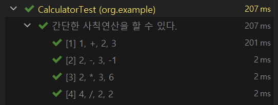

테스트 메소드 실행결과

**13 단계 : 인터페이스를 사용하여 관심사 분리를 하는 리팩토링하고 테스트 메소드 실행**

* 연산의 동일한 기능을 추상화한 인터페이스 생성

```
package org.example.calculate;

public interface NewArithmeticOperator {

    // 1. 해당 연산자에 대한 서비스를 지원하는지
    boolean supports(String operator);

    // 2. 사칙연산을 처리
    int calculate(int operand1, int operand2);
}
```

* 인터페이스에 대한 구현체

```java
// 덧셈
public class AdditionOperator implements NewArithmeticOperator {
    @Override
    public boolean supports(String operator) {
        return "+".equals(operator);
    }

    @Override
    public int calculate(int operand1, int operand2) {
        return operand1 + operand2;
    }
}
// 뺄셈
public class SubtractionOperator implements NewArithmeticOperator {
    @Override
    public boolean supports(String operator) {
        return "-".equals(operator);
    }

    @Override
    public int calculate(int operand1, int operand2) {
        return operand1 - operand2;
    }
}
// 곱셈
public class MultiplicationOperator implements NewArithmeticOperator {
    @Override
    public boolean supports(String operator) {
        return "*".equals(operator);
    }

    @Override
    public int calculate(int operand1, int operand2) {
        return operand1 * operand2;
    }
}

// 나눗셈
public class DivisionOperator implements NewArithmeticOperator {
    @Override
    public boolean supports(String operator) {
        return "/".equals(operator);
    }

    @Override
    public int calculate(int operand1, int operand2) {
        return operand1 / operand2;
    }
}
```

* 인터페이스의 구현체를 사용하는 Calculate 클래스 리팩토링

```java
package org.example;

import org.example.calculate.*;

import java.util.List;

public class Calculator {

    // 인터페이스의 구현체들을 상위 인터페이스 타입에 리스트를 통해 저장시킨다.
    private static final List<NewArithmeticOperator> arithmeticOperators = List.of(new AdditionOperator(), new SubtractionOperator(), new MultiplicationOperator(), new DivisionOperator());

    public static int calculate(int operand1, String operator, int operand2) {
        return arithmeticOperators.stream()
                // 해당하는 연산자에 구현체를 찾는다.
                .filter(arithmeticOperator -> arithmeticOperator.supports(operator))
                // 해당 구현체의 calculate 메소드에 위임한다.
                .map(arithmeticOperator -> arithmeticOperator.calculate(operand1, operand2))                       
                .findFirst()
                .orElseThrow(() -> new IllegalArgumentException("올바른 사칙연산이 아닙니다."));
    }
}
```

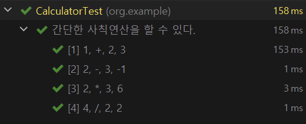

리팩토링한 실행 결과

**14 단계 : 요구사항 3번에 대한 테스트 코드 작성**

> 나눗셈에서 0을 나누는 경우 illegalArgument 예외를 발생시킨다.

```java
package org.example;

/*
* 간단한 사칙연산을 할 수 있다.
* 양수로만 계산할 수 있다.
* 나눗셈에서 0을 나누는 경우 illegalArgument 예외를 발생시킨다.
* MVC 패턴(Model-View-Controller) 기반으로 구현한다.
* */

public class CalculatorTest {
   ...

    @DisplayName("나눗셈에서 0을 나누는 경우 illegalArgument 예외를 발생시킨다.")
    @Test
    void calculateExceptionTest() {
        assertThatCode(() -> Calculator.calculate(10, "/", 0))
                .isInstanceOf(IllegalArgumentException.class);
    }
}
```

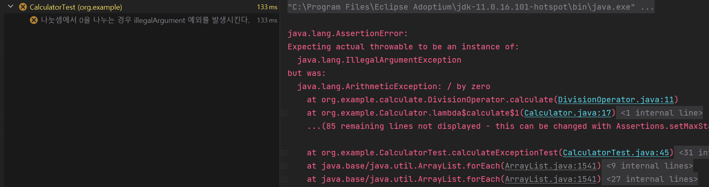

테스트 실행 결과 - 실패

**15 단계 : 요구사항에 대한 테스트 코드 성공을 위한 리팩토링**

```java
package org.example.calculate;

public class DivisionOperator implements NewArithmeticOperator {
    @Override
    public boolean supports(String operator) {
        return "/".equals(operator);
    }

    @Override
    public int calculate(int operand1, int operand2) {
        if (operand2 == 0)
            throw new IllegalArgumentException("0으로 나눌 수 없습니다.");
        else
            return operand1 / operand2;
    }
}
```

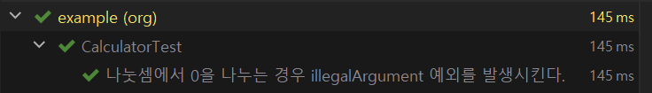

실행 결과

**16 단계 : 요구사항 2번에 대한 알고리즘 구현**

> 요구사항 2번 - 양수로만 계산할 수 있다.  
>   
> 인터페이스 구현체마다 양수인지 음수인지 판별하는 코드를 넣을 경우, 중복되는 단점이 발생한다.  
> 이를 위해 양수를 판별하는 객체를 생성한다.

```java
package org.example.calculate;

public class PositiveNumber {
    private final int value;

    public PositiveNumber(int value) {
        validate(value);
        this.value = value;
    }

    private void validate(int value) {
        if(isNegativeNumber(value))
            throw new IllegalArgumentException("0 또는 음수를 전달할 수 없습니다.");
    }

    private boolean isNegativeNumber(int value) {
        return value <= 0;
    }

    // 계산은 int 값으로 반환해주기 위한 메소드
    public int toInt(){
        return value;
    }
}
```

> **💻 코드 분석**  
> 값이 음수이면 **IllegalArgumentException**예외가 발생하고, 양수이면 객체가 생성된다.  
> 즉 PositiveNumber가 만들어지면 음수가 아니라는 의미이고 양수라는 것을 보장할 수 있다.  
> 이를 통해 DivisionOperator에서 필요했던 validate 검사가 필요 없어지게 된다. 이유는 PositiveNumber을 통해 이미 0에 대한 예외 처리가 이루어지기 때문이다.

```java
public class CalculatorTest {

    // 피연산자, 연산자, 피연산자를 Calculator에 전달하여 그에 대한 결과값을 반환받는다.
    @DisplayName("간단한 사칙연산을 할 수 있다.")
    @ParameterizedTest
    @MethodSource("formulaAndResult")
    void additionTest(int operand1, String operator, int operand2, int result) {
        int calculateResult = Calculator.calculate(new PositiveNumber(operand1), operator, new PositiveNumber(operand2));
        assertThat(result).isEqualTo(calculateResult);
    }

    private static Stream<Arguments> formulaAndResult(){
        return Stream.of(
                Arguments.arguments(1, "+", 2, 3),
                Arguments.arguments(2, "-", 3, -1),
                Arguments.arguments(2, "*", 3, 6),
                Arguments.arguments(4, "/", 2, 2)
        );
    }

    @DisplayName("나눗셈에서 0을 나누는 경우 illegalArgument 예외를 발생시킨다.")
    @Test
    void calculateExceptionTest() {
        assertThatCode(() -> Calculator.calculate(new PositiveNumber(10), "/", new PositiveNumber(0)))
                .isInstanceOf(IllegalArgumentException.class);
    }
}
```

**17 단계 : PositiveNumber에 대한 테스트 코드 구현**

```java
package org.example;

import org.example.calculate.PositiveNumber;
import org.junit.jupiter.api.Test;
import org.junit.jupiter.params.ParameterizedTest;
import org.junit.jupiter.params.provider.ValueSource;

import static org.assertj.core.api.Assertions.assertThatCode;

class PositiveNumberTest {

    @ParameterizedTest
    @ValueSource(ints = {0, -1})
    @Test
    void createTest(int value) {
        assertThatCode(()-> new PositiveNumber(value))
                .isInstanceOf(IllegalArgumentException.class)
                .hasMessage("0 또는 음수를 전달할 수 없습니다.");
    }
}
```

---

### **실습 2.** **학점 계산기**

#### **요구사항**

* 평균학점 = (학점 수 x 교과목 평점)의 합계 / 수강신청 총학점 수
* 일급 컬렉션 사용
* [실습코드](https://github.com/bang-star/oop-practice/tree/master/test-Code%20Training)

**💡 객체지향 설계 순서**

> 1. 도메인을 구성하는 객체에는 어떤 것들이 있는지 고민  
> 2. 객체들 간의 관계를 고민  
> 3. 동적인 객체를 정적인 타입으로 추상화해서 도메인 모델링 하기  
> 4. 협력을 설계  
> 5. 객체들을 포괄하는 타입에 적절한 책임을 할당  
> 6. 구현하기  
>   
> 객체지향 설계 순서에 맞게 구현할 것이다.

**1 단계 : 도메인을 구성하는 객체에는 어떤 것들이 있는지 고민하기**

* 학점계산기 도메인 - 이수한 과목, 학점 계산기

**2 단계 : 객체들 간의 관계를 고민**

> **학점 계산기**가 **이수한 과목**들을 가지고 학점을 계산하면 된다.  
> 즉 **학점 계산기**가 **이수한 과목**을 인스턴스 변수로 가지면서 평균 학점을 계산할 수 있을 것 같다.

**3 단계 : 동적인 객체를 정적인 타입으로 추상화해서 도메인 모델링 하기**

* **학점계산기 도메인** - 이수한 과목, 학점 계산기
* **이수한 과목** : 객체지향프로그래밍, 자료구조, 중국어회화  --> 과목(코스) 클래스

> **🔎 설명**이수한 과목에 객체지향프로그래밍, 자료구조, 중국어회화 총 3가지 객체가 있다.   
> 이들을 **동적인 객체를 정적인 타입으로 추상화한다는 의미**는 과목(코스) **클래스로 표현한다**는 의미이다.  
> 즉 **객체는 3가지일때 하나의 클래스로 표현할 수 있다**는 것이 **동적인 객체를 정적인 타입으로 추상화한다**는 의미이다.

**4 단계 : 협력을 설계하기**

> 평균학점을 계산하기 위해서   
> **이수한 과목을 전달하여 평균학점 계산 요청**→**학점 계산기 → (학점 수 x 교과목 평점)의 합계**→ 과목(코스)**  
> **→**수강신청 총학점 수 ****→과목(코스)******\* (학점 수 x 교과목 평점)의 합계와 수강신청 총학점 수는 과목(코스) 클래스를 통해 얻을 수 있다.

**5 단계 : 객체들을 포괄하는 타입에 적절한 책임을 할당**

> **4번 과정**을 통해 적절한 책임을 할당할 수 있게 된다.

**6 단계 : 구현하기**

**1. GradeCalculatorTest 테스트 클래스 생성**

```java
package org.example;

/*
* 요구사항
* 평균학점 = (학점 수 x 교과목 평점)의 합계 / 수강신청 총학점 수
* 일급 컬렉션 사용
* */

import org.junit.jupiter.api.Test;

public class GradeCalculatorTest {
    // 학점 계산기 도메인 : 이수한 과목(객체지향프로그래밍, 자료구조, 중국어회화), 학점 계산기
    // 객체지향프로그래밍, 자료구조, 중국어회화  --> 과목(코스) 클래스

    // 이수한 과목을 전달하여 평균학점 계산 요청 ---> 학점 계산기 ---> (학점 수 x 교과목 평점)의 합계 ---> 과목(코스)
    //                                                  ---> 수강신청 총학점 수            ---> 과목(코스)

    @Test
    void calculateGradeTest() {
    }
}
```

**2. (작은 객체부터 만드는 것을 선호) 이수한 과목 테스트 클래스 생성한다.**

> 이수한 과목을 생성하는 테스트 코드를 작성(TDD 방식으로 개발)

```java
package org.example;

import org.junit.jupiter.api.DisplayName;
import org.junit.jupiter.api.Test;

import static org.assertj.core.api.Assertions.assertThatCode;

public class CourseTest {

    @DisplayName("과목(코스)를 생성한다.")
    @Test
    void createTest() {
        assertThatCode(() -> new Course("OOP", 3, "A+"))
                .doesNotThrowAnyException();
    }
}
```

> 이수한 과목에 대한 클래스 생성

```java
package org.example;

public class Course {

    private String Subject; // 과목명
    private int credit;     // 학점
    private String grade;   // 성적

    public Course(String subject, int credit, String grade) {
        Subject = subject;
        this.credit = credit;
        this.grade = grade;
    }

}
```

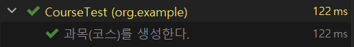

테스트 코드 실행 결과

**3. 학점계산기가 생성될 때 이수한 과목을 전달하여 평균학점을 계산하는 테스트 코드를 작성한다.**

```java
package org.example;

public class GradeCalculatorTest {            

    @Test
    void calculateGradeTest() {
        // 이수한 과목 리스트
        List<Course> courses = List.of(
                new Course("OOP", 3, "A+"),
                new Course("자료구조", 3, "A+"));

        GradeCalculator gradeCalculator = new GradeCalculator(courses);
        double gradeResult = gradeCalculator.calculateGrade();   // 성적을 계산

        assertThat(gradeResult).isEqualTo(4.5);
    }
}
```

**4. 학점계산기 클래스를 생성하고, calculateGradeTest 테스트 메소드를 실행하기 전에 메소드가 성공할 수 있도록 설정하고 테스트를 실행한다.**

```java
package org.example;

import java.util.List;

public class GradeCalculator {

    private final List<Course> courses;

    public GradeCalculator(List<Course> courses) {
        this.courses = courses;
    }

    public double calculateGrade() {
        // return 0;
        return 4.5;
    }
}
```

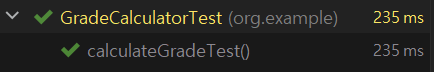

테스트 메소드 실행 결과

**5. calculateGrade메소드의 구현부를 채운다.**

> calculateGradeTest 메소드가 성공하여 해당 로직이 정상적으로 작동한다는 것을 보장할 수 있기 때문에 구현 부분을 채워줘도 된다.

```java
public class GradeCalculator {

    private final List<Course> courses;

    public GradeCalculator(List<Course> courses) {
        this.courses = courses;
    }

    // 평균학점 = (학점 수 x 교과목 평점)의 합계 / 수강신청 총학점 수
    public double calculateGrade() {

        // (학점 수 x 교과목 평점)의 합계
        double multipliedCreditAndCourseGrade = 0;
        for (Course course : courses) {
            multipliedCreditAndCourseGrade += course.getCredit() * course.getGradeToNumber();
        }

        // 수강신청 총학점 수
        int totalCompletedCredit = courses.stream().mapToInt(Course::getCredit).sum();

        return multipliedCreditAndCourseGrade / totalCompletedCredit;
    }
}
```

```java
public class Course {

    private String Subject; // 과목명
    private int credit;     // 학점
    private String grade;   // 성적

    public Course(String subject, int credit, String grade) {
        Subject = subject;
        this.credit = credit;
        this.grade = grade;
    }

    public int getCredit() {
        return credit;
    }

    public double getGradeToNumber() {
        double grade = 0;

        switch (this.grade) {
            case "A+":
                grade = 4.5;
                break;
            case "A":
                grade = 4.0;
                break;
            case "B+":
                grade = 3.5;
                break;
            case "B":
                grade = 3.0;
                break;
            case "C+":
                grade = 2.5;
                break;
            case "C":
                grade = 2.0;
                break;
        }
        return grade;
    }
}
```

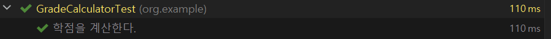

테스트 메소드 실행 결과

**6. 리팩토링**

> **💣 문제점**  
> calculateGrade() 내부에서 (학점 수 \* 교과목 평점)의 합계 즉, Course 클래스 값들을 가져와서 계산을 수행하고 있다.  
> 만약 (학점 수 \* 교과목 평점)의 합계가 여러 곳에서 사용이 된다면, **중복된 코드**를 사용해야할 가능성이 있다.  
> 즉 응집도가 약하다고 할 수 있다.   
>   
> **💉 해결 방법**  
> getter를 통해 정보를 가져와서 처리해주는 방식이 아닌 해당 정보를 가진 객체에게 메시지를 던져서 작업을 처리해주게 된다면 변화에 유연한 코드를 만들 수 있다.

**7. 요구사항 3번. 일급 컬렉션을 사용하라!**

> **📣 중요!  
> 일급 컬렉션** 사용한다는  의미는 아직까지도 Course에 대한 로직 처리가 GradeCalculator클래스 내부에 남아 있다.  
> 하지만 이 부분을 **일급 컬렉션**을 사용하면 어떻게 되는지를 알아보면 좋을 것 이다.

```java
public class GradeCalculator {

    private final Courses courses;

    public GradeCalculator(List<Course> courses) {
        this.courses = new Courses(courses);
    }

    // 평균학점 = (학점 수 x 교과목 평점)의 합계 / 수강신청 총학점 수
    public double calculateGrade() {

        // (학점 수 x 교과목 평점)의 합계
        double multipliedCreditAndCourseGrade = courses.multiplyCreditAndCourseGrade();

        // 수강신청 총학점 수
        int totalCompletedCredit = courses.calculateTotalCompletedCredit();

        return multipliedCreditAndCourseGrade / totalCompletedCredit;
    }
}
```

```java
public class Courses {
    private final List<Course> courses;

    public Courses(List<Course> courses) {
        this.courses = courses;
    }

    public double multiplyCreditAndCourseGrade() {
        double multipliedCreditAndCourseGrade = 0;

        for (Course course : courses) {
            multipliedCreditAndCourseGrade += course.multiplyCreditAndCourseGrade();
        }
        return multipliedCreditAndCourseGrade;
    }

    public int calculateTotalCompletedCredit() {
        return courses.stream()
                .mapToInt(Course::getCredit)
                .sum();
    }
}
```

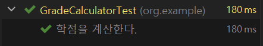

실행 결과

> 💡  **정리  
> 일급 컬렉션이란 Collection 형태로된 인스턴스 변수로만 갖는 클래스를 의미한다.  
> 컬렉션을 가지고 처리할 수 있는 기능들이 해당 일급 컬렉션 밑으로 이동하게 된다.  
> 이를 통해 어떠한 수정이 발생했을 때, 해당 메소드만 수정하여 해결할 수 있게 된다.**

**8. 리팩토링**

```java
package org.example;

import java.util.List;

public class Courses {
    private final List<Course> courses;

    public Courses(List<Course> courses) {
        this.courses = courses;
    }

    public double multiplyCreditAndCourseGrade() {
        // as-is
//        double multipliedCreditAndCourseGrade = 0;
//        for (Course course : courses) {
//            multipliedCreditAndCourseGrade += course.multiplyCreditAndCourseGrade();
//        }
//        return multipliedCreditAndCourseGrade;

        // to-be
        return courses.stream().mapToDouble(Course::multiplyCreditAndCourseGrade).sum();
    }

    public int calculateTotalCompletedCredit() {
        return courses.stream()
                .mapToInt(Course::getCredit)
                .sum();
    }
}
```

---

### **실습 3. 음식점에서 음식 주문하는 과정**

#### **요구사항**

1. 도메인을 구성하는 객체에는 어떤 것들이 있는지 고민
2. 객체들 간의 관계를 고민
3. 동적인 객체를 정적인 타입으로 추상화해서 도메인 모델링 하기
4. 협력을 설계
5. 객체들을 포괄하는 타입에 적절한 책임을 할당
6. 구현하기

#### **구현 : TDD 방식**

**1단계 - 테스트 코드 패키지에 CustomerTest 클래스를 생성하고, 요구사항을 주석으로 상단에 배치한다.**

```java
package org.example;

/**
 * 음식점에서 음식 주문하는 과정
 * 요구사항
 * 1. 도메인을 구성하는 객체에는 어떤 것들이 있는지 고민
 * 2. 객체들 간의 관계를 고민
 * 3. 동적인 객체를 정적인 타입으로 추상화해서 도메인 모델링 하기
 * 4. 협력을 설계
 * 5. 객체들을 포괄하는 타입에 적절한 책임을 할당
 * 6. 구현하기
 */

public class CustomerTest {
}
```

---

**2단계 - 요구사항 분석**

1. **도메인을 구성하는 객체에는 어떤 것들이 있는지 고민**  
   ▶손님, 메뉴판, 음식(돈까스, 냉면, 만두 등), 요리사, 요리
2. **객체들 간의 관계를 고민**▶손님     ---> 메뉴판 : 손님이 메뉴판을 보고 요리사에게 메뉴를 요청할 것이기 때문  
   ▶손님     ---> 요리사 : 손님이 요리사에게 메뉴를 요청할 것이기 때문  
   ▶요리사  ---> 요리 : 요리사는 요리를 할 것이기 때문
3. **동적인 객체를 정적인 타입으로 추상화해서 도메인 모델링하기**  
   ▶손님 -- 손님 타입  
   ▶돈까스/냉면/만두 -- 요리 타입  
   ▶메뉴판 -- 메뉴판 타입  
   ▶메뉴 -- 메뉴 타입

요구사항 4, 5번은 테스트 코드를 작성하면서 진행하겠다.

---

**3단계 - 메뉴와 요리 타입 생성**

> 가장 간단한 타입들이기 때문이다.

**1. CookTest클래스를 생성하고, 테스트 코드를 작성한다.**

```java
public class CookTest {

    @DisplayName("요리를 생성한다.")
    @Test
    void createTest() {
        assertThatCode(() -> new Cook("만두", 5000))
                .doesNotThrowAnyException();
    }
}
```

**2. 요리(Cook) 클래스를 생성한다.**

```java
public class Cook {
    private String name;
    private int price;

    public Cook(String name, int price) {
        this.name = name;
        this.price = price;
    }

    public String getName() { return name; }

    public void setName(String name) { this.name = name;}

    public int getPrice() { return price; }

    public void setPrice(int price) { this.price = price; }
}
```

**3. CookTest 클래스에 createTest 메소드를 실행한다.**

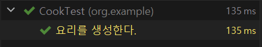

Cook클래스 테스트 코드 실행결과

**4. 1-3번 과정을 Menu 클래스를 생성하고 테스트 코드를 작성한다.**

* **MenuItemTest** 클래스

```java
public class MenuItemTest {

    @DisplayName("메뉴 항목을 생성한다.")
    @Test
    public void createTest() {

        assertThatCode(() -> new MenuItem("만두", 5000))
                .doesNotThrowAnyException();
    }
}
```

* **MenuItem 클래스**

```java
public class MenuItem {
    private String name;
    private int price;

    public MenuItem(String name, int price) {
        this.name = name;
        this.price = price;
    }

    public String getName() { return name; }

    public void setName(String name) { this.name = name;}

    public int getPrice() { return price; }

    public void setPrice(int price) { this.price = price; }
}
```

* **MenuItemTest 클래스 실행결과**

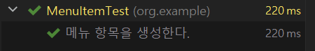

MenuItem Test 클래스 실행결과

---

**4단계 - 요리를 만드는 요리사 클래스 + 테스트 클래스 생성**

**1. 테스트 클래스 생성**

```java
public class CookingTest {

    @DisplayName("메뉴에 해당하는 음식을 만든다.")
    @Test
    void makeCookTest() {
        // 1. 요리사 클래스 생성
        Cooking cooking = new Cooking();

        // 2. 메뉴를 선정하기
        MenuItem menuItem = new MenuItem("돈까스", 5000);

        // 3. 요리를 만들라고 요청하면 요리를 만들어줄 것이다.
        Cook cook = cooking.makeCook(menuItem);

        assertThat(cook).isEqualTo(new Cook("돈까스", 5000));
    }
}
```

**2. 테스트 코드에 맞게 Cooking 클래스를 생성**

```java
public class Cooking {

    public Cook makeCook(MenuItem menuItem) {
    }
}
```

**3. 테스트 코드를 실행결과 : Fail**

> **2번 과정**에서 makeCook 메소드를 구현하지 않았기 때문에 실패할 것이다.

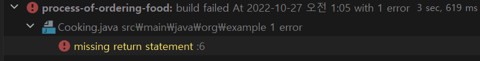

CookingTest 클래스에 테스트 메소드 실행결과

**4. Cooking 클래스에 makeCook 메소드를 구현하고 테스트 실행**

```java
public class Cooking {

    public Cook makeCook(MenuItem menuItem) {
        // 1차. 동일한 값으로 리턴하기
        return new Cook("돈까스", 5000);
    }
}
```

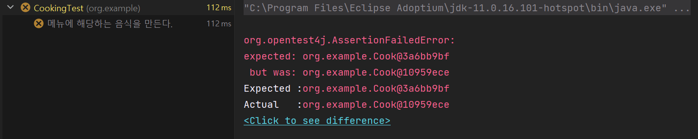

테스트 결과 : 성공

> **원인 : 객체들끼리 비교할때는 equals and hashcode가 필요하기 때문이다.**

```java
public class Cook {
    private String name;
    private int price;

    public Cook(String name, int price) {
        this.name = name;
        this.price = price;
    }

    @Override
    public boolean equals(Object o) {
        if (this == o) return true;
        if (o == null || getClass() != o.getClass()) return false;
        Cook cook = (Cook) o;
        return price == cook.price && Objects.equals(name, cook.name);
    }

    @Override
    public int hashCode() {
        return Objects.hash(name, price);
    }
}
```

테스트 코드를 재실행하게 되면 테스트 결과가 성공하는 것을 볼 수 있다.

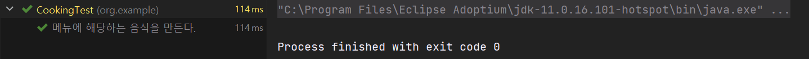

테스트 결과 : 성공

**5. 하드코딩되어 있는 Cooking클래스에 makeCook 메소드를 리팩토링 후 검증을 위해 테스트 코드 실행**

```java
public class Cooking {

    public Cook makeCook(MenuItem menuItem) {
        // AS-IS
        // return new Cook("돈까스", 5000);

        // TO-BE
        Cook cook = new Cook(menuItem);
        return cook;
    }
}
```

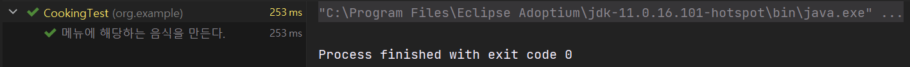

테스트 결과 : 성공

> 요구사항 1단계 중  
> 요리, 요리사, 메뉴를 만들었다.  
>   
> 남은 것은  
> 손님과 메뉴판이다.

---

**5단계 - 메뉴판 클래스 + 테스트 클래스**

> 4 단계에 1~3번 과정과 동일

**Menu 테스트 클래스**

```java
public class MenuTest {

    @DisplayName("메뉴이름에 해당하는 메뉴를 반환하다.")
    @Test
    void chooseTest() {
        // 1. 메뉴판에 여러 개에 메뉴 아이템이 있다.
        Menu menu = new Menu(List.of(new MenuItem("돈까스", 5000), new MenuItem("냉면", 7000)));

        // 2. 메뉴판에서 메뉴를 선택한다.
        MenuItem menuItem = menu.choose("돈까스");

        assertThat(menuItem).isEqualTo(new MenuItem("돈까스", 5000));
    }
}
```

**Menu 클래스**

```java
public class Menu {
    private List<MenuItem> menuItems;

    public Menu(List<MenuItem> menuItems) {
        this.menuItems = menuItems;
    }

    public MenuItem choose(String name) {
        return new MenuItem("돈까스", 5000);
    }
}
```

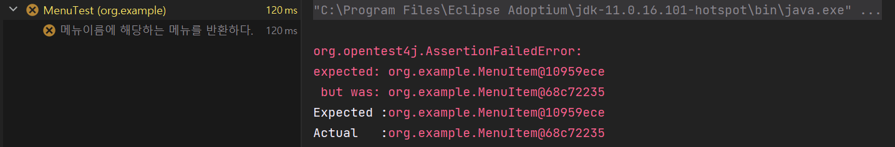

테스트 결과 : 실패

> **원인은 4단계와 동일하다. 객체 비교를 위한 equals and HashCode가 필요하다.**

```java
public class MenuItem {
    ...

    // equals and HashCode 적용
    @Override
    public boolean equals(Object o) {
        if (this == o) return true;
        if (o == null || getClass() != o.getClass()) return false;
        MenuItem menuItem = (MenuItem) o;
        return price == menuItem.price && Objects.equals(name, menuItem.name);
    }

    @Override
    public int hashCode() {
        return Objects.hash(name, price);
    }
}
```

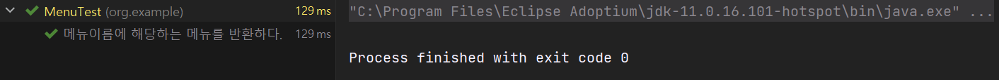

테스트 결과 : 성공

* **Menu클래스에 choose 메소드 리팩토링**

```java
public class Menu {
    private List<MenuItem> menuItems;

    public Menu(List<MenuItem> menuItems) {
        this.menuItems = menuItems;
    }

    public MenuItem choose(String name) {
        // AS-IS
        // return new MenuItem("돈까스", 5000);

        // TO-BE
        return this.menuItems.stream()
                .filter(menuItem -> menuItem.matches(name))
                .findFirst()
                .orElseThrow(() -> new IllegalArgumentException("잘못된 메뉴 이름입니다."));
    }
}
```

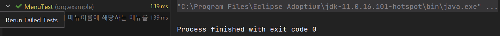

테스트 결과 : 성공

* **메뉴판에 없는 메뉴를 선택할 시 에러가 발생하도록 테스트 코드 작성**

```java
public class MenuTest {

    @DisplayName("메뉴판에서 메뉴이름에 해당하는 메뉴를 반환하다.")
    @Test
    void chooseTest() {
        // 1. 메뉴판에 여러 개에 메뉴 아이템이 있다.
        Menu menu = new Menu(List.of(new MenuItem("돈까스", 5000), new MenuItem("냉면", 7000)));

        // 2. 메뉴판에서 선택한 메뉴를 반환한다.
        MenuItem menuItem = menu.choose("돈까스");

        assertThat(menuItem).isEqualTo(new MenuItem("돈까스", 5000));
    }

    @DisplayName("메뉴판에 없는 메뉴를 선택할 시 예외를 반환한다.")
    @Test
    void chooseTest2() {
        Menu menu = new Menu(List.of(new MenuItem("돈까스", 5000), new MenuItem("냉면", 7000)));

        assertThatCode(() -> menu.choose("통닭"))
                .isInstanceOf( IllegalArgumentException.class)
                .hasMessage("잘못된 메뉴 입니다.");
    }
}
```

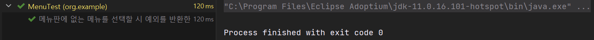

테스트 결과 : 성공

---

**6단계 - 손님클래스 + 테스트 클래스**

* **Customer 클래스**

```java
public class Customer {

    public void order(String name, Menu menu, Cooking cooking){
        MenuItem menuItem = menu.choose(name);
        Cook cook = cooking.makeCook(menuItem);
    }
}
```

* **CustomerTest 클래스**

```java
public class CustomerTest {

    @DisplayName("메뉴이름에 해당하는 요리를 주문한다.")
    @Test
    void orderTest() {
        // 1. 손님이 들어온다.
        Customer customer = new Customer();

        // 2. 손님은 요리와 메뉴 항목과 요리사를 선정한다.
        Menu menu = new Menu(List.of(new MenuItem("돈까스", 5000), new MenuItem("냉면", 7000)));
        Cooking cooking = new Cooking();

        assertThatCode(() -> customer.order("만두", menu, cooking))
                .doesNotThrowAnyException();
    }
}
```

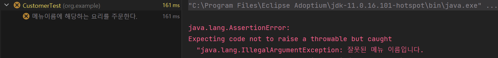

테스트 결과 : 실패

> 원인 : 고객이 주문한 요리("만두")는 메뉴판에 존재하지 않는 메뉴이기 때문

```java
public class CustomerTest {

    @DisplayName("메뉴이름에 해당하는 요리를 주문한다.")
    @Test
    void orderTest() {
        // 1. 손님이 들어온다.
        Customer customer = new Customer();

        // 2. 손님은 메뉴 요리와 메뉴판과 요리사를 선정한다.
        Menu menu = new Menu(List.of(new MenuItem("돈까스", 5000), new MenuItem("냉면", 7000)));
        Cooking cooking = new Cooking();

        assertThatCode(() -> customer.order("돈까스", menu, cooking))
                .doesNotThrowAnyException();
    }
}
```

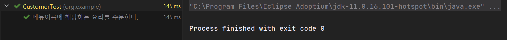

테스트 결과 : 성공

이 과정을 통해 요구사항 6가지를 모두 충족하게 되었다.
