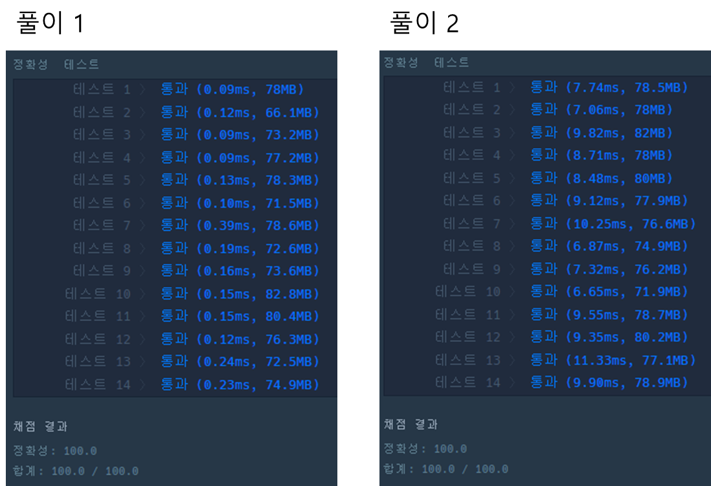

* [Summer/Winter Coding(~2018) > 스킬트리](https://school.programmers.co.kr/learn/courses/30/lessons/49993)

[프로그래머스

코드 중심의 개발자 채용. 스택 기반의 포지션 매칭. 프로그래머스의 개발자 맞춤형 프로필을 등록하고, 나와 기술 궁합이 잘 맞는 기업들을 매칭 받으세요.

programmers.co.kr](https://school.programmers.co.kr/learn/courses/30/lessons/49993)

---

### **문제**

선행 스킬이란 어떤 스킬을 배우기 전에 먼저 배워야 하는 스킬을 뜻합니다.   
예를 들어 선행 스킬 순서가 스파크 → 라이트닝 볼트 → 썬더일때, 썬더를 배우려면 먼저 라이트닝 볼트를 배워야 하고, 라이트닝 볼트를 배우려면 먼저 스파크를 배워야 합니다.  
위 순서에 없는 다른 스킬(힐링 등)은 순서에 상관없이 배울 수 있습니다. 따라서 스파크 → 힐링 → 라이트닝 볼트 → 썬더와 같은 스킬트리는 가능하지만, 썬더 → 스파크나 라이트닝 볼트 → 스파크 → 힐링 → 썬더와 같은 스킬트리는 불가능합니다.  
선행 스킬 순서 skill과 유저들이 만든 스킬트리1를 담은 배열 skill\_trees가 매개변수로 주어질 때, 가능한 스킬트리 개수를 return 하는 solution 함수를 작성해주세요.

### **제한 조건**

* 스킬은 알파벳 대문자로 표기하며, 모든 문자열은 알파벳 대문자로만 이루어져 있습니다.
* 스킬 순서와 스킬트리는 문자열로 표기합니다.
  + 예를 들어, C → B → D 라면 "CBD"로 표기합니다
* 선행 스킬 순서 skill의 길이는 1 이상 26 이하이며, 스킬은 중복해 주어지지 않습니다.
* skill\_trees는 길이 1 이상 20 이하인 배열입니다.
* skill\_trees의 원소는 스킬을 나타내는 문자열입니다.
  + skill\_trees의 원소는 길이가 2 이상 26 이하인 문자열이며, 스킬이 중복해 주어지지 않습니다.

### **알고리즘**

**선행 스킬 순서 skill과 유저들이 만들 스킬트리를 담은 배열 skill\_trees가 매개변수로 주어질 때, 가능한 스킬트리 개수를반환하는 문제이다.**

**1. skill\_trees 배열에 문자열을 순차적으로 탐색한다.**

**2. 각 문자열을 임시로 저장한다.**

**3. 해당 문자열의 문자가 skill에 존재하는지 파악하고, 없는 경우 문자열에서 잘라낸다.**

**4. 최종 남은 문자열이 skill에 존재하는지 파악한다.**

---

### **문제 풀이**

> 스킬트리에서 선행 스킬 순서에 해당하는 스킬들만 남도록 변환을 먼저 하고 그렇게 남은 스킬이 선행 스킬 순서와 맞는지 비교

**풀이 1**

```java
class Solution {
    public int solution(String skill, String[] skill_trees) {
       int answer = 0 ;

        for(String skill_tree : skill_trees){
            String temp = skill_tree;

            for(int i=0; i<skill_tree.length(); i++){
                String s = skill_tree.substring(i, i+1);

                // 필수 스킬이 아닌 경우
                if(!skill.contains(s)){
                    temp = temp.replace(s, "");
                }
            }

            if(skill.indexOf(temp) == 0)
                answer++;
        }

        return answer;
    }
}
```

**풀이 2**

```java
class Solution {
    public int solution(String skill, String[] skill_trees) {
        int answer = 0;

        for(int i = 0; i < skill_trees.length; i++) {
            //선행스킬들만 남도록 변환
            String pre = skill_trees[i].replaceAll("[^" + skill + "]", "");
            //원래 선행 스킬 순서를 앞에서 부터 변환한 선행스킬의 길이만큼 잘라냄
            String need = skill.substring(0, pre.length());

            if(pre.equals(need)) {
                answer++;
            }
        }
        return answer;
    }
}
```

### **성능**



실행 결과

---

> Point : 5  
>   
> 이 문제를 처음 인덱스로 접근하여 풀이하는 방법을 선택하였다.  
> 인덱스를 배열에 저장하여 풀이하는 방향으로 갔을 때  
> 알고리즘이 더욱 복합해져서 방향을 틀게 되었다.  
>   
> 이를 통해 더 빠른 정답을 추출할 수 있었다.
